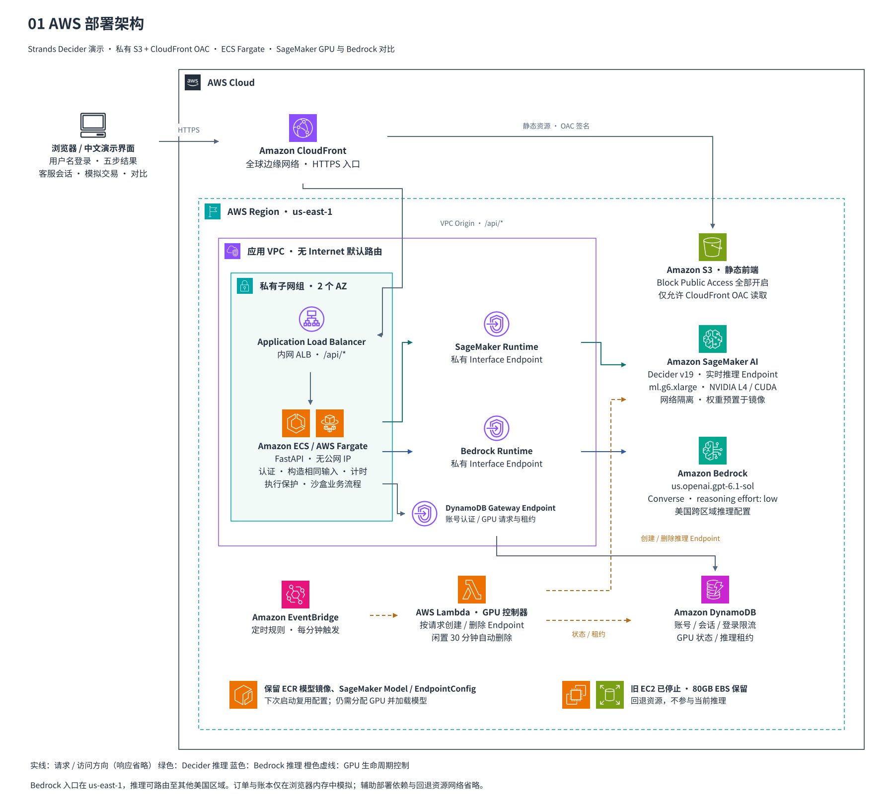
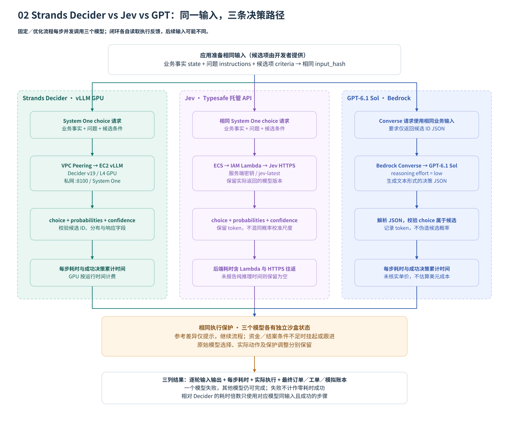
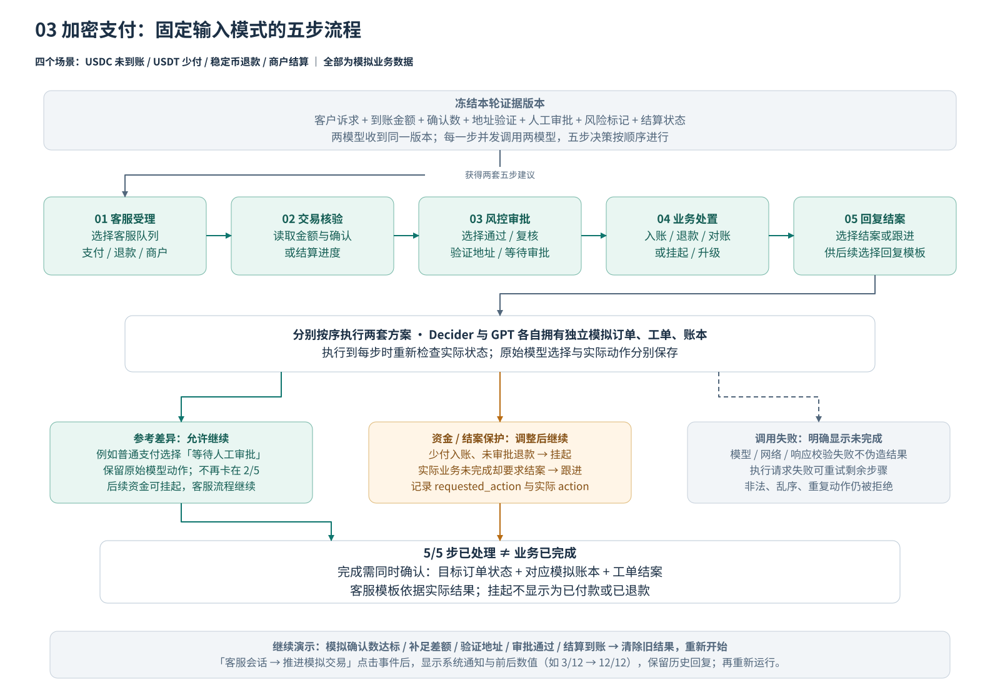

# Strands Decider · 决策实验室、支付与模型路由对比

**Strands Decider 在本项目典型任务中可用几十到几百毫秒完成决策，兼具快速响应与实用的判断效果，适用于模型路由、客服队列和工具选择等高频场景，并可通过补充明确的判断条件和使用领域数据微调，进一步提升准确性与稳定性。**

一个可以实际操作的中文演示：让 **Strands Decider、Jev** 与 **Amazon Bedrock 上的 GPT-6.1 Sol** 判断同一笔业务，观察每一步的选择、耗时、执行结果和最终客服回复。

支付对比统一并排展示 **Strands Decider vs Jev vs GPT**，一次运行三个模型，支持四个场景及三种测试方式。接入与比较口径见 [三模型对比说明](docs/JEV.md)。

**[模型路由对比](docs/MODEL_ROUTING.md)**：Decider、Jev 与 **GPT-6 Sol（low effort）** 从纯业务任务选择处理流程和目标型号。前端只保留原始流程，展示逐步输入输出、选型、耗时和目标执行；覆盖客服、代码、结算、双语索引四场景。当前使用 LiveBench + MTEB，支持接入 Artificial Analysis API。

**[模型路由实测报告：测试过程、四场景结果与结论](docs/MODEL_ROUTING_COMPARISON.md)**：Decider 决策最快；Jev / GPT 在中英文索引和代码选型上更符合已提供的能力证据。

**[各场景验证结果汇总](validation/README.md)**：汇总 Jev Skills、真实浏览器、金融、类 OpenRouter 路由及已有支付和游戏对照，包含逐场景结果、错误分析、耗时和原始证据。

项目基于 [Strands Decider 官方介绍](https://strandsagents.com/blog/introducing-strands-decider/)，采用 FastAPI + 原生 HTML/CSS/JavaScript。AWS 部署使用私有 S3、CloudFront OAC、ECS Fargate 和 EC2 On-Demand GPU。

当前文字 Decider 调用统一使用 [StrandsDeciderVLLM](https://github.com/milan9527/StrandsDeciderVLLM) 的常驻 `g6.xlarge`，覆盖工作台、工具守卫、支付固定／优化流程、自主闭环和模型路由。[图片决策模块](docs/VISION.md)使用另一台现有 L4 上的官方视觉服务，支持三模型图片对比、上传和 Decider 实测回放。

**[打开在线演示](https://d3i7ogfx5ml7dc.cloudfront.net) · [支付流程对比](https://d3i7ogfx5ml7dc.cloudfront.net/#crypto) · [模型路由对比](https://d3i7ogfx5ml7dc.cloudfront.net/#routing) · [图片决策](https://d3i7ogfx5ml7dc.cloudfront.net/#vision) · [查看架构图](docs/diagrams/architecture.svg)**

**[Decider 微调示例](https://github.com/milan9527/StrandsDeciderTetrisFinetuning)**：提供数据准备、LoRA 与决策头微调及评估流程；在俄罗斯方块的 2,068 道独立测试题上，准确率从 **60.35% 提升至 99.95%**，候选换序后的实际落点一致率从 **35.44% 提升至 99.85%**，展示了领域微调对该任务决策效果与稳定性的提升（[实测报告](https://github.com/milan9527/StrandsDeciderTetrisFinetuning/blob/main/finetuning/RESULTS.md)）。

## 实测摘要

**Decider 适合优先评估的场景：**

- **客服选择**：意图分类、客服队列和工具选择。本批分类 13/13、局部动作选择 10/10；到账、退款和结案条件仍由程序核验。
- **模型路由**：原始流程由模型识别任务并选择型号，保留真实选择与两步输入输出，目标输出单独验收。

**场景验证主要结果**：原版 Decider 与 Jev 共保存 466 次调用，按问题或任务分别评分，未包含 GPT。

| 验证场景 | Decider | Jev |
| --- | ---: | ---: |
| Skills：分类、工具、证据等判断 | 50/65 | 65/65 |
| 真实浏览器任务完成 | 4/10 | 10/10 |
| 金融判断（原始候选顺序） | 22/30 | 28/30 |
| 政策路由（两种候选顺序） | 25/64 | 46/64 |

简单分类和局部选择接近；Jev 在本批证据核验、多步操作中更好，两者都出现过金融和路由错误。[验证详情](validation/README.md)。

**[JevBench 公开集实测](validation/jevbench/README.md)**：原版 Decider 在 g6.xlarge 上答对 **168/231（72.73%）**，简单题 48/48、困难题 55/111；私网客户端 P50 / P95 为 **68.3 / 403.7 ms**，无调用失败。该结果为 231 题公开子集，不是榜单综合分；[榜单公式与分项估算](validation/jevbench/leaderboard-score.md)。

**[图片三模型实测](docs/VISION.md)**：12 张合成截图，Decider / Jev / GPT 分别答对 **27/28、28/28、28/28** 项，平均后端耗时 **178.1 / 424.6 / 1,539.2 ms**。Decider 支付状态与客服分流全对，凭证组合条件仍有一次误判。支持同图同题三列对比、上传及候选换序／无图／白图对照；该视觉批次与下文文字任务分别统计。

**三模型历史性能摘要**（以下数据使用原版 EC2 Decider 服务，未重新测量迁移后的 vLLM 性能）：

| 指标 | Decider | Jev | GPT |
| --- | ---: | ---: | ---: |
| 支付单步平均后端耗时 | **102.2 ms** | 416.5 ms | 1116.7 ms |
| 支付选择与演示参考一致 | 18/20 | 20/20 | 20/20 |
| 原始路由均值（10-16） | **416.3 ms** | 991.6 ms | 2506.0 ms |
| 增强信息后（仍由模型判断） | **413.7 ms** | 986.0 ms | 2075.5 ms |

支付使用 GPT-6.1 Sol low，路由使用 GPT-6 Sol low；Jev 耗时含 Lambda 转发。支付为 20 个节点；路由为四任务各三轮、每模型 12 个配对样本。两条路径复用同一次分类，再分别调用模型选择型号。参考一致不等于业务完成，路由耗时不含目标执行。[完整对比](#5-实测对比与计时口径)。

## 1. 演示目的

本项目回答三个问题：

1. **小型专用决策模型能否承担 Agent / 业务系统中的高频判断？** 例如选择客服队列、核验下一步、决定继续跟进还是结案。
2. **同一个有限候选决策任务，Decider、Jev 与普通生成式大模型有什么差异？** 比较原始选择、参考一致情况、每步耗时、计费方式与接入流程。
3. **怎样把模型建议变成可解释的完整业务流程？** 分开显示模型原始建议、应用实际执行、资金保护调整和客户最终看到的结果。

| 工作区         | 功能                                                                                                                  |
| -------------- | --------------------------------------------------------------------------------------------------------------------- |
| 决策实验室     | 16 个场景、`choice` / `noul` / `score` 三种问题类型、可编辑上下文与选项、工具调用守卫、逐项计时、运行记录及 JSON 导出 |
| 加密支付业务台 | 四个支付案例 × 五个业务步骤，Decider / Jev / GPT 三模型同时对比，完整模拟订单、工单、账本与客服交互                               |
| 模型路由对比 | 客服、代码、结算、双语索引四场景；Decider / Jev / GPT-6 Sol 原始流程对比，展示两步模型输入、实际选择、参考价格与目标执行 |
| 图片决策对比 | 支付状态、中文客服分流、凭证完整性；12 张预设图片与上传，Decider / Jev / GPT 同图同题三列对比选择和耗时，支持候选换序／无图／白图 |

业务数据均为模拟快照。演示不连接钱包、不查询实时区块链、不广播交易。客服回复由应用模板根据实际处理结果生成，本次对比不测量自由长文本生成质量。

## 2. 架构与流程图

仓库包含四张 SVG 图，可直接在 GitHub 或浏览器中查看：

| 页面                     | 内容                                                   | 预览                                      |
| ------------------------ | ------------------------------------------------------ | ----------------------------------------- |
| 01 AWS 部署架构          | 网络边界、静态站点、API、文字 vLLM、图片视觉服务与认证 | [SVG](docs/diagrams/architecture.svg)     |
| 02 Decider vs Jev vs GPT | 相同输入、不同推理调用方式、输出校验、共同执行策略     | [SVG](docs/diagrams/model-comparison.svg) |
| 03 加密支付完整流程      | 五步流程、参考差异、保护调整、最终结果与模拟事件       | [SVG](docs/diagrams/payment-workflow.svg) |
| 04 自主闭环 | 三侧独立判断、执行、等待事件、反馈重判及停止条件 | [SVG](docs/diagrams/closed-loop.svg) |

### AWS 部署



| 组件         | 当前实现                                                                                                    |
| ------------ | ----------------------------------------------------------------------------------------------------------- |
| 前端         | 私有 S3 bucket，四项 Block Public Access 全部开启；CloudFront 通过 OAC 签名访问                             |
| API 入口     | CloudFront `/api/*` → VPC Origin → 内网 ALB → ECS Fargate                                                   |
| 业务后端     | FastAPI，1 个 ARM64 Fargate Task，0.25 vCPU / 0.5 GiB；无公网 IP                                            |
| 身份认证     | 自建用户名 / 密码；scrypt 密码摘要、可撤销 Cookie 会话、限流；AWS 用 DynamoDB，本地用 SQLite                |
| Decider      | 官方 v19 的 vLLM 适配服务，EC2 `g6.xlarge`，NVIDIA L4 24GB；返回模型 ID `strands-decider-2B-hobson-v19-vllm` |
| 图片 Decider | 官方 v19 视觉推理，独立私网服务；返回 `strands-decider-2B-hobson-v19-vision`，与文字 vLLM 路径分别计时 |
| 普通大模型   | Bedrock Converse API；支付模块 `us.openai.gpt-6.1-sol`，路由决策器 `us.openai.gpt-6-sol`，均为 `low`；路由目标模型另按评测配置执行                                    |
| Jev 决策模型 | ECS 经 IAM 调用 Lambda，再通过 HTTPS 访问 Typesafe System One API；密钥保存在 Secrets Manager |
| 模型网络     | API 经 VPC Peering 私网调用 vLLM `:8100/v1/systemone`；Bearer 密钥由 Secrets Manager 注入后端；Bedrock 经私有端点调用 |
| GPU 管理     | 共享 On-Demand 实例常驻，页面显示健康状态；启停由部署端管理，演示不启停共享实例 |
| 业务演练状态 | 各案例、各模型的订单 / 工单 / 模拟账本保存在浏览器内存；刷新或退出清除                                      |

区域资源部署于 **us-east-1**，CloudFront 和 IAM 为全球服务。Bedrock 使用美国跨区域推理配置，AWS 可以将推理路由到其他美国区域。API 无公网 IP，应用 VPC 无 Internet 默认路由。vLLM 位于另一个 VPC，其模型端口仅允许受控安全组访问；演示通过私网连接，密钥不下发浏览器。

共享 GPU **持续运行，不因闲置自动停止**。`g6.xlarge` 按需计算费 $0.8048/小时，730 小时约 $587.50/月；160GB gp3 磁盘约 $12.80/月，其他服务另计。迁移未停止原版 GPU；保留实例的费用另计，资源记录见 [DEPLOYED.md](deployment/DEPLOYED.md)。

## 3. Strands Decider vs Jev vs GPT



### 谁提供规则，谁做决定？

应用提供 **业务事实、问题、候选动作和各选项的适用条件**。Decider 和 Jev 使用 System One 接口，在给定候选项中选择，返回原始选择、概率分布和 confidence。候选项由应用定义；两个模型的 confidence 不假定具有相同校准尺度。

普通大模型可以自由生成建议和文本，但本演示为了比较同一个任务，也向 GPT 提供相同候选项，并要求仅返回 `{"choice":"candidate_id"}`。三个模型收到相同的业务 payload，GPT 适配层另加输出格式要求。

Decider 的判断过程、confidence 含义，以及与常见 BERT 固定标签分类器的区别，见 [模型与参考策略说明](docs/MODEL_COMPARISON.md)。BERT 本身是深度学习模型，本项目未对 BERT 进行质量或性能实测。

| 维度 | Strands Decider | Jev | Bedrock GPT-6.1 Sol |
| --- | --- | --- | --- |
| 本次任务 | 有限候选动作选择 | 相同候选动作选择 | 相同候选动作选择 |
| 模型 / 配置 | 官方 v19 的 vLLM 适配，EC2 `g6.xlarge` / L4 | `jev-latest`，实测返回 `jev-1.13.0` | `us.openai.gpt-6.1-sol`，推理强度 `low` |
| 请求流程 | ECS → 私网 VPC Peering → vLLM System One | ECS → Lambda → Typesafe HTTPS API | ECS → Bedrock Converse |
| 原始输出 | 选择、概率、confidence | 选择、概率、confidence、tokens | 候选 ID JSON、tokens；不伪造概率 |
| 运行管理 | 自行部署 GPU，当前常驻 | Typesafe 托管，密钥保存在 Secrets Manager | AWS 托管，受模型权限、限流与推理配置影响 |
| 成本口径 | GPU 实例小时费、磁盘及基础设施 | Jev 用量、Lambda、PrivateLink 与密钥存储 | Bedrock 模型用量及基础设施 |

本演示不比较自由长文本客服写作、开放式规划或真实交易执行，也不根据不同计费单位推断每次决策的美元成本。

**固定输入对比的运行顺序：**

1. 冻结本轮业务快照。对每一个步骤，同时调用三个模型；五个决策步骤按顺序进行。
2. 收集三套五步建议，再分别执行各自的沙盒方案。三侧不共用已变更的订单或账本。
3. 原始建议与演示参考不一致时只显示提示，继续流程。
4. 资金条件不足时挂起资金动作，提前结案时改为持续跟进。记录原始动作、实际动作和保护调整原因，继续客服回复。
5. 模型或执行请求失败会明确显示错误，不用规则回放冒充真实模型输出。

以上描述的是固定输入模式。自主闭环模式则会读取每次实际执行结果，再继续判断。

结果区分别显示 **决策已返回、步骤已处理、模拟资金动作、业务完成**。挂起、等待审批和持续跟进也会计入已处理步骤，因此 `5/5` 不表示业务成功。只有模拟订单达到目标状态、存在对应收款／退款／对账账本记录且工单结案，才显示“业务已完成（模拟）”。未完成时列出外部条件、模型选择造成的待复核状态和保护调整原因；每一步并列显示原始建议与实际采用动作。JSON 导出中的 `businessOutcomes` 保留同样的判断和原因。

**自主闭环**：在顶部「测试方式」选择「自主闭环」，点击统一的「开始对比」，每步读取实际执行结果，再判断下一步。可勾选自动推进模拟确认、补款、地址验证、审批与结算；事件来源明确标记，风险需手动解除。关闭自动事件时等待手动推进，保留历史并续跑。每轮决策、实际动作和反馈完整展示；同一步连续两次无进展转人工，最多 20 次决策。当前运行保存在页面内存中，刷新会清除。实现与生产化边界见 [闭环工作流](docs/CLOSED_LOOP.md)。

**优化流程**：四个场景均可选择。以固定五步流程为基线，按场景去除无关输入字段，并明确每个候选适用的业务类型：收款不要求退款审批，退款保留地址与审批证据，结算使用到账与 SLA。三模型收到同一份优化后的业务输入、问题和候选条件，随后分别模拟执行。候选 ID 集合、演示参考及执行保护保持一致，不把参考答案输入模型，也不自动推进外部证据。可以先运行固定流程，再以相同证据运行优化流程，通过对比记录回看；模式、模型原始输入及结果随 JSON 导出。输入优化不保证模型总能正确选择。

**对比界面**：顶部依次选择场景、测试方式（固定流程／优化流程／自主闭环）和真实模型／规则回放，再点击「开始对比」。耗时卡片下方默认展开「每轮输入 / 输出」及客户会话，逐轮并排显示输入证据、三模型建议、实际执行结果与时间；每轮可展开实际模型输入中的问题与候选条件。闭环每轮保留当时的执行状态及反馈；模拟器事件、失败请求、客服模板回复分别标记。可切换带模式标签的历史对比，最近 80 轮输入输出随 JSON 导出，证据更新不改写旧输入。流程总表与最终结果位于其后，证据编辑、原始 JSON 与日志按需展开。当前直接调用共享 vLLM，顶部「GPU」查看健康状态，实例由部署端管理。失败恢复后手动重新运行，不自动续跑；示例／规则回放无需 GPU。闭环耗时包含各自重判，不混入固定输入配对统计。

**决策工作台**：顶部运行栏集中显示当前场景、问题数、示例／真实模式和「运行决策」，桌面与手机首屏可见，向下滚动时保持固定。「编辑输入」定位到上下文，运行后自动定位到结果。

### 参考策略与执行约束

本演示的参考策略由开发者定义，供比较和教学使用，没有将其作为行业标准。默认的 **12 次链上确认、60 分钟结算 SLA** 也只是演示参数。

- **参考差异**：模型选择与 `reference()` 的参考动作不同，仅记录差异。
- **执行保护**：资金动作检查对应场景、到账金额、确认数、退款地址、人工审批、风险标记和待复核状态；结案还检查实际模拟订单状态。
- **保持真实**：后端保护调整不覆盖原始模型结果，也不计作模型判断正确。挂起资金后，客服回复不会声称已收款、已退款或已对账。

代码入口：[候选动作与条件](app/crypto.py)、[Jev 适配](app/jev.py)、[GPT 适配](app/bedrock.py)、[前端执行与结果展示](frontend/static/crypto.js)。

## 4. 场景演示



五个业务步骤为：**客服受理 → 交易核验 → 风控审批 → 业务处置 → 回复结案**。

| 场景                    | 初始证据                                | 初始业务结果               | 推进方式                                           |
| ----------------------- | --------------------------------------- | -------------------------- | -------------------------------------------------- |
| USDC 已转账，订单未到账 | 应付 / 到账 129 USDC；确认数 3/12       | 资金待确认，工单持续跟进   | 点击「模拟确认数达标」，再运行完整流程             |
| USDT 少付               | 应付 100，到账 99.80 USDT；差额 0.20    | 等待补足，不能确认足额收款 | 点击「模拟补足差额」，重新核验                     |
| 稳定币退款              | 250 USDC；地址未验证、未审批            | 退款挂起，提示验证与审批   | 依次点击「模拟验证地址」「模拟审批通过」，重新运行 |
| 商户结算延迟            | 4,800 USDC；120 分钟未到账，SLA 60 分钟 | 升级或跟进结算工单         | 点击「模拟结算到账」，重新对账                     |

模型可能选择不同的保守处理路径，因此推进事件后仍应查看实际结果，不能把上述路线当作强制的模型答案。

### 推荐的 5 分钟演示路线

1. 登录并进入「支付流程对比」。首次体验可选择「规则回放」熟悉界面；回放不调用模型，不产生模型性能数据。
2. 切换到「真实模型」，默认同时运行三个模型。Decider 使用共享 vLLM 常驻 GPU；顶部「GPU」可查看连接状态。
3. 选择 **USDC 未到账**，测试方式选「固定流程」，点击「开始对比」。
4. 查看三侧五步原始选择、每一步的执行输出、耗时和最终客服回复。Decider 即使选择“等待人工审批”，也不会仅因参考差异停在 2/5。
5. 观察最终结果：可以显示 **已处理 5/5 步，同时资金动作未落实、业务未完成**。展开查看确认数、差额、审批或本次模型选择造成的阻塞原因；黄色状态表示仍有待办。
6. 点击「模拟确认数达标」，确认数从 **3/12 变为 12/12**。旧模型结果与执行状态会清除，重新运行观察变化。
7. 切换退款案例，先看地址未验证时的挂起路径，再模拟验证和审批。查看“原始模型建议”和“保护调整”是否不同。
8. 导出记录，复核本次输入、三侧结果、时间、参考差异、保护调整和模拟账本。

**「推进模拟交易」位于主区域「客户对话与回复」内，无需展开。** 点击事件后，会话立即显示系统通知、证据版本、时间与前后数值（如 `3/12 → 12/12`）；原有回复保留并标记为历史记录。模拟事件失败会显示原因且不改变证据。固定流程下需重新点击「开始对比」获得新回复；自主闭环等待中的事件会继续当前运行。

客户消息、金额、确认数、风险标记和结算耗时均可修改；修改后重新核验。详细操作与 API 行为见 [加密支付模块说明](deployment/CRYPTO.md)。

基础工作台另外提供客服分流、退款资格、销售线索、工具路由、RAG 依据、内容审核、发票校验、运维告警等 16 个场景，以及基于概率阈值的工具调用守卫，见 [开发与基础工作台指南](docs/DEVELOPMENT.md)。

## 5. 实测对比与计时口径

### 模型路由：四场景对比

前端只保留原始流程。此前的**模型输入优化实验**仍保留[方法与实测](docs/MODEL_ROUTING_OPTIMIZATION.md)：两侧均由模型判断，优化只补充任务相关分项和已知限制。Decider 仍选英文向量模型，独立顺序检查发现选择随首项变化，尚不能宣称准确率改善。旧程序选型方案的提速不计入模型输入优化效果。

2026-10-13 完整复测，三模型都识别了正确的处理流程。每格为 **所选目标型号 · 两次决策累计后端耗时**，使用 GPT-6 Sol low 作为路由决策器。

| 场景 | Strands Decider | Jev | GPT-6 Sol low |
| --- | --- | --- | --- |
| 支付客服 | Claude Opus 5 · 461.0 ms | Claude Opus 5.5 · 747.9 ms | GPT-6 Luna · 1464.8 ms |
| 交易代码 | Claude Opus 5 · 522.6 ms | Claude Sonnet 5.5 · 933.3 ms | Claude Sonnet 5.5 · 6168.2 ms |
| 结算分析 | Claude Opus 5 · 504.6 ms | Claude Opus 5.5 · 820.4 ms | GPT-6.1 Sol · 12106.1 ms |
| 知识库索引 | Embed English · 182.2 ms | Embed Multilingual · 801.7 ms | Embed Multilingual · 1900.8 ms |

**Decider 本批最快，但索引场景选了不适合中英文工单的英文模型；代码场景中 Jev / GPT 的选择更符合提供的代码评分。** 客服、分析没有足够的目标任务实测依据判定选型优劣。24 次正式调用返回有效候选不等于全部选对；本批未执行目标任务，不代表代码通过率或检索效果。每场景仅一个正式样本，6 次预热另存；首轮 GPT 超时也保留。详见 **[独立实测报告](docs/MODEL_ROUTING_COMPARISON.md)**，包含完整过程、分步时间、截图、原始数据与后续优化。

### 三模型同时对比实测（原版 Decider）

四场景优化流程，2026-10-12 先向三个模型各发起一次预热请求，再正式实测 60 次，全部成功。CloudWatch 确认正式的 20 次 Jev 请求均复用已预热的 Lambda 环境。每格为 **五步累计后端耗时 · 与演示参考一致次数**，单次样本不代表通用准确率或稳定延迟；Jev 耗时包含 Lambda 与外部 HTTPS 往返。[完整输入输出](docs/presentations/v8/live-observations.json) · [预热验证](docs/presentations/v8/lambda-warm-verification.json)。

| 场景 | Strands Decider | Jev | GPT-6.1 Sol |
| --- | ---: | ---: | ---: |
| USDC 未到账 | 0.557 s · 5/5 | 2.318 s · 5/5 | 8.537 s · 5/5 |
| USDT 少付 | 0.514 s · 4/5 | 1.896 s · 5/5 | 4.171 s · 5/5 |
| 稳定币退款 | 0.564 s · 4/5 | 2.112 s · 5/5 | 5.453 s · 5/5 |
| 商户结算 | 0.408 s · 5/5 | 2.003 s · 5/5 | 4.173 s · 5/5 |
| **合计** | **2.043 s · 18/20** | **8.329 s · 20/20** | **22.335 s · 20/20** |

| 本批次指标 | Strands Decider | Jev | GPT-6.1 Sol |
| --- | ---: | ---: | ---: |
| 平均每次后端耗时 | 102.2 ms | 416.5 ms | 1116.7 ms |
| 每次后端耗时中位数 | 81.3 ms | 397.7 ms | 863.4 ms |
| 成功调用 / 尝试 | 20/20 | 20/20 | 20/20 |
| 执行保护调整 | 1 次 | 0 次 | 0 次 |

**结果差异**：少付核验时，Decider 选择「等待链上确认」，Jev / GPT 选择参考动作「请求补款」；退款审批时，Decider 选择「规则检查通过」，Jev / GPT 选择「验证退款地址」，执行器将 Decider 的动作调整为验证地址。其余 18 个步骤三模型选择相同。四个初始场景均处理完五步，但因确认数、差额、退款条件或结算状态未满足，**三个模型均未完成资金业务或结案**。逐场景解释见 [结果分析](docs/MODEL_COMPARISON.md#本批次选择差异与业务结果)。

**为什么 Jev 没有宣传中的几十倍加速？** 本批次 GPT / Jev 耗时比为 **2.68×**。我们的 GPT 使用低推理强度、仅输出候选 ID；Jev 则额外经过 Lambda 与外部 HTTPS。官方所述 **70–500 ms 是端到端响应范围**，我们的 20 次 Jev 调用有 17 次低于 500 ms；宣传中的高倍数来自不同工作流和对照条件。当前没有 Jev 纯推理时间，不能把全部后端耗时归到模型。详见 [官方口径与本项目差异](docs/JEV.md#为什么没有官方宣传中的加速倍数)。

此前 Decider / GPT 的固定流程与优化流程四场景数据见 [项目历史](docs/HISTORY.md#四场景明细2026-10-11)，保留原批次口径。

**并发性能测试：** [查看原版服务 1 / 2 / 4 / 8 / 16 / 32 并发下的吞吐、p50/p95、成功率和排队分析](docs/CONCURRENCY.md)。当时 Decider 串行执行，Jev / GPT 各有两个调用槽，结果包含应用并发限制。当前 vLLM 路径已取消原版串行租约，API 允许最多 128 个在途 Decider 请求；[vLLM 并发实测](https://github.com/milan9527/StrandsDeciderVLLM) 与历史完整演示 API 测试分别统计。

**如何解读：**

- 每步 `backend_total_ms` 包含后端到模型的通信、处理和排队，不能视为纯 GPU 计算时间。
- 当前同一步的三模型并发运行。表中的合计是各自五步时间之和，**不是浏览器整轮等待时间**，也不能将三列相加当作端到端延迟。
- 当前页面按模型显示成功决策累计耗时和成功次数，Jev、GPT 相对 Decider 的倍数只计算两者同输入且均成功的步骤。页面另外显示浏览器往返、三套沙盒流程的总经过时间；一个模型失败不隐藏其他模型结果。
- 每个模型的累计时间保留所有成功调用；相对耗时倍数只使用同输入且双方成功的配对。失败、规则回放和输入不一致的数据不进入倍数统计。历史连接失败记录见 [项目历史](docs/HISTORY.md#2026-10-12jev-接入与三模型统一对比)。
- 参考一致率衡量与本演示自定义策略的相符程度，**不是通用准确率**；5/5 已处理既不代表五次判断都正确，也不代表资金业务完成。
- 均值和中位数仅汇总这 20 个不同任务样本；正式统计不含预热请求，但保留全部正式请求的实际耗时；未测稳定 P95 / P99 或并发吞吐。这里只验证自有 Lambda 代理的预热状态，未测 Jev 纯推理耗时。
- GPU 实例小时费、Jev 服务用量与 Bedrock token 费用的计费基础不同。本项目没有足够依据声称哪个模型每次决策的美元成本更低。

## 6. 结论

1. **Decider 在本批次后端耗时最低，仍需处理选择错误。** 20 次中有两次与演示参考不同，其中退款审批触发一次执行保护；适合继续评估低延迟、有限候选任务。
2. **Jev 提供托管的结构化判断。** 本批次 20 次选择均符合参考，累计耗时约为 GPT 的 37%；实际体验受网络、转发及连接管理影响，不能直接套用官方宣传倍数。
3. **支付流程中的 GPT 全部符合参考，耗时更高。** 该批支付测试只测低推理强度的候选 ID 输出；模型路由模块的目标文本执行单独记录。
4. **三个模型均需独立的业务执行保护。** 参考一致、五步已处理与资金业务完成是不同指标；金额计算、交易状态核验和执行权限仍由应用确定性代码负责。
5. **优化路由需要验证模型是否利用了更准确的信息。** 原始流程中 Jev 的代码、双语索引选型依据更强；优化流程仍由各模型判断，不提供程序答案。应同时比较型号选择、实际耗时、目标输出和失败。

当前结果支持继续评估 Decider 在高频有限候选任务中的应用，不支持据此认定它可替代所有普通大模型，或直接承担真实支付执行。

## 7. 本地运行

需要 Python 3.11+ 和 [uv](https://docs.astral.sh/uv/getting-started/installation/)；前端无需 Node.js 构建。

```bash
uv sync
uv run python -m scripts.manage_users create admin \
  --generate-to .deployment/local-credentials.json
AUTH_COOKIE_SECURE=false uv run uvicorn app.main:app \
  --host 127.0.0.1 --port 8000
```

打开 `http://localhost:8000`，使用本机生成的凭据登录。基础工作台可以使用示例模式；进入 `/#crypto` 后选择「规则回放」即可体验完整业务流程。

真实 Decider 服务可在另一终端启动：

```bash
# 本地默认 CPU；NVIDIA 环境可使用 DECIDER_DEVICE=cuda
bash scripts/serve_model.sh
```

本地 API 如需调用真实 Bedrock，启动时设置 `BEDROCK_ENABLED=true`、`AWS_REGION=us-east-1`，并提供有该模型访问权限的 AWS 凭据。模型地址、超时、CPU / GPU 配置见 [.env.example](.env.example) 与 [本地开发指南](docs/DEVELOPMENT.md)。

## 8. AWS 部署与验证

当前文字决策使用 `us-east-1` 的共享 vLLM / EC2 On-Demand `g6.xlarge` 常驻推理服务；[图片决策](docs/VISION.md)调用另一台现有 L4 的官方视觉服务。私网、密钥和更新步骤见 [部署入口](deployment/README.md)，实际资源及版本记录见 [DEPLOYED.md](deployment/DEPLOYED.md)。

更新已有环境：

```bash
# 更新 API 和前端，保留已部署的 vLLM 参数
python deployment/deploy.py --region us-east-1 --api-only \
  --model-provider vllm --tag YOUR_NEW_API_TAG

# 仅更新前端
python deployment/deploy.py --region us-east-1 --frontend-only
```

当前 **273 项自动化测试全部通过**。图片模块已通过线上实时调用、图片上传、对照方式及桌面／手机界面验证；文字模块保留此前共享 vLLM 接入验证记录。回放与接入验证不计入历史性能基准。复测命令：

```bash
uv run --extra dev pytest -q
uv run --extra dev ruff check app tests scripts deployment examples
node --check frontend/static/crypto.js

# 三模型、四场景、三种方式、失败恢复、计时及手机布局
uv run --with playwright playwright install chromium
uv run --with playwright python scripts/check_jev_browser.py \
  --url http://localhost:8000 \
  --credentials .deployment/local-credentials.json

# 历史 EC2 管理模式的公共弹窗；启停与模型调用均在浏览器内拦截
uv run --with playwright python scripts/check_gpu_dialog_browser.py \
  --url http://localhost:8000 --credentials .deployment/local-credentials.json

# 当前共享 vLLM：文字模块真实调用验证
uv run python scripts/check_vllm_demo.py \
  --url https://d3i7ogfx5ml7dc.cloudfront.net \
  --credentials .deployment/admin-credentials.json \
  --output .deployment/vllm-live-verification.json

# 图片模块：五组 × 三模型真实推理、上传、历史标识与对照
uv run --with playwright python scripts/check_vision_browser.py --live \
  --url https://d3i7ogfx5ml7dc.cloudfront.net \
  --credentials .deployment/admin-credentials.json \
  --output .deployment/vision-browser.json

# AWS 环境：四场景三模型优化流程，共 60 次真实调用
uv run --with playwright python scripts/check_jev_browser.py --live \
  --url https://d3i7ogfx5ml7dc.cloudfront.net \
  --credentials .deployment/admin-credentials.json \
  --output .deployment/triple-models-rerun.json
```

三模型验证使用 `scripts/check_jev_browser.py`，默认覆盖四场景三种方式的规则回放及明确的合成错误／计时测试；添加 `--live` 执行四场景优化流程，共 60 次真实调用。验证输出写入忽略的本地目录；仓库中的基准 JSON 仅保留不含凭据的实测摘录。

## 9. 项目结构与接口

```text
app/
  main.py                  # FastAPI、认证集成、原有决策接口与计时
  crypto.py                # 支付场景、演示参考、执行保护与回复模板
  crypto_profiles.py       # 优化输入：场景字段与候选适用条件
  crypto_loop.py           # 受限反馈闭环、等待、重判、预算与当前运行内账本保护
  bedrock.py               # GPT-6.1 Sol Converse 适配与输出校验
  routing.py               # 模型路由目录、两步决策与可选目标执行
  routing_policy.py        # 流程定义、候选证据与决策输入
  routing_evidence.py      # 任务相关证据与指标解释，不进行选型
  routing_rankings.json    # 第三方评测数据、来源与配置
  sagemaker.py             # 签名的 SageMaker InvokeEndpoint
  auth.py                  # 自建账号、会话、限流
  gpu.py / gpu_state.py    # GPU 控制 API、状态与推理租约
frontend/
  static/crypto.js          # 三模型决策、完整沙盒执行、每步与最终结果
  static/crypto.css         # 支付工作台与移动端布局
deployment/                # CloudFormation、镜像、控制器、部署与运维
docs/
  diagrams/                # AWS 架构、模型对比、固定流程与反馈闭环 SVG 图
  presentations/v9/        # 最新 52 页：适用场景、支付、路由、vLLM 并发与成本
  presentations/v8/        # 保留的 30 页三模型支付预热对比、讲稿与截图
  presentations/v2/        # 历史实测截图、固定输入与闭环采集来源
  MODEL_COMPARISON.md      # 判断机制、BERT 区别、演示参考与执行约束
  CLOSED_LOOP.md           # 闭环实现、观测指标与生产化边界
  results/                 # 本次实测摘录
  DEVELOPMENT.md           # 本地模型、基础工作台、工具守卫与详细 API
  HISTORY.md               # 版本更新、部署迁移与历史实测
  JEV.md                   # 三模型对比、Jev 接入与验证
  MODEL_ROUTING.md         # 模型路由功能、API 与复现
  MODEL_ROUTING_COMPARISON.md # 四场景路由实测、选择差异与结论
  CONCURRENCY.md           # 三模型并发测试过程、性能与限制
scripts/                   # 账号管理、图表生成、浏览器与真实模型验证
tests/                     # API、认证、计时、GPU、SageMaker 与支付流程测试
```

| 接口                                                  | 用途                                              |
| ----------------------------------------------------- | ------------------------------------------------- |
| `/api/auth/login`、`/api/auth/me`、`/api/auth/logout` | 自建登录、会话查询与退出                          |
| `/api/examples`、`/api/decide`、`/api/guard`          | 基础场景、Decider 推理与工具调用守卫              |
| `/api/crypto/catalog`                                 | 支付案例、步骤与候选项                            |
| `/api/crypto/decision`                                | 单步骤、单模型决策或明确标记的规则回放            |
| `/api/crypto/apply`                                   | 顺序执行、参考差异提示、资金 / 结案保护与状态更新 |
| `/api/crypto/loop/tick`                               | 根据执行反馈单步推进自主闭环，等待事件、重判与预算控制 |
| `/api/crypto/event`                                   | 模拟确认、补款、地址验证、审批或结算到账          |
| `/api/routing/catalog`、`/api/routing/candidates`   | 区域模型目录、评测证据与候选范围                  |
| `/api/routing/decision`、`/api/routing/execute`     | 两步模型路由决策与可选目标执行                    |
| `/api/vision/catalog`、`/api/vision/health`、`/api/vision/decide` | 图片样例、视觉服务状态、实时推理与标记来源的历史实测 |
| `/api/routing/decision` 的 `strategy` 参数        | 原始 / 增强证据，两侧均由模型选择具体型号             |
| `/api/gpu`、`/api/gpu/start`、`/api/gpu/stop`         | GPU 状态与管理员启停                              |

登录后可访问 `/api/docs`。业务 API 需要有效会话；写请求沿用 CSRF / Origin 校验。

模型版本、权重许可与推理实现以 [Strands Decider 官方仓库](https://github.com/strands-labs/strands-decider)为准。本项目是独立教学演示。
