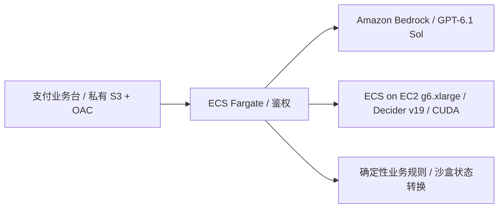

# 加密支付业务台

入口：[在线业务台](https://d3i7ogfx5ml7dc.cloudfront.net/#crypto)。使用现有用户名 / 密码登录，左侧选择「支付流程对比」。

## 演示路线

工作台提供四个独立案例，每个案例包含五个步骤：客服受理 → 交易核验 → 风控审批 → 业务处置 → 回复结案。

| 案例 | 初始处理路径 | 如何推进到结案 |
| --- | --- | --- |
| USDC 未到账 | 等待确认，保留客服工单 | 点击「模拟确认数达标」，重新对比并采用方案 |
| USDT 少付 | 计算 0.20 USDT 差额，提示补款 | 点击「模拟补足差额」，重新核验后确认收款 |
| 稳定币退款 | 目的地未验证、审批未通过，挂起退款 | 依次模拟验证地址、审批通过，重新对比并采用方案 |
| 商户结算 | 超过 SLA，升级运营工单 | 点击「模拟结算到账」，重新对比并完成对账 |

推荐先使用退款案例：

1. 选择「固定流程」，点击「开始对比」。主区域依次显示总耗时、每轮输入／输出与客户对话、流程总表和最终处理结果。
2. 「最终业务结果」分别展示决策返回数、步骤处理数、模拟资金动作是否落实、业务是否完成，以及订单 / 工单状态、模拟账本和客服回复。`已处理 5/5 步` 可以同时对应 `资金动作未落实 / 业务未完成`，原因在卡片中列出。
3. 耗时卡片下方默认展示「每轮输入 / 输出」：输入包含客户诉求、当时证据及闭环反馈，两侧输出分别列出模型选择、实际执行和耗时。客户会话与模板回复同时展开；主表与最终结果位于其后。等待、挂起与未结案使用黄色状态。
4. 改变地址验证、审批或风险标记后重新运行；旧结果会被清除，避免用过期证据执行。
5. 模型建议与演示参考不同只显示提示，继续走完五步。资金条件不足时，后端挂起资金动作并继续客服回复；页面分别保留原始建议、实际动作和保护调整原因，无需人工修正才能继续。
6. 导出 JSON，复核模型输出、输入版本、实测计时、参考差异、保护调整、模拟账本和 `businessOutcomes` 中的业务完成判断。

也可以选择测试方式「仅比较决策」，点击「开始对比」，再单独「采用此方案 · 模拟执行」。仅获得模型建议时，结果明确显示「尚未执行」。参考差异不阻断执行；保护调整后的步骤计入已处理，但分别标明「资金未执行 · 已挂起」或「已回复 · 未结案」。执行请求失败仍会保留错误并暂停，可重试剩余步骤。页面下方仍可查看所选步骤的候选分布、原始响应及输入指纹。

「推进模拟交易」按钮位于主区域「客户对话与回复」中，无需展开。点击后，会话以系统通知展示事件、时间、证据版本和前后变化；拒绝的事件也会显示原因且不改证据。旧回复按版本保留，重新运行后追加两侧新回复；可导出最近 80 条会话及最近 80 轮输入输出记录，切换对比记录回看旧轮次。原始业务请求与响应可按轮展开，模板回复不会标成模型自由生成的文本。

客户消息可编辑；交易金额、确认数、结算耗时和风险标记可修改。四个案例分别保存在当前页面内存中，刷新或退出后清除。金额计算使用服务端 `Decimal`。所有资金操作都是沙盒状态变更，不连接钱包或广播链上交易。

## 自主完成闭环（crypto7 引入，crypto10 展示逐轮输入输出）

测试方式选择「自主闭环」，点击同一个「开始对比」按钮，两侧分别执行“判断 → 实际执行 → 读取反馈 → 继续判断”。默认勾选自动推进模拟事件：遇到确认数、差额、地址验证、审批或结算条件缺失时，由明确标记的模拟器提供新证据，再继续核验；不会自动解除风险。

关闭自动事件时暂停等待。点击对应的「推进模拟交易」按钮后，原运行保留历史并自动续跑。请求失败或用户暂停后，可点击「继续本次对比」；已完成的一侧不重复执行。每轮选择、实际动作、执行反馈与事件都显示在时间线中。

最多返回 20 次决策；同一步连续两次无进展转人工。模型的错误选择不会被替换成规则答案。模拟账本在当前运行内只登记一次；页面刷新会清除记录，尚不具备生产数据库的持久化与跨请求幂等。实现详情见 [闭环工作流](../docs/CLOSED_LOOP.md)。

当前常驻 GPU 模式直接发起真实推理，不在每次对比前额外查询 GPU。仅 Decider 连接、超时或服务端错误才触发状态检查，确认未就绪或状态未知时打开恢复弹窗；GPT 错误和输入校验／排队错误单独显示。顶部「GPU」与业务台「GPU 管理」共用唯一一组启停按钮；正常运行时不每 5 秒轮询，打开弹窗或启停期间恢复刷新。管理员可手动启停，恢复后返回模块重新运行；其他用户可查看状态并联系管理员。规则回放无需 GPU。

## 模型对比口径

- **Bedrock：`us.openai.gpt-6.1-sol`，GPT-6.1 Sol，reasoning effort 为 `low`。** 使用 Bedrock Converse API；没有其他模型回退。
- **Decider：官方 v19，EC2 On-Demand `g6.xlarge`。** 复用串行推理和占用租约；2026-10-11 起常驻运行，禁用闲置停机，支持手动停止并保留磁盘。
- 每个步骤发送相同业务事实、问题和候选项；服务器生成输入指纹，只有相同指纹的真实成功结果才进入配对统计。Bedrock 适配层额外要求输出候选 ID JSON。
- 五个决策步骤按顺序运行，同一步的两个模型并发调用。输入事实在本轮运行开始时固定；一键流程随后分别执行两侧沙盒动作，不因参考差异暂停；资金条件或实际结案条件不足时执行保护调整，原始模型建议保留。沙盒执行另行计时、另行记录。
- 展示各步后端总时间、浏览器往返、模型服务报告时间及配对合计。合计不是整轮并发请求的墙钟时间；整轮时间在处置记录中单独显示。
- 「动作一致」仅表示两个模型选了相同动作。「演示参考」是本程序自定义的确定性策略，只用于对比，不能解读为通用准确率，也不作为动作完全匹配的执行门槛。
- Decider 展示模型真实概率和 confidence；Bedrock 不生成虚构的概率或 confidence。
- Bedrock 显示实际输入 / 输出 token。未核实单价，不估算美元成本。Decider 按 GPU 实例小时计费，不伪造每次调用的 token 账单。
- 客服回复来自可审阅模板，由处理结果选择；本页测量的是模型的决策任务，不包含长文本生成。
- 「规则回放」完全不调用模型，没有推理时间、token 或性能统计。真实请求失败时显示错误，不退回规则回放。
- 结果区域单列五步决策的浏览器经过时间、最近一次一键流程经过时间及各侧沙盒请求往返合计。规则回放也有真实的 HTTP 往返时间，但这些时间不是模型推理时间；重试请求累加在该侧执行合计中，不改写此前一键流程用时。
- 固定输入卡片显示已对比的步骤数和两侧选择不同的步骤数。闭环中后续输入可能不同，单独统计所有返回的决策及耗时，不混入相同输入的配对比较。

## 执行方式（crypto4 起，crypto6 更新结果展示）

- 客服分流、核验建议、保守审批与跟进选择可以偏离演示参考；差异记录在 `policy_warning` 中。
- 模型选择继续人工复核 / 审批会记录 `review_pending`，该侧仍处理五步并回复客户，资金保持挂起。这可能来自模型不必要的保守选择，不能算作已完成资金任务。
- 入账必须满足对应支付场景、足额到账和确认门槛；退款还要求地址验证、人工审批；对账必须已有结算到账证据。有风险标记或待人工复核时不执行资金动作。
- 不能执行的资金动作转为 `hold`，继续回复客户。提前结案转为 `follow_up`；结案判断同时检查实际订单状态，不能仅凭满足交易条件就宣称已付款 / 已退款。
- 服务端返回 `requested_action`、实际 `action`、`safety_adjusted` 和 `safety_reason`。这些调整来自后端，不计作模型正确判断。页面显示参考差异与保护调整的步数，并保留原始模型输出。
- 已处理五步可以是「持续跟进 / 待处理」。crypto6 同时核对目标订单状态、对应账本记录和结案状态，才显示「业务已完成（模拟）」；资金已落实但仍未结案时也单独说明。回复模板依据实际执行状态，避免将挂起说成已收款或已退款。
- 两模型使用相同的执行策略。非法动作、乱序、重复步骤及接口错误仍会被拒绝；模型请求失败不伪装成完成。

## 当前 EC2 验收与演示资料（2026-10-11）

当前 Decider 使用 EC2 `g6.xlarge` 常驻服务。迁移验收完成四个场景、20 组同输入配对：两侧各 20 次成功；Decider 累计后端耗时 1,651.831 ms，GPT 为 20,249.118 ms。这是一次固定样本验收，不代表稳定性能；详情见 [部署记录](DEPLOYED.md)。

最新 [25 页 v5 PPT / PDF / 讲稿](../docs/presentations/v5/README.md) 已更新 EC2 架构和调用路径。文稿中的速度图表与截图继续使用下述 2026-10-10 历史采集，并标明日期和环境；两批结果不混合统计。

## 历史真实观测（2026-10-10）

前端 `crypto10`、API `20261010-loop1`，复用已运行的 SageMaker GPU；未发起启停。四个初始案例每侧尝试 20 次决策，得到 19 组成功同输入配对。配对 Decider 累计 1,809.6 ms、GPT 累计 22,068.2 ms，耗时比约 12.20×；配对参考一致分别为 13/19、19/19。商户结算的 GPT 业务处置发生一次 `ReadTimeoutError`，该侧未执行不完整的方案，错误保留且不进入成功请求耗时统计。

另行运行 USDC 未到账与退款自主闭环，两模型均确认了对应模拟订单、账本与结案。USDC 每侧 6 次决策、1 个模拟事件；退款每侧 9 次决策、2 个模拟事件。后续输入可能不同，闭环累计时间不混入同输入配对速度比较。本次成功不能保证未来所有闭环都成功。

本次数据与采集来源：[固定输入原始摘录](../docs/results/benchmark-2026-10-10.json)、[闭环观测](../docs/presentations/v2/loop-observations.json)、[历史 v2 截图 / 讲稿](../docs/presentations/v2/README.md)。

## 历史观测（2026-10-09，放宽参考差异后）

2026-10-09，线上以四个案例的初始证据重新调用真实模型，无人工修正：

| 案例 | Decider 已处理步骤 | GPT-6.1 Sol 已处理步骤 | Decider 参考差异 / 保护调整 |
| --- | --- | --- | --- |
| USDC 未到账 | 5 / 5 | 5 / 5 | 1 / 0 |
| USDT 少付 | 5 / 5 | 5 / 5 | 1 / 1 |
| 稳定币退款 | 5 / 5 | 5 / 5 | 3 / 2 |
| 商户结算 | 5 / 5 | 5 / 5 | 1 / 1 |

四个初始案例均正确保留「订单待处理 / 工单持续跟进」，没有产生资金账本记录。USDC 案例中 Decider 的「等待人工审批」原样保留，后续步骤继续完成。其余保护调整针对少付入账、退款和提前结案，不会改写模型原始输出。GPT 本轮无保护调整。这是一次固定案例观测；原始记录为 `.deployment/crypto-flexible-models-live.json`。

上述历史记录来自固定输入模式。crypto7 新增的自主闭环会按实际执行反馈自动重判，其回放验证不计入这些历史真实模型基准。

## 历史线上实测记录（crypto1–3，严格参考校验）

2026-10-09，通过 CloudFront → ECS 业务 API 实测四个案例的**初始证据**，每个案例五步。下面的时间为各步后端实测时间合计，包含模型调用、通信与排队；同一步的两模型并发运行，不能把合计理解为页面整轮墙钟时间。

| 案例 | Decider 五步合计 | GPT-6.1 Sol 五步合计 | Decider 规则一致 | GPT-6.1 Sol 规则一致 |
| --- | --- | --- | --- | --- |
| USDC 未到账 | 430.7 ms | 4,024.9 ms | 4 / 5 | 5 / 5 |
| USDT 少付 | 423.5 ms | 3,756.0 ms | 4 / 5 | 5 / 5 |
| 稳定币退款 | 416.9 ms | 4,005.3 ms | 2 / 5 | 5 / 5 |
| 商户结算 | 429.1 ms | 4,526.8 ms | 4 / 5 | 5 / 5 |

本次共 20 组相同输入的真实配对，Decider 合计 **1.70 秒**，GPT-6.1 Sol 合计 **16.31 秒**。Decider 有 6 个建议不符合本演示规则，包括少付时建议确认收款、审批未满足时建议退款、未完成业务时建议结案；当时这些建议都被严格参考校验拦截，规则修正后完成后续步骤。crypto4 已移除该相等性门槛。GPT-6.1 Sol 本轮无需规则修正。

这是四个固定案例上的一次观测，**不是通用准确率或稳定性能保证**。原始模型输出与每步时间保存在本机 `.deployment/crypto-models-live.json`，可用下述脚本复测。界面不会预填这些观测结果；用户点击运行后展示自己的实际调用结果。

## 部署与接口



项目资源与 Bedrock API 调用入口位于 `us-east-1`。GPT-6.1 Sol 使用美国跨区域推理配置，AWS 可以将推理路由到 `us-east-1`、`us-east-2`、`us-west-2`。这不创建其他区域的项目资源。

新增一个单子网 Bedrock Runtime interface VPC endpoint；IAM 和 endpoint policy 仅允许此 GPT-6.1 Sol 推理配置及其三个对应基础模型 ARN 的 `bedrock:InvokeModel`。ECS 无公网 IP、VPC 无互联网默认路由，前端保持私有 S3 + CloudFront OAC。

这个私网端点有独立的 AWS PrivateLink 小时费与数据处理费，另计 Bedrock 实际 token 费用。GPU 的闲置删除不删除 API 所需的私网端点。

| 接口 | 用途 |
| --- | --- |
| `GET /api/crypto/catalog` | 案例、步骤、模型与候选动作 |
| `POST /api/crypto/decision` | 单模型、单步骤决策，返回相同输入指纹 |
| `POST /api/crypto/apply` | 参考差异提示、资金与结案保护，更新模拟工单 / 账本并继续流程 |
| `POST /api/crypto/event` | 模拟确认、补款、地址验证、审批或结算到账 |
| `POST /api/crypto/loop/tick` | 自主闭环的单轮决策、执行、反馈、等待、模拟事件与预算控制 |

所有接口沿用登录认证；写请求沿用 CSRF / Origin 检查。Bedrock 模型 ID 固定允许列表，最多两个并发请求，无自动重试，单次执行预算 45 秒。

```bash
python deployment/deploy.py --region us-east-1 --api-only \
  --model-provider sagemaker --tag YOUR_NEW_API_TAG

uv run --with playwright python scripts/check_crypto_browser.py \
  --url https://d3i7ogfx5ml7dc.cloudfront.net \
  --credentials .deployment/admin-credentials.json --live \
  --output .deployment/crypto-browser-live.json

uv run python scripts/check_crypto_models.py \
  --url https://d3i7ogfx5ml7dc.cloudfront.net \
  --credentials .deployment/admin-credentials.json \
  --output .deployment/crypto-models-live.json
```

本地开发可以使用规则回放；设置 `BEDROCK_ENABLED=true` 和 `AWS_REGION=us-east-1` 后使用当前 AWS 凭证调用指定模型。账号凭证不写入前端、源码或镜像。
