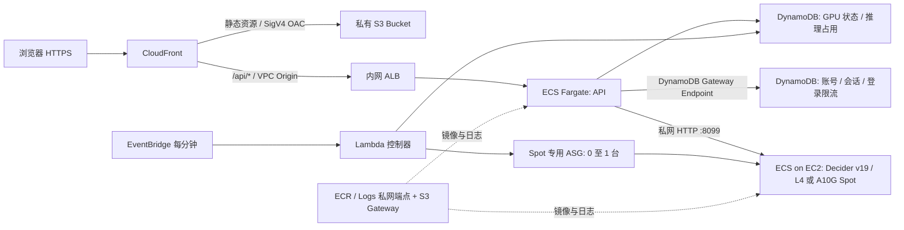

# AWS 部署

前端和后端分别发布。浏览器只访问一个 CloudFront HTTPS 域名，`/api/*` 由 CloudFront 转发到 ECS，无需跨域配置。

当前访问地址：**https://d30wbetbveqce3.cloudfront.net**。资源标识和验收记录见 [DEPLOYED.md](DEPLOYED.md)。



## 部署配置

- 区域：本次部署使用 `us-east-2`。首次选择的 `us-east-1` 已达到 VPC / Internet Gateway 配额；失败创建的空资源已清理。
- 前端：S3 的四项 Block Public Access 全部启用，禁用 ACL（Bucket owner enforced），未开启 S3 website hosting。
- OAC：签名行为为 `always` / SigV4；Bucket policy 仅授权本 CloudFront distribution 的 `s3:GetObject`，并拒绝明文 HTTP。
- 后端：内网 ALB、API Task 和 GPU EC2 均处于独立 VPC 的私有子网，无公网 IP。GPU 的 8099 端口只接受 API 安全组访问。
- 网络：ECR API / ECR Docker / CloudWatch Logs 使用两个 AZ 的 interface endpoints；ECS / ECS Agent / ECS Telemetry 各使用一个 AZ 的 endpoint ENI，并供三个私有子网访问。S3、DynamoDB 使用 gateway endpoint。没有 NAT Gateway，也没有互联网默认路由。
- VPC 附加了 Internet Gateway，这是 CloudFront VPC Origin 的 AWS 前置要求；它不为私有子网提供互联网路由。
- API：Linux ARM64 Fargate，0.25 vCPU / 0.5 GiB，常驻 1 个 Task。
- 模型：独立 ECS EC2 服务，x86_64 NVIDIA L4 / A10G 24GB，CUDA BF16 推理。模型权重随镜像发布；GPU 内核预热后才报告健康。
- Spot：ASG 最小 0、最大 1，`OnDemandBaseCapacity=0`、`OnDemandPercentageAboveBaseCapacity=0`，不会回退到按需实例。三个 AZ 使用 `price-capacity-optimized` 策略，在 `g6.xlarge`、`g6.2xlarge`、`g5.xlarge` 中选择可用容量，实例单价上限为 $0.55/小时。Spot 容量不足时等待或超时释放，不能保证启动成功。
- 可用性：API 使用滚动更新及失败回滚；GPU 为单实例演示配置，Spot 回收或启动期间真实推理暂不可用。
- 健康检查：API 的 `/api/live`、ALB 的 `/api/ready` 不依赖 GPU 在线；登录和示例回放始终可用。`/api/health` 单独检查真实模型。
- 日志：CloudWatch `/ecs/strands-decider-demo`，保留 14 天。
- API 不缓存。静态资源缓存 1 小时，HTML 不缓存；发布完成后创建 CloudFront invalidation。
- API 序列化整次运行；等待槽位超过 5 秒返回 `429`。所有问题共用 50 秒执行预算，CloudFront origin timeout 为 60 秒；任一问题失败或整次执行超时都不返回部分答案。
- 界面为逐项实测设置 `measure_decisions: true`，在一次 API 请求中依次执行问题，显示每项时间和浏览器总时间。省略此参数的 API 请求仍使用原来的批处理。计时定义见项目 [README](../README.md#时间的含义)。

访问入口是 CloudFront 默认 HTTPS 域名，使用自建用户名和密码登录，无 Cognito。S3 和 ALB 本身不提供公共访问入口。

## GPU 启停与自动释放

管理员 `admin` 登录后，使用页面上的「启动 GPU」和「结束演示并释放」。有 Spot 容量时预计启动需要几分钟，后台每分钟协调一次实际资源；实际启动耗时待 GPU 容量可用后验证。其他已登录用户可以查看状态和使用就绪的模型；管理用户由 API 的 `GPU_MANAGERS` 配置限定。

- 启动：将控制表的目标状态设为运行；控制器把 ASG 和 GPU ECS 服务扩到 1，等模型健康后发布私网地址。
- 释放：立即停止接收新推理，等待已有推理的占用结束，先将模型服务任务数设为 0，再把 ASG 缩到 0。实例及其 80GB 加密 gp3 根卷随之删除。
- 闲置：最后一次推理结束 30 分钟后，在下一次后台检查时申请释放。刷新页面和查询状态不会重置闲置时间。实例终止还需要少量时间。
- 启动失败：等待 Spot 或模型启动超过 20 分钟后自动申请释放，可重新启动。
- 并发保护：DynamoDB 条件更新协调多 API Task 和控制器；推理占用具有过期时间，API 失败后保留缓冲期，避免网络超时立即终止仍在运行的 CUDA 工作。
- GPU 关闭时，真实模式提示先启动 GPU，示例回放继续可用。Spot 被回收时正在执行的请求仍可能失败，需要待替代实例就绪后重试。

## 登录与账号管理

- AWS 账号及会话保存在 DynamoDB `strands-decider-demo-auth`，通过 gateway endpoint 私网访问。容器滚动更新后登录仍然有效。
- 密码采用独立随机盐的 scrypt（N=32768、r=8、p=1），不保存明文。没有默认硬编码密码或公共注册接口。
- 随机会话令牌只放在 `__Host-decider_session` Cookie；`Secure`、`HttpOnly`、`SameSite=Strict`、`Path=/`，有效期 8 小时。服务端只保存令牌的 SHA-256。
- 退出时删除会话；重置密码或停用账号会撤销该账号所有旧会话。DynamoDB TTL 用于清理，会话过期时间仍由 API 实时校验。
- 每个用户名每个 5 分钟窗口最多 10 次登录尝试；计数保存在 DynamoDB。写请求要求自定义请求头并验证 Origin，API 响应禁止缓存。
- `/api/live` 和 `/api/ready` 保留为公开健康探针；其他业务 API、API 文档均需登录。
- 初始账号为 `admin`，生成的强密码保存在本机 `.deployment/admin-credentials.json`（权限 0600，不进入 Git、S3 或镜像）。
- 运行记录按用户名保存在标签页 sessionStorage，刷新可恢复，退出清除；不将会话令牌存入浏览器存储。

在项目根目录执行以下管理命令；需要访问此表的 AWS 凭据：

```bash
export AWS_REGION=us-east-2
export AUTH_TABLE=strands-decider-demo-auth

# 创建账号，交互输入密码（至少 12 位）
uv run python -m scripts.manage_users create alice

# 重置密码并撤销所有旧会话
uv run python -m scripts.manage_users reset alice

# 停用账号
uv run python -m scripts.manage_users disable alice

# 首次部署创建管理员，并将随机密码保存到一个新文件
uv run python -m scripts.manage_users create admin --generate-to .deployment/admin-credentials.json
```

本地开发使用 SQLite `.data/auth.sqlite3`；仅本地 HTTP 调试设置 `AUTH_COOKIE_SECURE=false`。AWS task 自动设置 `AUTH_TABLE`、`AWS_REGION`、`AUTH_ORIGIN` 和安全 Cookie，不会回退到本地数据库。

## 重复部署

需要 AWS CLI、Docker、Python、uv 和具备相应资源创建权限的 AWS 凭据。

```bash
# 更新常驻 API 与前端，复用 GPU 状态表和模型服务
python deployment/deploy.py --region us-east-2 --api-only --tag YOUR_UNIQUE_API_TAG

# 只更新前端（不重启模型）
python deployment/deploy.py --region us-east-2 --frontend-only

# 已构建好本地镜像时
python deployment/deploy.py --region us-east-2 \
  --api-only --tag YOUR_UNIQUE_API_TAG --skip-build

# 更新 GPU 镜像：先从页面释放 GPU，再构建并更新 GPU stack
uv run --extra model python deployment/package_model.py
python deployment/build_gpu.py --region us-east-2 --tag YOUR_UNIQUE_GPU_TAG
python deployment/deploy_gpu.py --region us-east-2 --tag YOUR_UNIQUE_GPU_TAG
```

GPU 镜像在临时 x86 CodeBuild 环境中构建，随后推送到项目 ECR；成功后删除临时 S3 数据与构建 stack。构建失败时保留资源用于排查，重试或清理前先查看 `.deployment/gpu-build.json`，避免丢失诊断信息。首次部署按以下顺序进行：

```bash
python deployment/deploy.py --region us-east-2 --bootstrap --tag bootstrap
uv run --extra model python deployment/package_model.py
python deployment/build_gpu.py --region us-east-2 --tag YOUR_UNIQUE_GPU_TAG
python deployment/deploy_gpu.py --region us-east-2 --tag YOUR_UNIQUE_GPU_TAG
# 将 gpu-outputs.json 中的 StateTableName 填入下方
python deployment/deploy.py --region us-east-2 --api-only \
  --gpu-state-table YOUR_GPU_STATE_TABLE --tag YOUR_UNIQUE_API_TAG
```

输出分别保存在 `.deployment/outputs.json` 和 `.deployment/gpu-outputs.json`。镜像使用不可覆盖的 tag；更新时请生成新 tag。GPU 部署脚本会拒绝在启动请求、运行任务或实例尚未释放时更新 GPU stack。

基础设施由主 stack 和 `strands-decider-demo-gpu` stack 管理，源码为 `infrastructure.py` 和 `gpu_infrastructure.py`。GPU stack 使用主 stack 的私有子网、ECR、日志和 ECS cluster。

```bash
python deployment/infrastructure.py
uv run --with cfn-lint cfn-lint deployment/cloudformation.json
```

## 模型可复现性

`package_model.py` 固定 Hugging Face 快照：

| 模型 | Revision |
| --- | --- |
| Decider v19 | `bb282d786bc251fd4e3068de3ada9ddbb38127cd` |
| Qwen3.5-2B-Base | `b1485b2fa6dfa1287294f269f5fb618e03d52d7c` |

模型在 `.deployment/models/` 临时准备。打包时只将 Decider 配置的 `base_model` 改为容器内 `/opt/models/base`，原始配置保存在 `packaging.json`；权重、LoRA 与校准参数不改动。镜像设置 `HF_HUB_OFFLINE=1` 和 `TRANSFORMERS_OFFLINE=1`。

镜像构建所需 Python 依赖从 `uv.lock` 导出，模型框架源码固定到官方提交。GPU 镜像另固定 PyTorch 2.7.1 CUDA 12.6、flash-linear-attention 0.5.2、causal-conv1d 1.7.0。容器以 UID 10001 运行；API 使用只读根文件系统。

## 验证与运维

```bash
# 查看 stack 输出
aws cloudformation describe-stacks --stack-name strands-decider-demo \
  --region us-east-2 --query 'Stacks[0].Outputs'

# 查看 ECS 服务状态
aws ecs describe-services --cluster strands-decider-demo \
  --services strands-decider-demo --region us-east-2 \
  --query 'services[0].{Running:runningCount,Desired:desiredCount,Events:events[:3]}'

# 查看容器日志
aws logs tail /ecs/strands-decider-demo --region us-east-2 --since 10m

# GPU 已释放时：验证资源归零、示例可用、访问控制及私有网络
python deployment/verify.py --region us-east-2 \
  --credentials .deployment/admin-credentials.json --gpu-state stopped

# GPU 已启动时：额外验证 Spot 实例、CUDA 推理与真实计时
python deployment/verify.py --region us-east-2 \
  --credentials .deployment/admin-credentials.json --gpu-state ready

# 通过浏览器验证真实启停按钮（会创建 / 终止 GPU Spot 实例）
uv run --with playwright python scripts/check_gpu_browser.py \
  --url https://YOUR_DISTRIBUTION.cloudfront.net \
  --credentials .deployment/admin-credentials.json --action start
# 将 --action 改为 stop 验证释放

# 对已部署页面运行完整浏览器检查，含真实模型
uv run --with playwright python scripts/check_browser.py \
  --url https://YOUR_DISTRIBUTION.cloudfront.net --credentials .deployment/admin-credentials.json --live

# 验证 4 个加密货币支付场景，结果保存在本机，不包含登录凭据
uv run python -m scripts.check_scenarios \
  --url https://YOUR_DISTRIBUTION.cloudfront.net \
  --credentials .deployment/admin-credentials.json \
  --ids crypto_pending crypto_underpaid crypto_refund crypto_settlement \
  --output .deployment/crypto-scenarios-live.json
```

S3 对象的匿名直连必须返回 `403`；通过 CloudFront 则应返回 `200`。未登录访问业务 API 返回 `401`。GPU 就绪时 `/api/health` 返回 `connected: true`、`device: cuda`；释放时返回未连接，但 API readiness 和示例接口仍成功。

固定运行成本主要来自 Fargate 0.25 vCPU / 0.5 GiB、ALB 和 9 个 interface endpoint ENI；另外按用量收取 DynamoDB、Lambda、ECR、CloudFront、S3、日志及数据处理费用。DynamoDB gateway endpoint 无小时费。GPU 就绪及启动期间另收 Spot 实例与 EBS 费用，实例终止后这部分停止；常驻资源费用仍存在。

## 清理

先从页面释放 GPU，确认实例数量为 0，再删除 GPU stack，最后删除主 stack。GPU 控制表与控制器随 GPU stack 删除；主 stack 的认证 DynamoDB、前端 S3、ECR 和日志采用 `Retain`，完整清理需要另行处理这些保留数据。CloudFront VPC Origin 的删除可能需要数分钟。
