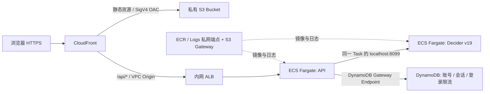

# AWS 部署

前端和后端分别发布。浏览器只访问一个 CloudFront HTTPS 域名，`/api/*` 由 CloudFront 转发到 ECS，无需跨域配置。

当前访问地址：**https://d30wbetbveqce3.cloudfront.net**。资源标识和验收记录见 [DEPLOYED.md](DEPLOYED.md)。



## 部署配置

- 区域：本次部署使用 `us-east-2`。首次选择的 `us-east-1` 已达到 VPC / Internet Gateway 配额；失败创建的空资源已清理。
- 前端：S3 的四项 Block Public Access 全部启用，禁用 ACL（Bucket owner enforced），未开启 S3 website hosting。
- OAC：签名行为为 `always` / SigV4；Bucket policy 仅授权本 CloudFront distribution 的 `s3:GetObject`，并拒绝明文 HTTP。
- 后端：内网 ALB 和 ECS 均处于独立 VPC 的私有子网。Task 不分配公网 IP，模型端口只监听 task 内部 localhost。
- 网络：ECR API / ECR Docker / CloudWatch Logs 使用两个 AZ 的 interface endpoints，S3 使用 gateway endpoint。没有 NAT Gateway，也没有私有子网的互联网默认路由。
- VPC 附加了 Internet Gateway，这是 CloudFront VPC Origin 的 AWS 前置要求；它不为私有子网提供互联网路由。
- ECS：Linux ARM64 Fargate，单 Task 为 4 vCPU / 16 GiB，包含 API 和模型两个容器。默认 1 个 Task，模型权重随镜像发布。
- 可用性：ALB、子网和私网端点跨两个 AZ；默认单 Task 用于演示。滚动更新使用 100% minimum / 200% maximum healthy，并启用失败回滚。
- 健康检查：API 的 `/api/live` 检查进程，ALB 的 `/api/ready` 检查真实模型已就绪。API 等模型容器健康后启动。
- 日志：CloudWatch `/ecs/strands-decider-demo`，保留 14 天。
- API 不缓存。静态资源缓存 1 小时，HTML 不缓存；发布完成后创建 CloudFront invalidation。
- API 序列化推理；等待槽位超过 5 秒返回 `429`。模型请求超时为 50 秒，CloudFront origin timeout 为 60 秒。

访问入口是 CloudFront 默认 HTTPS 域名，使用自建用户名和密码登录，无 Cognito。S3 和 ALB 本身不提供公共访问入口。

## 登录与账号管理

- AWS 账号及会话保存在 DynamoDB `strands-decider-demo-auth`，通过 gateway endpoint 私网访问。容器滚动更新后登录仍然有效。
- 密码采用独立随机盐的 scrypt（N=32768、r=8、p=1），不保存明文。没有默认硬编码密码或公共注册接口。
- 随机会话令牌只放在 `__Host-decider_session` Cookie；`Secure`、`HttpOnly`、`SameSite=Strict`、`Path=/`，有效期 8 小时。服务端只保存令牌的 SHA-256。
- 退出时删除会话；重置密码或停用账号会撤销该账号所有旧会话。DynamoDB TTL 用于清理，会话过期时间仍由 API 实时校验。
- 每个用户名每个 5 分钟窗口最多 10 次登录尝试；计数保存在 DynamoDB。写请求要求自定义请求头并验证 Origin，API 响应禁止缓存。
- `/api/live` 和 `/api/ready` 保留为公开健康探针；其他业务 API、API 文档均需登录。
- 初始账号为 `admin`，生成的强密码保存在本机 `.deployment/admin-credentials.json`（权限 0600，不进入 Git、S3 或镜像）。
- 运行记录按用户名保存在标签页 sessionStorage，刷新可恢复，退出清除；不将会话令牌存入浏览器存储。

在项目根目录执行以下管理命令；需要访问此表的 AWS 凭据：

```bash
export AWS_REGION=us-east-2
export AUTH_TABLE=strands-decider-demo-auth

# 创建账号，交互输入密码（至少 12 位）
uv run python -m scripts.manage_users create alice

# 重置密码并撤销所有旧会话
uv run python -m scripts.manage_users reset alice

# 停用账号
uv run python -m scripts.manage_users disable alice

# 首次部署创建管理员，并将随机密码保存到一个新文件
uv run python -m scripts.manage_users create admin --generate-to .deployment/admin-credentials.json
```

本地开发使用 SQLite `.data/auth.sqlite3`；仅本地 HTTP 调试设置 `AUTH_COOKIE_SECURE=false`。AWS task 自动设置 `AUTH_TABLE`、`AWS_REGION`、`AUTH_ORIGIN` 和安全 Cookie，不会回退到本地数据库。

## 重复部署

需要 AWS CLI、Docker、Python、uv 和具备相应资源创建权限的 AWS 凭据。

```bash
# 在项目根目录执行；生成新镜像版本并滚动更新
python deployment/deploy.py --region us-east-2

# 只更新前端（不重启模型）
python deployment/deploy.py --region us-east-2 --frontend-only

# 更新 API，复用已有模型镜像（仍会滚动替换整个 Task）
python deployment/deploy.py --region us-east-2 --api-only

# 已构建好本地镜像时
python deployment/deploy.py --region us-east-2 \
  --tag YOUR_UNIQUE_TAG --skip-build
```

脚本先创建 DesiredCount=0 的基础设施，同时构建镜像，随后推送到 ECR、更新 ECS 到 1 个 Task、上传前端。运行状态输出在 `.deployment/outputs.json`。镜像使用不可覆盖的 tag；更新时请生成新 tag。

基础设施源码为 `infrastructure.py`，生成的 `cloudformation.json` 可直接在 AWS CloudFormation 检查或部署。所有项目 AWS 资源由一个 stack 管理，不修改其他应用的网络。

```bash
python deployment/infrastructure.py
uv run --with cfn-lint cfn-lint deployment/cloudformation.json
```

## 模型可复现性

`package_model.py` 固定 Hugging Face 快照：

| 模型 | Revision |
| --- | --- |
| Decider v19 | `bb282d786bc251fd4e3068de3ada9ddbb38127cd` |
| Qwen3.5-2B-Base | `b1485b2fa6dfa1287294f269f5fb618e03d52d7c` |

模型在 `.deployment/models/` 临时准备。打包时只将 Decider 配置的 `base_model` 改为容器内 `/opt/models/base`，原始配置保存在 `packaging.json`；权重、LoRA 与校准参数不改动。镜像设置 `HF_HUB_OFFLINE=1` 和 `TRANSFORMERS_OFFLINE=1`。

镜像构建所需 Python 依赖从 `uv.lock` 导出，模型框架源码固定到官方提交。容器以 UID 10001 运行；API 使用只读根文件系统。

## 验证与运维

```bash
# 查看 stack 输出
aws cloudformation describe-stacks --stack-name strands-decider-demo \
  --region us-east-2 --query 'Stacks[0].Outputs'

# 查看 ECS 服务状态
aws ecs describe-services --cluster strands-decider-demo \
  --services strands-decider-demo --region us-east-2 \
  --query 'services[0].{Running:runningCount,Desired:desiredCount,Events:events[:3]}'

# 查看容器日志
aws logs tail /ecs/strands-decider-demo --region us-east-2 --since 10m

# 验证 S3 私有访问、OAC、私网 ECS 和真实推理
python deployment/verify.py --region us-east-2 --credentials .deployment/admin-credentials.json

# 对已部署页面运行完整浏览器检查，含真实模型
uv run --with playwright python scripts/check_browser.py \
  --url https://YOUR_DISTRIBUTION.cloudfront.net --credentials .deployment/admin-credentials.json --live
```

S3 对象的匿名直连必须返回 `403`；通过 CloudFront 则应返回 `200`。未登录访问业务 API 返回 `401`；登录后 `/api/health` 应返回 `connected: true`，真实决策应返回 `source: live` 和实际模型名。

固定运行成本主要来自 Fargate 4 vCPU / 16 GiB、ALB 和 6 个 interface endpoint ENI；另外按用量收取 DynamoDB（含按需请求、存储与时间点恢复）、ECR、CloudFront、S3、日志及数据处理费用。DynamoDB gateway endpoint 无小时费。暂停 ECS Task 只会减少计算费用，不能消除 ALB 和 endpoint 的固定费用。

## 清理

删除 stack 会移除 ECS、ALB、CloudFront、VPC 和私网端点；DynamoDB、S3、ECR 和日志采用 `Retain`。完整清理还需要在确认不再保留数据后移除认证表、S3 所有版本、ECR 镜像及日志组。CloudFront VPC Origin 的删除可能需要数分钟。
