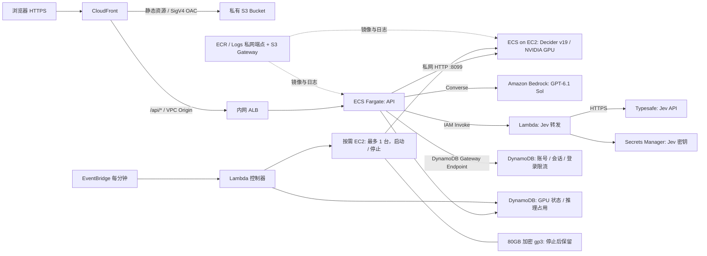

# AWS 部署

**当前使用 EC2 On-Demand `g6.xlarge`，持续运行，禁用闲置自动停机。** API 仍为 ECS Fargate，模型服务运行在 ECS on EC2；实际部署状态见 [DEPLOYED.md](DEPLOYED.md)。[SAGEMAKER.md](SAGEMAKER.md) 保留此前方案，SageMaker Endpoint 已释放、控制器禁用。

前端和后端分别发布。浏览器只访问一个 CloudFront HTTPS 域名，`/api/*` 由 CloudFront 转发到 ECS，无需跨域配置。

当前访问地址：**https://d3i7ogfx5ml7dc.cloudfront.net**。资源标识和验收记录见 [DEPLOYED.md](DEPLOYED.md)。

独立的加密支付业务台同时比较 Strands Decider / Jev / Bedrock GPT-6.1 Sol，操作说明见 [CRYPTO.md](CRYPTO.md)，当前性能及业务结果见 [模型比较](../docs/MODEL_COMPARISON.md#当前三模型性能)。

「模型路由对比」新增四个任务场景，比较 Decider / Jev / GPT-6 Sol（low）的处理流程选择与目标型号选择，两步均实际调用决策模型；第三方评测只提供候选依据。LiveBench + MTEB 评测快照随 API 镜像发布，刷新命令及 Artificial Analysis API 接入见模块说明。API 镜像构建前自动刷新当前区域 Bedrock 完整目录，页面显示目录版本与排除原因。目标模型可选执行，IAM 与私网端点已加入基础模型/推理配置调用权限；应用仍限制到当前目录与任务约束。详见 [模块说明](../docs/MODEL_ROUTING.md)。

Jev 对比通过单 AZ Lambda 私有端点 → IAM-only Lambda → Typesafe HTTPS API 接入，密钥存储于 Secrets Manager；API、GPU 和 S3 保持私有。启用、轮换和新增费用见 [Jev 部署说明](../docs/JEV.md#aws-调用路径)。

配套演示资料见 [30 页 v8 三模型对比](../docs/presentations/v8/README.md)：包含 ECS Fargate、EC2 GPU、Bedrock 与 Jev 架构，预热后的四场景实测、真实截图、JevBench 和输入优化案例。



## 部署配置

- 区域：所有应用区域资源使用 `us-east-1`；CloudFront 与 IAM 为 AWS 全球资源。部署脚本默认使用此区域。
- 前端：S3 的四项 Block Public Access 全部启用，禁用 ACL（Bucket owner enforced），未开启 S3 website hosting。
- OAC：签名行为为 `always` / SigV4；Bucket policy 仅授权本 CloudFront distribution 的 `s3:GetObject`，并拒绝明文 HTTP。
- 后端：内网 ALB、API Task 和 GPU EC2 均处于独立 VPC 的私有子网，无公网 IP。GPU 的 8099 端口只接受 API 安全组访问。
- 网络：ECR API / ECR Docker / CloudWatch Logs 使用两个 AZ 的 interface endpoints；ECS / ECS Agent / ECS Telemetry 各使用一个 AZ 的 endpoint ENI，并供五个私有子网访问。S3、DynamoDB 使用 gateway endpoint。没有 NAT Gateway，也没有互联网默认路由。
- VPC 附加了 Internet Gateway，这是 CloudFront VPC Origin 的 AWS 前置要求；它不为私有子网提供互联网路由。
- API：Linux ARM64 Fargate，0.25 vCPU / 0.5 GiB，常驻 1 个 Task。
- 模型：独立 ECS EC2 服务，x86_64 NVIDIA L4 / A10G 24GB，CUDA BF16 推理。模型权重随镜像发布；GPU 内核预热后才报告健康。
- 购买方式：On-Demand，最多一台活动 GPU，当前为 `us-east-1d` 的 `g6.xlarge`（$0.8048/小时，2026-10-11 查询）。`GpuInstanceTypes=g6.xlarge` 禁止自动切到更贵规格。原 `us-east-1f` 实例停止保留，标记为 `strands-decider-demo-gpu-retained`，不参与控制器调度；其 80GB 磁盘另计。
- 可用性：API 使用滚动更新及失败回滚；GPU 为单实例演示配置。停止和启动期间真实推理不可用，按需实例的再次启动也可能遇到容量不足，未购买容量预留。
- 健康检查：API 的 `/api/live`、ALB 的 `/api/ready` 不依赖 GPU 在线；登录和示例回放始终可用。`/api/health` 单独检查真实模型。
- 日志：CloudWatch `/ecs/strands-decider-demo`，保留 14 天。
- API 不缓存。静态资源缓存 1 小时，HTML 不缓存；发布完成后创建 CloudFront invalidation。
- Decider 工作台 API 序列化整次推理；等待槽位超过 5 秒返回 `429`。所有问题共用 50 秒执行预算，CloudFront origin timeout 为 60 秒；任一问题失败或整次执行超时都不返回该请求的部分答案。支付对比每步另行并发请求三个模型，各自保留成功或失败结果，不因一个模型失败隐藏其他结果。
- 界面为逐项实测设置 `measure_decisions: true`，在一次 API 请求中依次执行问题，显示每项时间和浏览器总时间。省略此参数的 API 请求仍使用原来的批处理。计时定义见 [开发指南](../docs/DEVELOPMENT.md#时间的含义)。

访问入口是 CloudFront 默认 HTTPS 域名，使用自建用户名和密码登录，无 Cognito。S3 和 ALB 本身不提供公共访问入口。

## GPU 启停与磁盘保留

管理员 `admin` 登录后，使用页面上的「启动 GPU」和「停止 GPU，保留磁盘」。后台每分钟协调一次实际资源。其他已登录用户可以查看状态和使用就绪的模型；管理用户由 API 的 `GPU_MANAGERS` 配置限定。

常驻模式的工作台、工具守卫和支付对比直接提交推理，不等待前端 GPU 状态查询。页面初始化读取一次状态，管理弹窗打开或启停期间再轮询；Decider 调用失败后才检查 GPU 并按需提示恢复。后端继续校验 readiness、推理租约与并发限制。工作台顶部固定显示场景、模式和「运行决策」，滚动编辑时仍可操作。

- 首次启动：控制器通过 Launch Template 创建一台按需 GPU，模型权重随镜像下载到根卷。ECS 任务健康后发布私网地址。
- 再次启动：对已保存的实例执行 `StartInstances`，复用同一实例、80GB 加密 gp3 根卷与 Docker 镜像。`ECS_IMAGE_PULL_BEHAVIOR=prefer-cached` 避免重复拉取已有镜像；`/opt/decider-cache` 持久保存 Triton、CUDA 和 Hugging Face 缓存。模型仍须加载到显存，Stop 不保留内存。
- 停止：立即停止接收新推理，等待已有推理结束，先将模型服务任务数设为 0，确认无运行或待启动任务后执行 `StopInstances`。实例 ID 与根卷保留，控制器没有终止实例的权限。
- 闲置：当前 `IdleTimeoutSeconds=0`，无论闲置多久都保持运行。若以后需要自动停止，可在停止 GPU 后部署 `--idle-timeout-seconds 1800`，恢复 30 分钟策略。
- 启动失败：等待容量或模型启动超过 20 分钟后自动停止并显示错误；已创建的磁盘继续保留，可以重新启动。
- 并发保护：DynamoDB 条件更新协调多 API Task 和控制器；推理占用具有过期时间，API 失败后保留缓冲期，避免网络超时立即停止仍在运行的 CUDA 工作。
- GPU 停止时不收 EC2 计算费，80GB gp3 磁盘约 $6.40/月。页面显示当前规格和计算单价；示例回放、登录及常驻 API 继续运行。

启停均为异步操作。历史旧 EC2 复用启动实测约 3 分 51 秒，不能当作当前新实例的启动时间；正常停止也需要数分钟，页面显示「已停止」后才允许再次启动。

没有使用 Auto Scaling Group。EC2 实例由控制器通过项目标签和 DynamoDB 记录管理，CloudFormation 管理其启动模板、角色、子网和服务；因此完整清理时需要显式终止保留的实例，见下文。

## 登录与账号管理

- AWS 账号及会话保存在 DynamoDB `strands-decider-demo-auth`，通过 gateway endpoint 私网访问。容器滚动更新后登录仍然有效。
- 密码采用独立随机盐的 scrypt（N=32768、r=8、p=1），不保存明文。没有默认硬编码密码或公共注册接口。
- 随机会话令牌只放在 `__Host-decider_session` Cookie；`Secure`、`HttpOnly`、`SameSite=Strict`、`Path=/`，有效期 8 小时。服务端只保存令牌的 SHA-256。
- 退出时删除会话；重置密码或停用账号会撤销该账号所有旧会话。DynamoDB TTL 用于清理，会话过期时间仍由 API 实时校验。
- 每个用户名每个 5 分钟窗口最多 10 次登录尝试；计数保存在 DynamoDB。写请求要求自定义请求头并验证 Origin，API 响应禁止缓存。
- `/api/live` 和 `/api/ready` 保留为公开健康探针；其他业务 API、API 文档均需登录。
- 初始账号为 `admin`，生成的强密码保存在本机 `.deployment/admin-credentials.json`（权限 0600，不进入 Git、S3 或镜像）。
- 运行记录按用户名保存在标签页 sessionStorage，刷新可恢复，退出清除；不将会话令牌存入浏览器存储。

在项目根目录执行以下管理命令；需要访问此表的 AWS 凭据：

```bash
export AWS_REGION=us-east-1
export AUTH_TABLE=strands-decider-demo-auth

# 创建账号，交互输入密码（至少 12 位）
uv run python -m scripts.manage_users create alice

# 重置密码并撤销所有旧会话
uv run python -m scripts.manage_users reset alice

# 停用账号
uv run python -m scripts.manage_users disable alice

# 首次部署创建管理员，并将随机密码保存到一个新文件
uv run python -m scripts.manage_users create admin --generate-to .deployment/admin-credentials.json
```

本地开发使用 SQLite `.data/auth.sqlite3`；仅本地 HTTP 调试设置 `AUTH_COOKIE_SECURE=false`。AWS task 自动设置 `AUTH_TABLE`、`AWS_REGION`、`AUTH_ORIGIN` 和安全 Cookie，不会回退到本地数据库。

## 重复部署

需要 AWS CLI、Docker、Python、uv 和具备相应资源创建权限的 AWS 凭据。

```bash
# 更新常驻 API 与前端，复用 GPU 状态表和模型服务
python deployment/deploy.py --region us-east-1 --api-only --tag YOUR_UNIQUE_API_TAG

# 只更新前端（不重启模型）
python deployment/deploy.py --region us-east-1 --frontend-only

# 已构建好本地镜像时
python deployment/deploy.py --region us-east-1 \
  --api-only --tag YOUR_UNIQUE_API_TAG --skip-build

# 更新 GPU 镜像：先从页面停止 GPU，再构建并更新 GPU stack
uv run --extra model python deployment/package_model.py
python deployment/build_gpu.py --region us-east-1 --tag YOUR_UNIQUE_GPU_TAG
python deployment/deploy_gpu.py --region us-east-1 --tag YOUR_UNIQUE_GPU_TAG

# 当前固定 g6.xlarge、常驻运行的控制配置（修改前先手动停止 GPU）
python deployment/deploy_gpu.py --region us-east-1 --tag YOUR_UNIQUE_GPU_TAG \
  --enable-controller --instance-types g6.xlarge --idle-timeout-seconds 0
```

GPU 镜像在临时 x86 CodeBuild 环境中构建，随后推送到项目 ECR；成功后删除临时 S3 数据与构建 stack。构建失败时保留资源用于排查，重试或清理前先查看 `.deployment/gpu-build.json`，避免丢失诊断信息。首次部署按以下顺序进行：

```bash
python deployment/deploy.py --region us-east-1 --bootstrap --tag bootstrap \
  --availability-zones us-east-1d us-east-1b
uv run --extra model python deployment/package_model.py
python deployment/build_gpu.py --region us-east-1 --tag YOUR_UNIQUE_GPU_TAG
python deployment/deploy_gpu.py --region us-east-1 --tag YOUR_UNIQUE_GPU_TAG \
  --availability-zone us-east-1c --extra-availability-zones us-east-1a us-east-1f
# 将 gpu-outputs.json 中的 StateTableName 填入下方
python deployment/deploy.py --region us-east-1 --api-only \
  --gpu-state-table YOUR_GPU_STATE_TABLE --tag YOUR_UNIQUE_API_TAG
```

输出分别保存在 `.deployment/outputs.json` 和 `.deployment/gpu-outputs.json`。镜像使用不可覆盖的 tag；更新时请生成新 tag。GPU 部署脚本会拒绝在启动请求、运行任务或实例尚未停止时更新 GPU stack；允许保留已停止的实例和磁盘。更新模型 tag 后首次启动会下载新镜像。修改 Launch Template 不会改写已有实例的 AMI、用户数据或磁盘，涉及这些配置时需单独规划实例替换。

基础设施由主 stack 和 `strands-decider-demo-gpu` stack 管理，源码为 `infrastructure.py` 和 `gpu_infrastructure.py`。GPU stack 使用主 stack 的私有子网、ECR、日志和 ECS cluster。当前 GPU 候选可用区为 `us-east-1d`、`us-east-1b`、`us-east-1c`、`us-east-1a`、`us-east-1f`；可用区字母映射以当前 AWS 账号为准。新建主 stack 时可用 `--availability-zones` 指定两个 AZ，GPU stack 的 `--availability-zone` 指定第三个不同的 AZ，`--extra-availability-zones` 最多增加两个。更新时省略这些参数会保留已有选择。

```bash
python deployment/infrastructure.py
uv run --with cfn-lint cfn-lint deployment/cloudformation.json
```

## 模型可复现性

`package_model.py` 固定 Hugging Face 快照：

| 模型 | Revision |
| --- | --- |
| Decider v19 | `bb282d786bc251fd4e3068de3ada9ddbb38127cd` |
| Qwen3.5-2B-Base | `b1485b2fa6dfa1287294f269f5fb618e03d52d7c` |

模型在 `.deployment/models/` 临时准备。打包时只将 Decider 配置的 `base_model` 改为容器内 `/opt/models/base`，原始配置保存在 `packaging.json`；权重、LoRA 与校准参数不改动。镜像设置 `HF_HUB_OFFLINE=1` 和 `TRANSFORMERS_OFFLINE=1`。

镜像构建所需 Python 依赖从 `uv.lock` 导出，模型框架源码固定到官方提交。GPU 镜像另固定 PyTorch 2.7.1 CUDA 12.6、flash-linear-attention 0.5.2、causal-conv1d 1.7.0。容器以 UID 10001 运行；API 使用只读根文件系统。

## 验证与运维

```bash
# 查看 stack 输出
aws cloudformation describe-stacks --stack-name strands-decider-demo \
  --region us-east-1 --query 'Stacks[0].Outputs'

# 查看 ECS 服务状态
aws ecs describe-services --cluster strands-decider-demo \
  --services strands-decider-demo --region us-east-1 \
  --query 'services[0].{Running:runningCount,Desired:desiredCount,Events:events[:3]}'

# 查看容器日志
aws logs tail /ecs/strands-decider-demo --region us-east-1 --since 10m

# GPU 已停止时：验证计算停止、磁盘保留、示例可用及私有网络
python deployment/verify.py --region us-east-1 \
  --credentials .deployment/admin-credentials.json --gpu-state stopped

# GPU 已启动时：额外验证按需实例、CUDA 推理与真实计时
python deployment/verify.py --region us-east-1 \
  --credentials .deployment/admin-credentials.json --gpu-state ready

# 通过浏览器验证真实启停按钮（首次创建，后续启动 / 停止同一按需实例）
uv run --with playwright python scripts/check_gpu_browser.py \
  --url https://YOUR_DISTRIBUTION.cloudfront.net \
  --credentials .deployment/admin-credentials.json --action start
# 将 --action 改为 stop 验证停止并保留磁盘

# 对已部署页面运行完整浏览器检查，含真实模型
uv run --with playwright python scripts/check_browser.py \
  --url https://YOUR_DISTRIBUTION.cloudfront.net --credentials .deployment/admin-credentials.json --live

# 验证 4 个加密货币支付场景，结果保存在本机，不包含登录凭据
uv run python -m scripts.check_scenarios \
  --url https://YOUR_DISTRIBUTION.cloudfront.net \
  --credentials .deployment/admin-credentials.json \
  --ids crypto_pending crypto_underpaid crypto_refund crypto_settlement \
  --output .deployment/crypto-scenarios-live.json
```

S3 对象的匿名直连必须返回 `403`；通过 CloudFront 则应返回 `200`。未登录访问业务 API 返回 `401`。GPU 就绪时 `/api/health` 返回 `connected: true`、`device: cuda`；停止时返回未连接，但 API readiness 和示例接口仍成功。

固定运行成本包含 GPU `g6.xlarge`、Fargate 0.25 vCPU / 0.5 GiB、ALB、VPC interface endpoints 和 EBS；另外按用量收取 DynamoDB、Lambda、ECR、CloudFront、S3、日志及数据处理费用。DynamoDB gateway endpoint 无小时费。GPU 为 $0.8048/小时，730 小时约 $587.50；EC2 按秒计费、每次启动最低 60 秒。当前实例和旧回退实例各保留一块 80GB gp3 磁盘，合计约 $12.80/月。停止后计算费停止，磁盘与常驻服务费用继续。

## 清理

当前按要求常驻运行，结束演示无需停止。如需主动停止计费，可点击「停止 GPU，保留磁盘」，不要执行完整清理。

完整删除环境时：

1. 从页面停止 GPU，确认 EC2 为 `stopped`、GPU ECS 服务任务数为 0。
2. 通过 `DeciderGpuStack=strands-decider-demo-gpu` 和 `DeciderGpuStack=strands-decider-demo-gpu-retained` 标签定位当前实例及旧回退实例，记录所需数据后显式终止它们，并等待终止完成。根卷设置 `DeleteOnTermination=true`，这一步会删除保留的模型和缓存；跳过会阻止子网删除。
3. 删除 GPU stack，再删除主 stack。GPU 控制表和控制器随 GPU stack 删除。
4. 主 stack 的认证 DynamoDB、前端 S3、ECR 和日志采用 `Retain`，完整清理需要另行删除这些数据，以及 `/strands-decider-demo/migrated-us-east-2/` 下的三个历史日志组。版本化 S3 bucket 必须先清理所有对象版本及删除标记。CloudFront VPC Origin 的删除可能需要数分钟。
