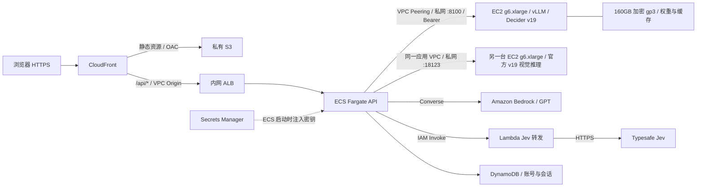

# AWS 部署

独立扩展方案：[AgentCore GPU EC2 架构与验证](../docs/AGENTCORE_GPU.md)，已验证 Runtime 管理 GPU、业务会话复用、Observability 和 Evaluations。其代码在 [StrandsDeciderAgentCore](https://github.com/milan9527/StrandsDeciderAgentCore) 维护；下文仍描述本演示现有的 ECS / vLLM / 视觉服务部署。

当前文字 Decider 请求使用共享 **vLLM / EC2 On-Demand `g6.xlarge`** 服务。工作台、工具守卫、支付固定／优化流程、自主闭环和模型路由共用这一入口。[图片决策](../docs/VISION.md)使用另一台现有 `g6.xlarge` 上的官方视觉服务；两台实例持续运行，业务 API 部署在 ECS Fargate。

访问地址：**https://d3i7ogfx5ml7dc.cloudfront.net**。资源和发布记录见 [DEPLOYED.md](DEPLOYED.md)。原版 ECS on EC2 的构建与启停方法归档至 [ORIGINAL_GPU.md](ORIGINAL_GPU.md)；历史 SageMaker 方案见 [SAGEMAKER.md](SAGEMAKER.md)。



## 当前配置

| 项目 | 实现 |
| --- | --- |
| 区域 | `us-east-1`；CloudFront / IAM 为全球资源 |
| 前端 | S3 四项 Block Public Access 全开、禁用 ACL；CloudFront OAC SigV4 读取 |
| API | 私有子网、内网 ALB；ARM64 Fargate 0.25 vCPU / 0.5 GiB，无公网 IP |
| vLLM | `i-0ae7eb0abcb815af3`，`g6.xlarge` / NVIDIA L4 24GB，On-Demand 常驻 |
| 私网入口 | `http://172.31.33.164:8100/v1/systemone`，经两个 VPC 之间的 Peering |
| 认证 | ECS Execution Role 读取 Secrets Manager JSON 字段 `api_key`，作为 `DECIDER_API_KEY` 注入 API；不返回浏览器 |
| 模型标识 | `strands-decider-2B-hobson-v19-vllm` |
| 图片服务 | `i-0daca64f56056aa1c` / L4；`http://10.78.1.15:18123`，仅业务 API 安全组可访问 |
| 图片模型与状态 | `strands-decider-2B-hobson-v19-vision`；`/api/vision/health` 单独检查 |
| 健康检查 | `/api/health` 验证模型响应中的 `engine=vllm`；`/api/gpu` 显示共享实例 |
| 登录 | 自建用户名／密码，DynamoDB 会话；不使用 Cognito |
| GPT / Jev | 原有 Bedrock Converse 和 IAM-only Lambda 转发路径不变 |

应用 VPC 没有互联网默认路由或 NAT Gateway。ECR、Logs、Bedrock、Lambda、Secrets Manager 使用 interface endpoints，S3 / DynamoDB 使用 gateway endpoints。图中省略这些网络端点。

共享 vLLM 位于另一 VPC。它有供出站使用的公共 IPv4，但 `8100` 不对互联网开放：安全组仅接受自身 CloudFront VPC Origin 与本演示 API 安全组。演示到模型使用私网路由，双向路由只覆盖模型 IP 和两个 API 子网。前端不访问模型 IP，不持有 vLLM 密钥。

vLLM 保留官方 v19 的决策头和 System One `choice` / `noul` / `score` 协议；部署、权重转换和独立性能测试见 [StrandsDeciderVLLM](https://github.com/milan9527/StrandsDeciderVLLM)。切换推理引擎不改变业务输入、候选条件、执行保护和比较方法。

## 并发与运行状态

- vLLM 路径不读取原版 GPU 状态表、不取得 DynamoDB 独占租约。演示 API 最多允许 128 个在途 Decider 请求；共享服务当前接受最多 256 个 HTTP 请求、vLLM 最多调度 128 个序列。
- 超过 API 槽位且等待超过 5 秒返回 `429`；上游限流也返回 `429`，不自动重复推理。上游通信或格式错误明确报错，不切回原版、不用回放替代真实结果。
- 工作台 `measure_decisions=true` 时，同一次请求中的问题仍依次执行以记录逐题耗时；不同 HTTP 请求可以并发。省略此参数则一次提交完整问题集。
- 顶部「GPU」显示实例和连接状态，`can_manage=false`。演示页面不启停共享实例；启停 API 返回 `409`。部署管理员通过 vLLM 项目维护服务。
- `/api/live` 和 `/api/ready` 不依赖模型在线，模型异常时登录与规则回放仍可用。`/api/health` 和 `/api/gpu` 显示真实连接情况；失败任务需要手动重新运行。
- 图片服务复用原版 GPU `i-0daca64f56056aa1c`，独立容器加载和预热后就绪，串行处理图片请求。文字 vLLM 与图片服务的状态、推理槽及计时独立；顶部 GPU 状态只对应文字服务。

## 更新部署

需要 AWS CLI、Docker、Python、uv 和相应 AWS 权限。镜像 tag 不可覆盖。

```bash
# 已切换的环境：保留现有 vLLM 资源参数，更新 API 与前端
uv run python deployment/deploy.py --region us-east-1 --api-only \
  --model-provider vllm --tag YOUR_UNIQUE_API_TAG

# 仅更新前端
uv run python deployment/deploy.py --region us-east-1 --frontend-only

# 第一次接入现有 vLLM 服务
uv run python deployment/deploy.py --region us-east-1 --api-only \
  --model-provider vllm --vllm-config .deployment/vllm-config.json \
  --tag YOUR_UNIQUE_API_TAG
```

`--vllm-config` 使用以下结构，只填写资源标识，**不包含密钥值**：

```json
{
  "VllmPrivateIp": "172.31.33.164",
  "VllmSecretArn": "arn:aws:secretsmanager:us-east-1:ACCOUNT:secret:NAME",
  "VllmInstanceId": "i-INSTANCE",
  "VllmSecurityGroupId": "sg-MODEL",
  "VllmRouteTableId": "rtb-MODEL",
  "VllmPeeringConnectionId": "pcx-EXISTING"
}
```

前置条件：两个 VPC 的网段不重叠，已建立同区域 Peering，模型 HTTP 服务监听 `8100`，Secrets Manager 中保存 JSON `{"api_key":"..."}`。主 stack 创建私网路由、到模型端口的安全组规则、单 AZ Secrets Manager endpoint 和限定到该密钥的执行角色权限。它不创建、替换或启停共享 EC2。

已有环境省略 `--model-provider` 与 `--vllm-config` 时保留原参数；显式使用 `--model-provider ec2` 会恢复旧部署模式，需先确认旧服务就绪。密钥轮换后需要重新部署 ECS Task 才会读取新值。

### 图片服务接入

先部署可用的官方视觉服务，再向主栈提供私网 URL 和其安全组：

```bash
uv run python deployment/deploy.py --region us-east-1 --api-only \
  --tag YOUR_UNIQUE_API_TAG \
  --vision-url http://10.78.1.15:18123 \
  --vision-security-group sg-077af78c8a42037c1
```

两个参数同时提供；后续省略时保留已有配置。主栈注入 `DECIDER_VISION_URL`，并添加仅允许 API 安全组访问 TCP 18123 的规则，不创建 GPU。

现有环境的首次安装脚本为 [deploy_vision.py](deploy_vision.py)：使用缓存模型镜像、固定上游源码及本地准备好的离线 wheel，经一次性 ECS 安装任务启动独立 Docker 容器。该脚本依赖当前账户的模型镜像、S3 桶和 ECS 主机，不是通用的一键创建实例脚本。容器 `unless-stopped`，依赖与缓存保存在宿主磁盘；模型先预热再接收请求。正式运行不需要临时安装任务。

## 登录与账号管理

账号和会话保存在 `strands-decider-demo-auth`。密码使用独立随机盐的 scrypt；服务端只保存会话令牌摘要。Cookie 为 `Secure`、`HttpOnly`、`SameSite=Strict`；重置密码或禁用账号撤销该账号的旧会话。写请求校验 Origin 与自定义请求头。

```bash
export AWS_REGION=us-east-1
export AUTH_TABLE=strands-decider-demo-auth
uv run python -m scripts.manage_users create alice
uv run python -m scripts.manage_users reset alice
uv run python -m scripts.manage_users disable alice
```

本机管理员凭据文件 `.deployment/admin-credentials.json` 不进入 Git、S3 或镜像。本地开发用 SQLite；仅本地 HTTP 调试设置 `AUTH_COOKIE_SECURE=false`。

## 验证与排查

```bash
# 文字 Decider 模块的真实调用，保存输入、输出与模型 ID
uv run python scripts/check_vllm_demo.py \
  --url https://d3i7ogfx5ml7dc.cloudfront.net \
  --credentials .deployment/admin-credentials.json \
  --output .deployment/vllm-live-verification.json

# 路由四场景的三模型真实界面对比
uv run --with playwright python scripts/check_routing_browser.py --live \
  --url https://d3i7ogfx5ml7dc.cloudfront.net \
  --credentials .deployment/admin-credentials.json \
  --output .deployment/vllm-routing-browser

# 图片模块：三模型实时推理、上传、对照方式与手机布局
uv run --with playwright python scripts/check_vision_browser.py --live \
  --url https://d3i7ogfx5ml7dc.cloudfront.net \
  --credentials .deployment/admin-credentials.json \
  --output .deployment/vision-browser.json

# API 日志
aws logs tail /ecs/strands-decider-demo --region us-east-1 --since 10m
```

检查 `/api/health` 中 `engine=vllm` 和 `model` 后缀 `-vllm`，以及 `/api/gpu` 的实例 ID。真实调用成功仅证明接入可用，不等于业务选择正确；历史原版测速和 JevBench 结果不能直接当作迁移后的结果。

登录失败先检查账号和会话；模型连接失败检查 vLLM 服务、双向 Peering 路由和 `8100` 安全组。ECS Task 启动失败检查 Secrets Manager endpoint、执行角色和 JSON 字段 `api_key`。不要将密钥或完整容器环境输出到日志。

图片不可用时检查 `/api/vision/health`、ECS 的 `DECIDER_VISION_URL`、TCP 18123 规则及视觉容器日志；文字 vLLM 健康不能证明图片服务健康。图片实时请求失败会显示错误，历史实测可独立查看。

图片对比的 Jev / GPT 复用现有 Lambda 转发与 Bedrock 权限。Jev 转发允许一张内联 PNG/JPEG、1–8 个 choice / noul，带图时添加官方图片启用请求头；仍拒绝任意 URL、调用方模型覆盖和多余字段。正式图片模型调用相互独立，单列失败不会替换为历史记录。

## 成本与资源维护

共享 `g6.xlarge` 为 $0.8048/小时，按 730 小时约 $587.50/月；160GB gp3 约 $12.80/月。新增单 AZ Secrets Manager interface endpoint 约 $7.30/月，另有数据处理费。Fargate、ALB、其他私有端点、公共 IPv4、存储、日志及 Jev / Bedrock 用量另计。

图片服务复用的原版 GPU 持续运行，计算与磁盘费用单独收取；按上述单价，两台 g6.xlarge 的计算费合计约 $1,175.01/月，其他费用另计。文字演示与公共 vLLM API 共用一台实例，计算费不能在两个项目中重复相加；共享实例停止会同时影响这两处文字入口。

日常发布只更新 API 和前端。删除演示主 stack 会删除其管理的 vLLM 路由和 API 访问规则，不会删除共享 EC2、vLLM 密钥或 vLLM CloudFront。原版 GPU 的完整清理步骤见归档；共享实例的清理由 vLLM 项目单独管理。
