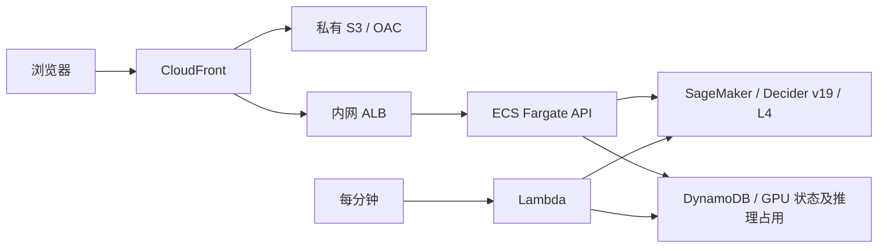

# SageMaker GPU

> 历史部署方案：2026-10-11 已切换到 EC2 On-Demand `g6.xlarge` 常驻运行。SageMaker Endpoint 已释放，`ControllerState=DISABLED`；Model、EndpointConfig 和镜像保留。当前运维见 [README.md](README.md)。下文的闲置释放规则仅适用于此历史 SageMaker 方案。

前端仍为私有 S3 + CloudFront OAC，业务 API 仍运行于 ECS Fargate。模型改为 us-east-1 的 SageMaker 实时推理 Endpoint，使用 `ml.g6.xlarge`（L4 24GB），2026-10-09 查询的计算参考价为 **$1.1267/小时**。



## 启动、停止和费用

- 所有模块顶部都有「GPU」公共入口；支付页的「GPU 管理」打开同一个弹窗，实际启停按钮只有一组。真实推理前检查最新状态，未启动、启动中、停止中或状态未知时自动弹窗并阻止推理。管理员可启动，非管理员可查看状态并联系管理员。
- 弹窗每 5 秒刷新；启动完成后返回原模块重新运行，不自动提交等待期间的旧输入。示例／规则回放无需 GPU。图示省略私有端点节点，网络实现仍见下文。
- 「启动 GPU」创建固定名称 `strands-decider-demo-decider` 的 Endpoint，最多一台 GPU。模型完成加载、CUDA 预热和 SageMaker 健康检查后，界面显示就绪。
- 「停止 SageMaker GPU」先阻止新推理，等待当前推理结束，再删除推理 Endpoint。模型镜像、SageMaker Model 和 EndpointConfig 保留，再次启动时复用这些配置。
- 最后一次推理完成后闲置 30 分钟，自动执行同样的删除流程；刷新页面不延长运行时间。
- 启动超过 20 分钟或 SageMaker 报告失败时，自动请求停止并清理 Endpoint。AWS 拒绝删除仍在 `Creating` 的 Endpoint，此时保留停止请求，每分钟重试，等 AWS 创建流程结束后删除。页面会明确展示等待清理，不会误报已停止或再创建一台 GPU。配额允许创建不代表存在即时 GPU 容量。
- 这是创建 / 删除 GPU Endpoint，不是 EC2 Stop，也不是无 GPU 的 Serverless Inference。再次启动仍需要分配硬件、拉取镜像和加载模型，不保证比保留磁盘的 EC2 更快。
- 原 EC2 保持停止，原 80GB 加密磁盘保留作为回退，约 $6.40/月。SageMaker 不使用这块磁盘。常驻 ECS API、ALB、VPC endpoints、ECR 等费用另计。

SageMaker Controller 只允许管理此固定 Endpoint；DynamoDB 的请求代次和推理占用防止并发启停误删正在执行的推理。原 EC2 控制器在 CloudFormation 中设置为 `DISABLED`，代码也拒绝处理 SageMaker 状态，避免重新启动旧 GPU。

## 模型与网络

- 原有官方 v19 权重、CUDA 12.6 和模型代码保持一致，使用既有 CUDA 镜像构建一个很小的适配层。
- SageMaker 容器监听 8080：`/ping` 转发模型健康检查，`/invocations` 转发 `/v1/systemone`。模型错误和逐项计时继续传给业务 API，不生成示例结果来替代真实推理。
- 指定 `al2023-ami-sagemaker-inference-gpu-4-1`，使用 NVIDIA 580 驱动，满足已有 CUDA 镜像需求。
- 模型启用网络隔离。镜像内已有全部权重，运行时不访问 Hugging Face。
- ECS 使用签名的 `InvokeEndpoint`，经一个私有 SageMaker Runtime interface endpoint 访问；IAM 和 endpoint policy 都限定到此 Endpoint ARN。前端 S3 仍禁止公共访问。

## 发布

在项目根目录运行：

```bash
# 基于已有、验收过的 CUDA 镜像构建适配层及 SageMaker 控制资源
python -m deployment.deploy_sagemaker --region us-east-1 --tag YOUR_NEW_TAG

# 停止旧 GPU 后禁用旧控制器；已禁用时后续部署保持该设置
python deployment/deploy_gpu.py --region us-east-1 \
  --tag 20261009-gpu1 --disable-controller

# 切换 ECS API 和前端
python deployment/deploy.py --region us-east-1 --api-only \
  --model-provider sagemaker --tag YOUR_NEW_API_TAG

# 检查旧 EC2 / ECS GPU 已停止，切换共享状态表并创建 SageMaker Endpoint
python -m deployment.deploy_sagemaker --region us-east-1 \
  --tag YOUR_NEW_TAG --skip-build --activate
```

常规更新 API 可以省略 `--model-provider`，脚本会保留当前配置。更新模型镜像前先停止 SageMaker GPU，再发布新 tag。模型服务、EndpointConfig 和控制器由 `strands-decider-demo-sagemaker` stack 管理；Endpoint 本身由控制器创建和删除。

```bash
python deployment/verify.py --region us-east-1 \
  --credentials .deployment/admin-credentials.json --gpu-state ready

uv run --with playwright python scripts/check_gpu_browser.py \
  --url https://d3i7ogfx5ml7dc.cloudfront.net \
  --credentials .deployment/admin-credentials.json --action stop
```

完整清理前先停止 GPU，确认 SageMaker Endpoint 已不存在，再删除 SageMaker stack。旧 EC2 和磁盘保留资源的清理步骤见 [README.md](README.md#清理)。
