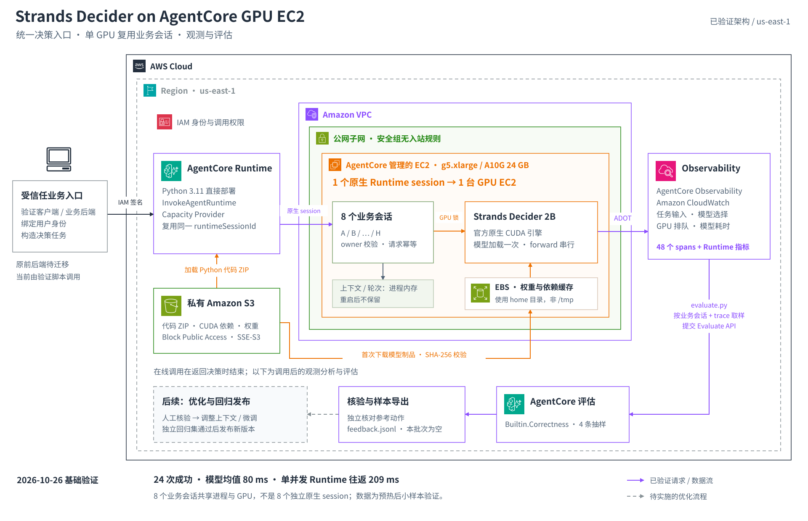

# Strands Decider on AgentCore GPU EC2

**已验证：通过 Amazon Bedrock AgentCore Runtime，在 AgentCore 管理的按需 GPU EC2 内运行 Strands Decider。** 单台 GPU 只加载一次模型，复用多个业务会话；真实决策 traces 接入 Observability，再调用 AgentCore Evaluations 评估。

实现位于独立项目 [StrandsDeciderAgentCore](https://github.com/milan9527/StrandsDeciderAgentCore)。本页与架构图同步到 StrandsDecider，便于查看方案与结果。独立仓库当前为私有，访问完整代码和原始记录需要仓库权限。

当前在线演示继续使用既有的 ECS、文字 vLLM 与图片视觉服务；其完整前后端尚未迁入 AgentCore。本页数据来自 **2026-10-26 的独立验证**，不计入原项目的三模型性能或场景准确率汇总。

## 方案架构

[](diagrams/agentcore-gpu-architecture.svg)

[SVG 矢量图](diagrams/agentcore-gpu-architecture.svg) · [高清 PNG](diagrams/agentcore-gpu-architecture.png) · [实测摘要 JSON](results/agentcore-gpu-2026-10-26/summary.json) · [来源与校验信息](results/agentcore-gpu-2026-10-26/provenance.json)

架构图使用 AWS 官方图标。实线表示已验证的请求、数据和制品流向，响应省略；灰色虚线表示待实施的优化流程。模型在 AgentCore 管理的 EC2 内部执行。

| 组件 | 已验证实现 |
| --- | --- |
| 调用入口 | 受信任验证客户端通过 IAM 签名调用 `InvokeAgentRuntime` |
| AgentCore Runtime | Python 3.11 直接部署；接收业务事实、问题与候选项 |
| Capacity Provider | 管理 GPU 机型、子网、角色及原生 session 对应的实例生命周期 |
| GPU EC2 | us-east-1，按需 **g5.xlarge / A10G 24 GB**，官方 Decider v19 原生 CUDA 引擎 |
| 业务会话 | 8 个 `business_session_id`，分别保存状态与轮次，检查归属及请求幂等 |
| 私有 S3 / EBS | S3 保存代码 ZIP、CUDA 依赖和权重，开启全部 Public Access Block；首次下载并校验 SHA-256，缓存在 EBS |
| Observability | AgentCore SDK + ADOT，将真实输入、选择、分段耗时与 trace 写入 CloudWatch |
| Evaluations | 按业务会话与 trace 提取实际 spans，调用 `Evaluate / Builtin.Correctness` |

当前实例在**公网子网**，安全组没有入站规则；业务访问使用 IAM 保护的 AgentCore API，没有向公网开放模型端口。公网子网用于出站通信，不能将它标为私有子网。模型与依赖缓存位于 EBS 上的 home 目录，业务会话状态则暂存于进程内存。

## 单台 EC2 怎样服务多个会话

AWS 原生 `(Capacity Provider, runtimeSessionId)` 与 EC2 是 **1:1**。要复用一台 GPU，调用方固定一个原生 `runtimeSessionId`，在请求体中区分多个 `business_session_id`。

```text
一个 Capacity Provider + 一个原生 runtimeSessionId
└── 一台 AgentCore 管理的 GPU EC2
    └── 同一个 Runtime 进程、同一份 Decider 模型
        ├── 业务会话 A：owner、上下文、轮次、请求记录
        ├── 业务会话 B：owner、上下文、轮次、请求记录
        └── … 共 8 个业务会话
```

每次请求先检查 `owner_id` 与会话归属；重复 `request_id` 返回原结果，不重复推进轮次。后两轮测试不重传业务状态，实际读取对应会话保存的上下文。

这是应用内的业务状态隔离，不提供独立进程或操作系统隔离。`owner_id` 必须由受信任后端从认证身份生成，不能相信浏览器自行声明的身份。原生 session ID 改变可能创建另一台实例；业务状态在进程重启后丢失，EBS 模型缓存不等于业务状态持久化。

## 请求与观测路径

1. 调用方提交业务事实、问题及候选条件，通过 `InvokeAgentRuntime` 进入共享原生 session。
2. Runtime 校验业务会话与请求 ID，获取 GPU 锁后执行 Decider。
3. 返回模型选择、轮次、GPU 排队、模型执行及 handler 耗时。客户端另外记录完整 Runtime 往返时间。
4. ADOT 输出 `invoke_agent decider` 和 `decider.gpu.evaluate` spans，以业务会话、原生 session、request ID 和 trace ID 关联输入、输出与耗时。
5. 决策结束后，评估脚本读取 CloudWatch 实际 spans，再调用 AgentCore Evaluations；这部分时间不计入在线决策延迟。

本轮引擎使用 GPU 锁串行执行 forward，多个请求可进入 Runtime 并等待 GPU。**8 个业务会话并不代表 8 路并行 GPU forward**。vLLM 尚未接入这个 AgentCore Runtime。

## 实测结果

测试包含 4 类简单场景：支付已确认选择 `settle`、支付仅 3/12 确认选择 `wait`、支付客服选择 `payments`、账户安全客服选择 `security`。每类分配两个业务会话，运行三轮，共 24 次决策。

| 检查 | 实际结果 |
| --- | --- |
| GPU 实例 / 原生 session / 业务会话 / 模型加载次数 | **1 / 1 / 8 / 1** |
| 决策成功 / 与预定义参考一致 | **24/24 / 24/24** |
| 状态与身份检查 | 8 个会话均保留自己的 3 轮记录；跨用户访问被拒绝 |
| 幂等检查 | 相同请求 ID 返回第一次结果，不增加轮次 |
| GPU 执行证据 | 参数位于 `cuda:0`，约 3.84 GB 显存分配；GPU UUID 与进程标识一致 |
| Observability | 24 个请求 spans + 24 个 GPU spans，共 **48 个**，可见 Runtime 指标 |
| AgentCore Evaluations | 每类场景抽一条实际 trace，共 **4 条 Correct，分数均为 1.0** |

| 客户端并发 | 请求数 | 模型耗时均值 | GPU 排队均值 | Runtime 往返均值 | Runtime 往返 P50 |
| --- | ---: | ---: | ---: | ---: | ---: |
| 1 | 16 | **80.22 ms** | 0.00 ms | **209.48 ms** | 208.06 ms |
| 8 | 8 | **81.82 ms** | 269.82 ms | **477.01 ms** | 476.28 ms |

模型耗时包含 Decider 执行和 CUDA 同步；Runtime 往返还包含服务调用、排队和响应传输，不能混用。并发增加后，GPU 排队是延迟增长的主要来源。

以上为预热后的基础设施冒烟测试，不是持续吞吐测试，也不是通用模型准确率。4 类场景重复运行得到的 24/24，不代表 24 个独立业务案例。首次制品准备、权重加载及内核预热共 136.91 秒，该轮 GPU EC2 已存在，不能视为全新 EC2 的完整冷启动时间。

## 评估闭环做到哪一步

| 阶段 | 当前状态 |
| --- | --- |
| 收集 | 已保存真实输入、候选条件、模型选择、GPU 排队和执行 traces |
| 评估 | 已按业务会话及 trace 抽样调用 AgentCore `Builtin.Correctness`，附预先定义的参考动作 |
| 错误样本出口 | 独立核对业务参考，选择不一致的记录可写入 `feedback.jsonl`；本批次为空 |
| 调整与发布 | 后续人工核验，调整上下文、判断条件或微调数据，在独立回归集通过后发布 |

CloudWatch 不会因图中的连线自动触发评估，当前由 `evaluate.py` 显式调用；也尚未实现自动改提示词、自动微调或自动发布。评估器的 `Correct` 不能代替真实业务完成。

下一步应将工具执行结果与最终业务状态加入 trace。例如分别记录“模型选择结算”与“结算实际成功”，再判断继续执行、修正、等待或转人工。这样才能用业务结果评价和改进模型。

## 部署过程与后续迁移

验证采用 **Python 直接部署**：从固定 digest 的上游 GPU 镜像提取模型、CUDA 和依赖制品，保存到私有 S3；SDK、ADOT 与 Runtime 入口打包为约 32.9 MB 的代码 ZIP。启动时下载制品并校验，不修改模型张量。

原约 7.13 GB GPU 镜像超过本账号 3072 MB 的镜像配额；缩小后的容器实验也未通过启动验证，因此不作为已验证方案。g6.xlarge 在多个可用区遇到容量不足，最终使用 g5.xlarge 完成验证。

验证结束后已通过 `DeleteCapacityProviderSession` 释放本次 GPU EC2。Runtime、Capacity Provider 和制品保留便于重跑；重新调用会创建 GPU 并产生费用。`StopRuntimeSession` 只结束 agent 进程，不能等同于释放整个 GPU session。

后续接入目标为：**现有 CloudFront / 私有 S3 前端 → ECS 业务 API → IAM InvokeAgentRuntime → AgentCore 管理的 GPU**。需要完成可信身份绑定、原生 session 生命周期管理、业务状态持久化，以及各演示模块的请求适配。该迁移尚未完成。

完整实现及复现入口（需要独立仓库权限）：

- [Runtime、部署、验证与评估脚本](https://github.com/milan9527/StrandsDeciderAgentCore/tree/main/agentcore)
- [部署步骤与权限配置](https://github.com/milan9527/StrandsDeciderAgentCore/blob/main/docs/AGENTCORE_GPU.md)
- [架构与调用路径](https://github.com/milan9527/StrandsDeciderAgentCore/blob/main/docs/AGENTCORE_ARCHITECTURE.md)
- [原始决策、spans、评估与资源释放记录](https://github.com/milan9527/StrandsDeciderAgentCore/tree/main/validation/agentcore_gpu)

AWS 官方依据：

- [Runtime Instances 工作方式](https://docs.aws.amazon.com/bedrock-agentcore/latest/devguide/runtime-instances-how-it-works.html)
- [创建 GPU Runtime](https://docs.aws.amazon.com/bedrock-agentcore/latest/devguide/runtime-instances-get-started-cli.html)
- [会话与安全边界](https://docs.aws.amazon.com/bedrock-agentcore/latest/devguide/runtime-instances-security.html)
- [Observability 配置](https://docs.aws.amazon.com/bedrock-agentcore/latest/devguide/observability-configure.html)
- [按需评估真实 spans](https://docs.aws.amazon.com/bedrock-agentcore/latest/devguide/getting-started-on-demand.html)
