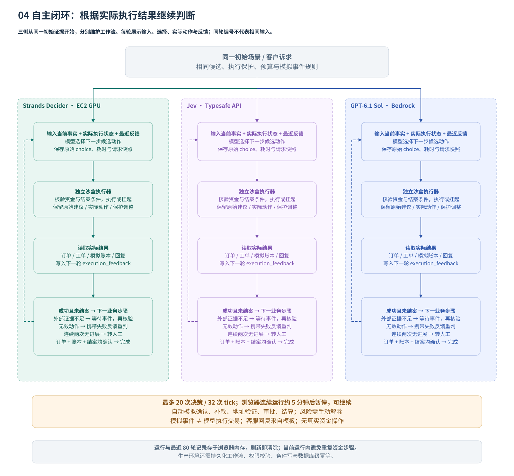
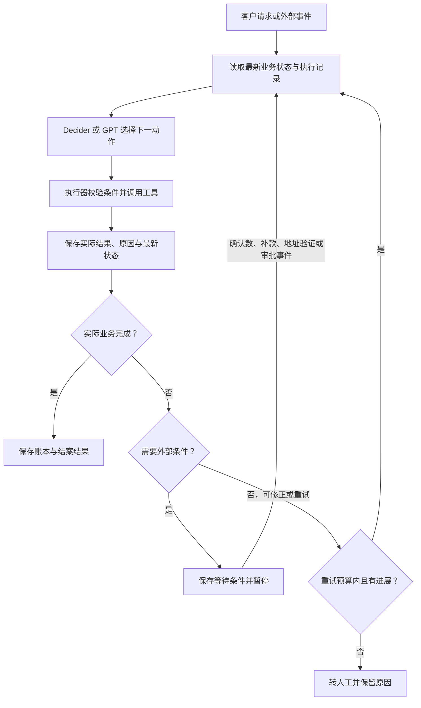

# 根据执行结果调整的闭环工作流

`crypto7` 引入自主闭环，`crypto8` 将它收为对比测试的一个选项。每次模型判断后执行实际沙盒动作，将结果反馈给下一次判断；遇到外部条件不足时等待事件，遇到无效选择时有限重判。原来的固定输入五步对比继续保留。

`crypto10` 在耗时卡片下方默认展开每轮输入／输出。两侧按各自请求轮次展示当时的客户诉求、交易证据、执行状态、上轮反馈、模型选择和实际执行结果；轮次编号不表示两侧输入相同。模拟器事件单独标注未调用模型；失败续跑追加记录，不覆盖失败输入。可切换历史对比并导出最近 80 轮原始业务请求与响应，客服模板回复在主区域同步展示。

这是当前页面内的有界业务演练：ECS 每次处理一个闭环请求，浏览器保存运行状态和审计历史。刷新或退出会清除演练；尚未实现持久化、浏览器关闭后的后台运行或跨请求的数据库去重。所有资金动作都是模拟记录。

2026-10-10 已完成 USDC 未到账与退款两组真实闭环观测，两模型均完成模拟订单、账本与结案；每侧分别返回 6 / 9 次决策、推进 1 / 2 个模拟事件。这是两例成功观测，不是通用完成保证，且不混入固定输入配对速度统计。见 [原始观测](presentations/v2/loop-observations.json) 与 [最新 v6 文稿](presentations/v6/README.md)。当前部署已改为 EC2 `g6.xlarge` 常驻服务；上述观测仍标注为迁移前 SageMaker 环境的历史实测。v6 新增的优化流程是固定五步的输入优化，未自动补齐证据，与本页反馈闭环分开演示。

## 如何演示

1. 选择真实模型或规则回放。当前常驻模式直接提交推理，不在每次运行前查询 GPU；Decider 连接、超时或服务端错误后才检查状态，未就绪或状态未知时打开共用的 GPU 管理弹窗。管理员恢复服务后可继续对比；规则回放无需 GPU。
2. 在顶部「测试方式」选择「自主闭环」，点击「开始对比」。两侧从相同初始证据出发，各自根据执行反馈调整。
3. 默认勾选「自动推进模拟证据」：等待时由模拟器依次提供确认、补款、地址验证、审批或结算证据，事件标注来源。这不是模型实际操作链上资金或获得真实审批。风险标记始终需要手动解除。
4. 关闭自动事件时，流程停在等待状态。点击「推进模拟交易」中的对应事件后，保留运行 ID、决策与账本历史，自动继续当前闭环。
5. 查看每轮的原始建议、实际动作、反馈原因，以及最终资金与结案结果。暂停或请求失败后可点击「继续本次对比」；已完成的一侧不会再次运行。

本实现最多返回 20 次决策、处理 32 个 tick；同一步连续两次无进展转人工，不用规则答案覆盖模型。浏览器每次连续运行超过 5 分钟时在当前请求结束后暂停。只有实际订单状态、对应模拟账本和结案结果满足条件，才显示闭环完成。

## 每次执行后重新判断

每次模型输入包含最新业务事实、实际订单和工单状态、最近 8 条执行反馈，以及当前候选动作。反馈字段为 `stage`、`status`、`requested_action`、`actual_action` 和 `reason`。运行状态另含 `next_stage`、`waiting_events`、预算计数与唯一账本记录。`applied=true` 仅表示步骤已处理，不能解释为资金任务成功。

Decider 仍然选择有限候选动作；应用负责调用工具、读取反馈和继续调度。闭环由模型与编排器共同实现，不要求 Decider 生成长文本或自行操作钱包。

## 退款示例

1. 地址或审批未满足时，审批步骤记录实际结果，编排器返回 `waiting_external`，账本保持不变。
2. 将阻塞原因和当前状态写入该工作流，向客户回复“等待审批”，暂停资金操作。
3. 演示中由用户或明确标记的模拟器提供审批事件，重新核验后恢复工作流。真实系统必须由授权人员提供可验证的审批事件。
4. 模型收到“地址已验证、审批已通过”的最新事实，重新选择退款。
5. 执行器保存模拟退款账本和实际退款状态；运行内的 `operation_id` 绑定运行 ID 与资金动作。之后重复结案判断不会再次提交资金步骤。
6. 下一次判断收到真实执行结果，选择结案；结案执行成功后才标记业务完成。

如果普通支付被错误送入退款审批，而实际业务条件已满足，反馈会说明该场景不要求退款审批，回到审批节点重判。资金不足、确认数不足、真实审批缺失等情况必须等待相应事件；反复调用模型不会补齐外部事实。

## 当前实现入口

| 位置 | 实现 |
| --- | --- |
| `app/crypto_loop.py` | `POST /api/crypto/loop/tick`：判断、执行、反馈、等待、模拟事件、重判和预算控制 |
| `app/crypto.py` | `Decision.execution_feedback` 与 `payload_for()`：把实际状态和反馈传给模型 |
| `frontend/static/crypto.js` | 两侧独立运行、GPU 检查、逐轮时间线、暂停与继续、手动事件恢复、结果导出 |
| `tests/test_crypto_loop.py` | 四场景、两种提供方、反馈重判、无进展转人工、等待与账本去重验证 |
| `scripts/check_crypto_loop_browser.py` | GPU 状态提示与模拟启动、实际回放闭环接口、手动事件续跑、失败恢复和移动布局 |

前端导出的 `executions` 保存 `loopState`、完整 `decisionHistory`、`events`、`timeline` 和 `audit`。固定输入模式的输入指纹与旧统计口径保持独立。

## 生产化还需要的改动

| 位置 | 改动 |
| --- | --- |
| ECS 后端 | 把当前单步接口接入后台调度，浏览器关闭后也可恢复 |
| 业务状态 | 用独立 DynamoDB 工作流表保存实例、状态版本、等待事件、尝试历史与结果；使用条件写控制并发 |
| 执行接口 | 以持久化状态为准，新增状态版本和幂等请求校验；不要信任客户端传回的金融状态 |
| 外部事件 | 接入真实事件来源与审批权限；写入持久化工作流后恢复待办 |
| 恢复调度 | 演示可由 ECS 接收事件后续跑；需要跨重启恢复与可靠重试时，使用持久化队列或 Step Functions |

当前运行内已经支持失败节点重判、等待事件恢复和预算限制。跨请求金融幂等、跨浏览器与服务重启恢复仍需要持久化工作流；当前的客户端状态和 `operation_id` 不能替代生产数据库的唯一约束。

## 重试与幂等

- 外部条件不足立即进入等待，不循环请求模型。相同事件只应用一次。
- 短暂工具错误可有限退避重试；调用超时而结果未知时，先查询工具状态，不能直接重复转账。
- 本演示同一步连续两次无进展即转人工，并设置整个运行的调用数与 tick 上限。生产环境还需把总耗时和费用预算持久化。
- 同一状态重复选择同一无效动作时转人工。状态指纹包含业务事实和有意义的执行反馈，不能用不断增长的时间戳假装有进展。
- 幂等键绑定业务操作（如订单 ID + 退款请求 ID），重判轮次不能产生新的资金操作键。状态版本和条件写防止两个并发事件重复执行。
- 审计保留所有失败及修正；应用修正或 GPT 接管必须标记来源，不能计为 Decider 原始决策成功。

## 如何公平比较

固定输入与闭环模式分开展示。闭环中两个模型从相同初始证据开始，各自维护独立工作流，使用相同模拟事件规则；预算、候选动作和执行约束相同。

第一次选择后两侧可能进入不同状态，因此不能继续把所有后续调用算作“相同输入配对”。本版本显示两侧完成状态、全部返回的决策及其耗时、逐轮记录和最近一次闭环运行时间；暂停期间的人为等待不计入推理时间。后续批量评测应另统计业务完成率、无效动作和人工接管次数，并单列外部等待时间。
