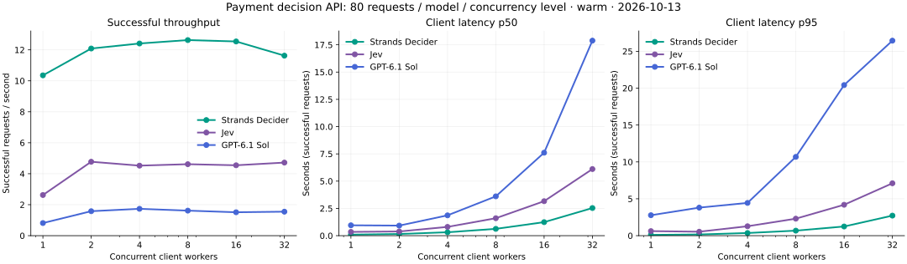
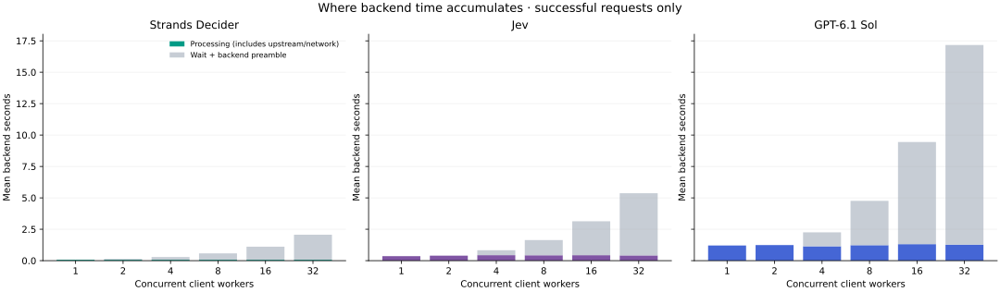

# 三模型并发性能测试 · 2026-10-13

测量 2026-10-13 部署的支付决策 API：客户端并发增加时，吞吐、延迟、排队和失败如何变化。这是完整应用路径的承载测试，保留当时服务并发限制；没有扩容、修改模型权重或执行模拟资金动作。

**历史配置说明：** 本文 Decider 为原版串行引擎。2026-10-16 起演示已切换共享 vLLM，取消原版串行租约；以下数据保持原值，不代表当前配置的并发上限或吞吐。

**正式请求 1440 次，成功 1440 次，失败 0 次；另有 120 次预热，不进入正式统计。**

- **Strands Decider**：并发 1 → 32，吞吐 10.35 → 11.62 次/秒；p95 107.0 → 2719.2 ms。本轮最高吞吐 12.63 次/秒（并发 8）。
- **Jev**：并发 1 → 32，吞吐 2.63 → 4.72 次/秒；p95 617.5 → 7105.4 ms。本轮最高吞吐 4.77 次/秒（并发 2）。
- **GPT-6.1 Sol**：并发 1 → 32，吞吐 0.81 → 1.55 次/秒；p95 2773.9 → 26446.1 ms。本轮最高吞吐 1.73 次/秒（并发 4）。



## 测试方法

- 路径：测试客户端 → CloudFront → ALB → ECS FastAPI → 模型服务。
- 请求单位：一个模型对一个业务步骤进行一次判断；统计的延迟与吞吐都以这个单位计算。
- 并发档位：1、2、4、8、16、32；每档每模型 80 次，三个模型分开测试，模型顺序随档位轮换。
- 输入：四个支付场景 × 五个步骤 = 20 个优化输入，各重复 4 次；使用相同的确定性打乱顺序。每次成功响应都验证实际模型输入与指纹。
- 固定并发施压：每个客户端请求完成后立即补下一个，无思考时间。固定 80 次包含起步与末尾排空；每模型单独发压。
- 所有输入先预热；每档还预热 Decider 一个执行槽、Jev/GPT 两个执行槽。暖请求原值另存，正式数据不扣减开销、不挑选较快请求。
- p50/p95 使用 nearest-rank；表中延迟只统计成功请求。原始统计同时保留全请求和失败延迟；吞吐为成功请求数 / 本档实际经过时间。
- HTTP 客户端复用连接，连接池支持最高并发；不自动重试失败请求。后端现有连接重试策略保持原样。
- 只请求决策接口，未执行支付步骤、启停 GPU 或更改生产配置。

每档只有 80 个混合任务样本，p95 是本轮观测，不报告 P99 或承诺生产 SLA。未运行持续时间型开放负载、长时间浸泡、突发流量或多租户公平性测试。

## 部署与并发上限

| 层级 | 本次配置 |
| --- | --- |
| 业务后端 | 1 个 ECS Fargate task，0.25 vCPU / 512 MiB，当前容器入口为 1 个 Uvicorn worker，镜像 strands-decider-demo-api:20261012-triple1 |
| Decider | EC2 On-Demand g6.xlarge / NVIDIA L4；业务进程锁与模型服务锁均串行，另有 DynamoDB 独占推理租约 |
| Decider 排队 | 业务进程锁等待超过 5 秒返回 HTTP 429 |
| Jev | 每个 API 进程 2 个调用槽；经 Lambda → HTTPS；总期限 50 秒，包含等待调用槽 |
| GPT | 每个 API 进程 2 个调用槽；Bedrock GPT-6.1 Sol / low；总期限 45 秒，包含等待调用槽 |

客户端并发 32 不等于 GPU 同时执行 32 次推理。`max_batch=8` 也不表示当前服务支持八个 HTTP 请求同时推理。这轮结果不能用于宣布某模型或供应商的最大吞吐。

## 完整结果

客户端延迟单位 **ms**；吞吐单位 **成功请求/秒**。客户端计时包含认证、HTTP 往返、API 排队及模型处理。它比 PPT 中的 `backend_total_ms` 多了客户端路径，不能直接混为同一指标。

| 模型 | 并发 | 成功/尝试 | 吞吐 | 平均延迟 | p50 | p95 | 最大延迟 |
| --- | ---: | ---: | ---: | ---: | ---: | ---: | ---: |
| Strands Decider | 1 | 80/80 | 10.35 | 96.5 | 94.3 | 107.0 | 166.8 |
| Strands Decider | 2 | 80/80 | 12.09 | 164.4 | 154.8 | 164.2 | 544.0 |
| Strands Decider | 4 | 80/80 | 12.41 | 316.2 | 313.3 | 359.6 | 494.0 |
| Strands Decider | 8 | 80/80 | 12.63 | 605.9 | 624.8 | 680.0 | 684.1 |
| Strands Decider | 16 | 80/80 | 12.54 | 1158.8 | 1239.9 | 1245.0 | 1422.9 |
| Strands Decider | 32 | 80/80 | 11.62 | 2255.0 | 2533.9 | 2719.2 | 3039.5 |
| Jev | 1 | 80/80 | 2.63 | 380.8 | 346.3 | 617.5 | 825.3 |
| Jev | 2 | 80/80 | 4.77 | 416.0 | 385.9 | 536.5 | 1783.0 |
| Jev | 4 | 80/80 | 4.52 | 871.4 | 804.8 | 1278.3 | 1875.6 |
| Jev | 8 | 80/80 | 4.62 | 1673.2 | 1600.3 | 2304.8 | 2644.3 |
| Jev | 16 | 80/80 | 4.55 | 3252.9 | 3162.2 | 4191.2 | 5000.0 |
| Jev | 32 | 80/80 | 4.72 | 5731.5 | 6108.0 | 7105.4 | 7564.7 |
| GPT-6.1 Sol | 1 | 80/80 | 0.81 | 1227.1 | 951.3 | 2773.9 | 5581.9 |
| GPT-6.1 Sol | 2 | 80/80 | 1.58 | 1261.0 | 923.0 | 3802.9 | 6631.7 |
| GPT-6.1 Sol | 4 | 80/80 | 1.73 | 2277.6 | 1863.9 | 4442.1 | 8390.0 |
| GPT-6.1 Sol | 8 | 80/80 | 1.62 | 4786.4 | 3606.2 | 10684.1 | 14398.3 |
| GPT-6.1 Sol | 16 | 80/80 | 1.51 | 9498.4 | 7608.0 | 20422.8 | 20782.4 |
| GPT-6.1 Sol | 32 | 80/80 | 1.55 | 17325.5 | 17882.7 | 26446.1 | 26888.5 |

## 后端处理与等待



`processing_ms` 包含模型调用及通信。`backend_total_ms - processing_ms` 是后端等待和前置处理的近似值；Decider 还包含取得推理租约的时间，不能全当作纯锁等待。两项都不是 GPU 纯计算或 Jev 纯推理时间。

| 模型 | 并发 | 后端总时间均值 ms | processing 均值 ms | 等待及前置均值 ms |
| --- | ---: | ---: | ---: | ---: |
| Strands Decider | 1 | 74.3 | 69.3 | 5.0 |
| Strands Decider | 2 | 138.0 | 68.2 | 69.9 |
| Strands Decider | 4 | 290.0 | 69.5 | 220.5 |
| Strands Decider | 8 | 580.3 | 69.4 | 510.9 |
| Strands Decider | 16 | 1111.8 | 68.3 | 1043.6 |
| Strands Decider | 32 | 2065.5 | 71.9 | 1993.6 |
| Jev | 1 | 361.0 | 360.9 | 0.1 |
| Jev | 2 | 397.4 | 397.3 | 0.1 |
| Jev | 4 | 829.5 | 439.0 | 390.5 |
| Jev | 8 | 1639.1 | 430.4 | 1208.7 |
| Jev | 16 | 3135.5 | 435.7 | 2699.8 |
| Jev | 32 | 5369.1 | 419.8 | 4949.3 |
| GPT-6.1 Sol | 1 | 1206.9 | 1206.8 | 0.1 |
| GPT-6.1 Sol | 2 | 1244.4 | 1244.2 | 0.1 |
| GPT-6.1 Sol | 4 | 2254.6 | 1146.3 | 1108.2 |
| GPT-6.1 Sol | 8 | 4761.2 | 1232.7 | 3528.5 |
| GPT-6.1 Sol | 16 | 9444.5 | 1316.6 | 8127.9 |
| GPT-6.1 Sol | 32 | 17167.5 | 1276.9 | 15890.6 |

Decider 从并发 1 到 32，模型服务自报平均耗时为 65.7 → 65.8 ms；后端等待及前置处理则为 5.0 → 1993.6 ms。模型服务自报时间也不是单独的 GPU kernel 时间。

## 调用失败与选择结果

| 模型 | 成功/尝试 | HTTP 状态 | 与演示参考一致/成功 |
| --- | ---: | --- | ---: |
| Strands Decider | 480/480 | {'200': 480} | 432/480 |
| Jev | 480/480 | {'200': 480} | 480/480 |
| GPT-6.1 Sol | 480/480 | {'200': 480} | 480/480 |

重复请求用于观测性能与输出变化，不能把同一 20 个任务的重复次数当成更多独立业务评测样本；参考一致仍不等于通用准确率。本次没有执行业务流程，不能据此统计资金完成率。

## Lambda 与 ECS 观测

Jev 各档 Lambda START/REPORT 数量与请求数全部一致；正式测量窗口内有 **0 次**包含初始化记录。

日志按每档测试的开始/结束时间归组；并发请求未逐条关联，因为应用不返回 Lambda RequestId。这只能观察本项目代理环境，不能证明上游 Jev 没有冷启动，也无法分离其纯推理时间。

ECS CPU / 内存按 60 秒采样，原始值随证据保存；相邻模型及预热可能落入同一个采样点。CloudWatch 数据可能延迟到达，最新采样时间和测试结束分钟单独记录。没有 GPU 利用率样本，因此不根据应用排队推断 GPU 利用率或模型极限。

## 如何使用结论

本次配置中，Decider 受串行执行与独占租约约束；Jev/GPT 受两调用槽约束。高客户端并发主要让请求等待，是否增加吞吐要看表中实际值。继续优化时，应分别评估 API CPU、认证/租约开销、上游调用槽、模型批处理和副本数，重新测试后再调整容量。

不要直接移除 Decider 锁：当前推理引擎含可变状态。需要先验证受支持的批处理或多实例方案。提高 Jev/GPT 调用槽也须重测供应商限额、后端资源和超时行为，当前未部署这些改动。

## 原始证据与复现

- [测试配置、各档统计](results/concurrency-2026-10-13/manifest.json)
- [逐请求输入索引、输出、计时和错误](results/concurrency-2026-10-13/requests.jsonl)
- [20 个输入与发起顺序](results/concurrency-2026-10-13/corpus.json) · [预热记录](results/concurrency-2026-10-13/warmups.jsonl)
- [实际部署快照](results/concurrency-2026-10-13/deployment-snapshot.json) · [Lambda / ECS 日志指标](results/concurrency-2026-10-13/infrastructure-metrics.json)
- [数据验证](results/concurrency-2026-10-13/verification.json)

```bash
# 会调用真实模型；输出目录必须是新的目录，凭据不会写入结果。
uv run python scripts/benchmark_concurrency.py \
  --credentials .deployment/admin-credentials.json \
  --output docs/results/concurrency-NEW-DATE

uv run python scripts/collect_concurrency_metrics.py docs/results/concurrency-NEW-DATE
uv run --with matplotlib python scripts/report_concurrency.py docs/results/concurrency-NEW-DATE
```
