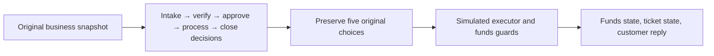

# Five-model validation report: method, results and use cases

[中文](FIVE_MODELS_COMPARISON.md) · [Demo](https://d3i7ogfx5ml7dc.cloudfront.net/#comparison) · [README](../README.md)

This report documents real validations completed on 2026-10-29 for Strands Decider, Liquid d1-2B, H2O-Lightning 4B, Jev and Bedrock GPT: four payment cases, four original routing cases and three device-control cases. No inference was rerun or test input changed to prepare this report. Quoted task text remains in its original Chinese.

## 1. Main results

| Model | Mean payment step | Payment reference matches | Mean two-step routing | Correct workflow types | Device tasks completed |
| --- | --- | --- | --- | --- | --- |
| Strands Decider | 48.5 ms | 14/20 | 184.5 ms | 4/4 | 2/3 |
| Liquid d1-2B | 37.4 ms | 12/20 | 165.9 ms | 4/4 | 2/3 |
| H2O-Lightning 4B | 77.9 ms | 14/20 | 370.7 ms | 4/4 | 3/3 |
| Jev | 446.4 ms | 18/20 | 714.9 ms | 4/4 | 3/3 |
| GPT | 1018.7 ms | 20/20 | 1269.2 ms | 4/4 | 3/3 |

All **140 payment/routing calls** succeeded. All **45 device calls** also succeeded. Each batch ran every scenario/provider once, at concurrency one. No pooled accuracy or latency is calculated. Routing 4/4 evaluates only the workflow type, not the selected model. Device completion checks the final power, temperature, mode or preset set.

Liquid had the lowest latency in this batch but fewer payment reference matches. Decider averaged 48.5 ms per payment step, with remaining mistakes about condition scope and completion. Jev and GPT better matched the payment reference; GPT took longer. All five completed explicit device settings and temperature ranges, while relative adjustment separated their outcomes.

## 2. Environment, inputs and timing

| Model | Observed model / service | Deployment and precision |
| --- | --- | --- |
| Strands Decider | `strands-decider-2B-hobson-v19-vllm` | vLLM 0.31.0 / BF16 |
| Liquid d1-2B | `LiquidAI/d1-2B` | Official Transformers / BF16 |
| H2O-Lightning 4B | `h2oai/h2o-lightning-4b` | Officially patched vLLM 0.30.0 / FP8 |
| Jev | `jev-1.14.0` | ECS → Lambda → Jev API |
| GPT | Payment/devices: `us.openai.gpt-6.1-sol`; routing: `us.openai.gpt-6-sol` | Bedrock / low effort |

The three local models remain resident on one us-east-1 On-Demand **g6.xlarge / NVIDIA L4**: 4 vCPUs, 16 GiB host memory and 23,034 MiB reported GPU memory. Requests run serially in Decider → Liquid → H2O → Jev → GPT order. H2O uses FP8; the other local models use BF16. These measurements compare deployed systems and do not isolate architecture or parameter-count effects.

| Batch | Scope and evidence | Timing |
| --- | --- | --- |
| `original-contract-v1` | 20 payment steps + 8 routing steps per provider; [140 complete records](results/five-models-original-2026-10-29.json) | Backend invocation elapsed; backend_total_ms for the original three, full ECS-to-gateway invocation for Liquid/H2O |
| `resident-workflows-20261029` | Only the three unchanged device cases; [45 verbatim records](results/five-models-devices-2026-10-29.json) | Original processing_ms and its cumulative value; queue time separate |

Before the payment/routing retest, 44 inputs were captured from the original modules: 20 payment steps, four routing classification questions and 20 possible branch candidate payloads. All 140 actual requests matched the original state, questions, criteria, candidate ordering and input_hash. [Captured fixtures](../tests/fixtures/original_comparison_inputs.json). The 45 device inputs were also compared byte-for-byte with the current workflow while replaying the recorded model choices; all 15 final states matched.

Payment providers receive identical business payloads at the same step. Routing step-two inputs match when the selected workflow matches. Devices start with the same task and state, but subsequent inputs follow each provider's own execution results and may differ. Providers retain native tokenizers and API wrappers. Payment/routing GPT retains the original single `{"choice":"candidate_id"}` protocol; device multi-question requests return per-question choices through each adapter. References are used for post-hoc scoring and are not sent to models.

The payment/routing batch had no warmup, first-request removal or network subtraction. Jev includes the Lambda bridge; its 1987.1 ms first USDC intake remains included, with no evidence here attributing it to cold start. Step times sum to provider decision time. Whole-round waiting, tool execution and routing-target generation are separate metrics. One observation per scenario does not establish stable P95 or general accuracy.

## 3. Payment support: four original five-step cases

Each model makes five independent decisions against the same initial business snapshot, then executes its saved suggestions. Execution feedback is not inserted into later decisions in this round. Confirmations, funding, approval and completion are not changed in advance.

Each cell below is `candidate ID` / backend milliseconds. These are original model choices; guarded actions are described separately.

### 3.1. USDC sent, order still unpaid

> 我已经支付了 129 USDC，钱包显示转账成功，为什么订单还是待支付？

Expected/received 129.00; 3/12 confirmations; no risk flag.

| Step | Reference | Strands Decider | Liquid d1-2B | H2O-Lightning 4B | Jev | GPT |
| --- | --- | --- | --- | --- | --- | --- |
| Intake | `payment_support` | `payment_support` / 51.9 | `merchant_ops` / 37.4 | `payment_support` / 80.0 | `payment_support` / 1987.1 | `payment_support` / 1094.5 |
| Verify | `await_confirmations` | `await_confirmations` / 47.6 | `await_confirmations` / 35.3 | `await_confirmations` / 77.4 | `await_confirmations` / 627.0 | `await_confirmations` / 1009.1 |
| Approve | `approved` | `await_approval` / 48.1 | `await_approval` / 36.5 | `await_approval` / 76.3 | `await_approval` / 461.4 | `approved` / 1274.6 |
| Process | `hold` | `hold` / 50.2 | `credit_order` / 38.7 | `wait_settlement` / 75.8 | `hold` / 375.4 | `hold` / 658.6 |
| Close | `follow_up` | `follow_up` / 47.2 | `follow_up` / 35.6 | `follow_up` / 81.7 | `follow_up` / 268.8 | `follow_up` / 712.0 |
| Five-step total | — | 244.9 ms | 183.5 ms | 391.2 ms | 3719.7 ms | 4748.8 ms |
| Reference matches | — | 4/5 | 2/5 | 3/5 | 4/5 | 5/5 |

GPT judged that this deposit does not need refund approval; the other four waited for approval. Liquid proposed credit_order, guarded to hold because confirmations were insufficient. All five ended waiting for confirmations with ticket follow-up.

### 3.2. Underpaid USDT

> 我付了 100 USDT，扣了手续费以后到账 99.8，能帮我确认订单吗？

Expected 100.00, received 99.80, shortfall 0.20; 20/12 confirmations.

| Step | Reference | Strands Decider | Liquid d1-2B | H2O-Lightning 4B | Jev | GPT |
| --- | --- | --- | --- | --- | --- | --- |
| Intake | `payment_support` | `payment_support` / 54.3 | `refund_support` / 37.8 | `payment_support` / 80.7 | `payment_support` / 326.4 | `payment_support` / 900.6 |
| Verify | `request_topup` | `request_topup` / 47.7 | `request_topup` / 36.4 | `request_topup` / 78.3 | `request_topup` / 415.1 | `request_topup` / 653.2 |
| Approve | `approved` | `approved` / 46.9 | `await_approval` / 36.4 | `await_approval` / 75.7 | `await_approval` / 342.0 | `approved` / 732.4 |
| Process | `hold` | `credit_order` / 46.8 | `wait_settlement` / 37.5 | `wait_settlement` / 77.6 | `hold` / 296.6 | `hold` / 640.1 |
| Close | `follow_up` | `follow_up` / 46.6 | `follow_up` / 37.4 | `follow_up` / 75.9 | `follow_up` / 360.2 | `follow_up` / 1366.1 |
| Five-step total | — | 242.2 ms | 185.5 ms | 388.1 ms | 1740.4 ms | 4292.4 ms |
| Reference matches | — | 4/5 | 2/5 | 3/5 | 4/5 | 5/5 |

Decider proposed credit_order, guarded to hold. Liquid/H2O chose the inapplicable wait_settlement. Jev/GPT correctly chose hold. No order was credited; the simulated reply asks for the missing 0.20.

### 3.3. Stablecoin refund

> 同一个订单重复付款了，请把多付的 250 USDC 退回我的地址。

Amount 250.00; 30/12 confirmations; refund destination unverified and approval missing.

| Step | Reference | Strands Decider | Liquid d1-2B | H2O-Lightning 4B | Jev | GPT |
| --- | --- | --- | --- | --- | --- | --- |
| Intake | `refund_support` | `refund_support` / 53.6 | `refund_support` / 37.5 | `refund_support` / 80.4 | `refund_support` / 339.9 | `refund_support` / 679.2 |
| Verify | `payment_verified` | `payment_verified` / 47.2 | `payment_verified` / 35.8 | `payment_verified` / 77.0 | `payment_verified` / 266.9 | `payment_verified` / 3171.3 |
| Approve | `verify_destination` | `await_approval` / 46.6 | `verify_destination` / 37.3 | `verify_destination` / 78.3 | `verify_destination` / 442.5 | `verify_destination` / 798.4 |
| Process | `hold` | `refund_payment` / 46.7 | `credit_order` / 39.2 | `wait_settlement` / 77.5 | `hold` / 273.3 | `hold` / 1831.1 |
| Close | `follow_up` | `resolve` / 46.2 | `follow_up` / 37.6 | `follow_up` / 76.7 | `follow_up` / 396.9 | `follow_up` / 706.2 |
| Five-step total | — | 240.4 ms | 187.5 ms | 389.8 ms | 1719.5 ms | 7186.3 ms |
| Reference matches | — | 2/5 | 4/5 | 4/5 | 5/5 | 5/5 |

Decider skipped destination verification and proposed a refund and closure. Guards changed refund_payment to hold and resolve to follow_up. Liquid proposed credit_order and was also guarded; H2O incorrectly waited for settlement. Jev/GPT selected destination verification, hold and follow-up. No refund was paid.

### 3.4. Delayed merchant settlement

> 这批 4800 USDC 的结算已经等了两个小时，约定一小时内到账，请协助排查。

Amount 4800.00; unsettled after 120 minutes against a 60-minute SLA.

| Step | Reference | Strands Decider | Liquid d1-2B | H2O-Lightning 4B | Jev | GPT |
| --- | --- | --- | --- | --- | --- | --- |
| Intake | `merchant_ops` | `merchant_ops` / 53.3 | `merchant_ops` / 39.0 | `payment_support` / 80.4 | `merchant_ops` / 400.6 | `merchant_ops` / 979.1 |
| Verify | `settlement_delayed` | `settlement_delayed` / 47.6 | `settlement_delayed` / 37.2 | `settlement_delayed` / 77.2 | `settlement_delayed` / 359.4 | `settlement_delayed` / 769.2 |
| Approve | `approved` | `approved` / 46.7 | `await_approval` / 38.4 | `approved` / 77.3 | `approved` / 297.5 | `approved` / 719.3 |
| Process | `escalate_settlement` | `escalate_settlement` / 47.2 | `escalate_settlement` / 39.4 | `escalate_settlement` / 76.5 | `escalate_settlement` / 271.2 | `escalate_settlement` / 910.9 |
| Close | `follow_up` | `resolve` / 47.9 | `follow_up` / 37.9 | `follow_up` / 76.8 | `follow_up` / 418.7 | `follow_up` / 769.0 |
| Five-step total | — | 242.7 ms | 191.9 ms | 388.2 ms | 1747.5 ms | 4147.4 ms |
| Reference matches | — | 4/5 | 4/5 | 4/5 | 5/5 | 5/5 |

Decider correctly escalated settlement but then proposed resolve, guarded to follow_up. Liquid unnecessarily waited for refund approval; H2O misrouted intake to payment support. All five chose escalate_settlement for processing. The payout remains unsettled and cannot be closed.

**Execution outcome:** All 20 provider/scenario combinations executed five steps; funds remained incomplete and tickets stayed open for follow-up, including GPT’s correct outcomes. An open ticket is not automatically a failure. Original guards adjusted four Decider actions and two Liquid actions, none for others. H2O’s incorrect wait actions did not trigger funds guards, so guard counts are not accuracy. Final replies come from executor templates, not model free-form generation.

## 4. Model routing: workflow first, model second

Step one provides the original task and workflow candidates, asking the model to choose support, coding, reasoning, embedding or general text. Step two follows that model’s actual workflow choice and supplies the original catalog, LiveBench/MTEB evidence, prices and capabilities for model selection. Each text task has 22 candidates; embedding has three, in original order.

Completing both steps means a valid route was returned. Target execution remains a separate user action and was not automatically triggered in this batch; target timeouts and generation quality were not used to score routing. The GPT router below is GPT-6 Sol; its chosen target may be GPT-6.1 Sol or another model.

### 4.1. Frequent payment support

> 回复客户的问题：USDC 已转出，为什么订单仍显示待支付？当前链上确认数为 3/12。

| Router | Workflow | Step 1 ms | Target model | Step 2 ms | Total ms |
| --- | --- | --- | --- | --- | --- |
| Strands Decider | `customer_support` | 53.3 | Claude Opus 5 | 159.4 | 212.7 |
| Liquid d1-2B | `customer_support` | 39.0 | Claude Opus 4.6 | 155.1 | 194.1 |
| H2O-Lightning 4B | `customer_support` | 81.0 | GPT 5.5 | 357.6 | 438.6 |
| Jev | `customer_support` | 273.5 | Claude Opus 5.5 | 371.1 | 644.6 |
| GPT | `customer_support` | 507.3 | GPT-6 Luna | 864.7 | 1372.0 |

### 4.2. Payment webhook code

> 编写 Python 支付 webhook 处理函数：按 event_id 去重，拒绝验签失败的请求，金额使用 Decimal，避免并发重复入账，并给出两个测试用例。

| Router | Workflow | Step 1 ms | Target model | Step 2 ms | Total ms |
| --- | --- | --- | --- | --- | --- |
| Strands Decider | `coding` | 51.6 | Claude Opus 5 | 159.6 | 211.3 |
| Liquid d1-2B | `coding` | 40.2 | Claude Opus 5.5 | 155.9 | 196.1 |
| H2O-Lightning 4B | `coding` | 80.6 | Claude Sonnet 5.5 | 359.0 | 439.5 |
| Jev | `coding` | 307.1 | Claude Sonnet 5.5 | 394.7 | 701.8 |
| GPT | `coding` | 566.2 | Claude Sonnet 5.5 | 685.2 | 1251.4 |

### 4.3. Settlement discrepancy analysis

> 商户 A 应结算 12000 USDC，实际收到 11880 USDC，手续费为 0.8%，另有 24 USDC 暂扣。分析结算差额及其原因。

| Router | Workflow | Step 1 ms | Target model | Step 2 ms | Total ms |
| --- | --- | --- | --- | --- | --- |
| Strands Decider | `reasoning` | 51.7 | Claude Opus 5 | 160.9 | 212.6 |
| Liquid d1-2B | `reasoning` | 38.7 | Claude Opus 5.5 | 156.3 | 195.0 |
| H2O-Lightning 4B | `reasoning` | 79.8 | Claude Opus 5.5 | 359.6 | 439.4 |
| Jev | `reasoning` | 354.9 | Claude Opus 5.5 | 424.7 | 779.7 |
| GPT | `reasoning` | 582.3 | GPT-6.1 Sol | 872.6 | 1454.9 |

### 4.4. Bilingual ticket indexing

> 将中英文支付工单转换为知识库检索索引所需的向量，工单内容为：USDC 已转账但商户订单仍显示待支付。

| Router | Workflow | Step 1 ms | Target model | Step 2 ms | Total ms |
| --- | --- | --- | --- | --- | --- |
| Strands Decider | `embedding` | 52.1 | Embed English | 49.5 | 101.5 |
| Liquid d1-2B | `embedding` | 35.7 | Embed Multilingual | 42.7 | 78.4 |
| H2O-Lightning 4B | `embedding` | 86.8 | Embed Multilingual | 78.5 | 165.3 |
| Jev | `embedding` | 347.9 | Embed Multilingual | 385.5 | 733.4 |
| GPT | `embedding` | 527.9 | Embed Multilingual | 470.7 | 998.6 |

**Routing outcome:** All five chose the correct workflow type in all four cases. Decider chose Claude Opus 5 for every text task; others varied with the task. Bilingual indexing exposes a clear capability mismatch: Decider selected Embed English, while the other four selected Embed Multilingual. Different text-model choices for support or coding require separate target-quality and cost evaluation; disagreement with GPT alone is not an error, and a valid route is not proof of optimal selection.

## 5. Device control: three business scenarios

The current entry is Five-model comparison → Device Control, including saved temperature presets. These results come from the real resident-workflows batch saved at 05:37 UTC, not a rerun after the UI regrouping. All 45 model inputs and recorded-choice-driven final states match the current workflow. Tables retain that batch’s processing_ms and are not pooled with payment/routing backend-total timing.

### 5.1. Home air-conditioning setup

> 开机，设为24度，使用制冷模式。

Initial state: `{"power": "off", "temperature_c": 26, "mode": "heat"}`。

| Model | Power choice | Temperature choice | Mode choice | Total ms | Final state | Outcome |
| --- | --- | --- | --- | --- | --- | --- |
| Strands Decider | `on` | `24` | `cool` | 146.9 | on / 24°C / cool | Complete |
| Liquid d1-2B | `on` | `24` | `cool` | 135.1 | on / 24°C / cool | Complete |
| H2O-Lightning 4B | `on` | `24` | `cool` | 233.9 | on / 24°C / cool | Complete |
| Jev | `on` | `24` | `cool` | 1004.4 | on / 24°C / cool | Complete |
| GPT | `on` | `24` | `cool` | 2897.5 | on / 24°C / cool | Complete |

### 5.2. Relative adjustment, preserve other settings

> 把设定温度降低2度，其他不变。

Initial state: `{"power": "off", "temperature_c": 26, "mode": "heat"}`。

| Model | Power choice | Temperature choice | Mode choice | Total ms | Final state | Outcome |
| --- | --- | --- | --- | --- | --- | --- |
| Strands Decider | `unchanged` | `18` | `cool` | 147.3 | off / 18°C / cool | Incomplete |
| Liquid d1-2B | `unchanged` | `20` | `heat` | 104.4 | off / 20°C / heat | Incomplete |
| H2O-Lightning 4B | `unchanged` | `24` | `heat` | 233.2 | off / 24°C / heat | Complete |
| Jev | `unchanged` | `24` | `unchanged` | 1068.2 | off / 24°C / heat | Complete |
| GPT | `unchanged` | `24` | `unchanged` | 2299.8 | off / 24°C / heat | Complete |

### 5.3. Set saved temperature range

> 把常用温度替换为22到25度之间的所有整数温度，包含22度和25度，删除旧的常用温度。

Initial state: `{"presets": [20, 26]}`。

The flow identifies replace, asks whether each integer from 16–30°C belongs to the set, writes the set and confirms the result. The middle step is one model request containing 15 yes/no questions: three external requests and 17 judgments per scenario, not 17 external calls.

| Model | Operation ms | Selection ms | Confirmation ms | Total ms | Final set | Reference matches |
| --- | --- | --- | --- | --- | --- | --- |
| Strands Decider | 51.9 | 627.5 | 45.9 | 725.3 | [22, 23, 24, 25] | 17/17 |
| Liquid d1-2B | 37.3 | 63.5 | 32.7 | 133.5 | [22, 23, 24, 25] | 17/17 |
| H2O-Lightning 4B | 80.2 | 1050.7 | 76.4 | 1207.3 | [22, 23, 24, 25] | 17/17 |
| Jev | 369.2 | 291.5 | 285.4 | 946.1 | [22, 23, 24, 25] | 17/17 |
| GPT | 686.8 | 2299.5 | 959.5 | 3945.7 | [22, 23, 24, 25] | 17/17 |

**Device outcome:** All five completed explicit on/24°C/cooling. Relative reduction should leave off/24°C/heating; Decider produced 18°C/cooling and Liquid 20°C, while H2O, Jev and GPT reached the correct state. H2O explicitly chose heat rather than the reference unchanged: only 2/3 label matches, yet the final state was correct. All five produced `[22,23,24,25]` for presets. Liquid’s multi-question request was faster in this example, which does not establish a general advantage for every multi-selection task.

## 6. Selection guidance and next steps

| Model | Observed strength | Observed limitation | Use cases worth further validation |
| --- | --- | --- | --- |
| Strands Decider | About 49 ms per payment step; all four workflow types correct | Refund/completion conditions, bilingual model choice and relative temperature errors | Frequent classification, queues and tool choices with explicit conditions and business regression checks |
| Liquid d1-2B | Low payment/routing latency; correct temperature set | 12/20 payment reference matches; incorrect relative adjustment | Multi-question set selection and explicit device instructions, with more approval validation |
| H2O-Lightning 4B | All three device tasks completed; correct bilingual model | 14/20 payment matches; slower temperature-set selection; FP8 deployment | Device state operations and business choices, validating quantization and language suitability |
| Jev | 18/20 payment matches; all device tasks completed | Two unnecessary deposit-approval waits; external-service/network latency | Hosted decisions requiring more contextual interpretation |
| GPT | 20/20 payment matches; all device tasks completed | About 1.02 s per payment step; evaluated only on candidate selection | Complex conditions, lower-frequency approval suggestions and decision review |

Optimization should preserve model choice: clarify that refund conditions apply only to refunds and define verified completion facts; make current state and fields to preserve explicit for relative commands; add task-relevant capability evidence for routing. Then collect real mistakes and nearby cases for domain fine-tuning, evaluated on independent data, candidate permutations and the same deployment. These proposals are not measured improvements in this report, and execution guards do not count as correct model choices.

## 7. Evidence and reproduction

- [140 raw payment/routing records](results/five-models-original-2026-10-29.json): requests, responses, candidates, step timings, guards and final state.
- [45 device records](results/five-models-devices-2026-10-29.json): verbatim extracts from the latest real device batch, with source SHA-256.
- [Full source batch for device extracts](results/resident-workflows-2026-10-29.json): available to verify extraction and hashing. Its payment/routing cases used changed inputs and are superseded by the original-input retest; old completion counts such as 8/11 are not conclusions in this report.
- [44 original-module input fixtures](../tests/fixtures/original_comparison_inputs.json): original fields and candidate-order verification.
- [Refund processing screenshot](screenshots/five-models-original/payment-refund-execute.png) · [Support routing screenshot](screenshots/five-models-original/routing-support-results.png) · [Temperature-set screenshot](screenshots/resident-workflows/temperature-presets-selection.png).

Sign in to the [demo](https://d3i7ogfx5ml7dc.cloudfront.net/#comparison), open the five-model comparison, choose payments, routing or devices and a scenario, then start the comparison. Original payment/routing tasks and order are locked; use default tasks and original order for devices. Open each step for its request, original choice and execution record, and export the round as JSON. New runs are new samples and do not overwrite this report. Device screenshots preserve the layout at capture time; the current UI groups presets under Device Control.
