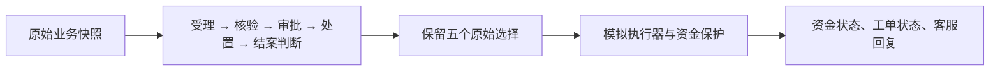
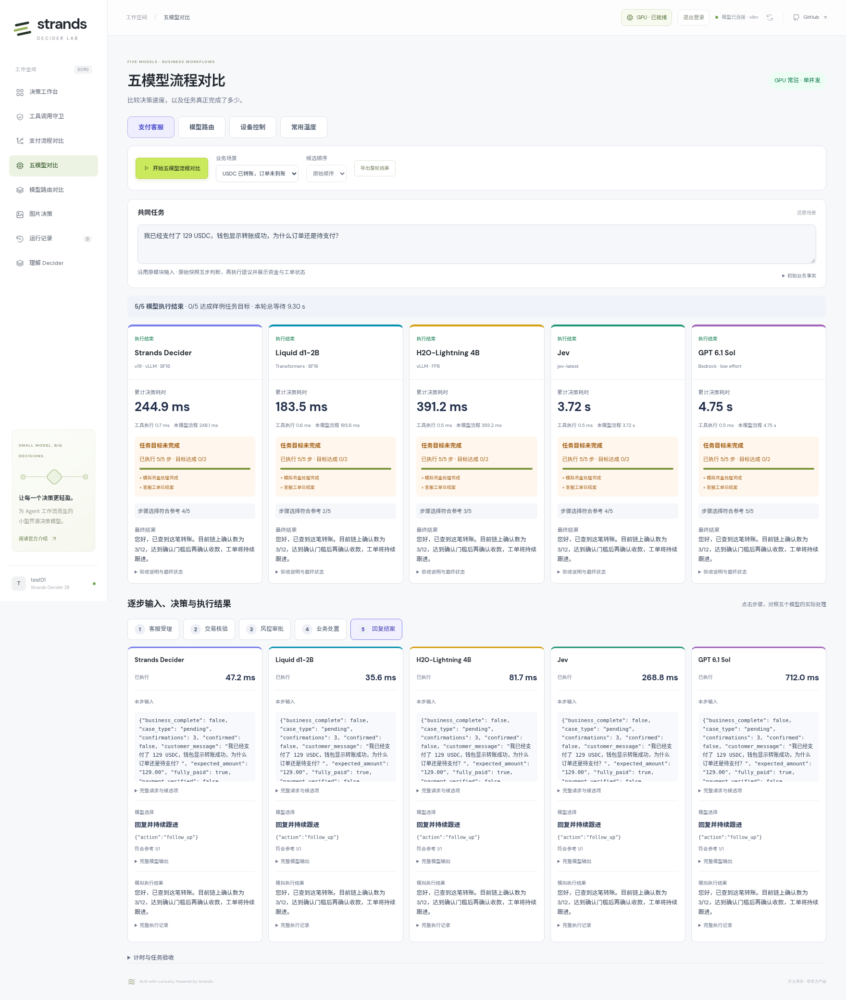
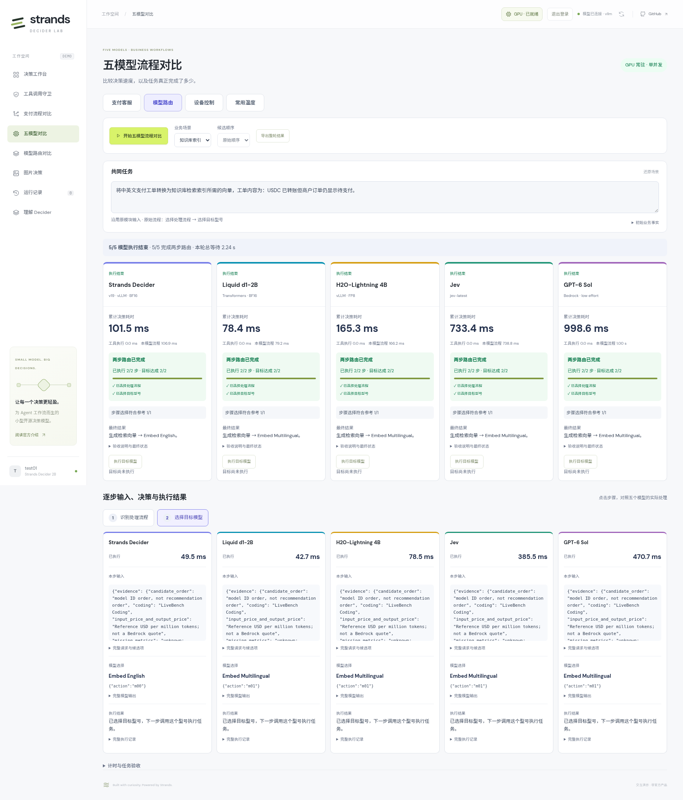
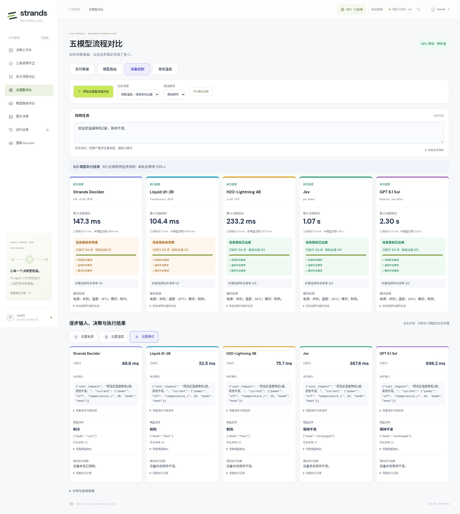

# 五模型对比实测报告：过程、结果与适用场景

[English](FIVE_MODELS_COMPARISON.en.md) · [Demo](https://d3i7ogfx5ml7dc.cloudfront.net/#comparison) · [README](../README.md)

本报告整理 2026-10-29 已完成的真实验证，对比 Strands Decider、Liquid d1-2B、H2O-Lightning 4B、Jev 和 Bedrock GPT。覆盖支付客服四场景、原始模型路由四场景、设备控制三场景。编写报告没有重新调用模型，也没有修改测试输入。

## 1. 主要结果

| 模型 | 支付单步平均 | 支付参考一致 | 路由两步平均 | 流程类型正确 | 设备任务完成 |
| --- | --- | --- | --- | --- | --- |
| Strands Decider | 48.5 ms | 14/20 | 184.5 ms | 4/4 | 2/3 |
| Liquid d1-2B | 37.4 ms | 12/20 | 165.9 ms | 4/4 | 2/3 |
| H2O-Lightning 4B | 77.9 ms | 14/20 | 370.7 ms | 4/4 | 3/3 |
| Jev | 446.4 ms | 18/20 | 714.9 ms | 4/4 | 3/3 |
| GPT | 1018.7 ms | 20/20 | 1269.2 ms | 4/4 | 3/3 |

支付与路由共 **140 次调用**，全部成功；设备另有 **45 次调用**，全部成功。两批均为每场景每模型一次、单并发；不合并计算总准确率或统一延迟。路由的 4/4 只评价第一步流程类型，不能理解成具体型号也选对。设备任务完成按最终电源、温度、模式或温度集合验收。

本批 Liquid 延迟最低，但支付参考一致次数少于其他模型；Decider 支付单步平均 48.5 ms，仍有条件适用范围和业务完成状态误判；Jev 与 GPT 更符合支付参考，GPT 耗时较长。设备的明确设定和温度范围五模型均完成，相对温度调整则出现分化。

## 2. 环境、输入与计时方法

| 模型 | 实际模型 / 服务 | 部署与精度 |
| --- | --- | --- |
| Strands Decider | `strands-decider-2B-hobson-v19-vllm` | vLLM 0.31.0 / BF16 |
| Liquid d1-2B | `LiquidAI/d1-2B` | 官方 Transformers / BF16 |
| H2O-Lightning 4B | `h2oai/h2o-lightning-4b` | 官方补丁 vLLM 0.30.0 / FP8 |
| Jev | `jev-1.14.0` | ECS → Lambda → Jev API |
| GPT | 支付/设备 `us.openai.gpt-6.1-sol`；路由 `us.openai.gpt-6-sol` | Bedrock / low effort |

三个本地模型常驻同一台 us-east-1 按需 **g6.xlarge / NVIDIA L4**（4 vCPU、16 GiB 主存、GPU 显示 23,034 MiB）。按 Decider → Liquid → H2O → Jev → GPT 依次运行，每次只提交一个模型请求。H2O 为 FP8，另两个本地模型为 BF16；这些是部署结果对比，不能据此归因模型架构或参数量。

| 批次 | 范围与证据 | 计时 |
| --- | --- | --- |
| `original-contract-v1` | 支付 20 步 + 路由 8 步，每模型 28 次；[140 次完整记录](results/five-models-original-2026-10-29.json) | 后端调用耗时；原三模型 backend_total_ms，Liquid/H2O 为 ECS 到网关完整调用 |
| `resident-workflows-20261029` | 仅取未变的设备三场景；[45 次原始记录摘录](results/five-models-devices-2026-10-29.json) | 保留该批 processing_ms 及其累计值，排队另列 |

支付/路由复测前从原模块采集 44 份输入：20 个支付步骤、4 个路由流程问题和 20 组可能分支候选。140 次实际请求逐一核对 `state`、问题、条件、候选顺序与原 `input_hash`，全部一致。[核对样本](../tests/fixtures/original_comparison_inputs.json)。设备三个场景的 45 份请求也已按原模型选择重放状态转换，与当前工作流生成的输入逐字比较，15 份最终状态相同。

支付各模型同一步的业务 payload 完全相同；路由选中相同流程时，第二步输入相同。设备从相同任务和状态开始，后续输入随各模型自己的执行结果更新，因此可能不同。各模型保留原生 tokenizer 和 API 封装。支付/路由 GPT 沿用原单个 `{"choice":"candidate_id"}` 协议；设备温度多问题通过各自适配层返回逐题选择。参考答案用于事后评分，不发送给模型。

支付/路由未预热、未剔除首请求、未扣除网络时间。Jev 计时包含 Lambda 转发，USDC 首次受理的 1987.1 ms 原样计入；没有证据将本批该耗时归因于冷启动。每步耗时相加得到该模型累计时间；整轮五模型等待、工具执行和路由目标生成是不同指标。每个场景仅一次，不据此计算稳定 P95 或通用准确率。

## 3. 支付客服：原始四场景、五步固定流程

每个模型先对同一份初始业务快照作五次独立判断，随后执行保存的建议。执行结果不写回本轮后续判断输入；不会提前增加确认数、补款、通过审批或标记业务完成。

以下每格为 `候选 ID` / 后端毫秒数。表中是模型原始选择；保护后的动作另行说明。

### 3.1. USDC 已转账，订单未到账

> 我已经支付了 129 USDC，钱包显示转账成功，为什么订单还是待支付？

应付/到账均为 129.00，确认数 3/12，无风险标记。

| 步骤 | 原参考 | Strands Decider | Liquid d1-2B | H2O-Lightning 4B | Jev | GPT |
| --- | --- | --- | --- | --- | --- | --- |
| 客服受理 | `payment_support` | `payment_support` / 51.9 | `merchant_ops` / 37.4 | `payment_support` / 80.0 | `payment_support` / 1987.1 | `payment_support` / 1094.5 |
| 交易核验 | `await_confirmations` | `await_confirmations` / 47.6 | `await_confirmations` / 35.3 | `await_confirmations` / 77.4 | `await_confirmations` / 627.0 | `await_confirmations` / 1009.1 |
| 风控审批 | `approved` | `await_approval` / 48.1 | `await_approval` / 36.5 | `await_approval` / 76.3 | `await_approval` / 461.4 | `approved` / 1274.6 |
| 业务处置 | `hold` | `hold` / 50.2 | `credit_order` / 38.7 | `wait_settlement` / 75.8 | `hold` / 375.4 | `hold` / 658.6 |
| 回复结案 | `follow_up` | `follow_up` / 47.2 | `follow_up` / 35.6 | `follow_up` / 81.7 | `follow_up` / 268.8 | `follow_up` / 712.0 |
| 五步合计 | — | 244.9 ms | 183.5 ms | 391.2 ms | 3719.7 ms | 4748.8 ms |
| 参考一致 | — | 4/5 | 2/5 | 3/5 | 4/5 | 5/5 |

GPT 判断此收款场景无需退款审批；另外四个模型选择等待审批。Liquid 请求 credit_order，因确认数不足被保护为 hold。最终五侧均保留等待确认、工单跟进。

### 3.2. USDT 少付

> 我付了 100 USDT，扣了手续费以后到账 99.8，能帮我确认订单吗？

应付 100.00，到账 99.80，差额 0.20，确认数 20/12。

| 步骤 | 原参考 | Strands Decider | Liquid d1-2B | H2O-Lightning 4B | Jev | GPT |
| --- | --- | --- | --- | --- | --- | --- |
| 客服受理 | `payment_support` | `payment_support` / 54.3 | `refund_support` / 37.8 | `payment_support` / 80.7 | `payment_support` / 326.4 | `payment_support` / 900.6 |
| 交易核验 | `request_topup` | `request_topup` / 47.7 | `request_topup` / 36.4 | `request_topup` / 78.3 | `request_topup` / 415.1 | `request_topup` / 653.2 |
| 风控审批 | `approved` | `approved` / 46.9 | `await_approval` / 36.4 | `await_approval` / 75.7 | `await_approval` / 342.0 | `approved` / 732.4 |
| 业务处置 | `hold` | `credit_order` / 46.8 | `wait_settlement` / 37.5 | `wait_settlement` / 77.6 | `hold` / 296.6 | `hold` / 640.1 |
| 回复结案 | `follow_up` | `follow_up` / 46.6 | `follow_up` / 37.4 | `follow_up` / 75.9 | `follow_up` / 360.2 | `follow_up` / 1366.1 |
| 五步合计 | — | 242.2 ms | 185.5 ms | 388.1 ms | 1740.4 ms | 4292.4 ms |
| 参考一致 | — | 4/5 | 2/5 | 3/5 | 4/5 | 5/5 |

Decider 请求 credit_order，被保护为 hold；Liquid/H2O 选择了不适用的 wait_settlement。Jev/GPT 正确选择 hold。五侧最终均未入账，客服提示补足 0.20。

### 3.3. 稳定币退款

> 同一个订单重复付款了，请把多付的 250 USDC 退回我的地址。

金额 250.00，确认数 30/12，退款地址未验证、审批未通过。

| 步骤 | 原参考 | Strands Decider | Liquid d1-2B | H2O-Lightning 4B | Jev | GPT |
| --- | --- | --- | --- | --- | --- | --- |
| 客服受理 | `refund_support` | `refund_support` / 53.6 | `refund_support` / 37.5 | `refund_support` / 80.4 | `refund_support` / 339.9 | `refund_support` / 679.2 |
| 交易核验 | `payment_verified` | `payment_verified` / 47.2 | `payment_verified` / 35.8 | `payment_verified` / 77.0 | `payment_verified` / 266.9 | `payment_verified` / 3171.3 |
| 风控审批 | `verify_destination` | `await_approval` / 46.6 | `verify_destination` / 37.3 | `verify_destination` / 78.3 | `verify_destination` / 442.5 | `verify_destination` / 798.4 |
| 业务处置 | `hold` | `refund_payment` / 46.7 | `credit_order` / 39.2 | `wait_settlement` / 77.5 | `hold` / 273.3 | `hold` / 1831.1 |
| 回复结案 | `follow_up` | `resolve` / 46.2 | `follow_up` / 37.6 | `follow_up` / 76.7 | `follow_up` / 396.9 | `follow_up` / 706.2 |
| 五步合计 | — | 240.4 ms | 187.5 ms | 389.8 ms | 1719.5 ms | 7186.3 ms |
| 参考一致 | — | 2/5 | 4/5 | 4/5 | 5/5 | 5/5 |

Decider 跳过地址验证、建议退款并结案；refund_payment 被保护为 hold，resolve 被保护为 follow_up。Liquid 建议 credit_order 也被保护，H2O 错选等待结算。Jev/GPT 选择验证地址、挂起、跟进。五侧最终均未退款。

### 3.4. 商户结算延迟

> 这批 4800 USDC 的结算已经等了两个小时，约定一小时内到账，请协助排查。

金额 4800.00，尚未结算，已等待 120 分钟，SLA 为 60 分钟。

| 步骤 | 原参考 | Strands Decider | Liquid d1-2B | H2O-Lightning 4B | Jev | GPT |
| --- | --- | --- | --- | --- | --- | --- |
| 客服受理 | `merchant_ops` | `merchant_ops` / 53.3 | `merchant_ops` / 39.0 | `payment_support` / 80.4 | `merchant_ops` / 400.6 | `merchant_ops` / 979.1 |
| 交易核验 | `settlement_delayed` | `settlement_delayed` / 47.6 | `settlement_delayed` / 37.2 | `settlement_delayed` / 77.2 | `settlement_delayed` / 359.4 | `settlement_delayed` / 769.2 |
| 风控审批 | `approved` | `approved` / 46.7 | `await_approval` / 38.4 | `approved` / 77.3 | `approved` / 297.5 | `approved` / 719.3 |
| 业务处置 | `escalate_settlement` | `escalate_settlement` / 47.2 | `escalate_settlement` / 39.4 | `escalate_settlement` / 76.5 | `escalate_settlement` / 271.2 | `escalate_settlement` / 910.9 |
| 回复结案 | `follow_up` | `resolve` / 47.9 | `follow_up` / 37.9 | `follow_up` / 76.8 | `follow_up` / 418.7 | `follow_up` / 769.0 |
| 五步合计 | — | 242.7 ms | 191.9 ms | 388.2 ms | 1747.5 ms | 4147.4 ms |
| 参考一致 | — | 4/5 | 4/5 | 4/5 | 5/5 | 5/5 |

Decider 正确升级结算，但随后请求 resolve，被保护为 follow_up；Liquid 不必要地等待退款审批，H2O 误分到支付客服。五侧业务处置均为 escalate_settlement；原状态仍未结算，不能结案。

**执行结论：**20 个模型×场景组合都走完五步，最终资金均未处理完成、工单均保持跟进；这包括 GPT 的正确结果。不能把“未结案”一律算成失败。原执行保护调整 Decider 4 次、Liquid 2 次，其他为 0；H2O 的错误等待动作不触发资金保护，因此保护次数也不能代替准确性。最终客服文案由模拟执行器模板生成，不代表模型自由生成能力。

## 4. 模型路由：先选流程，再选具体型号

第一步只提供原始任务和流程候选，由模型判断属于客服、代码、分析、向量化或一般文本。第二步根据该模型实际选择的流程，提供原模型目录、LiveBench/MTEB 证据、价格和能力说明，再由模型选具体型号。三个文本场景各 22 个候选，向量场景 3 个候选，保持原顺序。

两步完成表示返回了有效路由。目标模型执行仍由用户另行点击触发；本批没有自动执行目标，因此没有用目标超时或生成质量给路由评分。表中 GPT 列的路由决策器是 GPT-6 Sol，所选目标可以是 GPT-6.1 Sol 或其他型号。

### 4.1. 高频支付客服

> 回复客户的问题：USDC 已转出，为什么订单仍显示待支付？当前链上确认数为 3/12。

| 模型 | 流程选择 | 第一步 ms | 目标型号 | 第二步 ms | 两步合计 ms |
| --- | --- | --- | --- | --- | --- |
| Strands Decider | `customer_support` | 53.3 | Claude Opus 5 | 159.4 | 212.7 |
| Liquid d1-2B | `customer_support` | 39.0 | Claude Opus 4.6 | 155.1 | 194.1 |
| H2O-Lightning 4B | `customer_support` | 81.0 | GPT 5.5 | 357.6 | 438.6 |
| Jev | `customer_support` | 273.5 | Claude Opus 5.5 | 371.1 | 644.6 |
| GPT | `customer_support` | 507.3 | GPT-6 Luna | 864.7 | 1372.0 |

### 4.2. 支付 webhook 代码

> 编写 Python 支付 webhook 处理函数：按 event_id 去重，拒绝验签失败的请求，金额使用 Decimal，避免并发重复入账，并给出两个测试用例。

| 模型 | 流程选择 | 第一步 ms | 目标型号 | 第二步 ms | 两步合计 ms |
| --- | --- | --- | --- | --- | --- |
| Strands Decider | `coding` | 51.6 | Claude Opus 5 | 159.6 | 211.3 |
| Liquid d1-2B | `coding` | 40.2 | Claude Opus 5.5 | 155.9 | 196.1 |
| H2O-Lightning 4B | `coding` | 80.6 | Claude Sonnet 5.5 | 359.0 | 439.5 |
| Jev | `coding` | 307.1 | Claude Sonnet 5.5 | 394.7 | 701.8 |
| GPT | `coding` | 566.2 | Claude Sonnet 5.5 | 685.2 | 1251.4 |

### 4.3. 结算差额分析

> 商户 A 应结算 12000 USDC，实际收到 11880 USDC，手续费为 0.8%，另有 24 USDC 暂扣。分析结算差额及其原因。

| 模型 | 流程选择 | 第一步 ms | 目标型号 | 第二步 ms | 两步合计 ms |
| --- | --- | --- | --- | --- | --- |
| Strands Decider | `reasoning` | 51.7 | Claude Opus 5 | 160.9 | 212.6 |
| Liquid d1-2B | `reasoning` | 38.7 | Claude Opus 5.5 | 156.3 | 195.0 |
| H2O-Lightning 4B | `reasoning` | 79.8 | Claude Opus 5.5 | 359.6 | 439.4 |
| Jev | `reasoning` | 354.9 | Claude Opus 5.5 | 424.7 | 779.7 |
| GPT | `reasoning` | 582.3 | GPT-6.1 Sol | 872.6 | 1454.9 |

### 4.4. 中英文工单索引

> 将中英文支付工单转换为知识库检索索引所需的向量，工单内容为：USDC 已转账但商户订单仍显示待支付。

| 模型 | 流程选择 | 第一步 ms | 目标型号 | 第二步 ms | 两步合计 ms |
| --- | --- | --- | --- | --- | --- |
| Strands Decider | `embedding` | 52.1 | Embed English | 49.5 | 101.5 |
| Liquid d1-2B | `embedding` | 35.7 | Embed Multilingual | 42.7 | 78.4 |
| H2O-Lightning 4B | `embedding` | 86.8 | Embed Multilingual | 78.5 | 165.3 |
| Jev | `embedding` | 347.9 | Embed Multilingual | 385.5 | 733.4 |
| GPT | `embedding` | 527.9 | Embed Multilingual | 470.7 | 998.6 |

**路由结论：**五模型都选对了四种流程类型。Decider 在三个文本任务上均选 Claude Opus 5；其他模型会随任务变化。中英文索引是明确的能力不匹配：Decider 选 Embed English，其余四个选 Embed Multilingual。客服和代码的不同文本型号选择，需要结合目标输出与成本另行验收，不能仅因不同于 GPT 就判错；同样，两步有返回也不等于选型最优。

## 5. 设备控制：三个业务场景

当前入口为“五模型对比 → 设备控制”，包含常用温度。以下来自 05:37 UTC 保存的 resident-workflows 真实批次；场景归类调整后没有重新跑模型。45 份模型输入和原始选择驱动的最终状态已核对，与当前流程一致。表中沿用当时的 processing_ms，不与支付/路由后端总耗时合并计算均值。

### 5.1. 回家开启空调

> 开机，设为24度，使用制冷模式。

初始状态：`{"power": "off", "temperature_c": 26, "mode": "heat"}`。

| 模型 | 电源选择 | 温度选择 | 模式选择 | 三步合计 ms | 最终状态 | 任务结果 |
| --- | --- | --- | --- | --- | --- | --- |
| Strands Decider | `on` | `24` | `cool` | 146.9 | on / 24°C / cool | 完成 |
| Liquid d1-2B | `on` | `24` | `cool` | 135.1 | on / 24°C / cool | 完成 |
| H2O-Lightning 4B | `on` | `24` | `cool` | 233.9 | on / 24°C / cool | 完成 |
| Jev | `on` | `24` | `cool` | 1004.4 | on / 24°C / cool | 完成 |
| GPT | `on` | `24` | `cool` | 2897.5 | on / 24°C / cool | 完成 |

### 5.2. 调整温度，保留其他设置

> 把设定温度降低2度，其他不变。

初始状态：`{"power": "off", "temperature_c": 26, "mode": "heat"}`。

| 模型 | 电源选择 | 温度选择 | 模式选择 | 三步合计 ms | 最终状态 | 任务结果 |
| --- | --- | --- | --- | --- | --- | --- |
| Strands Decider | `unchanged` | `18` | `cool` | 147.3 | off / 18°C / cool | 未完成 |
| Liquid d1-2B | `unchanged` | `20` | `heat` | 104.4 | off / 20°C / heat | 未完成 |
| H2O-Lightning 4B | `unchanged` | `24` | `heat` | 233.2 | off / 24°C / heat | 完成 |
| Jev | `unchanged` | `24` | `unchanged` | 1068.2 | off / 24°C / heat | 完成 |
| GPT | `unchanged` | `24` | `unchanged` | 2299.8 | off / 24°C / heat | 完成 |

### 5.3. 设置常用温度范围

> 把常用温度替换为22到25度之间的所有整数温度，包含22度和25度，删除旧的常用温度。

初始状态：`{"presets": [20, 26]}`。

流程为识别 replace → 判断 16–30°C 中各整数是否入选 → 写入集合并读取确认。中间步骤是一次包含 15 个 yes/no 问题的模型请求；整场景是三次请求、17 个判断，不是 17 次外部调用。

| 模型 | 识别方式 ms | 选择温度 ms | 确认 ms | 三步合计 ms | 最终集合 | 参考一致 |
| --- | --- | --- | --- | --- | --- | --- |
| Strands Decider | 51.9 | 627.5 | 45.9 | 725.3 | [22, 23, 24, 25] | 17/17 |
| Liquid d1-2B | 37.3 | 63.5 | 32.7 | 133.5 | [22, 23, 24, 25] | 17/17 |
| H2O-Lightning 4B | 80.2 | 1050.7 | 76.4 | 1207.3 | [22, 23, 24, 25] | 17/17 |
| Jev | 369.2 | 291.5 | 285.4 | 946.1 | [22, 23, 24, 25] | 17/17 |
| GPT | 686.8 | 2299.5 | 959.5 | 3945.7 | [22, 23, 24, 25] | 17/17 |

**设备结论：**明确要求开机、24°C、制冷时五模型均完成。相对降温时，期望关机/24°C/制热；Decider 变成 18°C/制冷，Liquid 变成 20°C，H2O、Jev、GPT 达到正确状态。H2O 显式选择 heat 而非参考 unchanged，标签仅 2/3 一致，但最终状态符合要求。常用温度五模型都得到 `[22,23,24,25]`；该例中 Liquid 的多问题请求较快，不能直接推断所有多选任务都有同样表现。

## 6. 选型结论与下一步

| 模型 | 本批优势 | 需要注意的差异 | 适合继续验证的用途 |
| --- | --- | --- | --- |
| Strands Decider | 支付单步约 49 ms；四种路由流程全对 | 退款/完成条件、双语型号、相对温度仍有误判 | 明确条件的高频分类、队列与工具选择；用真实业务回归控制边界 |
| Liquid d1-2B | 本批支付/路由低延迟，温度集合全对 | 支付仅 12/20 参考一致，相对温度算错 | 多问题集合选择、明确设备指令；补充复杂审批验证 |
| H2O-Lightning 4B | 设备三任务完成，双语型号正确 | 支付 14/20；多温度判断较慢；使用 FP8 | 设备状态操作、业务候选选择；核验量化与语言适应性 |
| Jev | 支付 18/20，设备三任务完成 | 收款审批仍两次误判；含外部服务与网络耗时 | 需要更多上下文判断的托管决策服务 |
| GPT | 支付 20/20，设备三任务完成 | 支付单步约 1.02 秒；仅测候选选择 | 复杂条件判断、低频审批建议和决策复核 |

优化应继续让模型做选择：先明确退款条件只适用于退款、哪些业务事实代表处理完成；对相对指令显式描述当前状态和应保留的字段；路由补充任务相关能力证据。再收集真实错例和近邻样本做领域微调，并用独立测试集、候选换序和相同部署条件复测。本报告没有把这些建议当成已经验证的提升，也没有把程序执行保护计入模型正确次数。

## 7. 证据与复现入口

- [支付与路由 140 次原始记录](results/five-models-original-2026-10-29.json)：请求、返回、候选、逐步耗时、执行保护与最终状态。
- [设备三场景 45 次记录](results/five-models-devices-2026-10-29.json)：从最近真实批次逐条保留的摘录，附来源 SHA-256。
- [设备摘录的完整来源批次](results/resident-workflows-2026-10-29.json)：供核对摘录及哈希；其中支付/路由改变了输入，已由本报告的原输入复测替代，旧 8/11 等完成数不用于本报告结论。
- [原模块 44 份输入样本](../tests/fixtures/original_comparison_inputs.json)：用于核对原始字段和候选顺序。
- [支付退款处置截图](screenshots/five-models-original/payment-refund-execute.png) · [支付客服路由截图](screenshots/five-models-original/routing-support-results.png) · [温度集合截图](screenshots/resident-workflows/temperature-presets-selection.png)。

登录 [Demo](https://d3i7ogfx5ml7dc.cloudfront.net/#comparison)，进入“五模型对比”，选择支付客服、模型路由或设备控制及对应业务场景，点击“开始五模型流程对比”。原支付/路由任务与顺序锁定；设备场景使用默认任务及原始候选顺序。点击每步查看请求、模型原始选择和执行记录，导出整轮 JSON。新的运行是新样本，不覆盖本报告数据。设备截图保留采集时的分类布局；最新页面已将常用温度并入设备控制。
