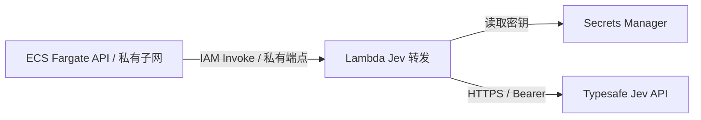

# Strands Decider / Jev / GPT 三模型对比

支付流程对比统一为 **Strands Decider vs Jev vs GPT**。无需选择模型组合，点击「开始对比」即同时运行三个模型，支持四个场景及固定流程、优化流程、自主闭环。

2026-10-16 起，文字 Decider 使用共享 vLLM GPU；图片 Decider 使用独立的官方视觉服务。本文 2026-10-12 的支付延迟与业务结果保留原版引擎口径；当前部署见 [部署说明](../deployment/README.md)。

固定／优化流程向三模型发送相同业务输入、问题与候选条件，每步并发调用，再分别模拟执行。闭环各自读取执行反馈，后续输入可能不同。三列展示输入输出、实际动作、耗时和最终业务结果；单个模型失败不隐藏其他模型结果。手机上按相同顺序纵向排列。JSON 包含 `comparisonProviders` 和每轮 `providers`，保留完整三侧记录及历史批次。

## 模型与计时

- 接口：`POST https://api.typesafe.ai/v1/systemone`，服务器指定 `model=jev-latest`。
- 返回：实际模型版本、候选 `choice`、`probabilities`、`confidence`，以及服务提供的 token 用量。`jev-latest` 是别名，复核结果时以每次返回的实际版本为准。
- Jev 和 Decider 的 confidence 分别展示；不假定两者的概率校准或计费规则相同。GPT 只返回候选 JSON，不伪造概率。
- AWS 的 Jev `backend_total_ms` 包含排队、Lambda 调用和到 Typesafe API 的 HTTPS 往返，可能包含 Lambda 冷启动；不是 Jev 纯模型推理时间。上游未报告 `latency_ms` 时，`model_reported_ms` 为 `null`。
- 耗时卡片显示各模型成功调用的累计耗时和成功次数；失败不计为零耗时成功。Jev、GPT 相对 Decider 的倍数分别使用同输入且双方成功的步骤，并注明样本数。三个模型均成功且输入相同才计入三模型选择差异。自主闭环单列各自全部成功决策，调用次数可能不同，不显示相对倍数。
- 缺少配置、认证失败、限流、超时、非法候选或概率均明确报错，不退回规则答案。仅 ECS → Lambda 的 TCP 连接超时、确认尚未提交请求时重连一次；读取超时、HTTP 错误和限流不自动重试。规则回放完全不调用 Jev。

## 图片决策对比

[图片模块](VISION.md)复用同一 Jev 密钥与 Lambda 转发，与 Decider、GPT-6.1 Sol low 对比同一张图片和同一组问题。Jev 使用 `assets` 传入 PNG/JPEG，开启 `TypeSafe-Danger-Zone-Images: true`；choice 与 noul 可以在一次请求中混合提交。图片字节在三个模型间保持一致，不预先 OCR，不发送样例预期。

2026-10-23 实际返回 **jev-1.14.0**。12 张图片的 28 项判断全部符合样例预期，平均业务 API 耗时 **424.6 ms**，包含 Lambda 与 HTTPS 往返；该批 Decider 为 27/28、178.1 ms，GPT 为 28/28、1,539.2 ms。完整请求、图片哈希与逐场景结果见[三模型实测](results/vision-triple-2026-10-23.json)。这是独立的视觉批次，不合并到下文历史支付数据。

[Jev 官方图片说明](https://docs.typesafe.ai/images)将该能力列为试验功能。接口要求每边至少 280 像素；演示上传统一等比例缩小并补白为 448×448 PNG。Jev 失败时保留该列错误，另外两列继续展示结果。

## 本地使用

先按 [开发指南](DEVELOPMENT.md) 创建本地账号，再启动：

```bash
JEV_API_KEY_FILE="$HOME/ai/jev/jevkey.txt" AUTH_COOKIE_SECURE=false \
  uv run uvicorn app.main:app --host 127.0.0.1 --port 8000
```

也支持服务端环境变量 `JEV_API_KEY`。密钥文件不放进仓库，禁止写入前端、截图、日志和导出结果。默认未配置时保留 Jev 的规则回放入口，真实模式提示管理员配置。

## AWS 调用路径



每次 Jev 请求独立创建并关闭 Lambda SDK 客户端，避免跨请求复用空闲连接；返回流在关闭客户端前读取完毕，并发调用互不关闭对方连接。连接中断不能确认请求是否已提交，因此不自动重复调用。

Lambda 不加入应用 VPC，通过其托管网络访问固定 Jev 地址；没有 Function URL 或公共入站接口。应用 VPC、API 和 GPU 继续使用私有网络，不增加 NAT Gateway。调用权限仅授予 API Task Role，Lambda 只可读取指定 secret；私有端点也限定到该角色与函数。

首次启用或轮换密钥：

```bash
uv run python deployment/deploy.py --region us-east-1 --api-only \
  --tag YOUR_NEW_API_TAG \
  --jev-key-file "$HOME/ai/jev/jevkey.txt"
```

部署脚本用 SDK 把密钥写入 Secrets Manager 的 `<stack>/jev-api-key`；CloudFormation、容器环境变量和部署记录只保存 secret ARN 或函数 ARN。也可使用 `--jev-secret-arn` 指向已有 secret。后续部署省略这两个参数会保留现有配置。

Lambda 在进程内缓存密钥；上游 401/403 后清空缓存，下次请求读取新值。轮换后也可更新函数配置以替换运行环境。secret 独立于 CloudFormation stack 保存，删除 stack 后需要按保留需求单独清理。

新增费用包括单 AZ Lambda interface endpoint 的 PrivateLink 小时费及数据费、Secrets Manager、Lambda 调用，以及 Jev 服务用量。没有核实 Jev 单价时，页面不推算美元成本。

### 失败排查

- 「转发服务连接失败，本步未提交模型请求」：ECS 连接 Lambda 超时，已尝试重连一次，可以重新运行。
- 「本次决策超时」：没有收到完整响应，不代表请求一定未到模型服务；保留本次失败记录，不自动重复调用。
- 「认证失败／请求限流／未返回有效候选动作或概率」分别对应密钥、服务限流和响应格式问题。
- ECS 日志记录连接尝试次数、错误类型或上游 HTTP 状态，不记录密钥、业务输入和原始异常内容。
- 闭环显示「转人工」属于业务结果：模型连续两次未推进流程时停止，和调用失败分开展示。不能用规则答案替换模型选择来制造完成结果。

## 验证

```bash
uv run --extra dev pytest -q tests/test_jev.py
uv run --with playwright python scripts/check_jev_browser.py \
  --url http://localhost:8000 --credentials .deployment/local-credentials.json
```

浏览器默认验证三模型 × 四场景 × 三种方式，使用明确标记的规则回放；另以合成响应验证 Jev 失败时另外两个模型继续执行、第三模型单独出现选择差异、部分失败的耗时合计和配对样本数。合成计时不计入真实测速。还检查历史模型身份、三份输入一致、独立执行、JSON 导出和手机布局，不启动或停止 GPU。

添加 `--live` 时，四个场景执行优化流程：五步 × 三模型 × 四场景，共 60 次真实决策。每个场景每步向三模型并发提交同一输入。原有双模型数据保留其采集口径。

## 三模型同批实测（2026-10-12）

后端 `20261012-triple1`，三个模型各预热一次后，四场景优化流程共 60 次正式调用全部成功。正式的 20 次 Jev 调用均无 Lambda 初始化记录，并复用预热环境，见 [原始输入输出](presentations/v8/live-observations.json) 和 [日志验证](presentations/v8/lambda-warm-verification.json)。每格为 **五步累计后端耗时 · 与演示参考一致次数**。

| 场景 | Strands Decider | Jev | GPT-6.1 Sol |
| --- | ---: | ---: | ---: |
| USDC 未到账 | 0.557 s · 5/5 | 2.318 s · 5/5 | 8.537 s · 5/5 |
| USDT 少付 | 0.514 s · 4/5 | 1.896 s · 5/5 | 4.171 s · 5/5 |
| 稳定币退款 | 0.564 s · 4/5 | 2.112 s · 5/5 | 5.453 s · 5/5 |
| 商户结算 | 0.408 s · 5/5 | 2.003 s · 5/5 | 4.173 s · 5/5 |
| **合计** | **2.043 s · 18/20** | **8.329 s · 20/20** | **22.335 s · 20/20** |

三模型每步同时接收相同输入；各场景只运行一次。Decider 运行于 EC2 `g6.xlarge`，Jev 实际版本 `jev-1.13.0`，GPT 使用 Bedrock `us.openai.gpt-6.1-sol` / `low`。参考一致次数不代表通用准确率，累计时间不等于整个页面的等待时间。

首轮验收曾遇到一次 Jev `ConnectionClosedError`，已改为每次请求独立建立并关闭 Lambda 连接。失败样本与修复后的 60 次观测分开保留于 [完整记录](results/triple-2026-10-12.json)；不覆盖下面的旧配对数据。

### 为什么没有官方宣传中的加速倍数？

[Typesafe 官方发布文章](https://typesafe.ai/blog/introducing-system-one-models-and-jev) 将 Jev 的 **70–500 ms** 描述为端到端响应时间；将工作流评测中的 **193.6 倍**称为实际收益较高的情况。它没有承诺所有问题、网络和对照模型都会达到该倍数。以下引用口径于 2026-10-12 核对。

| 本批次每次调用 | Strands Decider | Jev | GPT-6.1 Sol |
| --- | ---: | ---: | ---: |
| 平均后端耗时 | 102.2 ms | 416.5 ms | 1116.7 ms |
| 后端耗时中位数 | 81.3 ms | 397.7 ms | 863.4 ms |
| 最小 / 最大后端耗时 | 75.0 / 182.9 ms | 322.0 / 591.5 ms | 776.7 / 3283.9 ms |

Jev 的 20 次样本中 **17 次低于 500 ms**，多数落在官方所述范围内；GPT / Jev 累计耗时比为 **2.68×**。这里的均值与中位数来自四场景的 20 个不同步骤，不是重复同一请求测出的稳定延迟分布。页面场景卡片显示五次调用的累计，所以约 2 秒不等于一次 Jev 推理耗时。

影响比较的具体因素：

1. **对照任务不同。** 本项目 GPT 采用 `reasoning=low`，只输出候选 ID JSON。官方文章说明其部分评测使用 System One LLM wrapper，输出与 API 兼容的结构化决策及概率，比只输出决定更慢、更贵；与低推理或非推理模式比较时，加速倍数也会缩小。
2. **调用路径不同。** Decider 是同 VPC 内的常驻 GPU；Jev 是 ECS → Lambda → 外部 Typesafe API。Jev 后端计时包含 SDK 客户端建立、签名、连接、转发与 HTTPS 往返。应用 API 位于 `us-east-1`；官方发布文章描述其测试主要在美国西海岸进行，不能假定两者网络条件相同，也不能据此确认 Typesafe 现在的具体路由。
3. **连接可靠性有成本。** 当前每次调用独立创建并关闭 Lambda 客户端，避免空闲连接复用问题。这引入连接建立开销；没有控制变量实验，不能用前后两个批次相减来量化这一项。
4. **预热消除了本轮代理冷启动，其他开销仍存在。** 正式测试首次 Jev 受理为 549.8 ms，20 次均无 Lambda 冷启动。所有响应的 `model_reported_ms` 仍为空，不能把已预热的后端耗时当作纯模型计算时间，也不能确认上游 Jev 服务的内部状态。

当前能得出的结论是：**本批次应用调用体验中，Decider 最快，Jev 次之，GPT 最慢；Jev 和 GPT 的选择均符合演示参考。** 纯模型速度、稳定加速倍数和生产吞吐仍需独立评测。具体选择差异与执行结果见 [模型结果分析](MODEL_COMPARISON.md#本批次选择差异与业务结果)。

CloudWatch 已记录本次 Lambda 函数执行时间；该时间仍包含代理处理、HTTPS 与上游响应，未细分成模型纯推理。后续应补充客户端建立与上游往返计时，对固定输入重复、交错测量，再评估连接管理或更短路径；当前没有部署这些新优化。

此前 P16 的 1,708.7 ms 与同输入重试首个 2,077.2 ms 均查到 Lambda 冷启动；后续四次重试平均 444.7 ms。[重试证据](results/jev-p16-intake-retry-2026-10-12.json) 保留原值。本轮重新完整测试，没有用重试的较快值替换旧表，也没有直接减去初始化时间。

公开评测另见 [JevBench API 榜单](https://benchmarkheaven.com/jev-models/api) 与 [方法](https://benchmarkheaven.com/jev-models/api#jev16-method)。这是 Benchmark Heaven 第三方结果；综合分包含能力、校准、速度、成本及低分惩罚，不是官方准确率。其 Jev p50 为 239.1 ms，本项目为 397.7 ms，任务与测量路径不同，不能相减当作代理开销。

## 历史配对实测（2026-10-12，三模型统一前）

线上优化流程，每个场景各运行一次。Jev 实际返回版本 `jev-1.13.0`，Decider 使用 EC2 `g6.xlarge`，GPT 使用 Bedrock `us.openai.gpt-6.1-sol` / `low`。以下时间为五次决策的累计后端耗时，单位秒；“参考一致”指五次选择中符合本演示业务策略的次数。

**Decider / Jev 配对**

| 场景 | Decider 耗时 | Jev 耗时 | Decider 参考一致 | Jev 参考一致 |
| --- | ---: | ---: | ---: | ---: |
| USDC 已转账，订单未到账 | 0.382 | 1.508 | 5/5 | 5/5 |
| 支付少付，需要补款 | 0.386 | 1.443 | 4/5 | 5/5 |
| 退款与地址验证 | 0.408 | 1.369 | 4/5 | 5/5 |
| 商户结算延迟 | 0.382 | 1.354 | 5/5 | 5/5 |
| **合计** | **1.558** | **5.674** | **18/20** | **20/20** |

**Jev / GPT 配对**

| 场景 | Jev 耗时 | GPT 耗时 | Jev 参考一致 | GPT 参考一致 |
| --- | ---: | ---: | ---: | ---: |
| USDC 已转账，订单未到账 | 1.408 | 9.394 | 5/5 | 5/5 |
| 支付少付，需要补款 | 1.419 | 5.981 | 5/5 | 5/5 |
| 退款与地址验证 | 1.389 | 6.499 | 5/5 | 5/5 |
| 商户结算延迟 | 1.376 | 5.325 | 5/5 | 5/5 |
| **合计** | **5.591** | **27.199** | **20/20** | **20/20** |

在本批次，Decider 的累计决策耗时最短；Jev 和 GPT 的选择均符合演示参考。Decider 在少付核验时选择「等待链上确认」，参考为「请求补款」；退款审批时选择「规则检查通过」，参考为「验证退款地址」。执行保护仍独立检查实际条件，保留原始选择与实际动作。

80 次模型调用全部成功，各侧均处理五步。由于这里使用初始证据，待确认、少付、退款条件不足及结算未完成的案例仍需跟进；不把五步已处理算作资金与业务已完成。

这两组中的 Jev 分别调用了 20 次，不是复用同一份结果。单次样本、网络及部署方式不同，不能据此承诺稳定速度或通用准确率。完整输入、返回、概率、时间与执行摘录见 [实测 JSON](results/jev-2026-10-12.json)。
