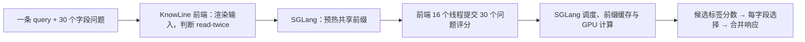

# KnowLine：EC2 部署与空调控制测试记录

整理日期：2026-11-05。本文独立整理 **PelaAI/KnowLine-4B-Gen5.5** 的模型信息、实际部署、测试过程、结果及复现步骤。内容来自已保存的官方资料、运行源码和原始回执；本次整理没有创建 EC2、重启服务或重新调用模型。

**本项目未对 KnowLine 做空调领域微调。** 在完整原始输入下，它的一次全答达到 **90% 完整正确率、约 1 秒**；30 步串行达到 **95%、约 6.6 秒**。中文附项为 **23/24**。它适合作为无需领域训练的开源候选，但仍会多发用户未要求的动作。后续两种输入压缩虽然降低全答耗时，却明显损害准确率，不建议沿用。

## 1. 模型来源与设计

| 项目 | 实际采用内容 |
|---|---|
| 发布者 | Hugging Face 组织 **PelaAI**；以下设计说明来自其模型卡 |
| 模型仓库 | `PelaAI/KnowLine-4B-Gen5.5` |
| 固定 revision | `779944d2cc8ffa19cef386aee83c83bcb967ade2` |
| 基础模型 | `Qwen/Qwen3.5-4B` |
| 许可证 | Apache-2.0 |
| 支持语言 | 官方列出英文、简体中文、繁体中文 |
| 决策方式 | 每个问题读取候选标签 token 的分数，在候选内归一化并选最高分 |
| 本轮业务接口 | `POST /v1/systemone`，输入 `state + questions` |
| 本轮运行后端 | SGLang，加载时 FP8 量化，单张 L4 |
| 本项目训练情况 | 没有额外训练，没有新增 LoRA 或 Pointer Head |

官方说明：Gen5 的权重由两个 LoRA SFT 模型合并后按 0.5 / 0.5 做权重平均，LoRA 为 rank 32、alpha 64，仅训练语言部分；校准温度 `T=1.50` 已折入最终 norm 权重。**Gen5.5 与 Gen5 的模型、配置和 tokenizer 文件相同，主要变化是服务端增加短输入重复读取。** 这些是发布者的训练过程，不是本项目执行过的微调。

推理时前端温度保持 `1`，不能再把 `1.50` 当成需要额外设置的参数。官方明确说明 KnowLine 独立于 TypeSafe / Jev；兼容其接口不代表使用同一个模型。

固定版本来源：[官方模型卡](https://huggingface.co/PelaAI/KnowLine-4B-Gen5.5/blob/779944d2cc8ffa19cef386aee83c83bcb967ade2/README.md) · [官方推理说明](https://huggingface.co/PelaAI/KnowLine-4B-Gen5.5/blob/779944d2cc8ffa19cef386aee83c83bcb967ade2/INFERENCE.md) · [项目保存的模型卡](../validation/model_research/2026-10-30-ac-candidates/PelaAI--KnowLine-4B-Gen5.5-README.md)。

## 2. 实际部署与测试的时间线

| 阶段 | 环境与覆盖 | 该阶段的用途 |
|---|---|---|
| 2026-10-30 候选测试 | `us-east-1`，独占 g6.xlarge/L4；156 次质量请求，计时主要围绕 S03 | 验证新模型可运行及初步表现；KnowLine 完整主轮共 285 次调用 |
| 2026-10-30 九模型完整测试 | `ap-northeast-1`，同规格独占 L4；全部 20 条规范题 × 三轮布局测试，另含质量附项 | 本文主要结果来源；KnowLine 2,049 次调用 |
| 2026-10-31 输入压缩对照 | 回到 `us-east-1d` 的 g6.xlarge/L4；原始输入与两种压缩版本各完整测试 | KnowLine 共 6,147 次调用；原始输入重新测量，不复用上一轮成绩 |

早期候选测试曾受系统自动维护影响：维护重启了正在测试的 Torchcast 服务，随后全部五个候选统一重测。KnowLine 更新前后的记录均保留，156 条质量请求的字段选择一致。这个维护事件不应写成 KnowLine 的模型故障。

九模型完整测试时，美国多个容量申请失败，测试环境通过镜像迁移到东京，使用同规格 g6.xlarge：**4 vCPU、16 GiB RAM、单张 L4**。七个本地模型依次独占同一 GPU；本地计时客户端也在该实例，通过 loopback 请求，因此没有东京到美国的网络往返。镜像复制、容量等待和磁盘预加载不计入单请求延迟。

九模型轮的 KnowLine 首次健康检查返回默认服务名 `m`，而测试器要求完整仓库身份，因此在任何预热或正式问题发出前中止。之后仅将前后端的 `--served-model-name` 都改为 `PelaAI/KnowLine-4B-Gen5.5`，从完整预热开始测试；没有丢弃已得到的答案。

历史实例 ID、AMI、S3 路径和服务状态仅作溯源，不代表今天仍可直接使用。新部署应选择自己的实例和独立目录；下面的命令没有自动停机步骤。

证据：[候选部署及维护记录](AC_CANDIDATE_L4_RESULTS.md) · [东京迁移记录](../validation/ac_control/runs/2026-10-30-all-models-full-v1/infrastructure/actual-region-amendment.json) · [服务身份修订](../validation/ac_control/runs/2026-10-30-all-models-full-v1/infrastructure/knowline-identity-amendment.json) · [压缩测试实例记录](../validation/ac_control/runs/2026-10-31-all-models-input-optimization-v1/infrastructure/active_instance.json)。

## 3. 实测运行环境

| 组件 | 记录中的版本或配置 |
|---|---|
| 系统 / Python | Ubuntu 24.04 系列环境，Python `3.12.3` |
| GPU / 驱动 | NVIDIA L4，约 23,034 MiB 可见显存；原候选环境驱动 `595.91.07` |
| PyTorch / CUDA | PyTorch `2.13.0`，CUDA 13.0 工具链 |
| SGLang / kernel | `0.5.21` / `sglang-kernel==0.4.7` |
| Transformers | `5.12.1` |
| FlashInfer | `flashinfer-python==0.6.18` |
| requests | `2.34.2` |
| 引擎端口 | `127.0.0.1:18812` |
| 业务前端端口 | `127.0.0.1:18811` |
| 并行与缓存 | TP=1，前端 workers=16，`mem-fraction-static=0.72` |
| 模型精度 | 磁盘权重 BF16，SGLang 加载时 FP8；`--enable-fp32-lm-head` |
| 布局 | header=false，read-twice=true，阈值 3,000 tokens |

九模型轮测试前的进程快照显示，引擎调度进程占用约 **17,702 MiB**，另一个相关进程约 **218 MiB**。这是包含运行时和缓存预留的现场占用，不能当作模型权重大小或任意输入下的最低显存需求。

原部署使用独立虚拟环境，安装核心命令是 `sglang==0.5.21`、`transformers==5.12.1` 和 `requests`。完整依赖见[当时的 pip 清单](../validation/ac_control/runs/2026-10-30-all-models-full-v1/logs/knowline-requirements.txt)。模型文件及服务源码见[逐文件 SHA-256 清单](../validation/ac_control/runs/2026-10-30-candidates-l4-v1/model-manifests/knowline.json)；不要只固定模型名而使用后来变化的 `main`。

## 4. 在新的 EC2 上复现部署

### 4.1 准备资源与独立环境

选用可用区有容量的 `us-east-1` g6.xlarge、带 CUDA 13 兼容驱动和工具链的 Ubuntu GPU AMI。准备足够的 gp3 磁盘空间存放模型、虚拟环境和缓存；历史多模型盘为 200–250 GiB，不能把它理解成单个 KnowLine 的最低要求。

EC2 / SSM / 网络权限的通用准备可参考 [EC2 部署手册第 2 节](LIQUID_LORA_EC2_HANDBOOK.md#2-创建-ec2-与访问权限)，模型安装与启动使用本文步骤。实例需能够下载 Hugging Face 与 Python 包；只有 SSM/S3 endpoints 并不足以提供这些下载通路。

在 GPU 主机以 Ubuntu 的 `ubuntu` 用户操作，先确认没有其他 GPU 推理或训练任务。以下使用新的 `/opt/knowline-ac`，不覆盖历史 `/opt/ac-nine-tests` 或 `/opt/ac-input-tests`：

```bash
export KL_BASE=/opt/knowline-ac
export KL_MODEL="$KL_BASE/model"
export KL_PY="$KL_BASE/env/bin/python"
export KL_REVISION=779944d2cc8ffa19cef386aee83c83bcb967ade2
export CUDA_HOME=/usr/local/cuda-13.0
export PATH="$CUDA_HOME/bin:$PATH"
export OMP_NUM_THREADS=2
export MKL_NUM_THREADS=2
export TORCHINDUCTOR_COMPILE_THREADS=1
export TOKENIZERS_PARALLELISM=false
export TRITON_CACHE_DIR="$KL_BASE/cache/triton"
export TORCHINDUCTOR_CACHE_DIR="$KL_BASE/cache/inductor"

nvidia-smi
nvcc --version
nvidia-smi --query-compute-apps=pid,process_name,used_memory --format=csv
sudo install -d -o ubuntu -g ubuntu "$KL_BASE"
mkdir -p "$KL_MODEL" "$KL_BASE/logs" "$KL_BASE/cache"
sudo apt-get update
sudo apt-get install -y python3.12-venv build-essential curl
python3.12 -m venv "$KL_BASE/env"
"$KL_PY" -m pip install --upgrade pip
"$KL_PY" -m pip install \
  'sglang==0.5.21' 'transformers==5.12.1' 'requests==2.34.2'
"$KL_PY" -m pip freeze > "$KL_BASE/logs/requirements.txt"
"$KL_PY" -m pip check
```

这组命令固定核心版本；传递依赖仍可能随包源变化。与上面的历史清单核对 torch、CUDA、kernel 和 FlashInfer 版本。新 AMI 上的安装配方本次未重新执行，不能因安装成功就宣称已复现历史速度。

### 4.2 下载固定版本并核验

```bash
"$KL_PY" - <<'PY'
import os
from huggingface_hub import snapshot_download
snapshot_download(
    repo_id="PelaAI/KnowLine-4B-Gen5.5",
    revision=os.environ["KL_REVISION"],
    local_dir=os.environ["KL_MODEL"],
    max_workers=4,
)
PY
```

把仓库中的 `validation/ac_control/runs/2026-10-30-candidates-l4-v1/model-manifests/knowline.json` 通过自己的文件传输方式放到 GPU 主机 `$KL_BASE/model-manifest.json`。该文件仅含模型版本、文件名和哈希，不含测试答案。逐文件流式校验，避免一次把数 GB 权重读入 RAM：

```bash
"$KL_PY" - <<'PY'
import hashlib, json, os
from pathlib import Path
base = Path(os.environ["KL_BASE"])
model = Path(os.environ["KL_MODEL"])
manifest = json.loads((base/"model-manifest.json").read_text())
assert manifest["revision"] == os.environ["KL_REVISION"]
for item in manifest["files"]:
    path = model/item["path"]
    assert path.stat().st_size == item["bytes"], item["path"]
    h = hashlib.sha256()
    with path.open("rb") as stream:
        for chunk in iter(lambda: stream.read(4*1024*1024), b""):
            h.update(chunk)
    assert h.hexdigest() == item["sha256"], item["path"]
print("Verified", len(manifest["files"]), "model and serving files")
PY
```

不要从另一个版本单独复制 `knowline_server.py`；`knowline_server.py`、`knowline_layout.py`、tokenizer 和权重一起固定。模型目录包含两个主权重分片及 `model-extra-from-base.safetensors`，下载完整快照可避免遗漏索引引用的文件。

### 4.3 启动引擎与业务前端

两个进程各有职责：SGLang 负责 GPU 评分，KnowLine 前端负责请求布局、候选标签与多题调度。初次验证可在两个持久终端或 tmux 窗口中分别启动；第二个终端须先设置与第一个相同的 `KL_BASE`、`KL_MODEL`、`KL_PY` 及线程/缓存环境变量。

终端 A 启动引擎：

```bash
CUDA_VISIBLE_DEVICES=0 "$KL_PY" -m sglang.launch_server \
  --model-path "$KL_MODEL" \
  --served-model-name PelaAI/KnowLine-4B-Gen5.5 \
  --tp 1 --quantization fp8 \
  --mem-fraction-static 0.72 \
  --mamba-radix-cache-strategy extra_buffer \
  --enable-fp32-lm-head \
  --host 127.0.0.1 --port 18812
```

等引擎日志显示就绪，终端 B 检查健康并启动前端：

```bash
curl -fsS http://127.0.0.1:18812/health
"$KL_PY" "$KL_MODEL/knowline_server.py" \
  --model "$KL_MODEL" --backend sglang \
  --url http://127.0.0.1:18812 \
  --served-model-name PelaAI/KnowLine-4B-Gen5.5 \
  --temperature 1 --workers 16 \
  --host 127.0.0.1 --port 18811
```

第三个终端检查 `http://127.0.0.1:18811/health`，应包含：

```json
{
  "status": "ok",
  "model": "PelaAI/KnowLine-4B-Gen5.5",
  "temperature": 1.0,
  "layout": {
    "header": false,
    "header_min_questions": 1,
    "read_twice": true,
    "twice_max_tokens": 3000
  }
}
```

不要把 `--workers 16` 改成 1 来“保证串行测试”：它控制一个请求内的评分线程，测试的外部并发由客户端保证为 1。改变它属于新的部署配置，需要另测。

原测试使用 systemd 管理两个进程，`KillMode=control-group`、`Restart=no`，启动超时单独记录。[实际启动脚本](../validation/ac_control/runs/2026-10-30-all-models-full-v1/operations/start-knowline-nine-models-identity.sh)可用于核对参数，但含历史路径、单元名和 S3 地址，不能直接在当前演示实例上执行。

上述前端没有鉴权层，两端口都保持 loopback。接入其他主机上的业务 API 时，另行配置私网认证网关和访问范围；本轮基准不包含该网关的延迟。

## 5. 如何发请求，以及模型怎样选择

业务请求形状如下。此小例子只说明接口，正式空调测试从冻结文件读取完整能力表和问题：

```json
{
  "model": "PelaAI/KnowLine-4B-Gen5.5",
  "state": "User request: Turn on the air conditioner. Change only explicitly requested settings.",
  "questions": {
    "t_power": {
      "type": "choice",
      "instructions": "Select the requested power setting; choose omit if power is not requested.",
      "criteria": {
        "0": "Turn power off.",
        "1": "Turn power on.",
        "omit": "Do not send a power command."
      }
    }
  }
}
```

在这种问题中，正确候选是 `"1"`。前端为候选分配标签，读取各标签 token 的 log probability，在候选集合内做 softmax，选择概率最高者，返回 `answers.t_power.choice` 以及候选分布。返回的 `confidence` 是按分布熵计算的指标，不应直接解释为“本请求一定正确的概率”。

它不需要生成完整 JSON 文本再解析。严格说，SGLang 适配器调用 `/generate` 时设 `max_new_tokens=1`，读取候选标签的分数；最终业务 JSON 由 Python 前端组装。官方所说的“不生成文本”不等于底层完全不调用生成接口。

正式 S01 请求仍包含 **30 个问题、283 个候选**，正确答案是 `t_power=1`，其余 29 个字段为 omit。[S01 完整请求与真实响应](../validation/ac_control/runs/2026-10-30-all-models-full-v1/examples/knowline-S01.json)可查看全部选项、概率和原始选择。该文件同时保存离线参考答案，不能把整个文件当作模型请求上传。

## 6. 完整测试要求与执行过程

### 6.1 冻结输入和标准答案

测试沿用原 [AC_Control_Test_Spec.md 归档](../validation/ac_control/runs/2026-10-30-v1/spec.md)：10 条单指令、10 条多指令、30 项能力。单指令也可能需要两个字段，例如摄氏温度必须同时设置 `t_temp` 与 `t_temp_type`。

所有字段保留全部合法候选及 omit。DR 负载容量一题有 102 个候选，即 0–100 加 omit；没有为模型缩减选项。`0` 是实际控制值，omit 才是不下发。只有用户明确要求的命令全部正确、且没有额外命令，才判整条指令成功。

模型收到业务请求，不收到标准答案；不在输出后补单位、删除多发命令或自动裁剪非法值。这里只生成命令，不连接真实空调，也没有测试设备最终状态。

### 6.2 每模型 2,049 次请求的构成

| 阶段 | 内容 | 外部 HTTP 次数 |
|---|---|---:|
| 全答预热 | S03 完整请求 3 次 | 3 |
| 质量附项 | 20 规范＋10 诊断＋24 英文改写＋24 中文，各原序和倒序 | 156 |
| 字段形状预热 | S03 的 30 个字段各一次 | 30 |
| 单步 / 串行 | 20 题 × 30 字段 × 3 轮 | 1,800 |
| 一次全答 | 20 题 × 3 轮 | 60 |
| 合计 | 正式 2,016 次，预热 33 次 | **2,049** |

外部请求逐个等待返回，模型内部保留官方调度和缓存。串行与全答的先后按题号及轮次交替，不只连续测同一条最有利输入。预热不计入正式性能表。

“单步”和“30 步串行”来自同一批 1,800 次请求：单步评价一个字段；每 30 次组成一个任务，重新检查完整命令集合。各步都带完整 state 和该字段全部选项，上一字段的答案不传给下一字段。一次全答是一条用户 query 带 30 个字段问题，**不是把规范 20 条用户 query 打包为一个请求**。

计时用客户端实际往返；30 步总时间覆盖整轮执行，证据写盘及 S3 上传在整轮计时结束之后。缓存未主动清空，因此这是保留服务原生缓存的请求序列成绩。所有正式慢请求均保留。

错误单独记录，不重试或补答案；预热失败就停止，连续三次调用失败也停止并保留证据。本轮 KnowLine 没有触发这些运行中停止条件。

### 6.3 用冻结测试包重跑 KnowLine

在控制机本仓库根目录取得以下两个文件，再通过自己的 S3 / SSM / SCP 路径传到 GPU 主机 `$KL_BASE/inputs/`：

- [runtime-input.tar.gz](../validation/ac_control/runs/2026-10-30-all-models-full-v1/runtime-input.tar.gz)：15 个文件，含冻结推理脚本、业务输入及调用顺序。
- [runtime-transfer.json](../validation/ac_control/runs/2026-10-30-all-models-full-v1/runtime-transfer.json)：归档与成员 SHA-256。

这个包不含 `references.json` 或 `spec_references.json`。不要直接调用旧的云端调度脚本：它们固定了原实例和存储位置。

GPU 主机创建新目录并核验解包：

```bash
export KL_RUN="$KL_BASE/runs/knowline-$(date -u +%Y%m%d-%H%M%S)"
"$KL_PY" - <<'PY'
import hashlib, json, os, tarfile
from pathlib import Path
base, run = Path(os.environ["KL_BASE"]), Path(os.environ["KL_RUN"])
archive = base/"inputs/runtime-input.tar.gz"
transfer = json.loads((base/"inputs/runtime-transfer.json").read_text())
assert hashlib.sha256(archive.read_bytes()).hexdigest() == transfer["sha256"]
run.mkdir(parents=True, exist_ok=False)
with tarfile.open(archive) as bundle:
    assert set(bundle.getnames()) == set(transfer["files"])
    bundle.extractall(run, filter="data")
for name, expected in transfer["files"].items():
    assert hashlib.sha256((run/name).read_bytes()).hexdigest() == expected
assert not (run/"references.json").exists()
assert not (run/"spec_references.json").exists()
print(run)
PY
python3.12 -m venv "$KL_BASE/runner-env"
"$KL_BASE/runner-env/bin/python" -m pip install boto3 httpx
"$KL_BASE/runner-env/bin/python" -u "$KL_RUN/run_all_models.py" \
  --run "$KL_RUN" --provider knowline --endpoint http://127.0.0.1:18811
```

测试器会自行执行全部预热和正式请求，只调用 KnowLine。`boto3/httpx` 是冻结共享脚本的导入依赖；选择 `--provider knowline` 且不传 `--s3-output` 时不会调用 Jev、GPT 或上传结果。

正式复测前，完成安装与接口调试后重新启动该新部署的两个进程，再运行固定测试顺序，并记录启动日志和实际版本。任意手工试跑都可能改变缓存历史，不能插入正式运行中。

结果保存在 `$KL_RUN/results/knowline/`：

| 文件 | 用途 |
|---|---|
| `run.json` | 调用数、错误数、起止时间、60 个串行任务墙钟计时 |
| `receipts.jsonl` | 每次业务输入、传输体、SHA、原始响应、选择及客户端耗时 |
| `health_before.json` / `health_after.json` | 前后服务身份和布局配置 |
| `environment.json` | 客户端 Python、系统和 GPU 进程快照 |

成功时检查 `status=complete`、`calls=2049`、`errors=0`、`automatic_retries=0`、`external_concurrency=1`。已有结果目录会拒绝覆盖；失败记录保留，新复测使用新的 `KL_RUN`。

### 6.4 离线评分与审计

将新结果传回控制机，与冻结的 `references.json` 比较，按第 6.1 节计算完整匹配，并分别统计质量附项、单字段、串行及全答。每个字段的合法性不能代替完整正确性。

历史九模型轮的完整核算实现见 [report_all_models.py](../validation/ac_control/report_all_models.py)。它验证输入顺序及 SHA、原始响应解码、模型身份、字段覆盖、计时边界和调用无重叠。**其正式报告入口要求九模型全部齐全，并含那一轮的基础设施审计条件；不能把单独重跑 KnowLine 的结果塞入旧目录，或修改旧审计来凑齐。**

新单模型实验应单独保存结果与评分记录，复用其 `expected_choices`、`grade` 及统计定义，另记录本轮运行环境；不调用旧的整轮发布入口覆盖九模型报告。下面第 7–9 节的数字均为历史实测，新增结果不能自动继承这些成绩。

## 7. 九模型完整轮中 KnowLine 的结果

### 7.1 全部规范题、每题三轮

| 请求方式 | 准确率及分母 | 平均耗时 | P95 |
|---|---:|---:|---:|
| 单步字段 | 1,797/1,800，99.83% | **218.2 ms** | 312.2 ms |
| 30 步串行完整任务 | 57/60，95% | **6.559 秒** | 6.913 秒 |
| 一次全答完整任务 | 54/60，90% | **1.007 秒** | 1.101 秒 |

三种方式的接口错误均为 0。60 次任务来自 20 道独立规范题各重复三轮，不是 60 道新题。1,800 个字段中只有 120 个应执行、1,680 个应 omit；全部回答 omit 也能得到 93.3% 字段正确率，但所有完整任务都失败。

KnowLine 单字段选对了全部 120 个应执行字段，错误是 3 次多发；一次全答选对全部应执行字段，却有 6 次多发。因此，99.83% 不能宣传为完整空调控制成功率。

| 指令类别 | 单步字段正确 | 串行完整正确 / 均值 | 全答完整正确 / 均值 |
|---|---:|---:|---:|
| 单指令 | 900/900 | 30/30 · 6.557 秒 | 27/30 · 0.990 秒 |
| 多指令 | 897/900 | 27/30 · 6.562 秒 | 27/30 · 1.023 秒 |

独立的规范质量阶段每题只发一次全答，结果为 **18/20**，平均 **1.040 秒**，与三轮全答的 1.007 秒属于不同采样阶段。40 个预期命令对全部选对，额外输出 2 个命令对，所以 Key 精确率为 40/42、Key 召回率为 40/40。

### 7.2 换序、英文与中文附项

这些请求均为完整 30 字段一次全答：

| 数据集 | 原候选顺序 | 倒序 |
|---|---:|---:|
| 原规范 20 题 | 18/20，90% | 19/20，95% |
| 英文诊断 10 题 | 6/10，60% | 6/10，60% |
| 英文改写 24 题 | 20/24，83.3% | 22/24，91.7% |
| 中文翻译 24 题 | 23/24，95.8% | 23/24，95.8% |

中文仅翻译用户 query，能力表、字段说明和规则仍是英文；没有测全中文协议或多轮对话。改写与翻译共享业务语义，不能作为全新意图扩大独立样本数。附项没有完整重跑 30 步串行，不能把规范的 95% 串行成绩推广到这些输入。

### 7.3 为什么整个脚本跑了约 20 分钟

本轮记录从 `2026-10-30T19:27:25.791562Z` 到 `19:47:04.149492Z`，脚本墙钟共 **1,178.36 秒，约 19.64 分钟**；2,049 次 HTTP 调用计时合计 **610.71 秒，约 10.18 分钟**。

约 567.65 秒差额包含块间证据写盘、状态更新和当轮 S3 同步等；不能全部归为 GPU 推理，也不能在没有细分计时的情况下全部归为上传。新运行若省略 `--s3-output`，脚本整体耗时可能不同。模型冷启动和之前的 EC2 容量等待又是另外的时间，不在这段已开始测试的脚本计时中。

数据来源：[完整汇总](../validation/ac_control/runs/2026-10-30-all-models-full-v1/summary.json) · [KnowLine 运行记录](../validation/ac_control/runs/2026-10-30-all-models-full-v1/results/knowline/run.json) · [原始回执 gzip](../validation/ac_control/runs/2026-10-30-all-models-full-v1/results/knowline/receipts.jsonl.gz)。

## 8. 请求内部发生了什么

### 8.1 一次全答仍然逐题评分



共享前缀预热也是内部请求，并计入外部全答耗时。缓存可以减少重复计算，多个字段评分也能由引擎调度；“16 个线程”并不保证同一瞬间有 16 次 GPU 前向。

单字段请求只有一个问题，不执行这一步多题共享前缀预热。30 步串行时，客户端等待每一步再发下一步，无法利用同一业务请求内的多题提交方式；服务自身缓存仍保留。因此全答约 1 秒、串行约 6.6 秒，并不矛盾。

### 8.2 read-twice 的阈值按整请求计算

Gen5.5 对纯文本短请求，把输入重复写入模型上下文，再从答案位置读取一次候选评分。它既不是“调用模型两次取平均”，也不是“先判断 apply/omit，再选数值”的两阶段决策。

本批输入经固定 tokenizer 和官方布局源码离线重建：

| 请求布局 | 决定开关的单次读取 token 数 | 实际 read-twice |
|---|---:|---|
| 20 种完整 30 问形状 | 6,558–6,580 | 全部关闭 |
| 20 × 30＝600 种单字段形状 | 1,256–2,352 | 全部开启 |

阈值使用“共享前缀一次＋全部问题行”的计数，不是接口 `usage.input_tokens`。完整请求的 usage 汇总 30 个评分提示，平均 **40,389.5 tokens**；这不是一个 40K 的单体提示，也不等于消除了缓存复用后的 GPU 实际计算量。该计数还不包括单独共享前缀预热的 tokens。

历史离线重建核对了三轮全部 **1,860 次布局请求**，提示计数与真实响应一致，没有新增模型推理。[布局与 token 证据](../validation/ac_control/runs/2026-10-30-all-models-full-v1/knowline-layout-analysis.json)

### 8.3 具体错误如何判定

| 场景 | 按规范应输出 | KnowLine 一次全答 | 30 步串行 |
|---|---|---|---|
| S01：打开空调 | `t_power=1` | 正确 | 正确 |
| S04：设置为 68°F | `t_temp_f=68, t_temp_type=1` | 额外输出 `t_temp=20`，失败 | 不再多发摄氏字段，正确 |
| M08：开启上下扫风，左右风向设为两侧 | `t_up_down=1, t_swing_direction=2` | 额外输出 `t_swing_angle=0`，失败 | 仍多发该字段，失败 |

虽然 68°F 等于 20°C，规范要求只下发指定温标对应的温度字段；额外换算并输出摄氏温度仍算错。摆风角度 `0` 也是实际值，不能当成 omit。

S04 的 `t_temp` 在两种布局下接收到的内部提示确实不同。但 read-twice、请求调度与缓存历史同时改变，本轮没有单因素消融，不能断言这一个开关解释了全部准确率变化。

完整证据：[S04 请求与回答](../validation/ac_control/runs/2026-10-30-all-models-full-v1/examples/knowline-S04.json) · [M08 请求与回答](../validation/ac_control/runs/2026-10-30-all-models-full-v1/examples/knowline-M08.json) · [实际前端源码](../validation/ac_control/runs/2026-10-30-all-models-full-v1/runtime_sources/knowline/knowline_server.py) · [实际布局源码](../validation/ac_control/runs/2026-10-30-all-models-full-v1/runtime_sources/knowline/knowline_layout.py)。

## 9. 后续输入压缩对照

2026-10-31 在美国 L4 上，每种输入重新执行相同 2,049 次流程，三组均无接口异常。以下全是这一轮数据，不把东京轮的延迟填进对照：

| 输入版本 | 单步正确 / 均值 | 串行完整正确 / 均值 | 全答完整正确 / 均值 |
|---|---:|---:|---:|
| baseline：完整原始输入 | 1,797/1,800 · 227.1 ms | 57/60 · 6.832 秒 | **54/60 · 1.048 秒** |
| compact_catalog：精简问题和候选描述，state 保持 | 1,725/1,800 · 220.3 ms | 18/60 · 6.627 秒 | **6/60 · 0.713 秒** |
| schema_once：进一步紧凑表示能力表 | 1,752/1,800 · 229.4 ms | 32/60 · 6.900 秒 | **3/60 · 0.767 秒** |

全答平均 usage 从 **40,389.5** 降为 **38,522.5 / 33,512.5 tokens**。耗时有所下降，但完整正确率从 90% 降为 10% / 5%，主要表现为多发命令。

例如 S03 只要求设置 24°C，正确命令是 `t_temp=24, t_temp_type=0`：

| 输入 | 实际输出的全部非 omit 字段 |
|---|---|
| baseline | `t_temp=24, t_temp_type=0` |
| compact_catalog | `t_work_mode=2, t_temp=24, t_temp_f=75, t_temp_type=0, t_8heat=0` |
| schema_once | `t_temp=24, t_temp_f=75, t_temp_type=0, t_swing_angle=0` |

三种输入的全答都没有触发 read-twice，单字段都触发；所以同一布局压缩前后的退化不能归因于跨过 3,000 token 阈值。两种压缩同时改变了多处局部指令和候选描述，这次没有隔离哪一句是决定因素。

当前建议保留完整的问题指令、功能区分和字段专属 omit 描述。若继续优化，先分别验证前缀缓存、线程调度，或小幅度单因素文本改动；这些是待验证方向，不能标成已经做到“提速不降准确率”。

证据：[九模型输入压缩报告](AC_ALL_MODELS_INPUT_OPTIMIZATION_RESULTS.md) · [该轮汇总](../validation/ac_control/runs/2026-10-31-all-models-input-optimization-v1/summary.json) · [三种输入的布局核验](../validation/ac_control/runs/2026-10-31-all-models-input-optimization-v1/knowline-input-layout-analysis.json)。

## 10. 排查与选型结论

| 现象 | 应检查的内容 |
|---|---|
| 健康检查返回 `model=m` | 前后端 `--served-model-name` 都设为完整仓库名；不修改测试器放过身份不一致 |
| 前端健康，但业务请求报错 | 前端 health 主要报告自身配置；还要确认 18812 引擎就绪，以及真实请求能返回合法选择 |
| 显存不足或速度突然下降 | 是否与其他模型共用 GPU，是否改变缓存比例、输入长度或发生系统维护 |
| 冷启动很慢 | 权重下载、磁盘首次读取、FP8 加载、JIT/图捕获与业务推理分开计时 |
| 日志有 TorchCodec / FFmpeg 报错 | 历史启动日志有可选音视频库加载警告，但随后文本服务就绪并完成测试；以退出状态、引擎健康和真实请求判断，不能见警告就认定模型无法运行 |
| 新安装依赖冲突 | 核对独立环境及历史 pip 清单；不混装 Liquid/H2O 的 Transformers、vLLM 依赖 |
| 测试器报源文件哈希不符 | 使用同一个冻结包；不要修改预期 SHA 来掩盖脚本变化 |
| 认为 30 ms 榜单延迟应等于本地空调延迟 | 榜单输入、问题数、硬件和测量协议不同；官方推理示例主要基于 H20，本项目为 L4 与完整 AC 输入 |
| 短请求正确、全答多发 | 检查 read-twice、候选顺序、完整原始响应和同轮对照，不能套用另一种布局的准确率 |

在已测配置中，**需要开源、无需空调领域微调、兼顾中文与响应时间时，KnowLine 是优先候选，一次全答是实用的默认验证路径**。串行多答对一个规范场景，但总时间约为全答的 6.5 倍，且 M08 仍失败。

Liquid LoRA 在另一轮达到了同样的规范全答 90%、约 0.657 秒，但需要维护领域训练数据与适配器；其中文附项为 17/24，KnowLine 为 23/24。这个跨轮对照有助于理解取舍，不能当作同轮同配置的性能排名，也不能推断 KnowLine 微调后的潜力。完整选型见[九模型综合评价](AC_ALL_MODELS_FULL_RESULTS.md#open-model-summary)。

这些结果不包含生产并发、长时间尾延迟、真实设备反馈或真实用户分布验收。官方 JevBench / Decision Index 成绩用于候选筛选，本项目的判断依据仍是冻结 AC 请求、完整命令匹配和真实耗时。

## 11. 证据索引

| 需要核对的内容 | 文件 |
|---|---|
| 模型版本、下载来源、所有文件 SHA | [模型清单](../validation/ac_control/runs/2026-10-30-candidates-l4-v1/model-manifests/knowline.json) |
| 精确启动参数 | [实际启动脚本](../validation/ac_control/runs/2026-10-30-all-models-full-v1/operations/start-knowline-nine-models-identity.sh) |
| 测试调用与归档命令 | [实际执行脚本](../validation/ac_control/runs/2026-10-30-all-models-full-v1/operations/benchmark-knowline-nine-models-identity.sh) |
| 规范、冻结计划与调度 | [规范归档](../validation/ac_control/runs/2026-10-30-v1/spec.md) · [计划](../validation/ac_control/runs/2026-10-30-all-models-full-v1/plan.json) · [调用顺序](../validation/ac_control/runs/2026-10-30-all-models-full-v1/schedule.json) |
| 完整业务请求与参考答案 | [cases.json](../validation/ac_control/runs/2026-10-30-all-models-full-v1/cases.json) · [references.json，仅离线评分](../validation/ac_control/runs/2026-10-30-all-models-full-v1/references.json) |
| 环境与服务身份 | [依赖清单](../validation/ac_control/runs/2026-10-30-all-models-full-v1/logs/knowline-requirements.txt) · [进程快照](../validation/ac_control/runs/2026-10-30-all-models-full-v1/results/knowline/environment.json) · [健康检查](../validation/ac_control/runs/2026-10-30-all-models-full-v1/results/knowline/health_before.json) |
| 所有原始响应 | [KnowLine 结果目录](../validation/ac_control/runs/2026-10-30-all-models-full-v1/results/knowline/) |
| 全轮一致性验证 | [九模型审计](../validation/ac_control/runs/2026-10-30-all-models-full-v1/audit.json) |
| 后续压缩尝试 | [输入压缩对照](AC_ALL_MODELS_INPUT_OPTIMIZATION_RESULTS.md) |

原始 JSONL 已无损 gzip 归档，回执 SHA-256 按解压后的原始字节计算。不要把 `.gz` 文件本身的哈希与原始 JSONL 哈希直接比较。

本次文档核对：逐条检查 KnowLine 历史 2,049 次回执的身份、输入 SHA、原始响应、合法选择和时间顺序，重新计算主成绩、三种布局及中英文附项，结果与既有汇总一致；部署命令语法和文档链接检查通过。上述核对没有发起新模型调用，也不代表新 EC2 环境已重新部署验收。
