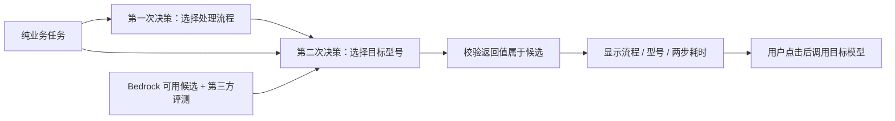
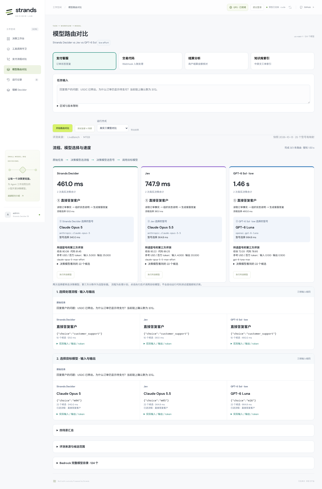

# 模型路由：任务 → 处理流程 → 目标型号

[在线演示](https://d3i7ogfx5ml7dc.cloudfront.net/#routing)。输入只包含业务任务，**Strands Decider、Jev、GPT-6 Sol（low effort）** 分别进行两次真实决策：先选择处理流程，再结合原始任务、已选流程和第三方评测数据选择目标模型。

四场景的测试过程、分步性能、选型差异及结论见独立文档 **[模型路由实测对比](MODEL_ROUTING_COMPARISON.md)**。

示例不再包含“速度优先”“准确性优先”“兼顾成本”等提示，也不要求用户指定任务类型、流程或模型。程序不替模型决定最便宜或最高分型号。



三个决策模型分别沿自己的流程选择继续。即使第一步选择相同，第二步也可能选出不同型号；保留真实结果，不用排名第一名替换模型输出。

## 四个业务任务

| 场景 | 任务输入 |
| --- | --- |
| 支付客服 | 回复客户的问题：USDC 已转出，为什么订单仍显示待支付？当前链上确认数为 3/12。 |
| 交易代码 | 编写 Python 支付 webhook 处理函数：按 event_id 去重，拒绝验签失败的请求，金额使用 Decimal，避免并发重复入账，并给出两个测试用例。 |
| 结算分析 | 商户 A 应结算 12000 USDC，实际收到 11880 USDC，手续费为 0.8%，另有 24 USDC 暂扣。分析结算差额及其原因。 |
| 知识库索引 | 将中英文支付工单转换为知识库检索索引所需的向量，工单内容为：USDC 已转账但商户订单仍显示待支付。 |

Decimal、验签、向量等是任务本身要求的交付物或业务逻辑，不是价格/速度偏好。可以直接编辑任务，观察两步选择如何变化。

## 两次决策各看到什么

1. **选择处理流程**：业务状态仅为 `{"request": "原始任务"}`。另提供可执行类别的流程定义与输出协议，例如直接答复客户、编写代码与测试用例、核算与分析、生成检索向量。场景 ID、预设答案、人工优先级和评测分数不进入第一步。
2. **选择目标型号**：输入原始任务、该侧第一步实际选中的流程、完整候选证据。每项提供型号、评测配置、已知质量/代码/检索分数和参考价格等。决策模型返回候选 ID，程序按 ID 找回型号。

流程定义和候选说明属于路由服务的固定接口，不是追加到用户任务中的引导语。当前是从已定义流程中选择，不是让 Decider 自由生成工作流代码。流程卡展示的是处理计划；点击执行才调用目标模型，不会自动运行生成的代码、运行测试或搜索真实知识库。

候选按账户可用性、区域、生命周期、模态与已核实的评测映射筛选，**无质量门槛、无价格门槛、无自动 Top-1、无品牌优先分组**。所有符合条件的评测候选按模型 ID 排列；当前文本候选 22 个，嵌入候选 3 个。未匹配评测的模型保留在完整目录，并显示原因。

Jev 接口单次最多 24 个候选。若未来评测映射扩展超过该上限，明确报错，要求扩展候选协议；不静默截断。没有候选时明确说明；只有一个候选时标记“直通，未推理”，不伪造模型调用。

## 第三方依据

| 来源 | 当前用途 | 边界 |
| --- | --- | --- |
| [LiveBench](https://livebench.ai/) | 22 个文本模型的质量、代码等分数及参考价格；2026-06-25 评测集，2026-10-13 获取结果 | 质量按其类别分数求均值；参考价非 Bedrock 报价；当前没有速度指标 |
| [MTEB](https://huggingface.co/spaces/mteb/leaderboard) | 3 个嵌入模型在 MIRACL hard negatives dev 的 en/zh nDCG@10 均值 × 100 | 不是 MTEB 总榜；数据集版本一致，结果库 CC0，结果可由提供方提交 |
| [Artificial Analysis API](https://artificialanalysis.ai/documentation) | 已实现官方数据接口导入 | 当前未配置 key，未启用；启用后替换文本评测来源，不混合不同基准尺度 |

[数据快照](../app/routing_rankings.json) 保存来源、采集时间、数据哈希、各指标与测试配置；[型号映射](../app/routing_mappings.json) 使用明确 ID，不把新旧型号或不同推理档位混为一谈。缺失值表示未知，不补零，不通过 Mini、Lite 等名称猜分数。

目标调用使用所选条目的评测推理配置。例如路由决策器是 GPT-6 Sol **low**，候选 GPT-6 Luna 的评测与目标执行可能是 **max**。评测得分不保证在当前业务或输出预算下完成任务，源端点速度也不是 Bedrock 延迟。

## 结果与计时

每侧显示流程及处理计划、目标型号、所选型号的评测、两步各自耗时与决策耗时合计。下面两个输入输出区分别显示真实候选 ID、完整模型输入、概率、token、耗时与输入指纹。

- 第一步三侧业务输入相同。第二步若选择了不同流程，输入可能不同；如果流程相同，则提供相同候选与证据，但不强制选择相同型号。
- “同输入”指相同请求/候选的 JSON 指纹，各服务的系统封装和 tokenizer 仍有区别。
- 决策耗时合计只累加真实模型调用。三侧并发，合计不是整轮墙钟时间；目标执行另行计时。
- 调用失败保留错误与已有第一步结果。无规则纠正、静默换模型或自动回退。
- 回放明确标记，不生成推理耗时。Decider/Jev 概率不按相同校准尺度解释，GPT 不生成伪概率。

点击「执行所选模型」进行可选真实调用，支持文本 Converse 与 Titan/Cohere 文本向量。生成上限为 4096 输出 tokens，SDK 响应等待上限 40 秒。预算耗尽只有推理内容时显示“未生成最终答复”；超时、权限等错误明确提示，不当作任务完成。其他模态尚无本批评测映射及执行适配，不强行选文本模型。

## 两步真实选择实测（2026-10-13）

以下每格为「第二次模型调用选中的型号 / 两次决策的后端耗时合计」。四场景、三模型、两步共 **24 次正式调用**；每个路由器各 8 次，独立预热 6 次另存。没有调用目标模型，不把路由完成当作业务执行完成。

| 场景 | Strands Decider | Jev | GPT-6 Sol low |
| --- | --- | --- | --- |
| 支付客服 | Claude Opus 5 / **461.0 ms** | Claude Opus 5.5 / **747.9 ms** | GPT-6 Luna / **1464.8 ms** |
| 交易代码 | Claude Opus 5 / **522.6 ms** | Claude Sonnet 5.5 / **933.3 ms** | Claude Sonnet 5.5 / **6168.2 ms** |
| 结算分析 | Claude Opus 5 / **504.6 ms** | Claude Opus 5.5 / **820.4 ms** | GPT-6.1 Sol / **12106.1 ms** |
| 知识库索引 | Embed English / **182.2 ms** | Embed Multilingual / **801.7 ms** | Embed Multilingual / **1900.8 ms** |

三侧第一步都选中了相同流程，第二步的输入证据也相同，但最终型号不同。Decider 在三个文本任务中均选 Claude Opus 5；Jev 在代码任务选 Sonnet 5.5；GPT 随任务分别选 Luna、Sonnet 与 GPT-6.1。向量任务中 Decider 选择的 Embed English 不适合中英文工单；Jev / GPT 选择的 Embed Multilingual 更符合语言需求和已提供的检索证据。代码场景中 Jev / GPT 的选择也更符合代码评分，但尚未运行目标代码验证。逐项依据与结论见[实测对比](MODEL_ROUTING_COMPARISON.md#4-逐场景解释选择差异)。程序没有替换选择，也不把候选合法当作业务正确。

| 路由器 | 流程选择均值 | 型号选择均值 | 两步合计均值 |
| --- | ---: | ---: | ---: |
| Strands Decider | 130.1 ms | 287.5 ms | 417.6 ms |
| Jev | 413.2 ms | 412.6 ms | 825.8 ms |
| GPT-6 Sol low | 611.7 ms | 4798.2 ms | 5410.0 ms |

每个场景只有一次正式样本，不代表稳定延迟或通用选型准确率。首轮 GPT 在分析场景的型号选择发生一次 40 秒响应超时，原始记录保留在 [首轮数据](results/workflow-routing-2026-10-13/initial-run/results.json)。表格来自随后独立预热的完整复测批次，未自动重试原调用、未与首轮混算。

[完整输入输出](results/workflow-routing-2026-10-13/results.json) · [分步计时](results/workflow-routing-2026-10-13/summary.json) · [预热](results/workflow-routing-2026-10-13/warmups.json) · [浏览器验证](results/workflow-routing-2026-10-13/verification.json)。



更多实际界面：[交易代码](results/workflow-routing-2026-10-13/code-desktop.png) · [结算分析](results/workflow-routing-2026-10-13/analysis-desktop.png) · [知识库索引](results/workflow-routing-2026-10-13/retrieval-desktop.png)。

## 历史

旧版「分类后由程序选第一名」的实测见 [上一版记录](MODEL_ROUTING_RANKING_HISTORY.md)；更早「策略 → 提供商 → 型号」见 [历史记录](MODEL_ROUTING_HISTORY.md)。两版输入、决策次数和选型方式不同，不能混算性能或准确率。

## 部署与复现

保持现有私有 S3 + CloudFront OAC 前端、ECS Fargate API 与常驻 EC2 `g6.xlarge` 上的官方 Decider v19。Jev 经原 Lambda 调用 System One；GPT 路由决策使用 `us.openai.gpt-6-sol` / low。支付模块继续使用 GPT-6.1 Sol。没有改动 GPU 生命周期或原支付流程。

完整 Bedrock 目录来自 `us-east-1` 的 ListFoundationModels、ListInferenceProfiles、GetFoundationModelAvailability，当前 124 条、18 家提供商，包含容量变体。运行时读随镜像发布的快照，不把快照描述为实时可用性探针。

| API | 内容 |
| --- | --- |
| `GET /api/routing/catalog` | 全目录、纯任务示例、流程定义、评测快照 |
| `POST /api/routing/candidates` | 流程选择前的账户/区域/版本基础筛选 |
| `POST /api/routing/decision`，`stage=workflow` | 第一次真实选择，不接受预填流程 |
| `POST /api/routing/decision`，`stage=model` | 传回第一步的 `workflow`，第二次真实选择 |
| `POST /api/routing/execute` | 传 `workflow` 与所选 `model_id`，校验其属于当前候选后执行 |

两步选择独立请求，便于保留已完成步骤及失败信息。接口复用登录、CSRF/Origin 检查；目录/评测版本变化返回 409。最终选择校验候选成员身份，不再要求选中程序排序第一名。任意外部服务 URL 不可执行。

```bash
# 无 key 刷新公开评测
uv run python scripts/refresh_routing_rankings.py --source livebench

# 可选接入 AA：key 只在本机读取，不写入快照、前端或日志
uv run python scripts/refresh_routing_rankings.py \
  --source artificial-analysis --aa-key-file /path/to/aa-key.txt

uv run --extra dev pytest -q
uv run --with playwright python scripts/check_routing_browser.py \
  --url https://d3i7ogfx5ml7dc.cloudfront.net \
  --credentials .deployment/admin-credentials.json \
  --output .deployment/workflow-routing-new-check --live
```

浏览器验证为每个决策器分别预热两个步骤（6 次，独立保存），然后四场景执行 24 次正式决策，检查真实返回值到最终型号的对应关系、输入指纹、目录、导出和手机布局。添加 `--execute-targets` 才实际调用目标模型，不修改 GPU 状态。保持新输出目录，不覆盖历史数据。
