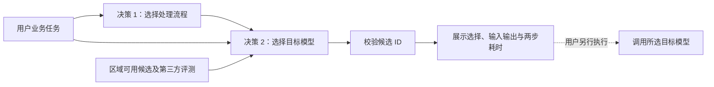
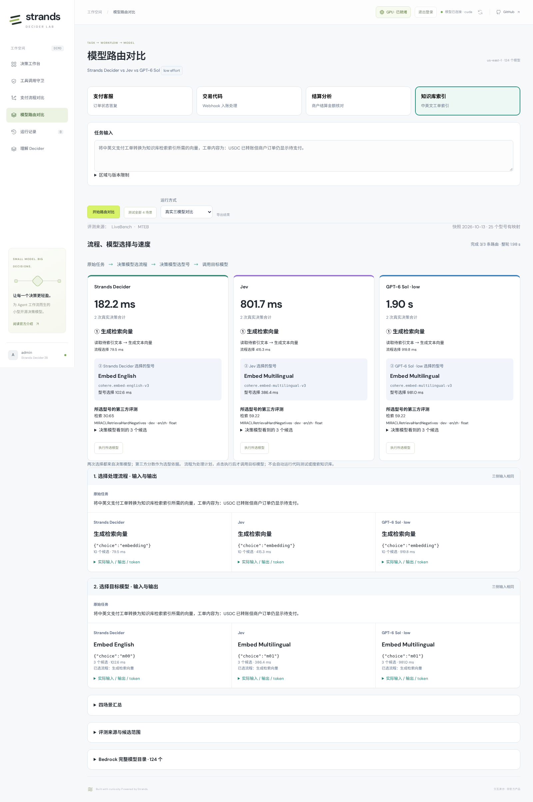

# 模型路由实测：Strands Decider vs Jev vs GPT

用四个支付相关任务，比较三个决策模型如何选择处理流程和目标模型，以及完成路由需要多长时间。

**本批结论：Decider 路由最快；Jev 和 GPT 在中英文索引、代码选型上更符合已提供的能力证据。** 三者都正确识别了四个任务的处理流程，但这不等于选型正确或目标业务完成。当前结果支持优先继续评估 Jev 承担本项目的模型选型，尚不足以给出通用准确率或所有路由任务的优劣排名。

[在线演示](https://d3i7ogfx5ml7dc.cloudfront.net/#routing) · [功能、部署与 API](MODEL_ROUTING.md) · [原始输入输出](results/workflow-routing-2026-10-13/results.json) · [计时数据](results/workflow-routing-2026-10-13/summary.json)

## 1. 比较的是什么

用户只提交任务，不填写“速度优先”“准确率优先”、模型名称或预选流程。每个决策模型分别执行两次真实调用：

流程定义由应用提供，模型从中选择；本演示不让模型自由编写工作流。第二步保留真实选择，程序不按排名替换答案、不自动纠错或回退。目标执行需要另外点击，本批测试没有执行目标模型。

| 决策模型 | 本批版本 / 配置 | 调用路径 |
| --- | --- | --- |
| Strands Decider | `strands-decider-2B-hobson-v19` | ECS API → 私网 EC2 `g6.xlarge` / L4，官方串行推理实现 |
| Jev | `jev-latest`，返回 `jev-1.13.0` | ECS API → Lambda → Typesafe System One API |
| GPT | `us.openai.gpt-6-sol`，推理强度 `low` | ECS API → Bedrock Converse |

这里的 GPT 是**路由决策器**，与它可能选中的 GPT-6.1 Sol、Claude 等**目标模型**是两个角色。Decider 使用本项目原服务，本次数据不来自独立的 vLLM 项目。

## 2. 测试过程与共同输入

1. 使用 `us-east-1` 的目录快照和同一份评测快照；先给每个决策器的两个步骤各预热一次，共 6 次，单独保存。
2. 按顺序测试四个场景；每个场景并发运行三个决策器，每侧先选流程，再选型号。
3. 第一步只提供原始任务、流程定义和选择协议。第二步提供原始任务、该侧实际选择的流程、候选模型名称、评测配置和已知指标。
4. 保存实际输入、输入指纹、候选 ID、概率（接口提供时）、tokens、耗时及错误。验证返回的 ID 与页面型号对应，不把返回合法候选计作正确率。
5. 导出记录并检查桌面、手机布局及浏览器错误。

本批为 **4 场景 × 3 决策器 × 2 步 = 24 次正式调用**，每个决策器各 8 次，全部返回有效候选。三者第一步选择相同，因此每个场景第二步的业务输入与候选证据也相同，输入指纹一致。服务的系统封装和 tokenizer 各有差异。

候选来自 124 条区域目录记录、18 家提供商。按账户权限、区域、生命周期、模态及已核实的评测映射筛选后，本批文本候选 22 个、向量候选 3 个。没有质量或价格门槛，也没有人为 Top-1 推荐；未匹配评测的目录模型不能据此参与本批选型。

| 场景 | 原始任务 | 三者共同选择的流程 |
| --- | --- | --- |
| 支付客服 | 回复客户的问题：USDC 已转出，为什么订单仍显示待支付？当前链上确认数为 3/12。 | 直接答复客户 |
| 交易代码 | 编写 Python 支付 webhook 处理函数：按 event_id 去重，拒绝验签失败的请求，金额使用 Decimal，避免并发重复入账，并给出两个测试用例。 | 编写代码与测试用例 |
| 结算分析 | 商户 A 应结算 12000 USDC，实际收到 11880 USDC，手续费为 0.8%，另有 24 USDC 暂扣。分析结算差额及其原因。 | 核算与分析 |
| 知识库索引 | 将中英文支付工单转换为知识库检索索引所需的向量，工单内容为：USDC 已转账但商户订单仍显示待支付。 | 生成检索向量 |

评测来源是 [LiveBench](https://livebench.ai/) 与 [MTEB 结果](https://huggingface.co/spaces/mteb/leaderboard)。LiveBench 使用 2026-06-25 评测集的结果；嵌入指标为 MIRACLRetrievalHardNegatives dev 的中英文 nDCG@10 均值 × 100，不是 MTEB 总榜。当前没有启用 Artificial Analysis；项目已提供其官方 API 导入功能。

[评测快照](../app/routing_rankings.json)记录来源链接、配置和原始指标。价格为外部参考价，并非 Bedrock 报价；文本模型缺少速度指标，没有根据名称补分。

## 3. 四场景选择与耗时

每格是「所选目标型号 / 两次决策累计后端耗时」，单位毫秒。

| 场景 | Strands Decider | Jev | GPT-6 Sol low |
| --- | --- | --- | --- |
| 支付客服 | Claude Opus 5 / **461.0** | Claude Opus 5.5 / **747.9** | GPT-6 Luna / **1464.8** |
| 交易代码 | Claude Opus 5 / **522.6** | Claude Sonnet 5.5 / **933.3** | Claude Sonnet 5.5 / **6168.2** |
| 结算分析 | Claude Opus 5 / **504.6** | Claude Opus 5.5 / **820.4** | GPT-6.1 Sol / **12106.1** |
| 知识库索引 | Embed English / **182.2** | Embed Multilingual / **801.7** | Embed Multilingual / **1900.8** |

### 分步时间

| 场景 | Decider：流程 / 型号 | Jev：流程 / 型号 | GPT：流程 / 型号 |
| --- | ---: | ---: | ---: |
| 支付客服 | 121.0 / 340.0 | 383.1 / 364.8 | 480.0 / 984.8 |
| 交易代码 | 153.2 / 369.3 | 436.3 / 497.0 | 509.7 / 5658.5 |
| 结算分析 | 166.6 / 338.0 | 418.0 / 402.4 | 537.4 / 11568.8 |
| 知识库索引 | 79.5 / 102.6 | 415.3 / 386.4 | 919.8 / 981.0 |
| **四场景均值** | **130.1 / 287.5** | **413.2 / 412.6** | **611.7 / 4798.2** |
| **两步合计均值** | **417.6** | **825.8** | **5410.0** |

计时使用导出记录的 `timings.backend_total_ms`，包含对应调用链的等待、传输和处理，不是统一边界的纯 GPU 推理时间。三侧并发，各侧内部两步顺序执行；三列不能相加当作用户整轮等待时间，表中也不包含目标任务执行时间。

四个任务各只有一个正式样本，均值是本批观测，不能当作稳定延迟、P95/P99 或并发吞吐量。Jev 已发起预热，但本批没有像支付 v8 批次那样通过 CloudWatch 逐次证明 Lambda 环境复用，因此不声称完全排除了冷启动。

首轮 GPT 在结算分析的第二步发生一次 40 秒响应超时，记录保留在[首轮数据](results/workflow-routing-2026-10-13/initial-run/results.json)。上述表格使用随后独立预热的完整复测批次；没有自动重试替换首轮错误，也没有把两批混算。完整复测的 24/24 是有效返回次数，不是 24 次选择都正确。

## 4. 逐场景解释选择差异

### 支付客服：不同选择，尚无充分依据判定谁更好

任务要求依据 3/12 确认数解释订单状态，没有规定速度、成本或回答风格。Decider 选择 Opus 5，Jev 选择 Opus 5.5，GPT 选择 Luna；三者都具备文本输出能力。

本批没有实际生成并评估客服答案，也没有测量这些目标模型在该任务上的延迟。不能仅因 GPT 选了较便宜的模型，就判定它最优；也不能仅因 Decider 选了大模型，就判定它错误。需要比较事实准确性、是否错误承诺到账、回答质量、实际延迟和费用。

### 交易代码：Jev / GPT 的选择更符合代码能力证据

| 决策器选择 | LiveBench Coding | 综合均分 | 本次评测配置 |
| --- | ---: | ---: | --- |
| Decider → Claude Opus 5 | 81.45 | **80.08** | max effort |
| Jev / GPT → Claude Sonnet 5.5 | **91.37** | 75.67 | max effort |

Sonnet 5.5 的代码分在本批候选中最高，更直接支持代码任务的选型。Opus 5 的综合分更高，但决策接口没有返回理由，不能事后编造“Decider 主动权衡后偏向综合能力”的解释。

**这说明 Decider 的选择依据较弱，尚不证明它选中的模型一定写不出正确代码。** 本批未执行目标生成、运行测试或验证并发幂等。下一步应在隔离环境检查验签失败、重复 event_id、金额精度和并发入账，再比较业务成功率与成本。

### 结算分析：先验证计算与解释，不能只看型号

本任务可核算：`12000 × 0.8% = 96`，`12000 − 96 − 24 = 11880`；手续费与暂扣恰好解释 120 USDC 的差额。

Decider 选择 Opus 5，Jev 选择 Opus 5.5，GPT 选择 GPT-6.1 Sol。候选对应的推理分分别为 91.21、92.15、92.63，第三方分数存在差异，但不是本题的正确率。没有目标模型的实际答复，无法判断哪个选型在正确计算、解释暂扣与响应成本之间更好。

### 中英文索引：Decider 选择了不适合任务的英文模型

Decider 正确识别 embedding 流程，却选择 `cohere.embed-english-v3`；Jev、GPT 均选择 `cohere.embed-multilingual-v3`。

| 候选模型 | 英文检索分 | 中文检索分 | 已传给决策器的均分 |
| --- | ---: | ---: | ---: |
| Embed English | 57.12 | **4.18** | 30.65 |
| Embed Multilingual | 57.80 | **60.65** | 59.23 |
| Embed v4 | 46.53 | **54.80** | 50.66 |

这里的检索分为指定 MIRACL 数据集的 nDCG@10 × 100，不是业务准确率，也不是模型是否接受中文输入的二元判定。三个结果使用相同数据集 revision；v3 与 v4 的 MTEB 软件版本不同，配置保留在快照中。

分语言数据保存在快照中，**当时没有传给三个决策器**；传入的是相同的名称、评测配置和正确均分。这些已有证据足以支持 Multilingual，Jev 与 GPT 也据此选中了它。因此不能把 Decider 的错误完全归因于缺少上下文。

Decider 给 English、Multilingual、v4 的输出概率分别为 44.55%、35.07%、20.38%，候选区分不明显。概率不是正确率，不能与 Jev 的数值直接比较校准程度。两轮相同输入均复现此选择，说明问题可重复；重复一道题不等于增加独立任务覆盖。

**在当前场景和输入协议下，Jev 与 GPT 的选择优于 Decider。** 本批仍未建立真实工单向量库或执行检索，不能把上述公开检索分描述成本项目实际检索效果。

其他真实界面：[支付客服](results/workflow-routing-2026-10-13/support-desktop.png) · [交易代码](results/workflow-routing-2026-10-13/code-desktop.png) · [结算分析](results/workflow-routing-2026-10-13/analysis-desktop.png)。

## 5. 为什么相同的正确上下文仍会产生不同选择

正确上下文提供了证据，模型仍需要识别任务需求、关联候选能力、比较指标并输出选择。Decider 的候选打分不等于执行确定性的数值排序；专门输出决策也不保证在所有路由任务上胜过其他模型。

本批观察到 Decider 在三个文本任务均选择 Opus 5，而 Jev、GPT 随任务选择不同型号。这个现象值得继续验证，但不能直接推断 Decider 存在品牌偏好或只看综合分。训练数据、训练目标、候选顺序、输入格式等都可能影响表现；本项目没有完成对应的受控实验，也没有内部推理证据来确定原因。

此前“去掉优先级、改成两步真实选择”修改的是应用调用流程，没有训练 Decider 权重。补充候选事实可能改善输入利用，但不能保证消除错误；Jev 和 GPT 的结果也需要独立业务验证，不能把两者一致当作标准答案。

## 6. 结论与后续优化

| 评估层次 | 本批结论 |
| --- | --- |
| 流程识别 | 三者都识别了四个任务对应的流程；覆盖有限 |
| 有效返回 | 完整复测 24/24 返回合法候选；首轮另保留一次 GPT 超时 |
| 型号选择 | 索引场景 Decider 选型不合适；代码场景 Jev / GPT 更符合提供的代码能力证据；客服与分析尚无目标任务实测结论 |
| 决策速度 | Decider 四场景均最快，Jev 次之，GPT 最慢；仅代表本批后端耗时 |
| 业务完成 | 本批未执行目标模型，未测代码通过率、客服质量或实际检索效果 |

**当前建议：优先继续评估 Jev 用于本项目的模型选型；Decider 的速度优势需要与选型可靠性一起验收。** 当前样本不支持宣称“Jev 在所有任务都更好”或“Decider 已达到生产路由准确率”。

后续优化按以下顺序验证，这些工作尚未包含在本批结果中：

1. **完善候选事实。** 保持用户只有任务输入，由后端补充可核实的语言能力和分语言评测，按任务去除无关指标。三个决策器同时使用更新后的上下文，不把目标答案写入提示。
2. **建立独立测试集。** 增加任务、语言、表达方式，打乱候选顺序，对输入格式分别做受控对比；保留失败、错误与耗时，避免只对四个固定示例调优。
3. **验证目标任务。** 运行代码验收、客服事实检查、结算核算和真实检索评价；记录正确完成率、端到端延迟与成本，不只比较路由器是否选了相同型号。
4. **再考虑专项训练与回退。** 若 Decider 仍持续选错，评估领域路由数据微调；使用独立验证集。若增加人工或其他模型复核，应单独记录原始错误、复核次数及新增耗时，不能把纠正结果计作 Decider 原始正确。

## 7. 复现与证据

本报告整理已有实测，没有为了文档重新调用或选择性替换数据。采集日期为 2026-10-13，完整批次导出于 12:45:27 UTC。

| 证据 | 位置 |
| --- | --- |
| 两步输入、候选、模型输出与指纹 | [results.json](results/workflow-routing-2026-10-13/results.json) |
| 各场景两步计时与均值 | [summary.json](results/workflow-routing-2026-10-13/summary.json) |
| 6 次独立预热 | [warmups.json](results/workflow-routing-2026-10-13/warmups.json) |
| 首轮原始结果及 GPT 超时 | [initial-run/results.json](results/workflow-routing-2026-10-13/initial-run/results.json) |
| 浏览器、手机与未执行目标的验证记录 | [verification.json](results/workflow-routing-2026-10-13/verification.json) |
| 评测来源和型号映射 | [routing_rankings.json](../app/routing_rankings.json)、[routing_mappings.json](../app/routing_mappings.json) |

版本标识：`routing_version=workflow-model-v1`，`catalog_version=34ec203d9142af53`，`ranking_version=75d59020478318df`。

登录后打开演示，进入「模型路由对比」，选择真实模型并运行四个场景，展开两步输入输出，然后导出结果。自动复测命令见[功能文档](MODEL_ROUTING.md#部署与复现)；每次使用新输出目录，保留全部错误。历史程序排名选型的数据见[历史记录](MODEL_ROUTING_RANKING_HISTORY.md)，不与当前两步模型选择混算。
