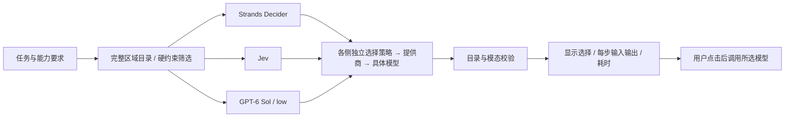
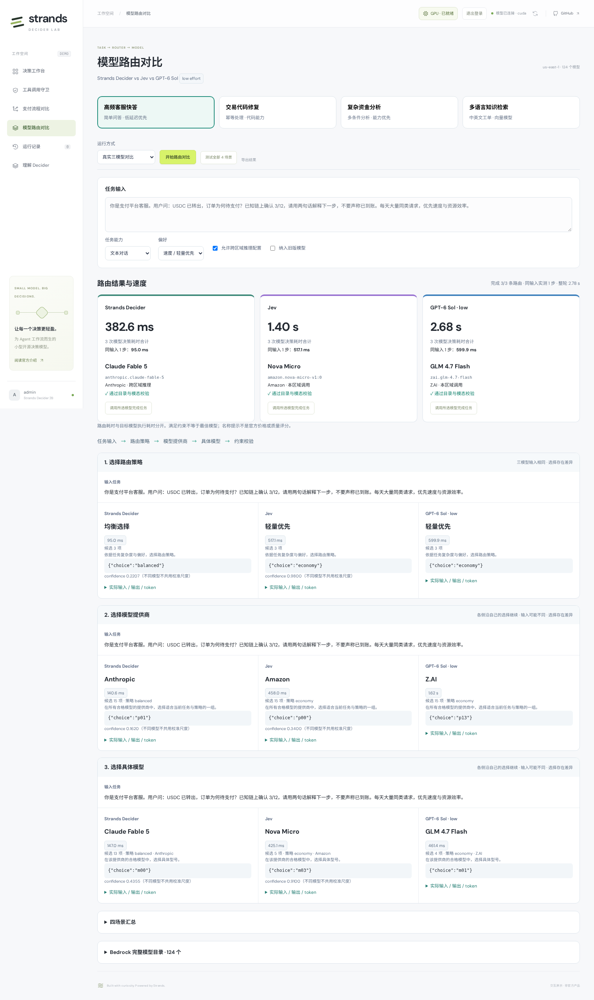

# 历史：分层模型路由演示

> 已由 [任务分类 + 第三方排名](MODEL_ROUTING.md) 替换。以下保留原流程与原始观测，不代表当前选型规则。

# 模型路由对比

在 [在线演示](https://d3i7ogfx5ml7dc.cloudfront.net/#routing) 选择「模型路由对比」，观察 **Strands Decider、Jev、GPT-6 Sol（low effort）** 如何为同一个任务选择 Bedrock 模型。用途类似模型网关的自动路由；本项目提供可观察的演示流程，不接入 OpenRouter。

## 四个场景

| 场景 | 输入与偏好 | 观察重点 |
| --- | --- | --- |
| 高频客服快答 | 解释 USDC 确认数；速度与轻量优先 | 是否选择足够完成简单任务的模型 |
| 交易代码修复 | Webhook 验签、去重、Decimal 与并发幂等 | 是否选择适合代码的模型家族 |
| 复杂资金分析 | 结算金额、手续费、暂扣金额及缺失证据 | 是否优先满足分析能力要求 |
| 多语言知识检索 | 为中英文支付查询生成检索向量 | 是否路由到 embedding 模型，而非聊天模型 |

任务、能力要求、偏好及跨区域限制都可修改。能力选择还包含图像理解、图像生成/编辑、视频生成、语音与检索重排；没有满足约束的模型时明确报错。

点击「开始路由对比」运行当前场景；「测试全部 4 场景」依次运行四个场景，并在各步骤并发调用三个路由模型。运行方式支持真实模型与明确标记的界面回放。回放不产生推理时间、token 或模型性能数据。

## 路由过程



1. **选择策略**：轻量优先、均衡选择或能力优先。
2. **选择提供商**：应用列出当前任务所有合格模型的提供商与完整模型名称，模型选择一组。
3. **选择具体模型**：列出该提供商全部合格模型，由路由模型选择。
4. **校验路由**：应用再次确认模型属于目录、满足账户、模态及区域限制。

所有合格模型都能通过对应提供商进入最终候选，不截取固定 Top-K。若未来目录增长使单层候选超过 24，明确要求扩展分组，避免悄悄丢弃模型。只有一个候选时由程序直通，标明“未推理”，不伪造一次模型调用。

这是分层路由：提供商选择会影响后续可选模型，不是对全目录逐模型评分。名字中的 Mini、Nano、Lite、Coder 等仅提供公开名称层面的演示提示，没有虚构价格、上下文长度、质量排名或延迟承诺。满足约束可能有多个合理选择，不设置唯一“正确模型”。

## 模型目录

目录通过 `us-east-1` 的以下 Bedrock API 实际采集：

- `ListFoundationModels`：全部基础模型、模态、生命周期与支持的推理方式。
- `ListInferenceProfiles`：可从该区域调用的推理配置及目标区域。
- `GetFoundationModelAvailability`：当前账户的授权、协议、使用资格及区域状态。

2026-10-13 采集到 **124 个目录条目、18 家提供商**，包括基础模型的容量变体；其中 123 个返回账户/区域可用，实际任务候选还会排除需要预置容量、模态不匹配及默认不纳入的旧版模型。完整目录保留这些条目和排除原因。“目录可用”不保证运行时 IAM、配额或 Converse 协议适配。

优先选择本区域 `ON_DEMAND` 调用；否则使用可用推理配置，优先美国配置。取消「允许跨区域推理配置」后，仅保留目标区域全部为 `us-east-1` 的模型。页面显示采集时间和目录版本，版本变化后的旧请求返回 409，避免用过期候选执行。

目录保存在 [bedrock_catalog.json](../app/bedrock_catalog.json)，不包含凭据。API 镜像构建前自动重新采集；运行中的应用读取该快照，不将静态快照描述成实时可用性探针：

```bash
uv run python scripts/refresh_routing_catalog.py --region us-east-1
```

## 结果与速度如何比较

页面突出显示最终模型、每侧真实决策次数、累计后端耗时和整轮墙钟时间；下方逐步列出输入任务、当前策略/提供商、模型返回候选 ID、概率、token、原始输入及输入指纹。

- 同一步三侧输入指纹相同时，标记“三模型输入相同”。
- 先前选择不同时，三侧各自沿自己的路径继续。后续候选或状态不同，标记“输入可能不同”，不算严格同输入样本。
- 每侧耗时合计只累加真实决策的后端时间；唯一候选直通与回放不计入。三侧并发，因此合计不是整轮墙钟时间。
- Decider/Jev 的概率及 confidence 按原样显示，不假定两者校准一致；GPT 不生成伪概率。
- 请求失败保留错误，该侧停止后续步骤，其他侧继续。没有规则替代、自动模型回退或伪造完整流程。
- 点击「调用所选模型完成任务」后才执行目标任务，结果与耗时单独显示。此时间不混入路由延迟。

目标执行演示支持文本 Converse，以及 Titan/Cohere 的文本 embedding 请求。其他模态仍可参与路由选择，但需要专用输入与 API 适配器才能执行。输出被 token 上限截断时显示“未完整结束”；API 错误明确显示，不自动订阅、部署容量或换模型。

“路由选择相同”不等于准确率；“满足目录与模态要求”也不等于任务质量已验证。四个固定输入的一次观测不能说明通用性能、模型优劣或稳定成本。

## 四场景真实观测（2026-10-13）

三个路由器各预热一次后，**36 次正式路由决策全部成功**，四个场景的三侧均完成策略、提供商和具体模型选择。下表每格为「所选目标模型 / 三次路由决策的后端耗时合计」，不包含目标模型执行。

| 场景 | Strands Decider | Jev | GPT-6 Sol · low |
| --- | --- | --- | --- |
| 客服快答 | Claude Fable 5 / **382.6 ms** | Nova Micro / **1400.2 ms** | GLM 4.7 Flash / **2677.7 ms** |
| 代码修复 | Claude Fable 5 / **444.6 ms** | Qwen3-Coder-30B-A3B / **1271.1 ms** | Claude Sonnet 5.5 / **2292.8 ms** |
| 复杂分析 | Claude Opus 4.5 / **405.0 ms** | Claude Opus 5 / **1263.1 ms** | GPT-6.1 Sol / **2275.0 ms** |
| 多语言检索 | Cohere Embed Multilingual / **357.0 ms** | Cohere Embed Multilingual / **1382.7 ms** | Cohere Embed Multilingual / **1921.7 ms** |

注意区分路由器与所选模型：GPT 路由器始终是 **GPT-6 Sol / low**；表中的 GPT-6.1 Sol、Nova Micro 等是其或其他路由器选择的**目标模型**。

本次 Decider 做路由决策较快，但客服任务选择了“均衡”策略，与输入中的速度偏好存在偏差；Jev 和 GPT 选择了“轻量优先”，随后选中不同提供商。代码与复杂分析也出现家族/版本差异；多语言检索三侧都选中同一个 Cohere 模型。这些选择没有被规则替换，也没有被换算成未经验证的准确率。

三侧输入完全相同的共有 **8 个步骤**：Decider / Jev / GPT 累计分别为 **1020.7 / 3562.1 / 5969.0 ms**。其余步骤的候选或上一步策略不同，属于各自路由流程的表现，不混入严格同输入测速。

首次部署验证中新模型访问被拒绝，GPT 预热返回 `AccessDeniedException`；该记录单独保留。权限与服务更新后的正式批次完整成功。另行验证的目标文本/向量执行不计入上述路由速度。

[完整请求与逐步输出](results/routing-2026-10-13/results.json) · [汇总](results/routing-2026-10-13/summary.json) · [预热](results/routing-2026-10-13/warmups.json) · [首次权限失败](results/routing-2026-10-13/initial-permission-failure.json) · [浏览器验证](results/routing-2026-10-13/verification.json) · [校验值](results/routing-2026-10-13/sha256.json)



其他实际界面：[代码修复](results/routing-2026-10-13/code-desktop.png) · [复杂分析](results/routing-2026-10-13/analysis-desktop.png) · [多语言检索](results/routing-2026-10-13/retrieval-desktop.png)。

附加功能验证中，点击按钮后实际得到了客服文本与检索向量，见 [目标执行记录](results/routing-2026-10-13/target-execution.json)、[文本结果截图](results/routing-2026-10-13/support-execution.png) 和 [向量结果截图](results/routing-2026-10-13/retrieval-execution.png)。该次客服路由的 GPT 改选 Nova Micro，说明重复运行也可能给出不同的合理选项；不与上面的固定批次混合统计。

## 模型、部署与 API

| 项目 | 当前实现 |
| --- | --- |
| Decider 路由器 | 原支付项目的官方 v19，EC2 `g6.xlarge` 常驻，沿用串行锁与推理租约；不是独立 vLLM 项目 |
| Jev 路由器 | `jev-latest`，经现有 IAM Lambda → Typesafe System One |
| GPT 路由器 | `us.openai.gpt-6-sol`，Bedrock Converse，`reasoning.effort=low` |
| 支付模块 GPT | 仍为 `us.openai.gpt-6.1-sol`，独立允许列表 |
| 前后端 | 私有 S3 + CloudFront OAC；现有 ECS Fargate API |
| 身份认证 | 复用用户名登录、会话、Origin/CSRF 检查 |
| 调用权限 | IAM 和 Bedrock 私网端点允许基础模型及推理配置调用；应用再按服务端目录和请求约束限制目标 |

| 接口 | 用途 |
| --- | --- |
| `GET /api/routing/catalog` | 完整模型目录、时间、版本、场景与路由器配置 |
| `POST /api/routing/candidates` | 当前任务的候选与逐模型排除原因 |
| `POST /api/routing/decision` | 一侧的一步路由，返回实际模型输入、选择与计时 |
| `POST /api/routing/execute` | 可选真实目标模型执行，重新校验目录版本与任务约束 |

所有接口需要登录；候选模型 ID、调用入口和提供商列表来自服务端目录，不接受浏览器传入任意服务 URL。运行状态保存在当前浏览器内存，刷新/退出清除；可导出四场景 JSON 复核。

## 验证与复现

```bash
uv run --extra dev pytest -q tests/test_routing.py tests/test_crypto.py
uv run --with playwright python scripts/check_routing_browser.py \
  --url https://d3i7ogfx5ml7dc.cloudfront.net \
  --credentials .deployment/admin-credentials.json \
  --output .deployment/routing-new-check
```

默认浏览器检查使用回放，验证四场景、逐步显示、完整目录、导出和移动端布局；添加 `--live` 才进行真实三模型调用。真实检查先分别预热一次，记录到 `warmups.json`，不计入四场景正式结果。使用新的输出目录保留每次记录。脚本禁止 GPU 启停，不自动执行目标任务。
