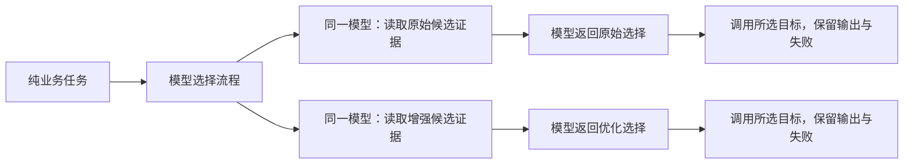
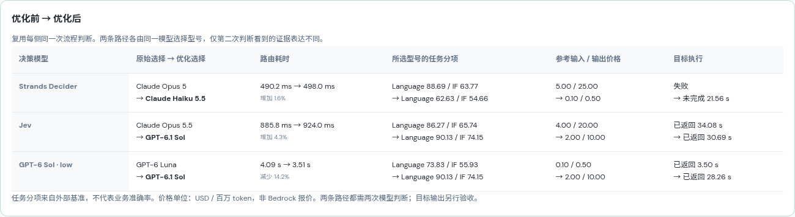
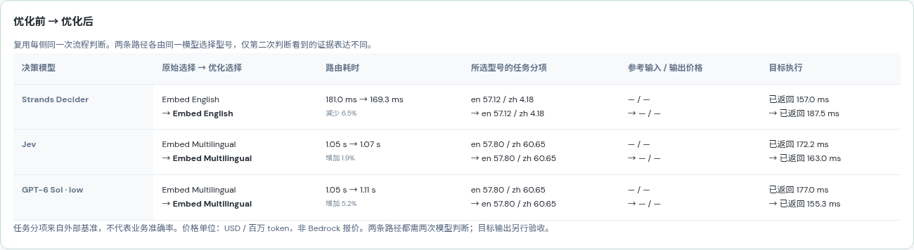

# 模型路由输入优化：始终由模型选择

> 历史实验记录：2026-10-16 起，前端模型路由只保留原始流程。本文中的优化界面、配对运行方法和截图描述此前实验，原始数据与后端接口保留。

[当前原始流程演示](https://d3i7ogfx5ml7dc.cloudfront.net/#routing) · [模块说明](MODEL_ROUTING.md)

原始与优化流程都由 **Strands Decider、Jev、GPT-6 Sol low** 做两次判断：先选择处理流程，再选择具体型号。优化只改变第二步的信息表达：提供与任务有关的分项指标、指标含义、来源、参考价格和实际调用限制。程序不排名、不设置人工质量门槛、不预填答案，也不替换模型选出的型号。

上一版程序选型方案已停用。其省去第二次模型调用的提速不能证明模型判断改善，相关数字不用于当前结论。[历史记录](MODEL_ROUTING_PROGRAM_SELECTION_HISTORY.md)单独保留。

## 比较流程



配对对比复用每侧同一次流程判断，分别发起两次独立的型号判断，隔离输入变化。单独运行任一路径都需两次模型调用；同时对比每侧实际调用三次，耗时按两条路径各自的两步累加。原始与优化的先后顺序按轮次、场景交替，导出文件保存 `selectionOrder`。

两侧使用相同任务、区域目录、评测快照、候选 ID 和候选顺序。未提供优先级、场景 ID、预设答案、Top-1 推荐、程序评分或及格线。低分候选依然可选；模型输出不在候选内则报错，不纠正答案。回放不计为模型推理。

## 补充了哪些信息

原始输入保留现有紧凑 JSON `metrics`；优化输入用自然语言逐项描述候选证据。

| 场景 | 优化提供的信息 | 由模型判断的内容 |
| --- | --- | --- |
| 事实型客服 | Language、IF 分开列出，说明 IF 是指令遵循；保留输入/输出参考价格 | 哪个型号适合据已知事实答复，如何权衡能力与成本 |
| 交易代码 | Coding、Agentic Coding 分开列出；说明分数不能保证验签、幂等、并发安全 | 哪些能力与实际开发任务有关、选择哪个型号 |
| 结算分析 | Reasoning、Mathematics、Data Analysis 分开列出 | 如何权衡核算、推理与数据分析能力 |
| 中英文检索 | 单独列出 en/zh nDCG@10 ×100，说明平均分可能掩盖单种语言短板 | 判断任务语言、比较相应语言的检索能力 |

例如英文向量候选的优化说明包含：

```text
Select Embed English to handle the requested embedding task.
Measured English retrieval 57.124/100; Chinese retrieval 4.178/100.
Evaluated configuration: MIRACLRetrievalHardNegatives · dev · en/zh · float.
```

它没有被删除，也没有被标成“不允许选择”。三模型各自根据这段信息判断；即使仍选英文模型，程序也会原样显示和执行。

优化输入还明确：分数越高代表同一指标下表现较好，不等于业务验收率；价格是外部参考价，不是 Bedrock 报价；没有目标模型延迟数据时标为未知；测试配置不能外推到其他推理档位；目标调用的输出上限为 4096 token，SDK 响应等待上限为 40 秒。

实现见 [`routing_evidence.py`](../app/routing_evidence.py)，版本 `model-evidence-v1`。只提取、换算和格式化证据，没有排名、阈值或 winner 函数。两条路径最终都进入同一个 `infer()`，调用相同的对应模型。

## 2026-10-16 重新测试：全部由模型判断

9 次预热后，四个任务各重复 3 轮。正式阶段 **108 次模型调用**：36 次流程判断、36 次原始输入型号判断、36 次增强输入型号判断；**程序选型调用 0 次**。三侧每次都保留相同候选 ID 和顺序。下表为每种路由器 12 个配对样本的两步后端耗时均值，不含目标执行。

| 路由器 | 原始输入 | 增强输入 |
| --- | ---: | ---: |
| Strands Decider | 416.3 ms | 413.7 ms |
| Jev | 991.6 ms | 986.0 ms |
| GPT-6 Sol low | 2506.0 ms | 2075.5 ms |

Decider、Jev 本批平均路由耗时接近，GPT 增强输入均值较低；样本为四个任务重复三轮，不能解释为稳定吞吐或 P95。两条路径都包含两次真实模型判断，已撤回上一版通过程序省去调用所得的提速结论。

### 实际选择

三个轮次的选型一致。每格为“原始 → 增强输入”：

| 场景 | Decider | Jev | GPT-6 Sol low |
| --- | --- | --- | --- |
| 客服 | Claude Opus 5 → Claude Haiku 5.5 | Claude Opus 5.5 → GPT-6.1 Sol | GPT-6 Luna → GPT-6.1 Sol |
| 代码 | Claude Opus 5 → Claude Haiku 5.5 | Claude Sonnet 5.5 → Claude Sonnet 5.5 | Claude Sonnet 5.5 → Claude Sonnet 5.5 |
| 结算 | Claude Opus 5 → Claude Haiku 5.5 | Claude Opus 5.5 → Claude Opus 5.5 | GPT-6.1 Sol → GPT-6.1 Sol |
| 中英文索引 | Embed English → Embed English | Embed Multilingual → Embed Multilingual | Embed Multilingual → Embed Multilingual |

**这次测试不能证明 Decider 选型准确率提高。** 它在三个文本场景都从 Opus 5 改选 Haiku 5.5，中英文索引仍选 Embed English。程序保留这些输出。Jev / GPT 的客服选择也变为 GPT-6.1 Sol；这说明更多语言与指令遵循证据影响了选择，不等于自动达到最低成本或最低延迟。

### 独立检查：候选顺序敏感性

正式路由结束后，额外向当前 Decider 服务发起 6 次请求：原始/增强输入各测试三种顺序，只改变候选对象的排列，型号、候选 ID、任务与数值都不变。该检查不混入上表或目标执行统计，也没有改动页面的正式候选顺序。

| 候选顺序 | 原始输入选择 | 增强输入选择 |
| --- | --- | --- |
| English → Multilingual → v4 | English | English |
| v4 → Multilingual → English | v4 | v4 |
| Multilingual → v4 → English | Multilingual | Multilingual |

六次均选首项。**这组任务下，当前 Decider 调用链对顺序明显敏感，补充分项信息还没有解决问题。** 这不等于证明所有 Decider 任务都有同样行为，也不能用一轮顺序检查估计通用准确率。后续应在更多任务和候选排列下验证，再调整候选表达或进行有标注数据的适配，而不是用程序选对的答案冒充模型改善。

[正式请求与响应](results/model-evidence-2026-10-16/results.json) · [独立顺序检查的 6 次完整请求](results/model-evidence-2026-10-16/candidate-order-diagnostic.json)

## 目标执行与实际截图

最后一轮每条路径的目标各执行一次，共 24 次；每格 n=1。即使选中同一型号也独立调用。输出预算、推理档位、40 秒 SDK 等待上限保持一致，未重试或换型号。

| 场景 / 路由器 | 原始选择的目标 | 增强输入后选择的目标 |
| --- | --- | --- |
| 客服 / Decider | 504 超时 | 21.56 s · 预算耗尽，无最终文本 |
| 客服 / Jev | 34.08 s · 完整文本 | 30.69 s · 完整文本 |
| 客服 / GPT-6 Sol low | 3.50 s · 完整文本 | 28.26 s · 完整文本 |
| 代码 / Decider | 504 超时 | 19.33 s · 预算耗尽，无最终文本 |
| 代码 / Jev | 29.92 s · 预算耗尽，无最终文本 | 29.84 s · 预算耗尽，无最终文本 |
| 代码 / GPT-6 Sol low | 29.82 s · 预算耗尽，无最终文本 | 30.53 s · 预算耗尽，无最终文本 |
| 结算 / Decider | 504 超时 | 21.42 s · 预算耗尽，无最终文本 |
| 结算 / Jev | 504 超时 | 504 超时 |
| 结算 / GPT-6 Sol low | 30.39 s · 完整文本 | 27.22 s · 完整文本 |
| 中英文索引 / Decider | 0.16 s · 1024 维向量 | 0.19 s · 1024 维向量 |
| 中英文索引 / Jev | 0.17 s · 1024 维向量 | 0.16 s · 1024 维向量 |
| 中英文索引 / GPT-6 Sol low | 0.18 s · 1024 维向量 | 0.16 s · 1024 维向量 |

两条路径都返回完整文本或向量 **6/12**，没有提升。原始路径 4 次超时、2 次预算耗尽；增强输入路径 1 次超时、5 次预算耗尽。不能把“超时变成更早耗尽预算”算成任务成功或有效答复更快。

- **客服**：GPT 路径从 Luna 的 3.50 s 变成 GPT-6.1 Sol 的 28.26 s。更高的语言/指令遵循分不等于简单客服响应更快。GPT-6.1 Sol 的答复补充了地址、金额、系统同步等条件；原始 Opus 5.5 则写入未提供的“30 分钟”时效，不能仅凭完整文本判为事实忠实。
- **代码**：六次调用全部没有最终代码，无法计算代码测试通过率。高 Coding 分数没有保证在当前推理配置和 4096 token 预算内完成。
- **结算**：只有 GPT 路径的两次 GPT-6.1 Sol 调用生成完整结果，均说明手续费基数，正确给出 `12000 × 0.8% = 96`、`96 + 24 = 120`。Decider 和 Jev 路径仍未完成。
- **中英文索引**：全部返回 1024 维向量，但 Decider 两侧都选择英文模型。现有执行适配仅生成 `search_query` 测试向量，没有构建索引或进行检索评测，不能把返回向量算成双语检索效果达标。

截图为第三轮路由与随后真实目标执行，显示的是单次结果，不是三轮均值：





[客服输入输出](results/model-evidence-2026-10-16/support-results.png) · [代码输入输出](results/model-evidence-2026-10-16/code-results.png) · [结算输入输出](results/model-evidence-2026-10-16/analysis-results.png) · [索引输入输出](results/model-evidence-2026-10-16/retrieval-results.png) · [手机布局](results/model-evidence-2026-10-16/mobile.png)

[统计及完整目标输出](results/model-evidence-2026-10-16/summary.json) · [验证、版本与截图哈希](results/model-evidence-2026-10-16/verification.json)

## 如何看效果

- 看型号是否变化，变化是否有任务证据支持。不能把与 GPT 选型一致当成准确率。
- 看两次模型判断的实际耗时、输入 token 和失败。增加信息可能让模型更慢，不能保证提速。
- 看目标模型的真实输出。完整文本不代表事实正确，向量生成不代表召回效果，代码生成不代表测试通过。
- 仍然保留错误选择、超时及预算耗尽。此次不改模型权重、目标推理档位和输出预算，不自动换模型或重试。

## 复现与接口

```bash
uv run --extra dev pytest -q
uv run --no-project --with playwright python scripts/check_routing_optimization.py \
  --url https://d3i7ogfx5ml7dc.cloudfront.net \
  --credentials .deployment/admin-credentials.json \
  --output docs/results/model-evidence-2026-10-16 \
  --live --rounds 3 --execute-targets
uv run python scripts/summarize_routing_optimization.py \
  docs/results/model-evidence-2026-10-16/results.json
```

`POST /api/routing/decision` 在型号判断阶段传 `strategy="original"` 或 `"optimized"`；优化另外传 `evidence_version="model-evidence-v1"`。返回实际 `model_input`、候选 ID、模型、usage、耗时、输入指纹与所选型号。`source="live"` 表示真实模型调用。只有回放返回 `rule_replay`，不会当成性能数据。

`POST /api/routing/execute` 沿用模型选出的 ID，校验可调用候选与版本。没有“必须选排名第一”的检查。已停用的 `/api/routing/rank` 返回 410，提示刷新页面，防止旧页面继续使用程序答案。
