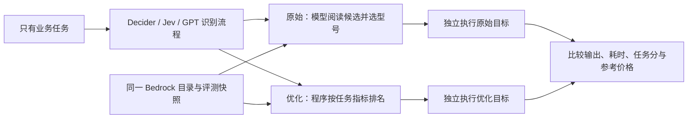
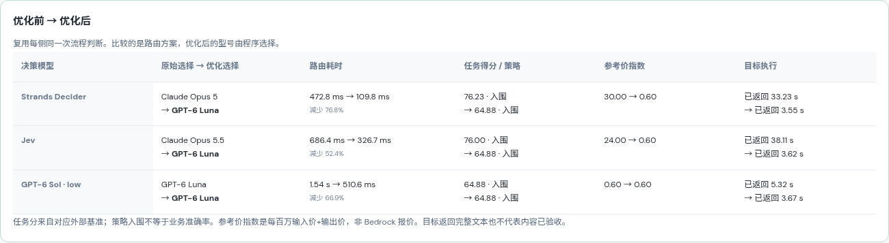
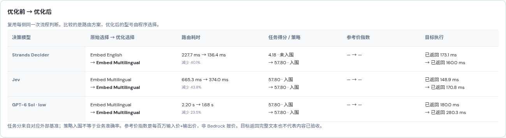

# 已停用的程序选型实验（不计入模型判断优化）

**此方案不符合模型自主判断的测试目的，已从演示移除。** 下文仅保留真实历史记录，其中 412→126 ms 等提速来自省去第二次模型调用，不能证明模型判断或输入优化有效。当前实现和重新测试见 [模型自主判断的输入优化](MODEL_ROUTING_OPTIMIZATION.md)。

[在线对比](https://d3i7ogfx5ml7dc.cloudfront.net/#routing) · [功能与接口](MODEL_ROUTING.md) · [原始两步实测](MODEL_ROUTING_COMPARISON.md)

原始流程让 Decider、Jev、GPT-6 Sol low 各做两次判断：先识别任务，再阅读多个型号的评测指标并选型号。已有测试中，Decider 能识别“生成向量”，却为中英文工单选择 Embed English；客服、代码与结算也容易重复选择同一个 Opus 型号。

这里采用先分类、再按任务排名的实现方式。项目没有 OpenRouter 的消费份额数据，使用公开基准分项和透明的服务策略，不宣称复现其官方排名。

这次保留原始流程，增加独立的优化路径：



**优化的是路由方案，没有改变 Decider 权重。** 模型仍可能判断错任务；排名也受评测覆盖范围影响。优化后选型与策略一致是程序执行规则的结果，不能称为 Decider 准确率提高。

## 1. 排名如何设计

历史实现 `task-ranking-v1`（已移除） 保存公式、参数与版本 `task-ranking-v1`。任务中不加入优先级，不使用场景 ID、型号品牌或人为指定答案。先按账户权限、区域、生命周期、模态和准确的评测映射建立候选池，再按流程使用对应指标。

| 任务 | 依据 | 排序规则 | 当前快照选型 |
| --- | --- | --- | --- |
| 事实型支付客服 | LiveBench Language、IF | Language ≥70、IF ≥55；入围后按参考价升序，同价按两项均分降序 | GPT-6 Luna |
| 交易代码 | LiveBench Coding | 距最高分不超过 2 分；入围后按参考价升序，同价按任务分降序 | Claude Sonnet 5.5 |
| 结算分析 | Reasoning、Mathematics、Data Analysis | 三项等权均分距最高分不超过 2 分；再比较参考价 | GPT-6.1 Sol |
| 中英文知识库索引 | MTEB MIRACL hard negatives dev 的 en/zh | 按两种语言中较低的 nDCG@10 ×100 降序 | Embed Multilingual v3 |
| 其他文本 | LiveBench Language、IF | 两项等权均分距最高分不超过 2 分；再比较参考价 | 随快照与区域候选变化 |

客服选择服务于“根据已知事实答复”这一流程。70/55 是可调整的初始能力门槛，2 分是避免为小幅基准差异付出过多参考费用的初始容差；**它们不是 LiveBench 官方及格线，也没有经过独立业务数据集校准**。对于高风险客服或不同业务要求，应验证并调整服务策略，不能直接套用。

参考价指数定义为：**每百万输入 token 的参考价格 + 每百万输出 token 的参考价格**。相当于固定输入输出各一百万 token 的比较单位，不是本次短任务的估算费用，也不是 Bedrock 报价。不使用型号名称猜价格、缺失值补零或不同来源分数混算。快照来源与测试档位完整保留在 [routing_rankings.json](../app/routing_rankings.json)。

双语检索不再只看综合平均分。例如 Embed English 的英文分数为 57.124，中文为 4.178；以较弱语言计分能直接暴露短板。Embed Multilingual 的两项为 57.802 / 60.648。这里仍是外部检索基准，不能把“返回向量”当成业务知识库检索达标。

当前没有可靠的 Bedrock 延迟分布，所以没有将速度纳入排名，也没有因之前一次 Opus 超时就给该型号永久降分。目标模型继续使用快照记录的推理档位，输出预算仍为 4096、SDK 响应等待仍为 40 秒。不存在用 max 档分数代表 low 档效果的情况。

## 2. 如何公平比较

页面默认「优化前后对比」，另可单独运行原始或优化流程。

1. 用户只提交同一个业务任务；每个路由器做一次流程判断。
2. 对比模式将这个**真实流程输出复用**到两条路径：原始路径再调用同一个决策模型选型号，优化路径执行程序排名。
3. 两条路径共享目录、评测快照与候选范围，保留不同选型。原始型号调用失败，不会覆盖优化结果；流程判断失败，则两条路径都不猜测流程。
4. 「执行两条流程的目标模型」依次发起六次独立调用；即使型号相同，也不复制输出或复用耗时。失败、预算耗尽、完整文本、向量分别记录。

原始路由耗时 = 流程判断 + 型号判断。优化路由耗时 = **同一次**流程判断 + 程序排名。这个配对设计用于隔离第二步选择方式的差异，不是两套完整服务的独立压测。目标模型执行另行计时；失败只记录等待时间，不补成成功延迟。三侧并发运行的墙钟时间也单独显示。

原始第二步继续使用原有的紧凑 `metrics` 输入；优化排名还读取同一快照中的 `category_scores` 与 en/zh `subsets`。因此这比较的是“任务指标提取 + 程序选型”的整体改造，不能把变化单独归因为模型能力或排序算法。

任务分、参考价、是否符合策略、是否生成完整结果分别展示。不同任务分数不能跨场景求平均当作质量总分，符合路由策略也不等于生成内容正确。

## 3. 2026-10-16 实测

先做 6 次独立预热，再对四个任务各运行 3 轮：共 72 次真实路由模型调用、36 次程序排名。三种路由器在 36 次流程判断中都选择了预期流程；只是 4 个任务的重复样本，不能外推为分类准确率。

### 路由耗时

以下均为后端计时，不含目标模型执行。每种路由器合计 12 个配对样本：

| 路由器 | 原始流程均值 | 优化流程均值 | 本批减少 |
| --- | ---: | ---: | ---: |
| Strands Decider | 412.2 ms | 126.3 ms | 69.4% |
| Jev | 728.2 ms | 378.8 ms | 48.0% |
| GPT-6 Sol low | 2493.4 ms | 1068.6 ms | 57.1% |

各场景均值（ms，每格 n=3，原始 → 优化）：

| 场景 | Decider | Jev | GPT-6 Sol low |
| --- | ---: | ---: | ---: |
| 支付客服 | 473.9 → 131.2 | 706.8 → 354.8 | 3355.8 → 2287.4 |
| 交易代码 | 477.6 → 103.6 | 646.2 → 347.6 | 1277.4 → 505.6 |
| 结算分析 | 495.7 → 126.5 | 834.0 → 423.9 | 3949.8 → 610.2 |
| 双语索引 | 201.7 → 143.9 | 725.6 → 388.7 | 1390.5 → 871.0 |

原始 GPT 第一轮客服流程判断为秒级长尾，已保留在两条路径中；原始结算型号判断也有长尾，没有挑选较快一轮替换。本批说明省去第二次模型判断能降低路由开销，不足以估计稳定 P95 或生产吞吐。

### 选型变化

三个正式轮次的型号选择保持一致：

| 场景 | Decider 原始 | Jev 原始 | GPT 原始 | 三侧优化选择 |
| --- | --- | --- | --- | --- |
| 客服 | Opus 5 | Opus 5.5 | GPT-6 Luna | GPT-6 Luna |
| 代码 | Opus 5 | Sonnet 5.5 | Sonnet 5.5 | Sonnet 5.5 |
| 结算 | Opus 5 | Opus 5.5 | GPT-6.1 Sol | GPT-6.1 Sol |
| 双语索引 | Embed English | Embed Multilingual | Embed Multilingual | Embed Multilingual |

- **客服**：Decider 路径的参考价指数 30 → 0.6，Jev 路径 24 → 0.6。任务均分有所降低，策略是先满足初始门槛再控制参考费用，不能表述为“所有质量指标都提高”。
- **代码**：Decider 选择从 Coding 81.45 的 Opus 5 改为 91.37 的 Sonnet 5.5。是否满足验签、幂等和并发安全仍需验收生成代码。
- **结算**：Decider 从 Opus 5、Jev 从 Opus 5.5 切换为 GPT-6.1 Sol。排名依据是推理、数学、数据分析和参考价格，最终仍要核对 96 手续费 + 24 暂扣 = 120 差额。
- **双语索引**：Decider 路径较弱语言的外部分数从 4.18 → 57.80；修正了这组 en/zh 证据下的选型短板。没有据此宣称真实知识库召回率提高了同样幅度。

实际请求、选择、输出与时间见 [原始记录](results/task-ranking-2026-10-16/results.json)。

### 实际目标执行与业务效果

三轮路由结束后，对最后一轮每条路径的所选型号各执行一次，共 **24 次独立目标调用**。同一型号也分别调用；以下每格 n=1，不能代表稳定延迟。

| 场景 / 路由器 | 原始路径目标执行 | 优化路径目标执行 |
| --- | --- | --- |
| 客服 / Decider | 33.23 s · 完整文本 | 3.55 s · 完整文本 |
| 客服 / Jev | 38.11 s · 完整文本 | 3.62 s · 完整文本 |
| 客服 / GPT-6 Sol low | 5.32 s · 完整文本 | 3.67 s · 完整文本 |
| 代码 / Decider | 504 超时（40 s 响应等待上限） | 28.86 s · 预算耗尽，无最终文本 |
| 代码 / Jev | 35.39 s · 预算耗尽，无最终文本 | 28.43 s · 预算耗尽，无最终文本 |
| 代码 / GPT-6 Sol low | 31.13 s · 预算耗尽，无最终文本 | 30.00 s · 预算耗尽，无最终文本 |
| 结算 / Decider | 504 超时（40 s 响应等待上限） | 26.67 s · 完整文本 |
| 结算 / Jev | 39.56 s · 预算耗尽，无最终文本 | 30.34 s · 完整文本 |
| 结算 / GPT-6 Sol low | 27.20 s · 完整文本 | 31.04 s · 完整文本 |
| 双语索引 / Decider | 0.17 s · 1024 维向量 | 0.16 s · 1024 维向量 |
| 双语索引 / Jev | 0.15 s · 1024 维向量 | 0.17 s · 1024 维向量 |
| 双语索引 / GPT-6 Sol low | 0.18 s · 1024 维向量 | 0.28 s · 1024 维向量 |

原始路径返回完整文本或向量 **7/12**，优化路径 **9/12**。这不是业务成功率：代码没有通过运行测试，向量没有进入真实检索系统，文本是否合规、忠实仍需验收。原始两次 HTTP 504 以及六次达到 token 上限的调用全部保留，没有重试或挑选成功结果。

**客服：响应更直接，但仍需限制无依据的承诺。** Decider 路径从 Opus 5 的 33.23 s、1991 输出 token，切换为 Luna 的 3.55 s、366 输出 token。原始 Opus 5 的回复包含“不会造成资金损失”“20 分钟后”等任务没有提供的承诺；Opus 5.5 也补充了“30 分钟”时效。Luna 较简短，正确解释了 3/12 尚未达到阈值，但其“自动更新”表述同样需要实际系统规则支持，不能把短答复自动评为完全忠实。

**结算：本批优化路径补上了实际结果。** Decider 原始路径超时，Jev 原始路径耗尽预算；优化目标均为 GPT-6.1 Sol，分别用 26.67 s、30.34 s 给出完整核算。答复明确按扣费前金额计算：`12000 × 0.8% = 96`，`96 + 24 = 120`，`12000 − 120 = 11880`；没有凭空确定暂扣释放时间。GPT 路由器原始与优化都选同一目标，其两次执行为 27.20 s / 31.04 s，后一次反而更慢，说明单次目标延迟差异不能归因于排名优化。

**代码：排名改善没有解决输出预算问题。** 原始 Opus 5 超时，其余五次 Sonnet 5.5 均耗尽 4096 输出 token，只有推理内容、没有最终代码。此次保持两条路径配置相同，没有为获得成功结果临时增加预算。后续应单独验证代码工作流的输出预算、任务拆分及推理档位，并重新测试代码验收率。

**双语索引：选型依据改善，尚未验证检索业务。** 所有六次调用都生成了 1024 维向量，Decider 的型号由英文版变为多语言版。本次沿用现有 `search_query` 嵌入适配，只生成测试向量，未建立工单索引或测量召回率。真正的知识库应使用文档嵌入配置、独立查询集和检索评价。

### 实际界面

截图来自上述真实执行，展示第三轮路由及随后独立执行的结果；不是前三轮均值。





[客服输入与完整结果面板](results/task-ranking-2026-10-16/support-results.png) · [代码结果](results/task-ranking-2026-10-16/code-results.png) · [结算结果](results/task-ranking-2026-10-16/analysis-results.png) · [双语向量结果](results/task-ranking-2026-10-16/retrieval-results.png) · [手机布局](results/task-ranking-2026-10-16/mobile.png)

[完整原始记录](results/task-ranking-2026-10-16/results.json) · [统计与目标输出](results/task-ranking-2026-10-16/summary.json) · [验证与截图哈希](results/task-ranking-2026-10-16/verification.json)

## 4. 历史采集方式

以下命令对应已移除的旧实现，当前同名脚本已改为模型判断对比，不能用于复现此程序选型批次。

```bash
uv run --extra dev pytest -q

# 默认是回放；真实测试必须显式 --live。
# credentials 文件只用于登录，不写进结果。
uv run --no-project --with playwright python scripts/check_routing_optimization.py \
  --url https://d3i7ogfx5ml7dc.cloudfront.net \
  --credentials .deployment/admin-credentials.json \
  --output docs/results/task-ranking-2026-10-16 \
  --live --rounds 3 --execute-targets
```

脚本先对三个路由器的两个阶段分别预热，保存预热结果，再运行四任务的配对比较。正式路由结束后独立执行两条路径的目标模型，不自动重试、换型号或调低推理档位。输出保留实际请求、响应、来源、配置、版本、截图与浏览器检查。

API 顺序：

```text
POST /api/routing/decision  stage=workflow，task.text=原始业务任务
  ├─ 原始：POST /api/routing/decision  stage=model，workflow=真实流程输出
  └─ 优化：POST /api/routing/rank      workflow=同一个真实流程输出

POST /api/routing/execute
  task、workflow、model_id、catalog_version、ranking_version
  优化路径另传 strategy="optimized"、policy_version="task-ranking-v1"
```

`/rank` 返回 `source="task_ranking"`、完整排名、未入围原因、程序耗时，`model_input` / `usage` 为 `null`，不会伪造第二次模型推理。目录、基准、策略版本过期返回 409。优化执行会在服务端重新核对所选型号，无候选时不执行。未覆盖的图像、视频、语音等流程明确报错，不用文本榜单代替。

## 5. 后续如何验证

应增加独立、未用于设定门槛的客服和代码任务集，测量事实忠实度、代码验收率、真实检索 Recall / nDCG，再校准客服门槛与 2 分容差。积累足够的 Bedrock 执行记录后，才能加入按任务、型号、推理档位区分的 P50/P95、成功率和 AWS 实际价格。

如果任务分类仍出错，可以补充清晰的流程定义、分类示例与困难样本，或微调 Decider。若分类正确但排名选型不理想，应调整任务指标或服务策略；两类问题应分别评估。
