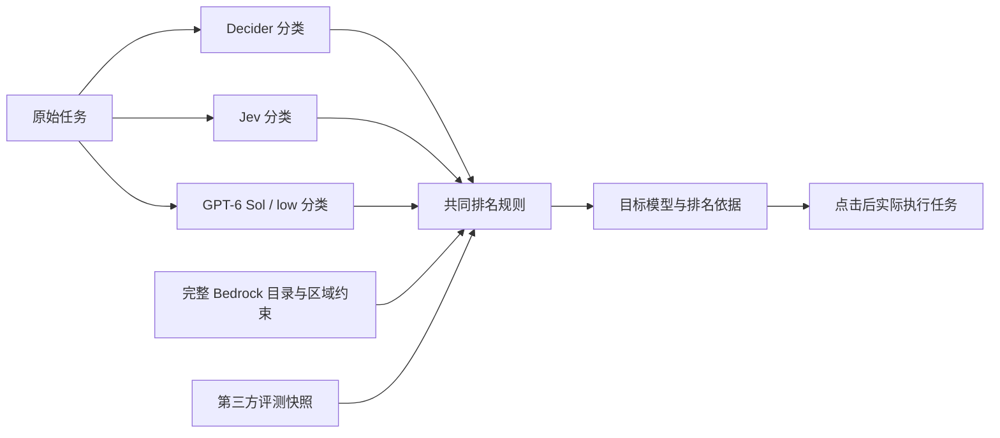
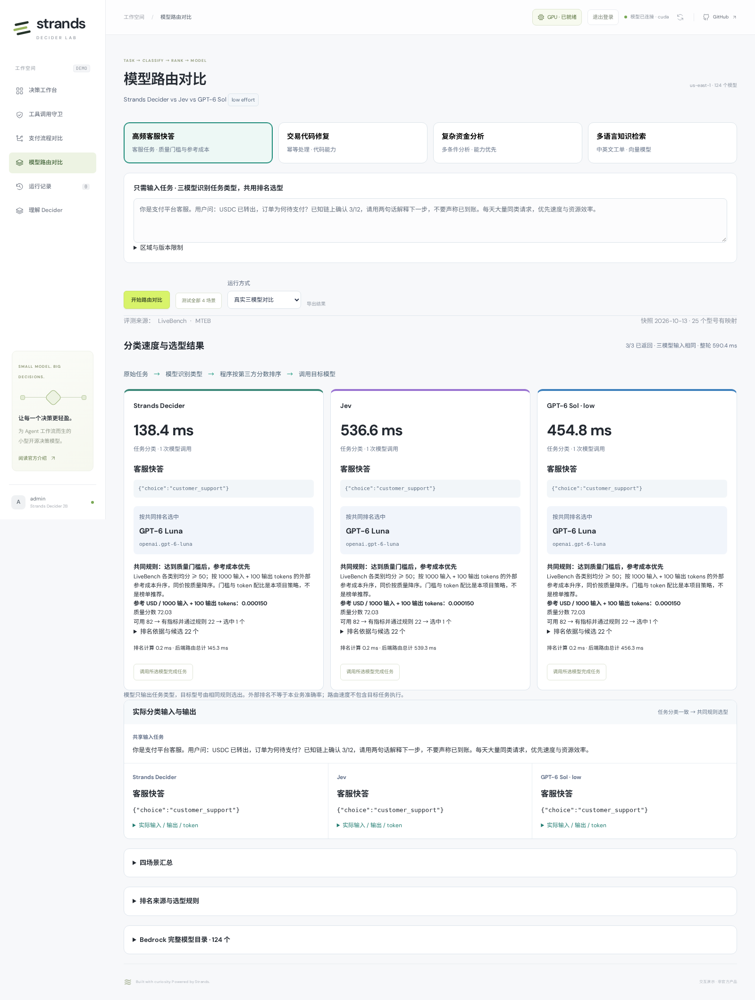

# 历史：任务分类 + 程序排名选型

> 此版本已被 [模型选流程，再选型号](MODEL_ROUTING.md) 替换。以下是历史实现和原始实测，不代表当前流程。

# 模型路由：任务分类 + 第三方排名

[打开演示](https://d3i7ogfx5ml7dc.cloudfront.net/#routing)。只输入任务，比较 **Strands Decider、Jev、GPT-6 Sol（low effort）** 的分类结果与速度，然后由同一套程序规则选择 Bedrock 模型。

不再要求用户填写“任务能力”“偏好”，也不再让三个模型先选品牌、再从品牌下选型号。原版记录保存在 [历史路由说明](MODEL_ROUTING_HISTORY.md)。



三模型各调用一次，输入包括原始任务、同一组任务类型定义和分类说明。排名、价格、预设场景 ID、人工参考标签都不进入分类输入。**分类相同、约束与快照相同，就会选中同一个目标模型**。分类不同时保留真实差异，不用规则纠正模型输出。

## 四个场景与规则

| 场景 | 模型应识别的任务类型 | 共同选型规则 |
| --- | --- | --- |
| 高频客服快答 | 客服回复 `customer_support` | 达到质量门槛后，参考成本升序；同价按质量降序 |
| 交易代码修复 | 代码 `coding` | 代码评测分数降序 |
| 复杂资金分析 | 分析 `reasoning` | 综合质量分数降序 |
| 多语言知识检索 | 向量 `embedding` | 同一数据集的中英文检索分数均值降序 |

表中类型用于解释场景，不作为模型已知答案。可直接改写任务，重新观察分类。运行按钮支持当前场景或全部四场景；也有明确标记、不产生模型耗时的界面回放。

质量门槛、参考 token 配比、同分处理是**本项目的服务策略**，不是用户必须提交的条件，也不是榜单官方推荐。当前没有自动估计用户真实 QPS、预算或输入长度。参考成本按 `1000 输入 + 100 输出 tokens` 计算，单位 USD；不是实际本次账单，也不包含隐藏推理 tokens。

## 数据来源

当前快照有 **22 个文本模型 + 3 个嵌入模型**的精确映射。完整 `us-east-1` Bedrock 目录仍显示所有 **124 个条目、18 家提供商**；容量变体、未排名和不满足约束的模型均可查看。

| 来源 | 使用的数据 | 限制 |
| --- | --- | --- |
| [LiveBench](https://livebench.ai/) | 2026-06-25 评测集，2026-10-13 获取的结果；Coding 分数、各类别均分、同批次 cost CSV 参考价 | 分数按官方类别分组计算；参考价非 Bedrock 报价；没有速度指标 |
| [MTEB](https://huggingface.co/spaces/mteb/leaderboard) | MIRACLRetrievalHardNegatives，dev，en/zh 两个子集的 nDCG@10 均值 × 100 | 是本项目选取的子集，不是 MTEB 总榜；结果库 CC0，提交结果可来自模型提供方 |
| [Artificial Analysis API](https://artificialanalysis.ai/documentation) | 已实现质量、Coding、参考价格、输出速度与 TTFT 导入 | **当前未配置 key，未启用**；启用后替换文本评测来源，不混合不同基准分数 |

当前 LiveBench 质量门槛是 50；启用 AA 后门槛是 5，分别处于各自评分尺度。两者不可直接比较。“客服低成本选型”不宣称“速度最快”。AA 速度导入后作为参考元数据保留；当前策略仍按质量和成本选型，不自动改变为速度排序。

来源 CSV、数据哈希、采集时间、评测配置、MTEB 数据集版本和固定 Git commit 记录在 [快照](../app/routing_rankings.json)。[映射表](../app/routing_mappings.json) 显式对应型号与推理配置，不模糊匹配名称、复制新旧版本分数或把 max 档成绩冒充 low 档。没有映射或缺少策略所需指标的模型不参与自动排名。没有可排名候选时显示原因，不猜选、不回退。

目标执行会按映射请求对应推理档位；例如分类器始终是 GPT-6 Sol **low**，所选 GPT-6 Luna 可能使用 **max**。目标执行最多 4096 输出 tokens，环境与 token 上限不等同基准测试，不能声称复现榜单成绩。

图像、视频、语音、重排等任务类型可以被识别，但本批快照没有对应选型指标，会明确提示“无可排名候选”，不强行选聊天模型。

## 界面与计时

页面显著显示原始任务、三侧分类输出、分类耗时、共同规则选中的模型，以及可展开的排名前五项、分数、来源链接和全部排除原因。原始请求、token、概率与输入指纹可以导出。

- **任务分类耗时**：每侧一次真实模型调用的后端计时，包含等待与调用开销。三侧输入指纹应相同。
- **排名计算耗时**：程序读取快照后确定性筛选/排序，不是第二次模型调用。
- **后端路由总计**：目录/快照读取、模型分类、排名等总时间。
- **目标执行耗时**：点击「调用所选模型完成任务」才发生，单独计时、显示真实文本或向量。

“同输入”指相同业务请求与候选定义的 JSON 指纹；各服务的协议封装、系统提示和 tokenizer 不同，不代表 token 数或实际端点相同。三侧并发运行，整轮墙钟时间不是三侧耗时之和。Decider/Jev confidence 不按同一尺度解释，GPT 不生成伪概率。失败返回真实错误，不转成回放；达到输出上限显示未完整结束。

三模型分类一致不是业务准确率，选型依据是第三方基准而非本业务最终质量验证。四条预设任务的一次测试不能推断通用分类准确率或稳定 P95。新旧路由执行次数不同，不混算速度。

## 本批真实观测（2026-10-13）

分别预热一次后，四个固定任务的 **12 次正式分类全部成功**，每个场景三侧输入指纹相同，且都识别出场景对应的任务类型。分类相同，所以共同规则选中了相同目标；这是本批四样本观测，不是通用准确率结论。

| 场景 | Decider 分类 | Jev 分类 | GPT-6 Sol low 分类 | 共同规则选中 |
| --- | ---: | ---: | ---: | --- |
| 客服快答 | 138.4 ms | 536.6 ms | 454.8 ms | GPT-6 Luna |
| 代码修复 | 147.9 ms | 441.1 ms | 4232.0 ms | Claude Sonnet 5.5 |
| 复杂分析 | 80.2 ms | 443.4 ms | 1727.3 ms | Claude Opus 5.5 |
| 多语言检索 | 78.8 ms | 528.7 ms | 474.7 ms | Embed Multilingual |

每侧四次分类均值：**Decider 111.3 ms / Jev 487.4 ms / GPT 1722.2 ms**。不包含排名计算与目标任务执行，不用于估计 P95。Decider 此次将客服任务识别为 `customer_support`，未再出现旧版先选“均衡策略”再偏向大模型品牌的路径；模型权重没有改变。

另行点击所选目标模型后：客服 GPT-6 Luna 返回最终答复（6.22 s）；Cohere 返回 1024 维向量（0.27 s）。代码场景的 Claude Sonnet 5.5 在 max 档耗尽 4096 输出 token，只返回推理内容；复杂分析的 Claude Opus 5.5 超过 40 秒响应等待。**目标任务完成 2/4，路由完成 4/4**，两者分开统计；未降低推理档位、换模型或伪造成功。

这也说明“第三方排名较高”不保证目标任务能在当前响应时间和 token 上限内完成。初次执行暴露了错误提示不足；后续补丁将预算耗尽显示为“未生成最终答复”，超时明确显示 40 秒限制。该补丁不改变分类输入、排序规则和上述正式分类数据。补丁后的独立 UI 验证返回 `max_tokens`、`complete=false`，明确展示 4096 token 预算耗尽；见 [实际响应](results/ranked-routing-2026-10-13/code-execution-postfix.json) 和 [更新后的截图](results/ranked-routing-2026-10-13/code-execution-postfix.png)。该次补充验证不并入正式测速。

[正式输入输出](results/ranked-routing-2026-10-13/results.json) · [计时汇总](results/ranked-routing-2026-10-13/summary.json) · [独立预热](results/ranked-routing-2026-10-13/warmups.json) · [目标执行（含失败）](results/ranked-routing-2026-10-13/target-execution.json) · [预算诊断](results/ranked-routing-2026-10-13/code-budget-diagnostic.json) · [界面验证](results/ranked-routing-2026-10-13/verification.json)



实际界面：[代码](results/ranked-routing-2026-10-13/code-desktop.png) · [分析](results/ranked-routing-2026-10-13/analysis-desktop.png) · [检索](results/ranked-routing-2026-10-13/retrieval-desktop.png) · [客服最终回复](results/ranked-routing-2026-10-13/support-execution.png) · [检索向量](results/ranked-routing-2026-10-13/retrieval-execution.png)。

## 刷新和接入 Artificial Analysis

排名在开发/部署环境刷新并随镜像发布，私有 ECS 请求路径不访问榜单网站。现有 API 部署只自动刷新 Bedrock 目录；排名固定在已审查的快照版本，更新后再部署。

```bash
# 无需 key：LiveBench + MTEB
uv run python scripts/refresh_routing_rankings.py --source livebench

# AA 官方免费 API；key 只读本机文件，不写入快照、浏览器或日志
uv run python scripts/refresh_routing_rankings.py \
  --source artificial-analysis --aa-key-file /path/to/aa-key.txt

# 更新目录
uv run python scripts/refresh_routing_catalog.py --region us-east-1

# 发布 API 与前端
uv run python deployment/deploy.py --region us-east-1 \
  --api-only --model-provider ec2 --tag YOUR_UNIQUE_TAG
```

AA 官方 API 要求 key 与来源署名，返回结果应缓存，文档标明免费限额为每日 1000 请求。脚本使用 `x-api-key` 请求官方接口，不抓取榜单网页作为生产导入方式。导入失败保留原快照；缺失字段不补零。API 集成已用结构化样例测试，实际 AA 网络调用需有效 key。

本项目借鉴 [OpenRouter Auto Router](https://openrouter.ai/docs/guides/routing/routers/auto-router) 的“分类后选型”结构，但使用第三方评测。本项目没有 OpenRouter 的使用量/消费份额数据，不复制其私有排序，也不调用 OpenRouter。

## 部署与 API

原 Decider 官方 v19 运行于常驻 EC2 `g6.xlarge`，沿用串行推理；Jev 经现有 Lambda 调用 System One；GPT 分类使用 Bedrock `us.openai.gpt-6-sol` / low。支付模块继续使用 GPT-6.1 Sol。前端私有 S3 + CloudFront OAC，API 为现有私有 ECS Fargate，无新增基础设施。

| 接口 | 用途 |
| --- | --- |
| `GET /api/routing/catalog` | 全目录、场景、分类选项、排名来源与快照 |
| `POST /api/routing/candidates` | 区域/账户/版本约束检查，分类前不猜模态 |
| `POST /api/routing/decision` | 一次真实分类 + 共同排序；返回真实输入输出、排名和计时 |
| `POST /api/routing/execute` | 实际调用排名选中的模型；重新检查目录、排名版本及选型结果 |

所有接口复用登录与 CSRF/Origin 检查。目录或排名版本变化返回 409；旧 `capability`、`priority`、`stage` 字段不再接受。客户端不能提供任意服务地址或绕过目录执行。状态保存在浏览器内存，可导出 JSON，刷新清除。

```bash
uv run --extra dev pytest -q
uv run --with playwright python scripts/check_routing_browser.py \
  --url https://d3i7ogfx5ml7dc.cloudfront.net \
  --credentials .deployment/admin-credentials.json \
  --output .deployment/ranked-routing-new-check --live
```

浏览器检查分别预热三个分类器一次，并独立保存，然后对四场景进行 12 次正式分类、保存截图与结果。脚本禁止 GPU 启停，不自动执行目标任务。
