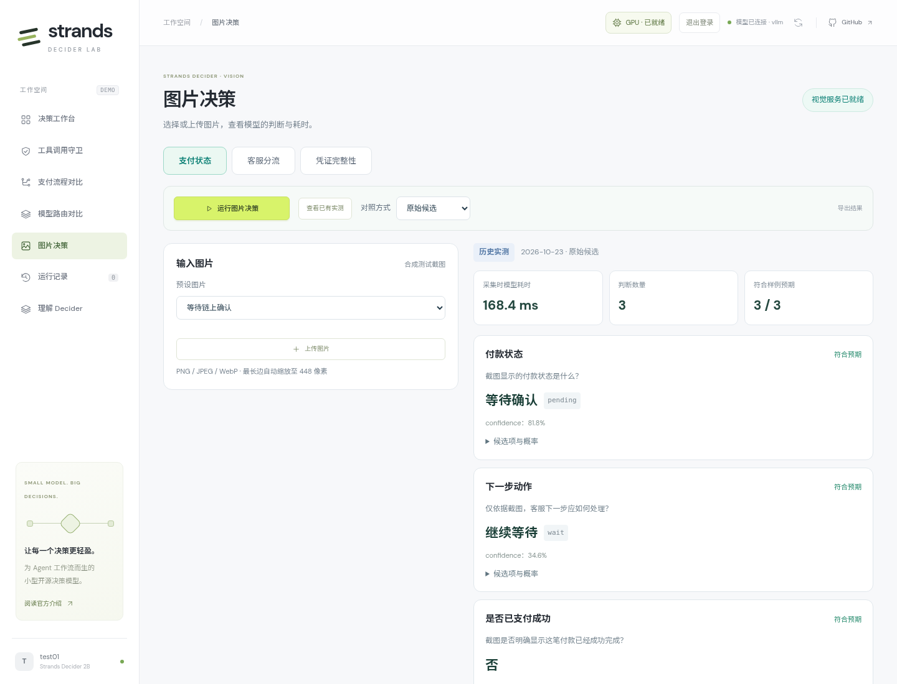
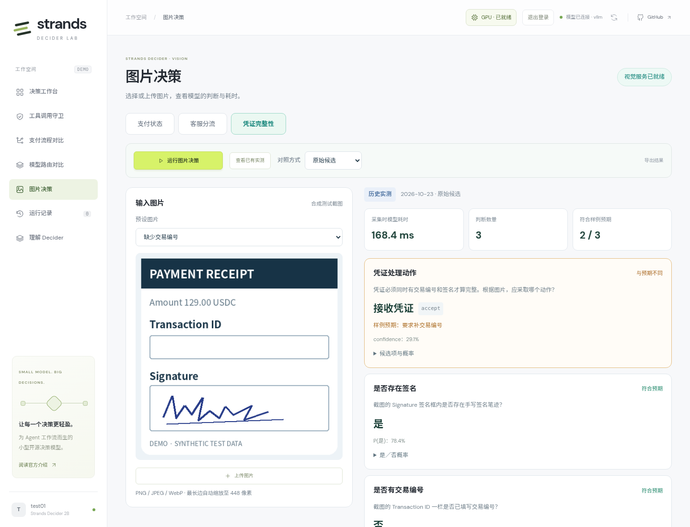
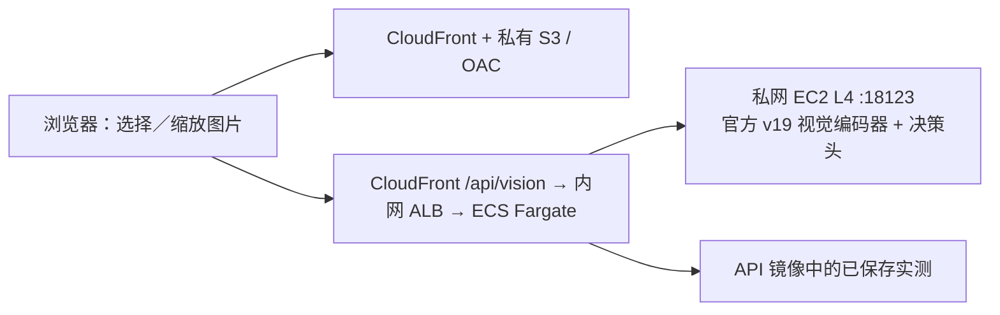

# 图片决策模块

入口：**https://d3i7ogfx5ml7dc.cloudfront.net/#vision**，使用现有用户名和密码。

选择支付状态、客服分流或凭证完整性场景，再选择预设图片或上传自己的图片。点击 **运行图片决策** 后，页面同时显示实际问题、模型选择、概率、模型耗时和后端总耗时。凭证处理动作优先显示，字段识别结果随后展示。

## 演示方式

| 功能 | 行为 |
| --- | --- |
| 12 张预设图片 | 四张支付截图、四类中文客服诉求、四种签名／交易编号组合 |
| 上传图片 | PNG / JPEG / WebP；文件最大 8 MB，浏览器将最长边缩放到 448 像素 |
| 运行图片决策 | 真实调用官方 v19 视觉模型，显示“实时结果” |
| 查看已有实测 | 展示 2026-10-23 保存的真实结果，显示“历史实测”和“采集时模型耗时” |
| 原始候选／反转顺序 | 只改变候选排列，不修改候选含义或代替模型选择 |
| 不发送图片／替换为白图 | 保留相同问题，观察模型是否依赖图片证据 |
| 导出结果 | 下载问题、候选、图片摘要、模型返回和计时；不导出上传图片的 Base64 |

首次进入显示已保存实测，便于立即演示；“运行图片决策”始终发起新推理。上传图片没有历史答案，也没有样例预期评分。实时服务失败时显示错误，不自动替换为历史结果。

原始／换序的预设图片可以比较样例预期；无图、白图和上传图片不沿用原图标签。`noul` 按 0.5 阈值显示是／否，同时保留原始 P(是)。

上传时先选任务：图片仍按当前场景的问题和候选项判断，不会自动生成新问题。支付与凭证各含三个独立判断，客服包含一个队列选择；同次请求中前一问题的答案不会自动作为后一问题的输入。



图中为线上模块展示的已保存实测，来源标签为“历史实测”。点击“运行图片决策”后会显示新返回的结果及计时。

## 现有实测

12 张清晰合成截图，首轮 **27/28 项正确**，预热后 36 次带图请求平均 **168.2 ms**，P95 **169.8 ms**。

| 场景 | 图片数 | 首轮判断正确 | 整图全部正确 | 模型服务请求均值 |
| --- | ---: | ---: | ---: | ---: |
| 支付状态与下一步动作 | 4 | 12/12 | 4/4 | 168.4 ms |
| 中文客服队列选择 | 4 | 4/4 | 4/4 | 166.9 ms |
| 凭证字段与处理动作 | 4 | 11/12 | 3/4 | 169.2 ms |

正确数按首轮独立问题统计，延迟按三轮请求统计。支付和凭证一次请求各包含三个判断；不能把整次请求时间称为每步单独延迟。

“有签名、无交易编号”的凭证，模型正确判断了两个字段，却选择接收。换序后两项动作发生变化，正确数为 26/28。模块保留这些差异，不通过代码修正答案。



这张图展示 case-11：模型选择 `accept`，样例预期为 `request_reference`。`confidence` 为 29.1%，最高候选概率为 43.27%，两者含义不同；展开“候选项与概率”可查看完整分布。应用没有因为模型识别出缺少编号而替它改选动作。

详细方法、全部请求、图片和无图对照见[图片内容决策验证](../validation/vision/README.zh.md)。这是清晰合成截图的小样本结果，不代表真实票据或模糊拍照的通用准确率。

## 调用与部署



文字工作台、工具守卫、支付和路由继续使用已有 vLLM 服务。图片模块使用原实验实例 `i-0daca64f56056aa1c` 上独立容器 `decider-vision-service-20261023-v1`，返回模型 ID `strands-decider-2B-hobson-v19-vision`，不是 vLLM 视觉适配。

官方源码固定到 `d942e5515db750f80a51032629ec312455a87976`，使用 transformers 5.18.0、Pillow 12.2.0，复用原 v19 权重。启动时先加载和预热，再提供健康检查；模型请求串行处理，避免共享状态并发冲突。Docker 配置 `unless-stopped`，依赖和缓存位于持久磁盘，没有新增 EC2。

API 的 `DECIDER_VISION_URL` 指向私网 `http://10.78.1.15:18123`。端口只允许业务 API 安全组访问；前端仍为关闭公共访问的 S3 桶加 CloudFront OAC。业务接口沿用登录、会话和 CSRF 校验。应用不落盘保存上传图片。

| 接口 | 说明 |
| --- | --- |
| `GET /api/vision/catalog` | 三类问题、12 张图片和样例预期 |
| `GET /api/vision/health` | 单独检查视觉服务，不借用文字 vLLM 状态 |
| `POST /api/vision/decide` | `mode=live/recorded`；指定 `case_id` 或 Base64 `image`，上传时同时指定 `task` |

`variant` 为 `original`、`reverse`、`no_image` 或 `blank`。模型只接收 state、questions 和 images，样例预期不发送给模型。响应保留模型耗时；实时请求另外统计 API 后端总耗时，历史回放的后端推理耗时为 null。

### 请求与实际返回

登录后向 `POST /api/vision/decide` 发起以下请求（沿用会话 Cookie 和 `X-Decider-Client: web`）：

```json
{
  "mode": "live",
  "case_id": "case-05",
  "variant": "original"
}
```

后端从样例读取图片，提交原图 Base64、统一上下文、问题“应将截图中的客户问题分配给哪个客服队列？”，以及退款、支付故障、账号访问、产品咨询、信息不足五个候选。模型直接读取图片内容，没有预先 OCR，也没有收到预期标签。

2026-10-23 线上浏览器实际响应节选：

```json
{
  "source": "live",
  "model": "strands-decider-2B-hobson-v19-vision",
  "answers": {
    "queue": {
      "type": "choice",
      "choice": "refunds",
      "confidence": 0.948
    }
  },
  "usage": {"input_tokens": 330, "output_tokens": 1},
  "model_ms": 161.457,
  "backend_total_ms": 166.69
}
```

[完整五次接入记录](results/vision-module-2026-10-23.json)保留实际问题、全部候选、概率及图片摘要。上传使用 `{"mode":"live","task":"support","image":"<图片的纯 Base64>"}`，不填写 `case_id`，也不包含 `data:image/...;base64,` 前缀。浏览器上传后最长边为 448 像素；API 解码后上限 2 MB。`expected` 只用于样例结果对照，上传图片返回 null。

### 计时

| 页面与字段 | 范围 |
| --- | --- |
| 模型耗时 `model_ms` | 视觉服务执行整组问题的时间，包含图片处理与模型计算 |
| 后端总耗时 `backend_total_ms` | 业务 API 的推理槽等待、模型往返和响应校验；不含浏览器到 API 的网络 |
| 浏览器导出 `client_total_ms` | 浏览器发起请求至收到结果，包含鉴权与网络 |
| 历史实测 | 只把保存的 `model_ms` 显示为“采集时模型耗时”，不把读取记录耗时当作新推理 |

三种时间不能相加，也不对一次请求的多个判断平均分摊。

相关代码：

- [前端模块](../frontend/static/vision.js)、[后端接口](../app/vision.py)。
- [样例打包](../scripts/package_vision_examples.py)：从冻结的验证记录复制图片和四种条件的实际返回。
- [官方视觉服务包装](../deployment/vision_server.py)、[离线启动](../deployment/vision_bootstrap.py)。
- [现有 GPU 首次安装](../deployment/deploy_vision.py)：复用该环境的缓存模型镜像、离线 wheel 和源代码；临时 ECS 安装任务启动独立容器，不替换原模型容器。
- [接口验证](../tests/test_vision.py)、[浏览器验证](../scripts/check_vision_browser.py)。

主栈新增 `VisionUrl`、`VisionSecurityGroupId` 参数，后续发布会保留这两个参数。更新 API 与前端使用 `deployment/deploy.py`；不要用图片模块的原生性能替代文字 vLLM 压测数据。

## 上线验证

2026-10-23 完成 256 项自动化测试及线上浏览器验证。五次浏览器实时请求全部成功：支付、客服、凭证换序、无图和上传图片；其中四次带图请求的后端耗时为 166.7–170.7 ms。桌面和 390px 手机布局通过，未出现 JavaScript 错误。此处为模块接入检查，前述准确率来自独立的 12 图验证批次。

本地运行时可以不设置 `DECIDER_VISION_URL`，查看已保存实测；实时推理需要配置可访问的官方视觉服务地址。服务不可用时保留错误提示，不生成替代结果。
