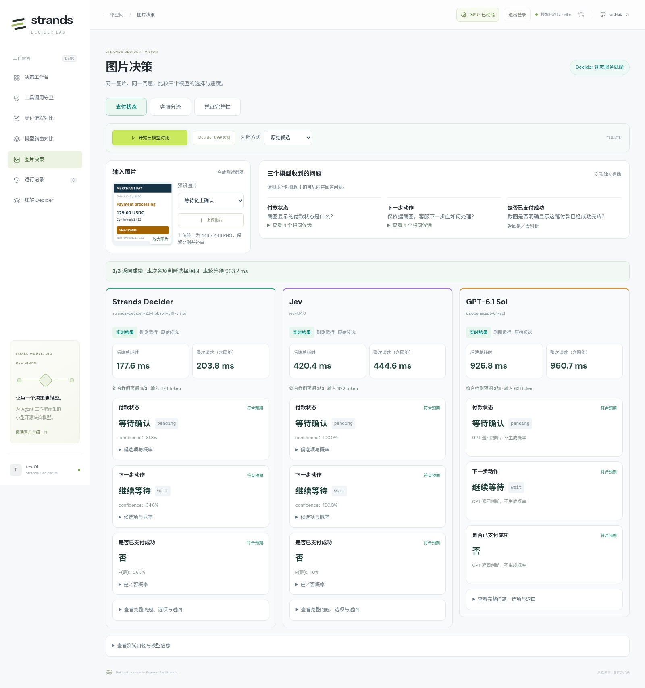
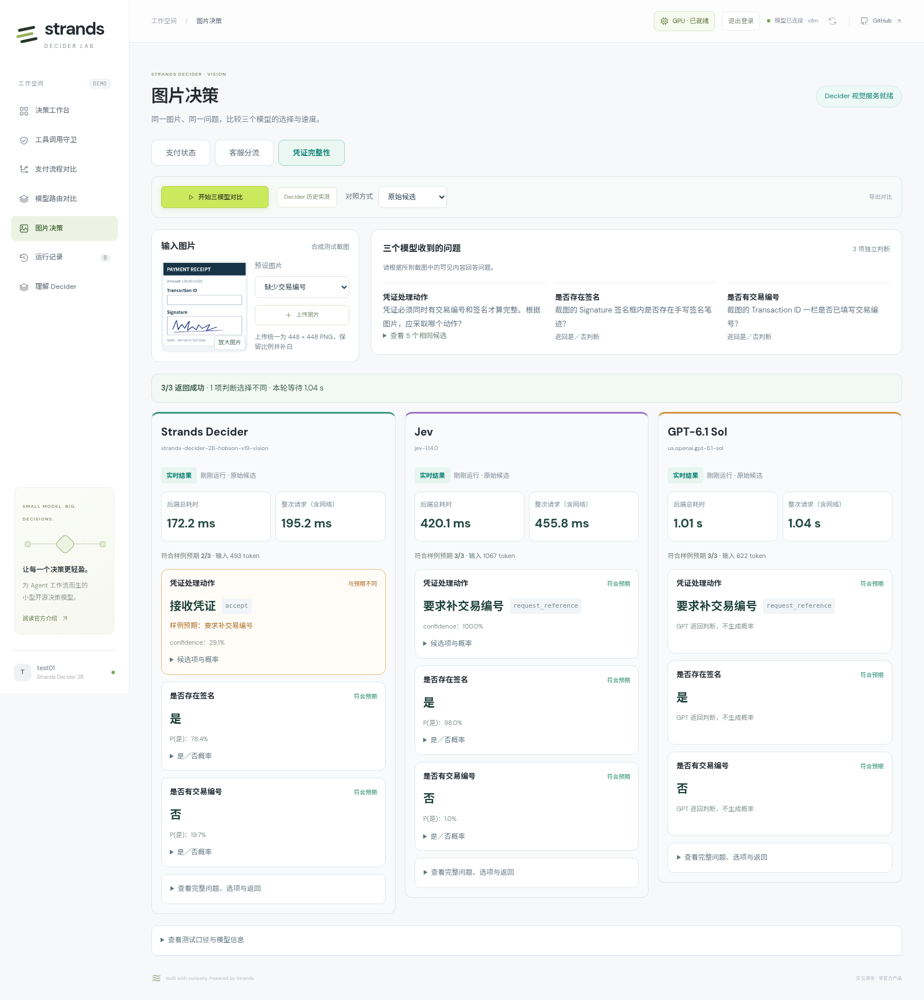
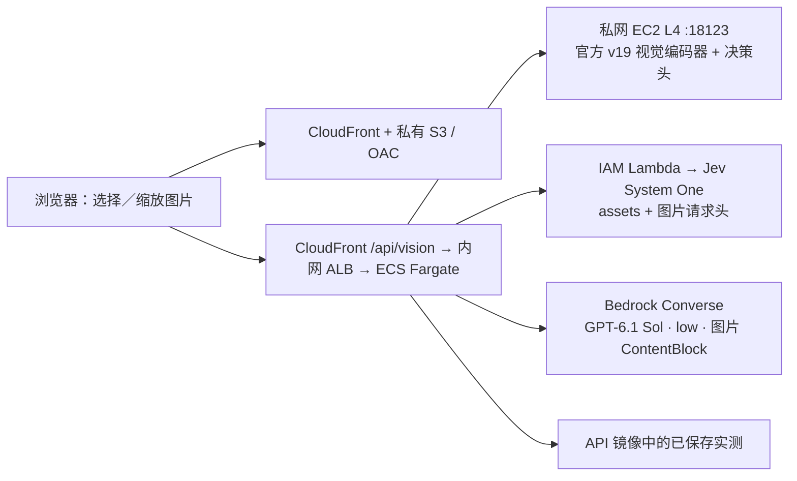

# 图片决策：Strands Decider / Jev / GPT 对比

入口：**https://d3i7ogfx5ml7dc.cloudfront.net/#vision**，使用现有用户名和密码。

选择支付状态、客服分流或凭证完整性场景，再选择预设图片或上传自己的图片。点击 **开始三模型对比**，同时调用 Strands Decider、Jev 和 Bedrock GPT-6.1 Sol（low effort）。上方显示共用图片、问题与候选，下方三列显示实际选择、后端总耗时、浏览器请求耗时和样例预期。凭证处理动作优先显示，字段识别结果随后展示。

每列返回后立即显示，一个模型失败不会清除另外两列。只有三个实时请求均成功、输入指纹一致时，才显示哪些判断选择不同。模型间选择相同不表示判断正确，正确性另外对照调用前定义的样例预期。

## 演示方式

| 功能 | 行为 |
| --- | --- |
| 12 张预设图片 | 四张支付截图、四类中文客服诉求、四种签名／交易编号组合 |
| 上传图片 | PNG / JPEG / WebP；文件最大 8 MB，等比例缩小并补白为 448×448 PNG，三个模型共用同一张图 |
| 开始三模型对比 | 并发调用三个真实模型，各列显示“实时结果”、选择和耗时 |
| Decider 历史实测 | 单独展示 2026-10-23 保存的 Decider 结果；Jev / GPT 显示暂无历史数据，不计算跨批次对比 |
| 放大图片 | 点击缩略图内的按钮，检查输入图片细节 |
| 原始候选／反转顺序 | 只改变候选排列，不修改候选含义或代替模型选择 |
| 不发送图片／替换为白图 | 保留相同问题，观察模型是否依赖图片证据 |
| 导出对比 | 下载三列的问题、候选、图片摘要、返回、错误和计时；不导出上传图片的 Base64 |

首次进入显示 Decider 已保存实测，便于立即演示；“开始三模型对比”始终发起新推理。上传图片没有历史答案，也没有样例预期评分。实时服务失败时显示错误，不自动替换为历史结果。

原始／换序的预设图片可以比较样例预期；无图、白图和上传图片不沿用原图标签。`noul` 按 0.5 阈值显示是／否，同时保留原始 P(是)。

上传时先选任务：图片仍按当前场景的问题和候选项判断，不会自动生成新问题。支付与凭证各含三个独立判断，客服包含一个队列选择；一次提交同一组问题，应用不会用前一问题的返回值改写后续问题。

GPT 返回候选 ID 或 Boolean；Decider / Jev 返回候选概率或 `P(true)`。页面按同一候选含义及 0.5 的是／否阈值比较，但不会给 GPT 填造概率，也不假设 Decider 与 Jev 的 confidence 具有相同校准尺度。





截图来自上线后的[浏览器实时验收](results/vision-triple-browser-2026-10-23.json)，保留该次返回的数值。

## 三模型实际对比

2026-10-23 04:07 UTC 起，通过线上业务 API 采集同一组 12 张图片。每个模型单独预热一次，随后按图片顺序执行，同一图片的三个请求并发。**36 次正式请求全部成功**，另保存 3 次预热；每个模型回答 28 个独立问题。

| 指标 | Strands Decider | Jev | GPT |
| --- | ---: | ---: | ---: |
| 实际模型 | v19 官方视觉推理 | jev-1.14.0 | GPT-6.1 Sol · low |
| 判断符合样例预期 | **27/28** | **28/28** | **28/28** |
| 平均后端耗时 | **178.1 ms** | **424.6 ms** | **1,539.2 ms** |
| 后端耗时中位数 | 171.2 ms | 398.0 ms | 1,208.4 ms |
| 成功请求 | 12/12 | 12/12 | 12/12 |

| 场景 | Decider：正确数 / 平均后端耗时 | Jev：正确数 / 平均后端耗时 | GPT：正确数 / 平均后端耗时 |
| --- | --- | --- | --- |
| 支付状态 | 12/12 · 170.2 ms | 12/12 · 469.5 ms | 12/12 · 2,107.3 ms |
| 中文客服分流 | 4/4 · 188.9 ms | 4/4 · 418.7 ms | 4/4 · 1,273.2 ms |
| 凭证完整性 | 11/12 · 175.3 ms | 12/12 · 385.6 ms | 12/12 · 1,236.9 ms |

**本批 Decider 最快，支付状态和客服分流全部选对；Jev 与 GPT 同时识别出凭证缺少交易编号，并选择要求补全。** case-11 的实际动作分别为 Decider `accept`、Jev / GPT `request_reference`，对应后端耗时 189.9 / 391.3 / 1,134.0 ms。三个模型都识别出“有签名、无交易编号”，差异发生在组合条件对应的动作选择。

上述时间为整组问题的业务 API 耗时，Jev 包含 Lambda 转发；模型内部图像 token 处理方式不同，不能将 token 数相同作为同图的条件。12 张图片属于清晰合成截图的小样本验收，不代表真实票据的通用准确率或服务延迟保证。详细问题、候选顺序、图片哈希、实际返回、错误和预热记录见[本批原始数据](results/vision-triple-2026-10-23.json)。

## 首批 Decider 单模型实测

12 张清晰合成截图，首轮 **27/28 项正确**，预热后 36 次带图请求平均 **168.2 ms**，P95 **169.8 ms**。

| 场景 | 图片数 | 首轮判断正确 | 整图全部正确 | 模型服务请求均值 |
| --- | ---: | ---: | ---: | ---: |
| 支付状态与下一步动作 | 4 | 12/12 | 4/4 | 168.4 ms |
| 中文客服队列选择 | 4 | 4/4 | 4/4 | 166.9 ms |
| 凭证字段与处理动作 | 4 | 11/12 | 3/4 | 169.2 ms |

正确数按首轮独立问题统计，延迟按三轮请求统计。支付和凭证一次请求各包含三个判断；不能把整次请求时间称为每步单独延迟。

“有签名、无交易编号”的凭证，模型正确判断了两个字段，却选择接收。换序后两项动作发生变化，正确数为 26/28。模块保留这些差异，不通过代码修正答案。


这张图展示 case-11：模型选择 `accept`，样例预期为 `request_reference`。`confidence` 为 29.1%，最高候选概率为 43.27%，两者含义不同；展开“候选项与概率”可查看完整分布。应用没有因为模型识别出缺少编号而替它改选动作。

详细方法、全部请求、图片和无图对照见[图片内容决策验证](../validation/vision/README.zh.md)。这是清晰合成截图的小样本结果，不代表真实票据或模糊拍照的通用准确率。

## 调用与部署



文字工作台、工具守卫、支付和路由继续使用已有 vLLM 服务。图片模块使用原实验实例 `i-0daca64f56056aa1c` 上独立容器 `decider-vision-service-20261023-v1`，返回模型 ID `strands-decider-2B-hobson-v19-vision`，不是 vLLM 视觉适配。

官方源码固定到 `d942e5515db750f80a51032629ec312455a87976`，使用 transformers 5.18.0、Pillow 12.2.0，复用原 v19 权重。启动时先加载和预热，再提供健康检查；模型请求串行处理，避免共享状态并发冲突。Docker 配置 `unless-stopped`，依赖和缓存位于持久磁盘，没有新增 EC2。

API 的 `DECIDER_VISION_URL` 指向私网 `http://10.78.1.15:18123`。端口只允许业务 API 安全组访问；前端仍为关闭公共访问的 S3 桶加 CloudFront OAC。业务接口沿用登录、会话和 CSRF 校验。应用不落盘保存上传图片。

Jev 与 GPT 复用支付、模型路由模块的后端凭据和访问路径。Jev 图片作为 `assets` 提交，使用一次性引用并添加 `TypeSafe-Danger-Zone-Images: true`；GPT 通过 Converse 的 image 内容块接收相同字节，额外系统提示仅约束输出格式及将图中内容视为数据。每个模型一次请求处理全部问题，不执行支付动作，也不先用 OCR 提取文字。

Jev 图片功能按[官方说明](https://docs.typesafe.ai/images)仍为试验功能，实际模型版本保留在返回中。Jev 接受 PNG/JPEG，且每边至少 280 像素；因此网页对所有模型统一转换并补白至 448×448，避免仅给某个模型改变输入。API 直接上传 WebP 时，Jev 会明确拒绝，其他模型独立处理。

| 接口 | 说明 |
| --- | --- |
| `GET /api/vision/catalog` | 三类问题、12 张图片和样例预期 |
| `GET /api/vision/health` | 单独检查视觉服务，不借用文字 vLLM 状态 |
| `POST /api/vision/decide` | `provider=decider/jev/bedrock`，`mode=live/recorded`；指定 `case_id` 或 Base64 `image`，上传时同时指定 `task` |

`variant` 为 `original`、`reverse`、`no_image` 或 `blank`。共用输入只有 state、questions 和图片，各适配层使用对应协议封装；样例预期不发送给模型。响应保留可获取的模型／服务耗时；实时请求另外统计 API 后端总耗时，历史回放的后端推理耗时为 null。

### 请求与实际返回

登录后向 `POST /api/vision/decide` 发起以下请求（沿用会话 Cookie 和 `X-Decider-Client: web`）：

```json
{
  "mode": "live",
  "provider": "decider",
  "case_id": "case-05",
  "variant": "original"
}
```

后端从样例读取图片，提交原图 Base64、统一上下文、问题“应将截图中的客户问题分配给哪个客服队列？”，以及退款、支付故障、账号访问、产品咨询、信息不足五个候选。模型直接读取图片内容，没有预先 OCR，也没有收到预期标签。

2026-10-23 线上浏览器实际响应节选：

```json
{
  "source": "live",
  "model": "strands-decider-2B-hobson-v19-vision",
  "answers": {
    "queue": {
      "type": "choice",
      "choice": "refunds",
      "confidence": 0.948
    }
  },
  "usage": {"input_tokens": 330, "output_tokens": 1},
  "model_ms": 161.457,
  "backend_total_ms": 166.69
}
```

[首版五次接入记录](results/vision-module-2026-10-23.json)保留实际问题、全部候选、概率及图片摘要。替换 `provider` 即可调用 Jev 或 GPT；三者的 `input_fingerprint` 按共用上下文、问题、候选顺序及图片计算，不包括各自的协议包装。上传使用 `{"mode":"live","provider":"jev","task":"support","image":"<图片的纯 Base64>"}`，不填写 `case_id`，也不包含 `data:image/...;base64,` 前缀。API 解码后上限 2 MB。`expected` 只用于样例结果对照，上传图片返回 null。

### 计时

| 页面与字段 | 范围 |
| --- | --- |
| 模型耗时 `model_ms` | 视觉服务执行整组问题的时间，包含图片处理与模型计算 |
| 后端总耗时 `backend_total_ms` | 业务 API 的推理槽等待、模型往返和响应校验；不含浏览器到 API 的网络 |
| GPT 服务报告 `provider_latency_ms` | Bedrock 返回的服务延迟；不与 Decider 纯服务计时混为一谈 |
| 浏览器导出 `client_total_ms` | 浏览器发起请求至收到结果，包含鉴权与网络 |
| 历史实测 | 只把保存的 `model_ms` 显示为“采集时模型耗时”，不把读取记录耗时当作新推理 |

后端总耗时是三列主要比较指标，Jev 包含 Lambda 与外部 HTTPS 往返。Jev 未返回纯模型耗时时显示为空。以上时间不能相加，也不对一次请求的多个判断平均分摊；三模型并发的本轮等待时间也不是三列耗时之和。

相关代码：

- [前端模块](../frontend/static/vision.js)、[后端接口](../app/vision.py)。
- [Jev / GPT 图片协议适配](../app/vision_providers.py)、[Jev Lambda 转发](../deployment/jev_proxy.py)。
- [样例打包](../scripts/package_vision_examples.py)：从冻结的验证记录复制图片和四种条件的实际返回。
- [官方视觉服务包装](../deployment/vision_server.py)、[离线启动](../deployment/vision_bootstrap.py)。
- [现有 GPU 首次安装](../deployment/deploy_vision.py)：复用该环境的缓存模型镜像、离线 wheel 和源代码；临时 ECS 安装任务启动独立容器，不替换原模型容器。
- [接口验证](../tests/test_vision.py)、[浏览器验证](../scripts/check_vision_browser.py)。
- [三模型适配回归](../tests/test_vision_comparison.py)、[12 图三模型实测采集](../scripts/capture_vision_comparison.py)。

主栈新增 `VisionUrl`、`VisionSecurityGroupId` 参数，后续发布会保留这两个参数。更新 API 与前端使用 `deployment/deploy.py`；不要用图片模块的原生性能替代文字 vLLM 压测数据。

## 复现实测

在仓库根目录执行，使用已有账号的本地凭据文件：

```bash
uv run python scripts/capture_vision_comparison.py \
  --url https://d3i7ogfx5ml7dc.cloudfront.net \
  --credentials .deployment/admin-credentials.json \
  --output .deployment/vision-comparison-rerun.json
```

脚本保存 3 次预热、36 次正式请求、全部失败及按场景汇总；输出文件已存在时拒绝覆盖。它只提交图片判断，不调用业务执行或 GPU 启停接口。每次返回的实际模型版本、输入指纹和耗时随结果保存；`jev-latest` 的后续版本可能与本批不同。

## 上线验证

首版完成 256 项自动化测试及五次 Decider 浏览器实时调用。三模型版新增 17 项接口回归，累计 273 项通过，覆盖相同图片／问题、混合选择与是非题、Jev 图片请求头、GPT 严格输出、换序、无图及错误不回放。浏览器回归检查三列并排、上传补白、图片放大、某一模型失败后其余结果保留，以及 390px 手机布局。

上线后另完成五组、共 **15 次浏览器真实调用**，全部成功，无 JavaScript 错误，涵盖支付、客服、凭证、无图和上传。候选换序与白图界面使用已保存记录校验，三模型无图语义不按原图标签评分。`check_vision_browser.py` 默认使用明确标记的合成响应检查故障分支；添加 `--live` 才执行这五组三模型真实调用。

本地运行时可以不设置 `DECIDER_VISION_URL`，查看已保存实测；实时推理需要配置可访问的官方视觉服务地址。Jev 使用 `JEV_API_KEY_FILE`，GPT 使用 `BEDROCK_ENABLED=true` 及有权限的 AWS 凭据。服务不可用时保留各列错误，不生成替代结果。
