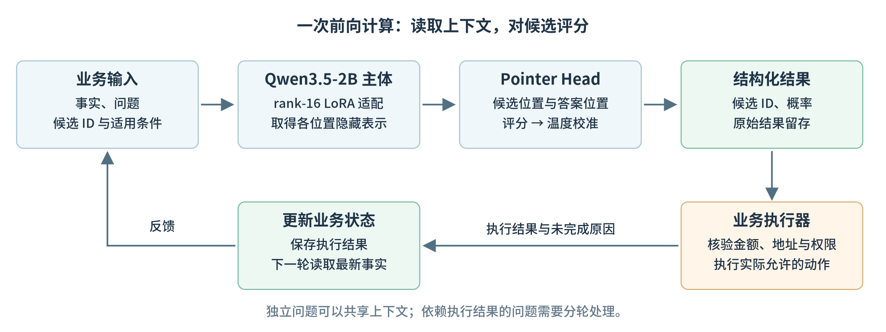
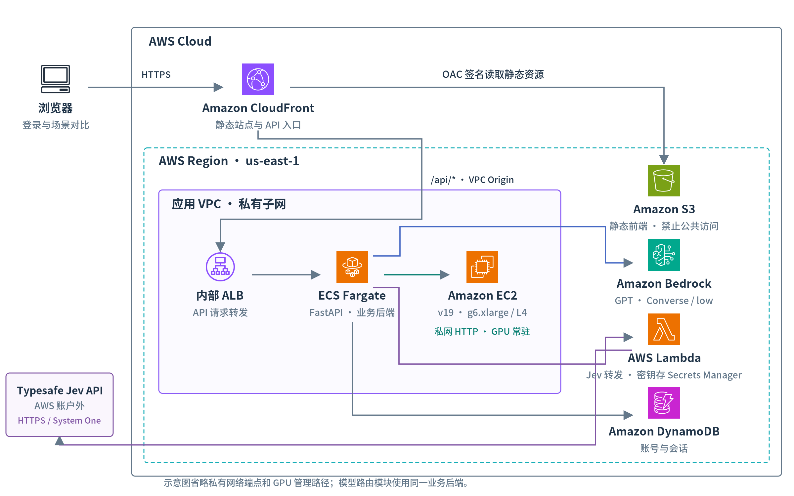
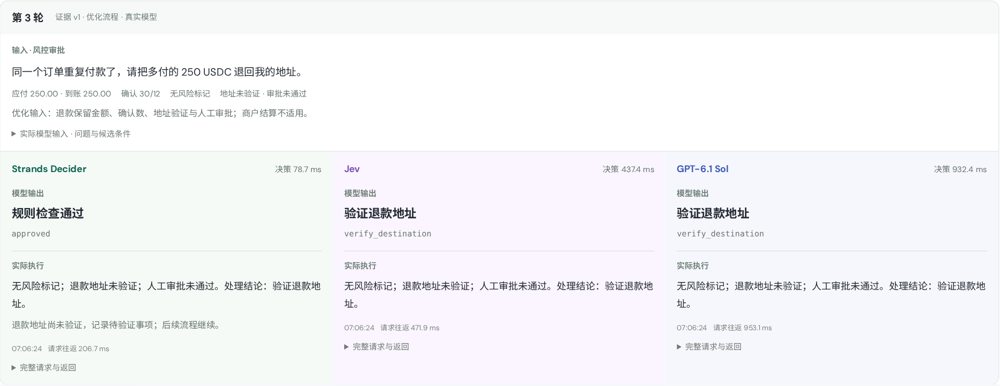
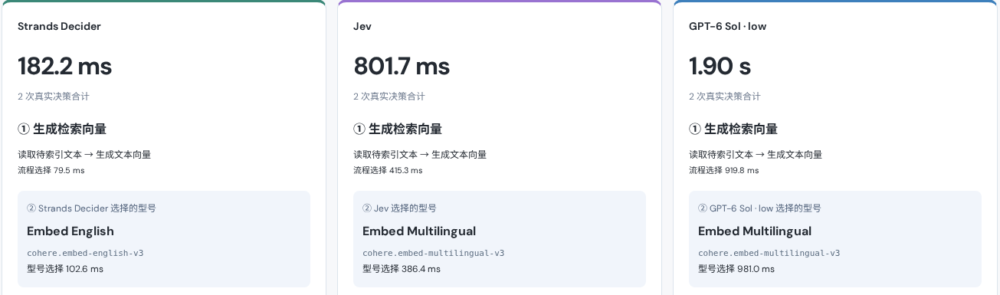
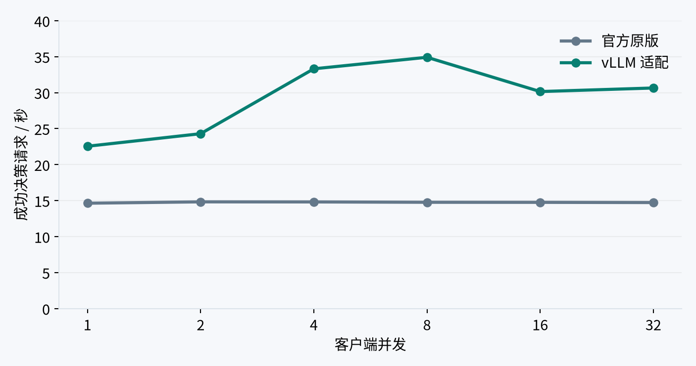

# 在 AWS 上部署 Strands Decider：从支付业务决策到模型路由与并发优化

摘要：Agent 在执行任务时，需要反复选择工具、判断条件和决定下一步动作。这些判断输出很短，却会多次调用模型。本文以加密货币支付为例，在 AWS 上部署 Strands Decider，与 Jev、Amazon Bedrock 上的 GPT 对比，说明决策模型的工作原理、业务接入方法，以及模型路由、vLLM 并发和成本测试中的实际表现。

## 一、业务流程中，哪些判断适合交给小模型

客户已经转出 USDC，商户订单却仍显示待支付。客服收到消息后，需要查询交易、核对金额、检查链上确认数，再决定等待、补款或者转交人工。如果涉及退款，还要验证退款地址和审批状态。一次看似简单的咨询，背后有多个判断和系统操作。

传统系统一般用规则和状态机处理这些流程。金额、确认数、账户权限都有明确条件，程序可以直接计算。但客户描述往往不够完整，同样是“没有到账”，可能指商户未收到付款，也可能是退款未到钱包，或者商户结算延迟。识别业务类型、选择处理队列，需要理解自然语言。

使用大语言模型构建 Agent 后，可以把客户消息和后台事实一起交给模型，由它选择工具并推动流程。不过，模型每次可能只需要回答“交给支付客服”或者“继续等待确认”。如果一笔订单经过五个节点，每个节点都调用一次大模型，等待时间会逐步累积。

Strands Decider 针对的就是这类工作：输入业务事实和有限的候选动作，输出一个选择，或者对条件进行评分。本文搭建了四个支付场景，分别观察三个模型选了什么、调用用了多久，以及后续动作是否真正完成。支付和交易操作使用模拟数据，模型调用均为真实服务。

## 二、Strands Decider 的原理与适用范围

### 2.1 从生成回答改为候选评分

Strands Decider 是 Strands Labs 发布的开源决策模型，属于通常称为 System One 的模型类型。Jev 也提供这类决策服务。它们接受业务事实、问题和候选项，返回结构化结果，方便程序直接使用。

本文采用官方 v19，主体为 Qwen3.5-2B。模型移除了生成文本使用的 LM Head，换成约百万参数的 Pointer Head，并通过 rank-16 LoRA 适配主体。推理时，主体读取上下文、问题与候选描述；Pointer Head 将各候选位置的隐藏表示与 `<answer>` 位置的隐藏表示进行评分，经过温度校准，得到候选概率。



图 1：候选评分完成一次选择，执行结果更新业务状态；依赖新状态的判断需要再次请求。

生成式大模型即使只返回一个 JSON，也需要经过文本生成过程。Decider 直接评分并选择候选，省去了逐 token 生成回答的过程。它仍然需要读取全部输入，因此上下文越长、候选越多，耗时也会增加。

以少付核验为例，下面是一个简化请求：

```json
{
  "state": "应付100 USDT，到账99.80 USDT，链上确认数20/12。",
  "questions": {
    "action": {
      "type": "choice",
      "instructions": "选择下一步处理动作",
      "criteria": {
        "request_topup": "确认数达标，且到账金额少于应付金额",
        "await_confirmations": "链上确认数尚未达到要求"
      }
    }
  }
}
```

应用定义两个动作及其适用条件，模型负责选择。`request_topup` 是程序可以识别的 ID，后端收到后再调用补款流程。候选来自业务设计，模型不会自行创造业务规则，也不会因为选中了动作就自动执行转账。

除单选 `choice` 外，接口还支持表示陈述支持程度的 `noul` 和有序等级评分 `score`。同一份订单信息可以同时用于判断业务类型、是否缺少材料等独立问题，共享上下文。但如果需要先查询交易，再依据查询结果审批，两个步骤仍要分开调用。

### 2.2 与 BERT 分类器、生成式大模型的分工

常见 BERT 分类器使用固定分类头，例如输出“支付咨询、退款、结算”三个标签，训练时标签集合已经确定。标签稳定、已有足够领域标注的场景，仍适合采用这种方式。新增类别通常需要调整训练数据和分类头，再进行适配。

Decider 把候选描述作为输入，今天选择客服队列，明天选择工具，可以使用同一套输出机制。不过，候选可变不代表新任务无需验证。BERT 的 NLI（自然语言推断）模型也可以比较文本与候选描述，本项目没有测试 BERT，不能据此判断其速度或效果优劣。

决策模型适合放在流程中的具体节点。例如客服受理时识别意图、工具调用前检查参数依据、RAG 检索后判断材料是否充分、内容审核时选择风险等级，以及按任务选择模型。每个节点都要有明确候选和可核对的结果。生成客服长回复、编写代码、分析复杂异常，仍由生成式大模型承担。

官方示例是在天气工具调用前检查城市参数是否来自用户。如果 Agent 猜测了用户未提供的城市，决策结果可以让它先补问。这种接入方式只改一个检查节点，便于评估收益，再决定是否扩展到其他环节。

在企业知识库中，也可以让决策模型阅读问题与召回片段，选择“依据充分、需要再次检索、转交人工”。模型只决定后续路径，回答仍需引用文档。运维告警则可以提供告警内容、最近变更和候选处置队列，先完成分级和分拨。相比让小模型直接写故障分析报告，这些任务的输出更容易核验，也便于统计误分带来的影响。

### 2.3 公开评测可以说明什么

PPT 引用了 [Benchmark Heaven 的 JevBench API 榜单](https://benchmarkheaven.com/jev-models/api)。10 月 12 日快照中，Jev 1.13.0 的能力分为 63.6、p50 为 239 ms，GPT-6 Luna low 的能力分为 96.6、p50 为 1854 ms。该结果可以帮助观察能力和速度的取舍，但与本项目的模型配置、输入和网络不同。

榜单综合分还包含校准、速度和成本，不等于准确率。Decider v19 在官方模型卡的公开子集上为 167/231，即 72.29%；这不是同一张 API 榜单的成绩，不能直接混排。因此，部署后仍需使用自己的业务数据验证，后面的支付测试就是为此设计。

## 三、AWS 部署与业务接入

### 3.1 前后端与模型服务分别部署

演示部署在 us-east-1。前端静态文件保存在 Amazon S3，开启全部 Block Public Access，通过 Amazon CloudFront 的 Origin Access Control（OAC）读取。API 请求经 CloudFront VPC Origin、内部 Application Load Balancer，进入 Amazon ECS Fargate 上的 FastAPI 服务。



图 2：业务后端分别连接 EC2 上的 Decider、Amazon Bedrock 和 Jev 转发服务。

Decider 运行于常驻 Amazon EC2 g6.xlarge，使用单张 NVIDIA L4 GPU，通过私网提供 HTTP 接口。用户名登录和会话由应用管理，保存在 Amazon DynamoDB。业务服务与推理服务分别构建镜像，修改候选条件、页面和业务流程时，无需重新加载模型。

GPT 通过 Amazon Bedrock Converse 调用，支付场景使用 GPT-6.1 Sol，模型路由使用 GPT-6 Sol，推理强度均为 low。Jev 通过 AWS Lambda 转发至 Typesafe API，密钥保存在 AWS Secrets Manager。Jev 的内部模型结构没有在本项目中验证，使用相似接口不代表它与 Decider 采用相同架构。

### 3.2 从本地验证到 GPU 服务

初次验证可以安装官方包，在本机运行一个客服分流问题：

```bash
pip install strands-decider
strands-decider ask StrandsAgents/strands-decider-2B-hobson-v19 \
  --state "Help! My payouts have been failing for 3 days!" \
  --choice "Which team should handle this?=billing,sales,retail"
```

项目部署时，将固定版本权重打包到镜像的 `/opt/models/decider`，通过官方 `create_app` 加载，指定 CUDA 设备，并在启动阶段执行一次真实判断完成预热。接口监听 8099 端口，业务后端请求 `/v1/systemone`。权重随镜像预置，运行时无需再从模型仓库下载。

常驻 GPU 适合持续使用的演示，避免每次调用前启动实例、加载权重。代价是空闲时间也产生计算费。业务后端只需使用 HTTP 客户端提交 JSON，无需安装类似聊天模型的专用 SDK；模型依赖集中在推理容器中。

验证部署时，先确认 GPU 容器能加载模型，再从业务后端提交实际候选请求，最后通过页面运行完整场景。健康检查成功只证明服务就绪，无法证明候选映射和业务状态处理正确。模型服务的安全组只允许业务后端访问，客户端通过登录后的应用 API 发起请求。

接入时需要保留四类记录：输入事实与候选、模型原始选择、实际执行动作、执行后的状态。候选 ID 必须在服务端允许的列表内，金额和权限仍由业务程序核验。这样可以判断一次失败究竟发生在模型选择、接口调用，还是动作执行阶段。

## 四、支付场景：从模型选择到业务结果

### 4.1 四个场景与五个处理节点

演示包含 USDC 未到账、USDT 少付、稳定币退款和商户结算。四者分别考查确认数不足、金额差额、退款地址与审批、结算时限。每个场景经过客服受理、交易核验、风控审批、业务处置和回复结案五步。

以未到账为例，初始确认数为 3/12，表示系统观察到 3 次链上确认，业务要求至少 12 次。即使金额已经足额，也不能立即记为支付完成。审批节点可以判断“当前没有风险标记”，执行节点仍应等待确认，客服回复则应说明订单正在处理中。

商户结算使用另一组条件：4800 USDC 已等待 120 分钟，约定时限为 60 分钟，系统尚未收到结算完成记录。此时应升级给商户运营并继续跟进。三个模型都选择了这条路径，但创建升级工单不会把结算状态改为已到账，最终仍要等待外部结算结果。

比较时固定每个场景的初始事实，三个模型收到相同问题和候选，GPT 额外要求只返回候选 ID JSON。完成方案选择后，各自在独立的模拟状态中执行，避免一个模型的操作改变另一个模型的输入。客服回复由应用模板生成，本批比较的是动作选择能力。

2026 年 10 月 12 日，三个模型各预热一次，随后完成四场景、五节点、三模型共 60 次正式调用。每个模型的 20 次结果如下：

| 指标 | Strands Decider | Jev | GPT-6.1 Sol |
| --- | ---: | ---: | ---: |
| 平均每次耗时 | 102.2 ms | 416.5 ms | 1116.7 ms |
| 20 步累计耗时 | 2.043 s | 8.329 s | 22.335 s |
| 与演示参考一致 | 18/20 | 20/20 | 20/20 |

Decider 的平均耗时约为 GPT 的十分之一。这里记录的是后端处理和调用链耗时，包含网络与排队。Jev 正式请求均复用了预热后的 Lambda 环境，未计入该代理的冷启动；三条路径的网络开销仍不相同。演示参考由开发者按照业务条件定义，一致次数只描述这 20 个判断。

### 4.2 两处错误，以及执行系统如何处理

第一处是少付核验。应付 100 USDT，到账 99.80，确认数已经达到 20/12。此时应该提示补款，Decider 却选择继续等待确认。这个选择的概率为 0.8448，confidence 为 0.8138。较高评分仍可能对应错误，不能直接把 confidence 当成业务正确率。

第二处是退款审批。退款地址尚未验证，Decider 返回 `approved`，页面解释为“规则检查通过”；Jev 和 GPT 选择 `verify_destination`。这是同一条件下的真实选择差异。



图 3：模型原始建议和实际采用动作分别展示。执行器发现地址未验证，先进入地址核验。

程序没有按 Decider 的建议直接退款，而是保留原始结果，将实际动作调整为验证地址。这次执行保护避免了不满足条件的操作，但不能算作 Decider 判断正确。后续业务处置保持等待，没有生成退款账本。

因此，页面显示“五步已处理”，只说明五个节点有了处理记录。确认不足、补款未完成、地址未验证时，资金业务仍未结束。检查模型效果，需要同时看候选选择和最终状态，不能只看接口是否成功返回。

### 4.3 先优化输入，再考虑训练

早期输入将收款、退款和结算字段放在同一份上下文里。例如普通收款也带着 `refund_approved=false`，容易让模型把退款审批条件应用到收款流程。我们按业务类型保留相关事实，并把适用条件写进候选：退款地址核验仅适用于退款；普通收款通过审批后，仍需在执行阶段检查金额和确认数。

在独立前后对照中，Decider 与演示参考一致的次数从 14/20 提高到 18/20。这里修改的是输入组织和候选描述，模型权重没有改变。优化后仍保留前述两个错误，说明上下文整理有帮助，但不能解决全部判断问题。

如需进一步微调，应先收集这类错误及其相近样本。例如保持其他事实不变，分别改变金额是否足额、确认数是否达标，让训练数据覆盖条件组合。再按业务模板划分训练集和验证集，避免只记住四个演示案例。候选顺序、中文表达和输入长度也应变化，检验模型是否学会了条件关系。

训练后除了检查选择正确率，还需要重新检查概率校准和延迟。置信度阈值应在独立样本上确定；对于高置信但持续选错的类型，单纯提高阈值无效，需要修正输入或转交其他模型复核。这些训练工作尚未在本项目完成。

### 4.4 闭环如何继续推进

固定输入比较便于分析选择差异，实际流程还需要读取执行反馈。闭环模式每轮将最新确认数、账本、审批和未完成原因交回模型，再决定下一步。仅重复提交原输入，无法让等待中的订单发生变化。

保存的 USDC 案例中，三个模型各经过六次决策和一次模拟确认事件。确认数达到要求后，系统重新核验，完成 129 USDC 模拟入账及结案。确认数变化来自模拟外部事件，入账由执行器完成，模型负责根据新事实选择动作。真实系统中，这一事件应由链上监听或支付服务提供。

## 五、模型路由：同一任务为什么选出不同型号

支付流程选择的是业务动作，模型路由选择的是执行任务的模型。用户只提交任务，不填写“速度优先”“质量优先”或目标型号。每个决策器先选择处理流程，再根据任务、已选流程和候选能力证据选择型号，两步都真实调用模型。

候选从区域目录筛选。本批目录有 124 条记录，结合账户权限、模态及已核实的评测映射，形成 22 个文本候选和 3 个嵌入候选。文本能力使用 LiveBench，向量检索使用 MTEB 中指定 MIRACL 数据集的中英文结果。没有匹配证据的模型不参与本批选型，也没有按榜单第一名替换模型输出。

2026 年 10 月 13 日，六次独立预热后完成四任务、三模型、两步骤共 24 次正式决策。每格为目标型号和两步累计耗时：

| 任务 | Decider | Jev | GPT-6 Sol low |
| --- | --- | --- | --- |
| 支付客服 | Opus 5／461.0 ms | Opus 5.5／747.9 ms | GPT-6 Luna／1464.8 ms |
| 交易代码 | Opus 5／522.6 ms | Sonnet 5.5／933.3 ms | Sonnet 5.5／6168.2 ms |
| 结算分析 | Opus 5／504.6 ms | Opus 5.5／820.4 ms | GPT-6.1 Sol／12106.1 ms |
| 中英文索引 | Embed English／182.2 ms | Embed Multilingual／801.7 ms | Embed Multilingual／1900.8 ms |

三者都选对了处理流程，型号选择却不同。中英文工单需要生成检索向量，Decider 选择 Embed English，Jev、GPT 选择 Embed Multilingual。传给三者的模型名称、评测配置和检索均分相同，输入指纹也一致。英文模型的均分为 30.65，多语言模型为 59.23，已有证据更支持后者。

这些检索分来自指定 MIRACL 数据集的中英文 nDCG@10 均值乘以 100，衡量相关文档的排序效果，并非全部 MTEB 任务的总分，也不是本项目实际工单的命中率。候选证据需要保留数据集、模型版本和评测配置，否则数字相近也可能没有可比性。



图 4：Decider 识别了向量流程，但选中了不适合中英文任务的英文模型。

正确上下文只是提供了证据，模型还需要理解任务并利用证据。候选评分不会自动等同于数值排序。本例中 Jev、GPT 的选择更合适；我们没有模型内部推理记录，不能断言 Decider 只看了名称或者忽略了某项指标。

代码任务要求处理 webhook 去重、验签、金额精度和并发入账。Sonnet 5.5 的 LiveBench Coding 为 91.37，Opus 5 为 81.45，Jev、GPT 的选择更符合代码能力证据。不过，本批没有让目标模型生成代码并运行测试，因此尚不能断定实际代码质量。

客服和结算分析也没有唯一已验证的最优型号。后续应分别检查回答是否错误承诺到账、代码是否通过并发幂等测试、结算计算是否正确，以及相关工单的检索效果。第三方排名帮助缩小候选范围，业务验收才能证明选择是否有效。

本批每个任务只测一次，表中时间不代表稳定延迟分布；首轮 GPT 分析选型曾发生 40 秒超时，原记录另行保留。24 次返回有效候选，也不等于 24 次都选对。

## 六、vLLM 适配与并发测试

### 6.1 为什么原服务会排队

单次判断较快，并不代表多人同时使用时仍然快。本项目原版服务通过锁串行执行推理，一个请求完成后再处理下一个。并发增加后，请求会排队。这是当前服务的实现方式，并非决策模型必须串行。

我们另建 vLLM 适配项目，保留官方输入模板、分词器、Pointer Head、温度参数和答案转换。先用官方加载器合并 LoRA、核对导出权重，再用 vLLM 加载主体，通过自定义 Pooler 在 GPU 上完成候选评分。每个请求必须携带自己的候选位置，不能直接改用普通聊天生成接口。

适配固定使用 vLLM 0.31.0，主体为 BF16，Pointer Head 为 FP32。当前实现要求完整 prefill，关闭前缀缓存、分块预填充和 CUDA Graph。新服务独立提供 `/v1/systemone`；前面的支付和路由数据仍来自原版服务。

### 6.2 原版对照与 Jev 并发结果

首先，在同一台 g6.4xlarge 的单张 L4 上分别测试，两个推理容器均限制为 4 vCPU、14 GiB 内存。完整复测中，8 并发吞吐从原版的 14.76 提高到 34.91 次/秒，P95 从 542.8 降至 237.6 ms。



图 5：相同硬件条件下，vLLM 在本批短输入上提高了并发吞吐。

随后，在 g6.xlarge 公网 API 上，与 Jev 直连接口比较。两者使用相同客户端和 20 条支付步骤输入，每档 1280 次请求；保持指定并发数，收到响应后立即补发，不自动重试。完整扫描覆盖 1—128 并发，部分结果如下：

| 并发 | vLLM 次/秒 | vLLM 平均／P95 ms | Jev 次/秒 | Jev 平均／P95 ms |
| ---: | ---: | ---: | ---: | ---: |
| 1 | 18.01 | 55.4／59.4 | 7.90 | 126.5／160.2 |
| 8 | 35.74 | 223.4／237.0 | 61.83 | 128.9／166.9 |
| 32 | 30.61 | 1039.2／1073.1 | 240.94 | 130.0／172.6 |
| 128 | 30.59 | 3981.9／11236.8 | 52.56 | 1743.5／5502.5 |

这里“次/秒”指每秒成功完成的单步决策数；P95 表示 95% 的成功请求延迟不超过该值。vLLM 在低并发时延迟较低，8 并发后吞吐没有继续提高，排队时间明显增加。Jev 在 8—32 并发表现出更高吞吐，128 并发也出现下降。结果反映两套 API 服务，不能推断 Jev 使用了多少 GPU。

完整测试中，vLLM 成功 10239/10240 次，出现一次 HTTP 502；Jev 全部成功。每条输入在每档重复 64 次，适合观察排队和吞吐，但没有增加独立业务样本。吞吐包含失败占用的时间，P95 只统计成功请求。

另外将批次 token 预算从 8192 提高到 16384、32768，含复测共 23040 次成功请求，没有持续提高吞吐。这个参数限制一批可处理的 token 数，并不是每条输入有 8192 token。本批 Decider 输入平均为 373.9 token，扩大上限并不会等比例增加单卡处理能力。

适配还出现过部分概率和 confidence 数值偏差。因而验收需要同时检查选择结果、概率和稳定性，不能只看吞吐提升。当前数据尚不能定位具体内核、CPU 或网络瓶颈；下一步应拆分预处理、调度和 GPU 计算耗时，再决定优化哪个环节。提高推理效率也不会自动修复前面的退款或路由错误，模型行为仍需独立验证。

## 七、按实际用量比较部署成本

成本以 2026 年 10 月 13 日查询的公开价格估算。us-east-1 Linux g6.2xlarge 按需价为每小时 0.9776 美元，每月按 730 小时计算，约 713.65 美元；160 GB gp3 磁盘另需 12.80 美元。实例常驻时，这部分费用不随请求数下降。

Jev 按输入 token 计费，每百万 0.042 美元，输出免费。并发测试中 10240 次正式请求使用了 6727168 个输入 token，平均每次 656.95 个，按公开价约 0.283 美元。两种模型的模板和分词器不同，不能直接用 Decider 的 token 数计算 Jev 费用。

按相同支付输入配比，Jev 每百万次决策约 27.59 美元。只比较计算费，与 g6.2xlarge 常驻费用的交点约为每月 2586 万次。换成上下文更长的两步模型路由，平均每次完整路由为 2805.75 个输入 token，每百万次约 117.84 美元，交点降至约每月 606 万次。

这些是实测用量乘公开单价，未包括网络、运维、冗余、税费和目标模型执行费。g6.2xlarge 没有参加本批性能测试，费用交点不能当作单卡容量承诺。低调用量时，按量 API 更容易控制开销；需要私有部署、固定版本或专项训练时，自托管的可控性也应纳入选择。

## 八、实践结论

本次支付测试中，Decider 平均约 102 ms 完成判断，适合继续评估高频、有限候选的业务节点。输入优化将参考一致次数从 14/20 提高到 18/20，vLLM 则改善了并发处理能力，两项改进分别作用于判断和执行效率。

退款审批与中英文索引也说明，低延迟和合法输出还不足以支持自动执行。实际接入可以从一个结果可核验的节点开始，保留原始选择、执行记录和业务结果，再用独立样本评估错误率、尾延迟与成本。复杂异常交给生成式大模型或人工，金额和权限检查继续由业务程序负责。

代码与实测记录见 [StrandsDecider 项目](https://github.com/milan9527/StrandsDecider)及 [vLLM 适配项目](https://github.com/milan9527/StrandsDeciderVLLM)。[在线演示](https://d3i7ogfx5ml7dc.cloudfront.net/)需要账号登录，可查看支付流程和模型路由的逐步输入、输出与耗时。

## 参考资料

1. [Strands Decider 官方介绍](https://strandsagents.com/blog/introducing-strands-decider/)与 [v19 模型卡](https://huggingface.co/StrandsAgents/strands-decider-2B-hobson-v19)。
2. [支付实测数据与测试方法](https://github.com/milan9527/StrandsDecider/blob/main/docs/presentations/v8/README.md)。
3. [模型路由完整对比](https://github.com/milan9527/StrandsDecider/blob/main/docs/MODEL_ROUTING_COMPARISON.md)、[LiveBench](https://livebench.ai/)与 [MTEB](https://huggingface.co/spaces/mteb/leaderboard)。
4. [vLLM 并发与批次测试](https://github.com/milan9527/StrandsDeciderVLLM/blob/main/docs/VLLM_PERFORMANCE.zh-CN.md)、[Jev 并发对比](https://github.com/milan9527/StrandsDeciderVLLM/blob/main/docs/JEV_CONCURRENCY.zh-CN.md)。
5. [EC2 按需价格](https://aws.amazon.com/ec2/pricing/on-demand/)与 [Jev 官方说明及价格](https://typesafe.ai/blog/introducing-system-one-models-and-jev)。
