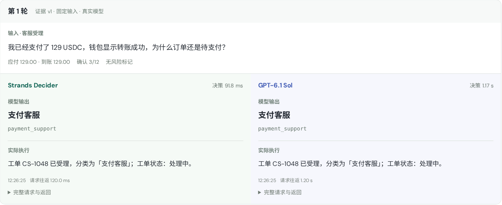
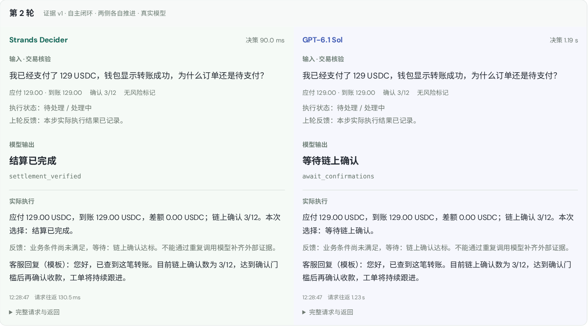
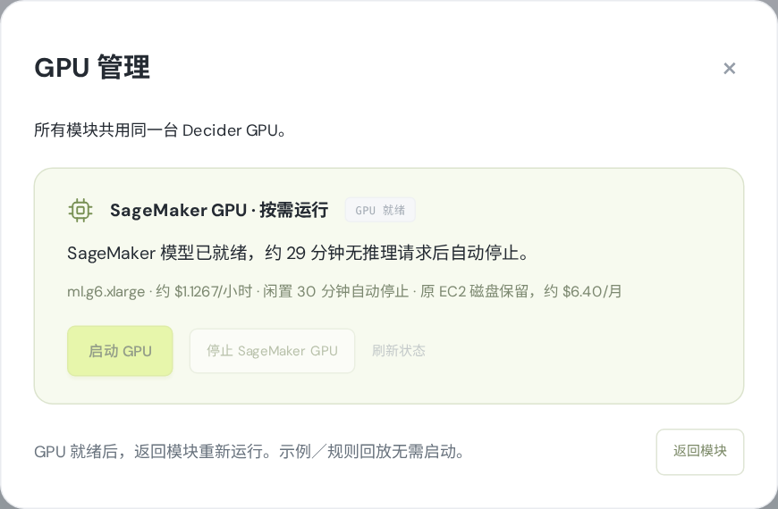

# Strands Decider 演示文稿 v2 · 2026-10-10

基于用户指定的 **《Strands-Decider-模型原理与支付业务演示.pptx》25 页原版**创建，共 **34 页**。原文件未覆盖；保留原版风格、模型基础与 AWS 架构，合入此前扩展版的判断过程、BERT 比较和演示参考说明，再更新当前项目与线上截图。

- **[下载 PPTX](Strands-Decider-模型原理与支付业务演示-v2-20261010.pptx)**
- [查看 PDF](Strands-Decider-模型原理与支付业务演示-v2-20261010.pdf)
- [逐页讲稿与来源](讲稿与来源.md)
- [截图采集记录](capture-manifest.json) / [文稿构建记录](build-manifest.json)
- [固定输入实测摘录](../../results/benchmark-2026-10-10.json) / [自主闭环观测](loop-observations.json)

## 本版更新

| 内容 | 更新 |
| --- | --- |
| 模型原理 | 保留模型目的、Pointer Head、问题类型；合入可核对的判断计算与 BERT 适配方式对比 |
| 业务完成 | 明确 `已处理 5/5` 不代表资金已落实，订单、对应账本及结案均满足才完成 |
| 流程对比 | 固定同输入对比与自主反馈闭环分开；闭环读取执行结果、等待事件、有限重判 |
| 交互界面 | 耗时卡片下方默认展开每轮输入 / 输出；客服对话与模拟事件位于主区域 |
| GPU 管理 | 所有模块共用一个弹窗；未就绪提示、管理员启停、进度刷新与返回运行 |
| 最新证据 | 当前 `crypto10` 生产界面，真实模型采集；失败和不完整执行也如实记录 |
| 演示讲稿 | 更新按钮位置、五分钟演示路线、计时口径、错误路径与生产化边界 |

## 最新截图

截图直接来自 [生产演示](https://d3i7ogfx5ml7dc.cloudfront.net/#crypto)，只调整取景与滚动位置，没有替换业务数据。客户、金额与账本是项目原有模拟案例；资金不会发送。

**每轮输入、两模型输出与实际执行：**



**闭环：读取上一轮执行反馈后继续判断：**



**公共 GPU 管理：**



其余截图见 [screenshots](screenshots/)。客服文字来自应用模板，PPT 将它与模型决策分别标记。规则回放与人工注入错误的测试截图没有用于本版真实模型结果展示。

## 本次真实数据的口径

固定输入批次于 **2026-10-10 12:26 UTC** 开始，使用 SageMaker `ml.g6.xlarge` / L4 上的官方 v19，以及 Bedrock `us.openai.gpt-6.1-sol` / `low`。

- 四个初始案例，每侧尝试 20 次决策；**19 组成功同输入配对**。
- 成功配对 Decider 合计 **1,809.6 ms**，GPT **22,068.2 ms**，累计比约 **12.20×**。
- 商户结算的 GPT 业务处置发生 **1 次 ReadTimeoutError**；该侧缺少完整方案，没有执行沙盒。失败请求不进入成功配对耗时，但错误保留，不能用这个比值概括整次用户等待体验。
- 配对参考一致为 Decider **13/19**、GPT **19/19**，衡量演示策略符合度，不是通用准确率。
- 另行采集 USDC 与退款闭环：两模型均完成；每侧分别返回 **6 / 9 次决策**，分别推进 **1 / 2 个模拟事件**。后续输入可能不同，闭环耗时不混入同输入配对统计。

这次采集复用了已经就绪的 GPU，没有发起启停。旧版 PPT 的 7.49× 与旧 README 批次的 8.87× 是独立历史观测，不与本次混算。BERT 的质量、延迟和成本均未在本项目实测。

## 文件与复现

新版 PPTX 自包含截图，模型和架构图中的主要说明为可编辑文本与形状。PDF 用于预览；原版与扩展版的 SHA256 记录在 `build-manifest.json`，供核对来源。

从仓库根目录执行。采集脚本要求 GPU **已经就绪**，会调用真实模型，不负责启停：

```bash
uv run --with playwright python scripts/capture_presentation.py \
  --credentials .deployment/admin-credentials.json

# 采集中断后复用已保存的固定输入记录，不重复调用已采集场景
uv run --with playwright python scripts/capture_presentation.py \
  --credentials .deployment/admin-credentials.json --resume

# 生成新版；这两个源文稿由维护者另外提供，不需要凭据
uv run --with python-pptx --with pillow python scripts/build_presentation.py \
  --base /path/to/Strands-Decider-模型原理与支付业务演示.pptx \
  --supplement /path/to/Strands-Decider-模型原理与支付业务演示-扩展版.pptx

# 安装 LibreOffice 后生成 PDF
libreoffice --headless --convert-to pdf --outdir docs/presentations/v2 \
  docs/presentations/v2/Strands-Decider-模型原理与支付业务演示-v2-20261010.pptx
```

本次固定采集出现的错误是原始观测；没有为了让结果更好看而重跑该场景。演示材料描述这个日期的快照，重新采集后需同步复核文稿中的失败路径、结果解释与数据说明。完整私有采集导出留在忽略目录 `.deployment/presentation-v2/`，GitHub 仅包含不含凭据的证据摘录和截图。
