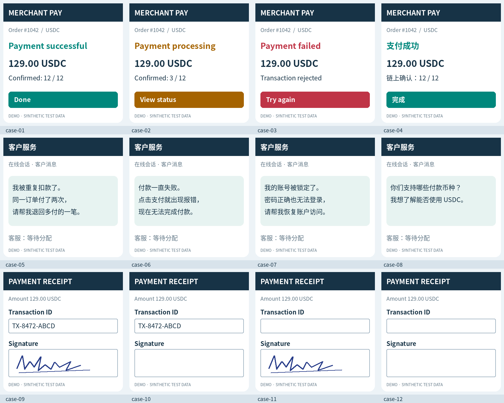

# Strands Decider 图片内容决策实测

2026-10-23，原始 **v19 + 官方视觉推理**，现有 **g6.xlarge / NVIDIA L4**，单并发。此次没有微调，也未修改线上 vLLM 服务。

12 张合成截图共 28 项判断，首轮正确 **27/28**；整张截图的问题全部正确 **11/12**。重复同一图片不增加独立样本数。

已接入独立的[图片决策演示](https://d3i7ogfx5ml7dc.cloudfront.net/#vision)，可上传图片实时运行，也可回看本批结果。界面、API、常驻部署及上线验收见[模块说明](../../docs/VISION.md)；本页保留原始实验口径。

## 场景结果

| 场景 | 图片 | 正确判断 | 整图全对 | 后端请求均值 | 后端 P95 |
| --- | ---: | ---: | ---: | ---: | ---: |
| 支付状态与下一步动作 | 4 | 12/12 | 4/4 | 168.4 ms | 169.3 ms |
| 中文客服队列选择 | 4 | 4/4 | 4/4 | 166.9 ms | 167.8 ms |
| 凭证字段与处理动作 | 4 | 11/12 | 3/4 | 169.2 ms | 170.7 ms |

36 次带图正式请求：后端均值 **168.2 ms**，P50 **168.3 ms**，P95 **169.8 ms**；本机 HTTP 往返均值 **169.8 ms**。每次请求包含一张图和该图的全部问题：支付、凭证各 3 问，客服 1 问，**不是每个问题分别计时**。3 次预热及模型加载不纳入这些延迟。
该 GPU 保留其他既有服务，因而这是功能验证中的请求延迟，不是隔离环境吞吐基准。模型加载与服务就绪耗时 16.0 秒；首次预热请求耗时 36.8 秒，原始记录保留该首次调用，不将预热后的延迟误称为首次调用耗时。

## 结论与实际案例

**清晰截图上的支付状态判断和中文客服分流可用，约 0.17 秒完成一次带图请求。**本次图片直接进入视觉编码器，没有先 OCR 再把文字送给 Decider。成功、处理中、失败图片使用相同请求文本，却分别得到 `completed / pending / failed`；中文客服四类诉求也分别进入正确队列。

**识别出字段，不代表组合条件一定执行正确。**第 11 张凭证有签名、交易编号留空。实际返回：

```json
{
  "signature": {
    "type": "noul",
    "noul": 0.7839
  },
  "reference": {
    "type": "noul",
    "noul": 0.1973
  },
  "action": {
    "type": "choice",
    "choice": "accept",
    "probabilities": {
      "accept": 0.4327,
      "request_signature": 0.1372,
      "request_reference": 0.072,
      "request_both": 0.346,
      "unknown": 0.0122
    },
    "confidence": 0.2909
  }
}
```

`signature=0.7839`、`reference=0.1973` 正确反映“有签名、无编号”，但动作选了 `accept`，预期应为 `request_reference`。动作 confidence 仅 0.2909；这体现字段判断与后续动作选择之间仍需一致性验收，本次没有用程序改写模型答案。

仅反转候选顺序后，第 10 张从正确的 `request_signature` 变为错误的 `request_both`；第 11 张从错误的 `accept` 变为同样错误的 `request_both`。首轮 27/28，反转后 26/28，不能把重复三轮完全一致当作候选换序也稳定。

## 测试图片



由 Pillow 绘制 UI：中英文支付状态、中文客服对话、凭证表单。签名使用手绘线条，不用“已签名”文字代替视觉证据。全部图片为 448×448，未使用真实客户数据。

## 每张图的实际选择

| 图片 | 问题 | 预期 | 实际 | 首轮结果 |
| --- | --- | --- | --- | --- |
| [case-01](images/case-01.png) | status | completed | completed | 正确 |
| [case-01](images/case-01.png) | next_action | confirm | confirm | 正确 |
| [case-01](images/case-01.png) | paid | 是 | 是 | 正确 |
| [case-02](images/case-02.png) | status | pending | pending | 正确 |
| [case-02](images/case-02.png) | next_action | wait | wait | 正确 |
| [case-02](images/case-02.png) | paid | 否 | 否 | 正确 |
| [case-03](images/case-03.png) | status | failed | failed | 正确 |
| [case-03](images/case-03.png) | next_action | retry | retry | 正确 |
| [case-03](images/case-03.png) | paid | 否 | 否 | 正确 |
| [case-04](images/case-04.png) | status | completed | completed | 正确 |
| [case-04](images/case-04.png) | next_action | confirm | confirm | 正确 |
| [case-04](images/case-04.png) | paid | 是 | 是 | 正确 |
| [case-05](images/case-05.png) | queue | refunds | refunds | 正确 |
| [case-06](images/case-06.png) | queue | payment_issues | payment_issues | 正确 |
| [case-07](images/case-07.png) | queue | account_access | account_access | 正确 |
| [case-08](images/case-08.png) | queue | product_information | product_information | 正确 |
| [case-09](images/case-09.png) | signature | 是 | 是 | 正确 |
| [case-09](images/case-09.png) | reference | 是 | 是 | 正确 |
| [case-09](images/case-09.png) | action | accept | accept | 正确 |
| [case-10](images/case-10.png) | signature | 否 | 否 | 正确 |
| [case-10](images/case-10.png) | reference | 是 | 是 | 正确 |
| [case-10](images/case-10.png) | action | request_signature | request_signature | 正确 |
| [case-11](images/case-11.png) | signature | 是 | 是 | 正确 |
| [case-11](images/case-11.png) | reference | 否 | 否 | 正确 |
| [case-11](images/case-11.png) | action | request_reference | accept | **错误** |
| [case-12](images/case-12.png) | signature | 否 | 否 | 正确 |
| [case-12](images/case-12.png) | reference | 否 | 否 | 正确 |
| [case-12](images/case-12.png) | action | request_both | request_both | 正确 |

## 图片依赖与选项顺序对照

| 对照 | 相比带图首轮改变的判断 | 明确选择信息不足 |
| --- | ---: | ---: |
| 仅反转 choice 候选顺序 | 2/28 | 0/16 个选择题 |
| 移除图片 | 19/28 | 8/16 个选择题 |
| 替换为纯白图片 | 22/28 | 16/16 个选择题 |

相同图片重复三轮，发生类别变化的判断项：**0/28**。
无图／白图时不再使用原图答案作为正确率：缺少证据不能沿用原图的标签。选择题均提供“图片缺失或信息不足”选项；noul 只能给是／否概率，不能单独表达未知。无图对照用于观察猜测和证据依赖，不能单凭概率高就认定图片被正确理解。

## 方法与复现

1. `prepare.py` 生成图片和预期，`cases.json` 在模型调用前冻结并计算 SHA-256。
2. 将图片作为 Base64 放入顶层 `images`，只提交统一 state、问题和候选；不传入文件名、预期或 OCR 文本。
3. 官方视觉服务启用 `vision=True`、CUDA、SDPA、共享上下文、严格 4096 token 窗口；保持原始 v19 的 LoRA、决策头及温度参数。底座 BF16，决策头 FP32。
4. 3 次预热后，12 图各测 3 轮；再各测反转候选、无图、白图一次，共 75 次 HTTP 调用。
5. choice 按选项 ID 比较，noul 使用事前固定的 0.5 阈值。所有失败与原始概率保留。

上游源码固定到 `d942e5515db750f80a51032629ec312455a87976`；transformers `5.18.0`、torch `2.7.1+cu126`。本次 HTTP 调用失败 0/75。

这是 12 张清晰合成图片的冒烟验证，不代表真实票据、小字扫描件、模糊拍照或通用多模态准确率。未比较 Jev/GPT，也未适配 vLLM 的视觉路径。

本批实验结束后，临时视觉容器已移除，既有容器仍运行；两个原有 EC2 保持原状态。实验的临时 ECS 任务定义已注销，未创建新 EC2。随后上线的图片模块在同一实验实例启动了独立的常驻视觉容器，当前状态见[部署记录](../../deployment/DEPLOYED.md)。环境准备过程中两次启动失败分别涉及离线依赖和结果上传签名，均未进入正式模型评测，不计入上述 75 次 HTTP 调用。

## 文件

- [交互结果页](report.html)：图片与实际判断并排查看。
- [冻结的请求模板与预期](cases.json)、[输入生成代码](prepare.py)、[调用代码](run.py)、[评分代码](analyze.py)。
- [汇总 JSON](results/summary.json)、[完整请求与响应](results/receipts.jsonl)、[环境与权重哈希](results/environment.json)、[官方服务健康状态](results/health.json)。
- [官方视觉说明](https://github.com/strands-labs/strands-decider/blob/main/docs/vision.md)。
